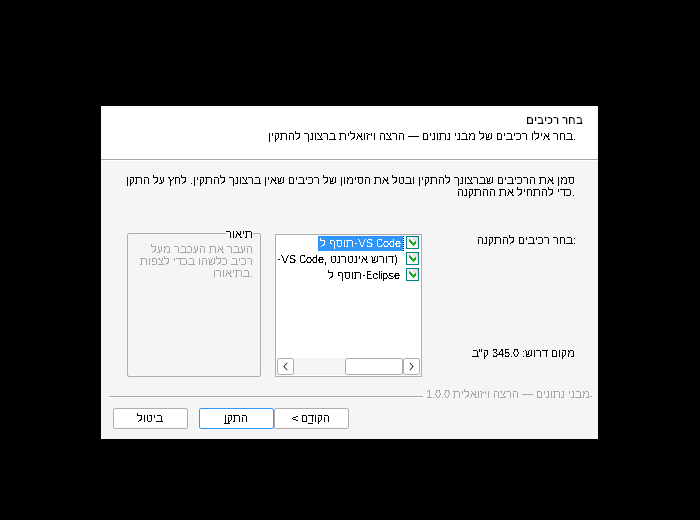

# מעטפת ויזואלית למבני נתונים — מחסנית, תור, רשימה מקושרת ועץ

כותבים פונקציה רגילה ב-Java, לוחצים **Run**, ונפתח חלון שמראה את ההרצה **צעד אחר צעד**:

- **המבנים עצמם** — מחסניות, תורים, רשימות מקושרות, עצים, **מערכים חד ודו ממדיים** ותלמידים (`Student`), מצוירים ומתעדכנים בכל צעד
- **שורת הקוד** שרצה עכשיו (מודגשת בצהוב)
- **מחסנית הקריאות** — רואים כל קריאה רקורסיבית
- **הפלט** (System.out) עד אותו צעד

אפשר לנוע קדימה ואחורה, להריץ אוטומטית, ולקפוץ לכל צעד עם פס הגלילה.

**הרצה ויזואלית אחת**: כל שורה בקוד היא צעד, עם **כל המשתנים המקומיים וערכיהם**,
ושמות המשתנים האמיתיים (`p`, `prev`, `temp`...) מופיעים לבד מעל החוליות והמבנים.


| היפוך רשימה מקושרת | הכנסה לעץ חיפוש (רקורסיה) |
|---|---|
|  |  |

---

## למה זה נוח

- **אותו API בדיוק כמו בספריית הבגרות** (`unit4.collectionsLib`):
  `Stack`, `Queue`, `Node`, `BinNode` עם `push/pop/top/isEmpty`, `insert/remove/head`,
  `getValue/getNext/setNext/hasNext`, `getLeft/getRight/setLeft/setRight/hasLeft/hasRight`.
  קוד קיים רץ כמו שהוא — רק `import unit4.collectionsLib.*;`
- **אפס מעטפת בקוד של התלמידים.** אין צורך לקרוא לשום פונקציית ציור — כל פעולה מתועדת אוטומטית.
- **קוד כמו שלומדים בכיתה:** המבנים נבנים עם `new Stack<Integer>()` ו-`push`, `new Queue<Integer>()` ו-`insert`,
  `new Node<Integer>(...)`, `new BinNode<Integer>(...)` ו-`setLeft/setRight`, ומערכים עם `{1, 2, 3}` — בלי מחלקות עזר.
- **שמות המשתנים מזוהים אוטומטית** מהקוד (`Stack<Integer> temp = new Stack<>()` יוצג בשם temp).
- Java טהורה (8 ומעלה), בלי ספריות חיצוניות. עובד ב-**Eclipse**, ב-**VS Code** ומשורת הפקודה.

---

## מה יש כאן (ובמה זה יותר מ-Unit4 של משרד החינוך)

ספריית **Unit4** של משרד החינוך נתנה את המחלקות (`Stack`, `Queue`, `Node`, `BinNode`) — וזהו.
כאן אותן מחלקות בדיוק (קוד קיים רץ כמו שהוא, כולל `getInfo`/`setInfo` ו-`BinTreeNode` מהגרסה הישנה), ובנוסף:

| | Unit4 | כאן |
|---|---|---|
| מחסנית, תור, חוליה, צומת בעץ | ✓ | ✓ אותו API |
| ציור המבנים בזמן הריצה, צעד אחר צעד | | ✓ |
| הרצה שורה אחר שורה עם משתנים ("הרצה ויזואלית") | | ✓ |
| מערכים חד ודו ממדיים בתצוגה (עם `i`, `j` מעל התאים) | | ✓ |
| מחלקת `Student` מוכנה לתרגילים | | ✓ |
| נתוני דמה מוכנים (`Student.random()`, "צור תור" ...) | | ✓ |
| "תרגיל חדש" — תבנית מלאה לבחירה | | ✓ |
| "הוספה לקוד" — צור תור / מערך / תלמיד עם נתוני דמה | | ✓ |
| התקנה אוטומטית ל-Eclipse ול-VS Code, כולל הגדרת הסביבה | | ✓ |

---

## התקנה בכל מחשב (תוסף ל-VS Code ול-Eclipse)

**Windows — [`release/DSViz-Setup.exe`](release/DSViz-Setup.exe):** לחיצה כפולה → הבא → התקן. זהו.

תוכנית ההתקנה (בעברית, בלי הרשאות מנהל):
- מוצאת לבד את VS Code ואת **כל** ההתקנות של Eclipse במחשב (בתיקיית המשתמש, בשולחן העבודה, בהורדות, ב-`C:\`, ב-Program Files...)
  ומתקינה בכל אחת. אם לא מצאה Eclipse — שואלת איפה הוא.
- **הכול בפנים, בלי הורדות:** כולל Java 21 מקוצרת (java, javac, חלון, הרצה שורה-שורה — כ-67MB, ההתקנה כולה כ-44MB).
  התוסף של VS Code מקמפל ומריץ איתה בעצמו (בטרמינל של VS Code, כולל קלט מהמקלדת), כך שלא צריך את
  "Extension Pack for Java" בשביל להריץ. שגיאות קומפילציה מסומנות באדום בקוד.
  ההשלמה האוטומטית של Microsoft היא רכיב רשות (לא מסומן) שמותקן ברקע מהאינטרנט.
- יוצרת **תיקיית תרגילים מוכנה** `מסמכים\DataStructures` (תרגיל לדוגמה, דוגמאות פתורות, הספרייה וכל ההגדרות) —
  אותה תיקייה נפתחת גם ב-VS Code וגם ב-Eclipse. בהתקנה חוזרת — רק הספרייה מתעדכנת, העבודה של התלמיד לא נמחקת.
- קיצור דרך בשולחן העבודה שפותח את תיקיית התרגילים ב-VS Code.
- ב-Eclipse: מגדירה `-Dfile.encoding=UTF-8` (עברית תקינה), ו**בהפעלה הראשונה Eclipse מכין את עצמו לבד**:
  מייבא את תיקיית התרגילים כפרויקט, מגדיר קידוד UTF-8, פותח את התרגיל הראשון ומציג הסבר קצר. התלמיד לא צריך לעשות כלום.
- נרשמת ב"אפליקציות ותכונות" של Windows, עם הסרה מלאה.
- **למעבדת מחשבים:** `DSViz-Setup.exe /S` מתקין בשקט, בלי שאלות (וגם `uninstall.exe /S`).



**Mac / Linux — [`release/dsviz-install.zip`](release/dsviz-install.zip):** פותחים, ומריצים `install-mac.command` (לחיצה כפולה ב-Mac) או `./install.sh`.

אחרי ההתקנה — סוגרים ופותחים מחדש את VS Code / Eclipse.

נדרש במחשב: VS Code ו/או Eclipse 2020 ומעלה. ב-Windows, Java כלולה בהתקנה.
ב-Mac/Linux צריך JDK (17 או 21 מומלץ; להרצה שורה אחר שורה — 11 ומעלה).

### איך זה נראה בתוך התוכנה

**VS Code:** בסרגל הצד מופיע סמל **מבני נתונים** עם שלושה חלקים:
**תרגיל חדש** (מחסנית · תור · רשימה · עץ · עץ חיפוש · מערך · מערך דו-ממדי),
**הוספה לקוד** (צור מחסנית / תור / רשימה / עץ / מערך / מערך דו-ממדי / תלמיד — גם בלחיצה ימנית בקוד),
ו**הרצה**.
בוחרים מבנה, עונים על כמה שאלות קצרות (טיפוס הערכים, מה הפעולה מחזירה, תוספות, ערכים, שמות),
ונפתח קובץ תרגיל מוכן עם הסמן במקום שבו כותבים. אחרי כתיבת הפעולה לוחצים **הרצה ויזואלית**
(כפתור ירוק למעלה מימין, בשורת המצב, או `Ctrl+Alt+R`) — כל שורה בקוד היא צעד בחלון. הרצה רגילה (Run) מדפיסה רק לקונסול, בלי חלון. אם התיקייה עוד לא מוגדרת — התוסף מגדיר אותה לבד
(מעתיק את הספרייה ל-`lib/` ומוסיף הגדרות Java).

**Eclipse:** בתפריט העליון מופיע **מבני נתונים** (וגם כפתורים בסרגל הכלים):
"תרגיל חדש: מחסנית / תור / רשימה / עץ / מערך…", "הוספה לקוד" (גם ככפתור נפתח בסרגל הכלים ובלחיצה ימנית בקוד),
"הרצה ויזואלית" ו"דוגמאות פתורות". כפתור ה-Run הרגיל של Eclipse מריץ כרגיל — הפלט רק בקונסול.
בחלון "תרגיל חדש" בוחרים מבנה, טיפוס, מה הפעולה מחזירה ותוספות — ולוחצים **יצירת התרגיל**. החלון קטן ופשוט, והקוד נוצר רק בסוף.
אם אין פרויקט מתאים נוצר פרויקט `DataStructures`, והספרייה נוספת ל-Build Path אוטומטית.

| בחירה | אפשרויות |
|---|---|
| מבנה | מחסנית, תור, רשימה מקושרת, עץ בינארי (לפי רמות), עץ חיפוש בינארי, מערך, מערך דו-ממדי |
| טיפוס | `Integer`, `String`, `Character`, `Double`, `Student` |
| הפעולה מחזירה | `void`, `int`, `boolean`, ערך מהמבנה, מבנה חדש |
| תוספות | שני מבנים (מיזוג/השוואה), פרמטר נוסף `x`, ערכים אקראיים |


### הוספה לקוד: "צור תור" — עם נתוני דמה

שמים את הסמן בתוך `main` (או בכל פעולה), לוחצים **צור תור** (או מחסנית, רשימה, עץ, מערך, מערך דו-ממדי, תלמיד),
בוחרים טיפוס (`int`, `String`, `char`, `double` או `Student`) וכמה איברים — ונכנסת שורה מוכנה עם ערכים אקראיים:

```java
Queue<String> q = new Queue<String>();
q.insert("tree");   // הראשון שנכנס — בראש התור
q.insert("fish");
q.insert("moon");
int[][] mat = {   // 3 שורות, 4 עמודות
        { 27, 83, 15, 74 },
        { 32, 20, 89, 36 },
        { 13, 92, 49, 35 }
});
Stack<Student> s = new Stack<Student>();
for (int i = 0; i < 4; i++) {
    s.push(Student.random());   // תלמיד עם נתוני דמה
}
Student st = Student.random();
```
אם חסרה שורת `import unit4.collectionsLib.*;` — היא נוספת לבד. שם המשתנה לא מתנגש בשמות שכבר קיימים בקובץ.


### בלי תוסף (הפרויקט הזה כמו שהוא)

- **Eclipse:** `File → Import → General → Existing Projects into Workspace` → בוחרים את `java-visualizer`.
- **VS Code:** `File → Open Folder` → בוחרים את `java-visualizer` (עם Extension Pack for Java).
- **שורת פקודה:** `run.bat` / `./run.sh` / `./run.sh examples.ListExamples`
- **פרויקט קיים:** מוסיפים את `release/dsviz.jar` ל-Build Path. אם כבר מחובר ה-jar המקורי של unit4 — יש להסיר אותו
  (אחרת יהיו שתי מחלקות `Stack` באותו שם). התוספים מזהים התנגשות כזו ומציעים להסיר אותה.

---

## מערכים חד ודו ממדיים

```java
int[] arr = {7, 3, 9, 1, 5};                                // מוצג בחלון ומתעדכן בכל צעד
int[][] mat = { {1, 2, 3}, {4, 5, 6} };
Student[] cls = new Student[4];
for (int i = 0; i < cls.length; i++) cls[i] = Student.random();
Viz.watch(other);                                           // מערך שנוצר אחרת — להציג גם אותו
```
התא שהשתנה מאז הצעד הקודם צבוע בכתום. **בהרצה שורה אחר שורה כל המערכים מוצגים לבד** (גם `int[] a = {...}` רגיל),
ומעל התאים מופיעים משתני האינדקס — `i`, `j`, `left`, `right`... — אבל רק כשבקוד באמת כתוב `arr[i]`.
במערך דו-ממדי: משתנה השורה ליד השורה ומשתנה העמודה מעל העמודה (`mat[r][c]`).
מערך של `main` מוצג גם כשנמצאים בתוך פעולה שקיבלה אותו (למשל `a, arr (main)`).


## מחלקת `Student`

```java
Student s = new Student("נועה לוי", "יא2", 90, 85, 77);   // שם, כיתה, ציונים (כמה שרוצים)
Student t = new Student("דני כהן", 88);                     // שם וציון אחד
Student r = Student.random();                               // תלמיד אקראי (נתוני דמה)
Queue<Student> q = new Queue<Student>();
for (int i = 0; i < 5; i++) q.insert(Student.random());   // 5 תלמידים אקראיים בתור
```

| פעולה | מה היא עושה |
|---|---|
| `getName()`, `getClassRoom()`, `getId()`, `getAge()` (וגם `set...`) | פרטים. תעודת זהות עם ספרת ביקורת תקינה |
| `getGrade(i)`, `setGrade(i, g)`, `addGrade(g)`, `getNumGrades()`, `getGrades()` | ציונים |
| `getAverage()`, `getMaxGrade()`, `getMinGrade()` | חישובים |
| `isExcellent()` (ממוצע ≥ 90), `isPassing()` (ממוצע ≥ 55) | בדיקות |
| `compareTo` (לפי ממוצע), `equals` (לפי ת"ז), `toString` | השוואה והצגה — אפשר גם עץ חיפוש של תלמידים |

## מחלקת Car (מכונית)

מחלקה מוכנה נוספת לתרגילים, בדיוק כמו `Student`: אפשר לבחור `Car` כטיפוס הערכים בכל מבנה ("תרגיל חדש"),
ולהוסיף לקוד "צור מכונית" עם נתוני דמה.

```java
Car c = new Car("Mazda", "3", 2019);          // יצרן, דגם, שנת ייצור
Car r = Car.random();                         // מכונית אקראית: יצרן, דגם, שנה, צבע, ק"מ ודלק
c.refuel(20);   c.accelerate(50);   int driven = c.drive(120);   c.brake(50);
c.getKm()   c.getFuel()   c.getSpeed()   c.getAge()   c.isOld()   c.needsFuel()   c.getYear() ...
```

| פרטים | פעולות |
|---|---|
| `getManufacturer`, `getModel`, `getYear`, `getColor`, `getPlate`, `getKm`, `getFuel`, `getTankSize`, `getSpeed` | `drive(km)` (נוסעת עד שנגמר הדלק, מחזירה כמה נסעה), `refuel(l)`, `accelerate(d)`, `brake(d)` |
| `compareTo` (לפי שנה), `equals` (לפי מספר רישוי), `toString` | `getAge()`, `isOld()` (10 שנים ומעלה), `needsFuel()`, `isMoving()` |

בחלון המכונית מוצגת כ"יצרן + שנה" (למשל `Mazda 2019`). בתפריט "דוגמאות פתורות" יש גם `CarExamples`.

בחלון תלמיד מוצג כ"שם פרטי + ממוצע" (למשל `נועה 84`), ובטבלת המשתנים — המלא.

## הרצה שורה אחר שורה

בכפתור **הרצה ויזואלית** (בשני התוספים) כל שורה שהתוכנית מבצעת היא צעד בחלון. המתג **כל שורה / רק פעולות** שבסרגל מסתיר את שורות הקוד ומשאיר רק את הפעולות על המבנים:

- **השורה עצמה** מודגשת בקוד ומופיעה בכותרת (למשל `שורה 20: total += x;`).
- **טבלת משתנים**: כל המשתנים המקומיים של הפעולה הנוכחית וערכיהם — מספרים, תווים, מחרוזות, מערכים ומבנים.
  ערך שהשתנה מאז השורה הקודמת צבוע **בצהוב**.
- **שמות המשתנים מעל המבנים**: `cur`, `prev`, `next` מעל החוליות שהם מצביעים עליהן, `temp` כשם המחסנית — לבד,
  בלי `Viz.point`. ברקורסיה רואים בכל קריאה את המשתנים שלה.
- הפעולות על המבנים (`push`, `setNext`...) מופיעות בין השורות, כך שרואים גם את השורה וגם מה היא עשתה.


איך זה עובד: התוכנית רצה בתהליך נפרד תחת ממשק הדיבאג של Java (JDI), שעוצר אותה לפני כל שורה בקוד של התלמיד
וקורא את המשתנים. לכן זה איטי יותר מהרצה רגילה (בערך אלפית שנייה לשורה), ונעצר אחרי 5000 צעדים.
**בלי תוסף:** כותבים `Viz.lines();` כשורה הראשונה ב-`main` ומריצים כרגיל (או `Viz.show();` לחלון בלי שורות).
דורש JDK 11 ומעלה; בגרסה ישנה יותר התוכנית פשוט רצה רגיל (עם הודעה).

---

## איך נראה תרגיל

```java
import unit4.collectionsLib.*;

public class Main {

    // כאן כותבים את הפונקציה של התרגיל
    public static int sum(Stack<Integer> s) {
        Stack<Integer> temp = new Stack<Integer>();
        int total = 0;
        while (!s.isEmpty()) {
            int x = s.pop();
            total += x;
            temp.push(x);
        }
        while (!temp.isEmpty()) {
            s.push(temp.pop());
        }
        return total;
    }

    public static void main(String[] args) {
        Stack<Integer> s = new Stack<Integer>();
        s.push(4);
        s.push(7);
        s.push(1);
        s.push(9);   // האחרון שנכנס — בראש המחסנית
        System.out.println("הסכום: " + sum(s));
    }
}
```

בתיקייה `src/examples` יש דוגמאות מוכנות להרצה:

| קובץ | מה מודגם |
|---|---|
| `ArrayExamples` | מקום המקסימום, היפוך במקום (`left`/`right`), סכומי שורות במערך דו-ממדי, מיון בועות |
| `StudentExamples` | ספירת מצטיינים בתור של תלמידים, התלמיד הטוב ביותר במערך |
| `StackExamples` | היפוך מחסנית עם מחסנית עזר, הכנסה לתחתית ברקורסיה |
| `QueueExamples` | ספירת איברים בלי להרוס את התור, מחיקת כל המופעים של ערך |
| `ListExamples`  | סכום, מחיקת חוליה, היפוך רשימה במקום (עם תוויות `p`, `prev`, `cur`) |
| `TreeExamples`  | מספר צמתים, גובה, הכנסה לעץ חיפוש בינארי |

---

## החלון

| אזור | מה רואים |
|---|---|
| למעלה | כפתורי ניווט, מהירות, ומונה "צעד X מתוך Y" |
| פס צבעוני | מה קרה בצעד הזה (למשל `temp.push(9)`), באיזו שורה ובאיזו פעולה |
| מבנים | כל המבנים הקיימים כרגע. המבנה שהצעד נגע בו מסומן בכותרת כחולה |
| קוד | הקובץ, עם השורה הנוכחית מודגשת |
| מחסנית הקריאות | הקריאה הפעילה למעלה, `main` למטה |
| פלט | כל מה שהודפס עד הצעד הזה |

**צבעים:** ירוק = נוסף / נוצר · צהוב = נקרא · כתום = שונה · אדום מקווקו = הוצא (pop / remove) ·
מסגרת כתומה ומשולש = החוליה / הצומת האחרונים שהקוד נגע בהם.

**מקלדת:** חץ שמאלה / רווח / Enter = צעד הבא · חץ ימינה = צעד קודם · Home / End = התחלה / סוף · P = הפעלה אוטומטית.

**"להציג בדיקות"** — כשמבטלים את הסימון, הניווט מדלג על `isEmpty / hasNext / hasLeft / hasRight`
ורואים רק את הפעולות שמשנות או קוראות.

---

## פקודות עזר

### Build — קיצורים (לא חובה; הקוד שנוצר בתוספים לא משתמש בהם)
```java
Stack<Integer>   s = Build.stack(1, 2, 3);           // push לפי הסדר → 3 בראש
Queue<String>    q = Build.queue("a", "b", "c");      // insert לפי הסדר → "a" בראש התור
Node<Integer>  lst = Build.list(4, 7, 1);            // 4 -> 7 -> 1 -> null
BinNode<Integer> t = Build.tree(5, 3, 8, null, 4);    // לפי רמות, null = אין צומת
BinNode<Integer> b = Build.bst(5, 3, 8, 1, 4);        // עץ חיפוש בינארי
Stack<Integer>   r = Build.randomStack(6, 1, 20);     // וגם randomQueue / randomList / randomBst
int[]          arr = Build.array(5, 2, 8);           // מערך (גם double / char / String / Student)
int[][]        mat = Build.matrix(new int[][] {{1, 2}, {3, 4}});
int[]          ra  = Build.randomArray(6, 1, 20);    // וגם randomMatrix(3, 4, 1, 20)
Queue<Student>   s = Build.queue(Build.students(5)); // 5 תלמידים אקראיים
```

### Viz — שליטה בתצוגה (הכול אופציונלי)
```java
Viz.point("p", p);          // תווית "p" מעל החוליה ש-p מצביע עליה (לקרוא שוב אחרי כל p = p.getNext())
Viz.name(s, "מקורית");      // לתת שם למבנה
Viz.note("עכשיו מתחילים");  // הערה שמופיעה כצעד
Viz.off();  ...  Viz.on();  // לא לתעד קטע קוד (למשל לולאה ארוכה)
Viz.maxSteps(20000);        // ברירת המחדל: 5000 צעדים
Viz.textMode();             // בלי חלון — הצעדים מודפסים לקונסול
Viz.lines();                // בשורה הראשונה של main: הרצה ויזואלית שורה אחר שורה (כשמריצים בלי התוסף)
Viz.show();                 // בשורה הראשונה של main: חלון בלי שורות (רק הפעולות על המבנים)
Viz.watch(arr);             // להציג מערך כשמריצים בלי שורה-שורה (בהרצה ויזואלית מערכים מוצגים לבד)
Viz.text(x);                // מחרוזת של כל מבנה או מערך: "3 -> 8 -> null", "[1, 2]", "inorder: ..."
```

---

## דברים שכדאי לדעת

- **חוליה שנעלמת מהתצוגה** — כשאף משתנה כבר לא מצביע על חוליה (למשל אחרי מחיקה מהרשימה),
  היא נאספת ע"י ה-Garbage Collector ונעלמת, בדיוק כמו בזיכרון האמיתי. הזדמנות טובה להסביר GC 🙂
- **חוליה ראשונה שנשארת** — אחרי `lst = lst.getNext()` החוליה הישנה עדיין מצביעה הלאה, ולכן יכולה להופיע
  עד שינוי המצביעים הבא. `Viz.point("lst", lst)` מראה לאן `lst` מצביע עכשיו.
- **מחסנית/תור עזר ריקים** שלא נגעו בהם זמן רב מוסתרים, כדי שהמסך לא יתמלא במבני עזר ישנים.
- **שגיאות** (למשל `pop()` על מחסנית ריקה, `NullPointerException`, רקורסיה אינסופית) מופיעות כצעד אדום
  בשורה שגרמה להן.
- **לולאה אינסופית** — אחרי 5000 צעדים התיעוד נעצר והחלון מציג הודעה. סוגרים את החלון כדי לעצור את התוכנית.
- **הקוד לא מוצג?** החלון מחפש את קובץ המקור בתיקיית הפרויקט. ב-Eclipse וב-VS Code זה עובד אוטומטית;
  בשורת הפקודה צריך להריץ מתוך התיקייה `java-visualizer`.
- **עברית בקוד** — הקבצים שמורים ב-UTF-8 (הפרויקט כבר מוגדר כך ב-Eclipse וב-VS Code).

---

## מבנה הקבצים

```
java-visualizer/
├── release/                       ← קובצי ההתקנה (נבנים ע"י tools/build-all.sh)
│   ├── DSViz-Setup.exe            ← תוכנית ההתקנה ל-Windows
│   ├── dsviz-install.zip          ← הכול + התקנה ל-Mac/Linux + מדריך
│   ├── dsviz-1.0.1.vsix           ← תוסף VS Code
│   ├── il.lamerhav.dsviz_1.0.1.jar← תוסף Eclipse (לתיקיית dropins)
│   └── dsviz.jar                  ← הספרייה עצמה
├── src/
│   ├── Main.java                  ← תבנית לתרגיל
│   ├── examples/                  ← דוגמאות פתורות
│   └── unit4/collectionsLib/      ← הספרייה: Stack, Queue, Node, BinNode, Build, Viz + מנוע התצוגה
│                                     (LineByLine + JdiTracer = הרצה שורה אחר שורה)
├── vscode-extension/              ← קוד התוסף ל-VS Code (JavaScript)
├── eclipse-plugin/                ← קוד התוסף ל-Eclipse (Java)
├── installer/                     ← setup.nsi (DSViz-Setup.exe), install.sh, README-he.html,
│                                     project/ (תבנית תיקיית התרגילים שההתקנה יוצרת)
└── tools/
    ├── build-all.sh               ← בונה את כל release/
    └── test/                      ← בדיקות: התאמת התבניות בין שני התוספים, ובדיקת התוסף של VS Code
```

### בנייה מחדש (רק למי שמשנה את הקוד)

```
tools/build-all.sh          # דורש JDK 11+, Python 3, Node.js, NSIS (makensis)
tools/test/run-tests.sh     # תבניות, קומפילציה, התוסף של VS Code, והרצה שורה-שורה
```

התבנית שיוצרת את קוד התרגיל ואת "הוספה לקוד" כתובה פעמיים — `vscode-extension/templates.js` ו-`eclipse-plugin/src/.../Scaffold.java`
(כולל מחולל מספרים אקראיים זהה). שינוי באחת צריך להיעשות גם בשנייה; `tools/test/combos.js` + `ScaffoldAll.java`
בודקים שהן מפיקות קוד זהה בכל 1,504 הצירופים, וכל הקוד שנוצר מתקמפל מול הספרייה.
