# מעטפת ויזואלית למבני נתונים — מחסנית, תור, רשימה מקושרת ועץ (Java ו-C#)

<sub>© 2026 Moti Levi · motiml77@gmail.com</sub>

**האתר:** https://motiml77.github.io/java-lamerhav/ (הקוד שלו ב-[`site/`](site/README.md))

כותבים פונקציה רגילה ב-Java, לוחצים **הרצה ויזואלית**, ונפתח חלון שמראה את ההרצה **צעד אחר צעד**:

- **המבנים עצמם** — מחסניות, תורים, רשימות מקושרות, עצים, **מערכים חד ודו ממדיים** ותלמידים (`Student`), מצוירים ומתעדכנים בכל צעד
- **שורת הקוד** שרצה עכשיו (מודגשת בצהוב)
- **מעקב רקורסיה** — כל קריאה לפעולה בכרטיס נפרד: מה קיבלה, אילו שורות רצו (if → true/false), ומה החזירה. החלון גם מזהה את סוג הרקורסיה (פשוטה, זנב, כפולה, הדדית) ומציג כל סוג בדרך שמתאימה לו
- **הפלט** (System.out) עד אותו צעד

אפשר לנוע קדימה ואחורה, להריץ אוטומטית, ולקפוץ לכל צעד עם פס הגלילה.

🎬 **סרטון פרומו קצר (43 שניות):** [`docs/promo.mp4`](docs/promo.mp4) — מחסנית, עץ ורקורסיה בפעולה ([איך נוצר](promo/README.md)).

**קודם בודקים שהקוד מתקמפל:** לפני ההרצה הוויזואלית (ב-Eclipse, ב-VS Code וב-C#) הקוד מקומפל. אם יש שגיאות — מופיעה אזהרה עם השגיאות (ב-Eclipse בעברית, והקובץ נפתח בשורה הראשונה), וההרצה לא מתחילה.

**עלייה מהירה עם חיווי טעינה:** מיד בלחיצה על "הרצה ויזואלית" נפתח חלון קטן עם ספינר ("טוען את ההרצה הוויזואלית..."), ונסגר כשחלון ההרצה מוכן.
החלון נפתח לפני שהתוכנית מתחילה לרוץ (בזמן שהמעקב צועד על השורות, החלון כמעט לא מקבל זמן ריצה — ולכן קודם היה עולה אחרי כמה שניות);
בחלון עצמו מופיע ספינר עד שמגיע הצעד הראשון, וספינר קטן ליד "צעד X מתוך Y" כל עוד התוכנית עוד רצה.

**המעקב מתמקד בפעולה שהתלמיד כתב:** הבניה של המבנים ב-`main` (יצירת המחסנית, ה-`push`-ים, ההדפסות) היא מעטפת — ולכן לא מוצגת כצעדים.
ההרצה מתחילה בשורה הראשונה של הפעולה, והמבנים כבר מופיעים מוכנים. מי שרוצה לראות גם את `main` — לוחץ **"גם main"** בסרגל.
(תוכנית שכולה ב-`main`, בלי פעולות — מוצגת כרגיל.)

**הרצה ויזואלית אחת**: כל שורה בקוד היא צעד, עם **כל המשתנים המקומיים וערכיהם**,
ושמות המשתנים האמיתיים (`p`, `prev`, `temp`...) מופיעים לבד מעל החוליות והמבנים.

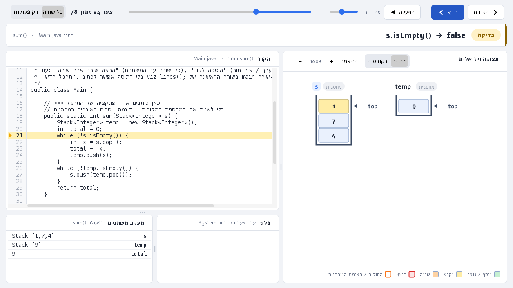

| היפוך רשימה מקושרת | הכנסה לעץ חיפוש (רקורסיה) |
|---|---|
| 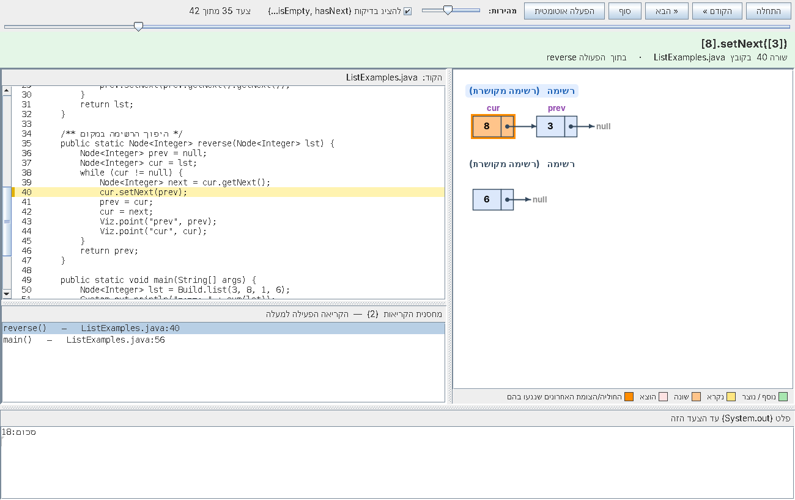 | 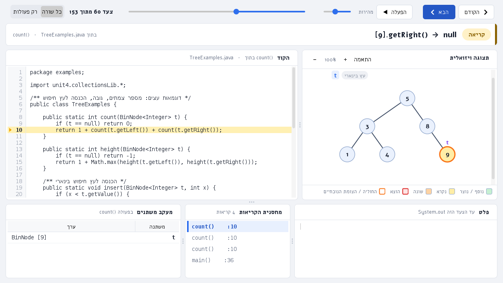 |

---

## למה זה נוח

- **אותו API בדיוק כמו בספריית הבגרות** (`unit4.collectionsLib`):
  `Stack`, `Queue`, `Node`, `BinNode` עם `push/pop/top/isEmpty`, `insert/remove/head`,
  `getValue/getNext/setNext/hasNext`, `getLeft/getRight/setLeft/setRight/hasLeft/hasRight`.
  קוד קיים רץ כמו שהוא — רק `import unit4.collectionsLib.*;`
- **אפס מעטפת בקוד של התלמידים.** אין צורך לקרוא לשום פונקציית ציור — כל פעולה מתועדת אוטומטית.
- **קוד כמו שלומדים בכיתה:** המבנים נבנים עם `new Stack<Integer>()` ו-`push`, `new Queue<Integer>()` ו-`insert`,
  `new Node<Integer>(...)`, `new BinNode<Integer>(...)` ו-`setLeft/setRight`, ומערכים עם `{1, 2, 3}` — בלי מחלקות עזר.
- **שמות המשתנים מזוהים אוטומטית** מהקוד (`Stack<Integer> temp = new Stack<>()` יוצג בשם temp).
- Java טהורה (8 ומעלה), בלי ספריות חיצוניות. עובד ב-**Eclipse**, ב-**VS Code** ומשורת הפקודה.

---

## מה יש כאן (ובמה זה יותר מ-Unit4 של משרד החינוך)

ספריית **Unit4** של משרד החינוך נתנה את המחלקות (`Stack`, `Queue`, `Node`, `BinNode`) — וזהו.
כאן אותן מחלקות בדיוק (קוד קיים רץ כמו שהוא, כולל `getInfo`/`setInfo` ו-`BinTreeNode` מהגרסה הישנה), ובנוסף:

| | Unit4 | כאן |
|---|---|---|
| מחסנית, תור, חוליה, צומת בעץ | ✓ | ✓ אותו API |
| ציור המבנים בזמן הריצה, צעד אחר צעד | | ✓ |
| הרצה שורה אחר שורה עם משתנים ("הרצה ויזואלית") | | ✓ |
| מערכים חד ודו ממדיים בתצוגה (עם `i`, `j` מעל התאים) | | ✓ |
| מחלקת `Student` מוכנה לתרגילים | | ✓ |
| נתוני דמה מוכנים (`Student.random()`, "צור תור" ...) | | ✓ |
| "תרגיל חדש" — תבנית מלאה לבחירה | | ✓ |
| "הוסף מבנה נתונים" — מבנה עם ערכים (או אקראיים) במקום הסמן, עם ציור חי ובדיקת שם | | ✓ |
| התקנה אוטומטית ל-Eclipse ול-VS Code, כולל הגדרת הסביבה | | ✓ |

---

## התקנה בכל מחשב (Eclipse, VS Code, Visual Studio)

**Windows — [קישור קבוע להורדה](https://github.com/motiml77/java-lamerhav/raw/master/java-visualizer/release/DSViz-Setup.exe) (קישור קצר: [is.gd/dsjava](https://is.gd/dsjava)):** לחיצה כפולה → הבא → בוחרים שפה (Java / C# / שתיהן) → סיום.
(הקישור מוביל תמיד לגרסה האחרונה שב-`master`, והנתיב לא משתנה — אפשר לתת אותו לתלמידים או לקצר אותו.)

תוכנית ההתקנה (בעברית, בלי הרשאות מנהל):
- מוצאת לבד את VS Code ואת **כל** ההתקנות של Eclipse במחשב (בתיקיית המשתמש, בשולחן העבודה, בהורדות, ב-`C:\`, ב-Program Files...)
  ומתקינה בכל אחת. היא שואלת איפה Eclipse רק אם לא נמצא **שום** דבר (לא VS Code ולא Eclipse).
- **הכול בפנים:** כולל Java 21 מקוצרת (java, javac, חלון, הרצה שורה-שורה — כ-67MB, ההתקנה כולה כ-44MB).
  התוסף של VS Code מקמפל ומריץ איתה בעצמו (בטרמינל של VS Code, כולל קלט מהמקלדת), כך שהרצה לא תלויה באינטרנט.
  שגיאות קומפילציה מסומנות באדום בקוד.
- **בוחרים רק שפה:** בעמוד אחד מסמנים באיזו שפה לומדים — **Java** (תוסף ל-Eclipse ול-VS Code), **C#** (Visual Studio, VS Code, Rider) או שתיהן.
  C# מסומן לבד אם נמצא Visual Studio או Rider. כל השאר אוטומטי: אין עוד שאלות ואין מה לסמן.
  בהתקנה שקטה: `DSViz-Setup.exe /S /LANG=java|cs|both` (בלי `/LANG` — Java, ו-C# רק אם נמצא Visual Studio / Rider).
- **הורדה אוטומטית של תוספי Microsoft:** ההשלמה האוטומטית ל-VS Code (Extension Pack for Java / תוסף ה-C#) יורדת לבד ברקע, בחלון נסתר,
  וההתקנה לא מחכה לה. אם אין אינטרנט — ההורדה פשוט מדלגת, ושאר ההתקנה לא מושפעת.
- יוצרת **תיקיית תרגילים מוכנה** `מסמכים\DataStructures` (תרגיל לדוגמה, דוגמאות פתורות, הספרייה וכל ההגדרות) —
  אותה תיקייה נפתחת גם ב-VS Code וגם ב-Eclipse. בהתקנה חוזרת — רק הספרייה מתעדכנת, העבודה של התלמיד לא נמחקת.
- קיצור דרך בשולחן העבודה שפותח את תיקיית התרגילים ב-VS Code.
- ב-Eclipse: מגדירה `-Dfile.encoding=UTF-8` (עברית תקינה), ו**בהפעלה הראשונה Eclipse מכין את עצמו לבד**:
  מייבא את תיקיית התרגילים כפרויקט, מגדיר קידוד UTF-8, פותח את התרגיל הראשון ומציג הסבר קצר. התלמיד לא צריך לעשות כלום.
- נרשמת ב"אפליקציות ותכונות" של Windows, עם הסרה מלאה.
- **למעבדת מחשבים:** `DSViz-Setup.exe /S` מתקין בשקט, בלי שאלות (וגם `uninstall.exe /S`).
- **בלי הרשאות מנהל:** ההתקנה היא למשתמש הנוכחי בלבד (`%LOCALAPPDATA%`), ולכן Windows לא מבקש אישור מנהל (UAC).

### "Windows protected your PC" (SmartScreen)

תוכנית ההתקנה **לא חתומה דיגיטלית**, ולכן Windows עשוי להציג "Windows protected your PC" בהפעלה ראשונה
(לחיצה על **More info ← Run anyway**), והדפדפן עשוי לכתוב "לא נפוץ". זו הגנה כללית על כל קובץ חדש ולא חתום, לא סימן לבעיה.
אי אפשר לבטל אותה בלי חתימה דיגיטלית — ראו למטה. עד אז, שתי דרכים לעקוף אותה:

1. **שורה אחת ב-PowerShell** — ההורדה לא עוברת בדפדפן, ולכן Windows לא מסמן את הקובץ ולא מציג אזהרה:
   ```powershell
   iwr https://github.com/motiml77/java-lamerhav/raw/master/java-visualizer/release/DSViz-Setup.exe -OutFile $env:TEMP\DSViz-Setup.exe; Start-Process $env:TEMP\DSViz-Setup.exe -ArgumentList '/S' -Wait; 'ההתקנה הסתיימה'
   ```
   (מתקין בשקט, בלי חלונות. לא נבדק עדיין על מחשב Windows אמיתי — מומלץ לנסות קודם על מחשב אחד.)
2. **חתימה דיגיטלית** (הפתרון האמיתי): תעודת חתימה (Code Signing) מסירה את "Unknown publisher" ואחרי זמן גם את האזהרה.
   אפשרויות: [SignPath Foundation](https://signpath.org/) — חינם לפרויקטים בקוד פתוח שמאושרים אצלם; או Azure Trusted Signing / תעודה
   מסחרית בתשלום. אחרי שיש חתימה — מוסיפים שלב `signtool` ב-`tools/build-all.sh`.

### עדכון הקישור הקבוע (למי שבונה)

אחרי `tools/build-all.sh` עושים commit ל-`release/DSViz-Setup.exe` וממזגים ל-`master` — הקישור הקבוע מתעדכן לבד, והכתובת לא משתנה.
(אפשר גם GitHub Release עם `tools/publish-release.sh`: הקישור הקבוע שלו הוא `https://github.com/motiml77/java-lamerhav/raw/master/java-visualizer/release/DSViz-Setup.exe`.)

**Mac / Linux — [`release/dsviz-install.zip`](release/dsviz-install.zip):** פותחים, ומריצים `install-mac.command` (לחיצה כפולה ב-Mac) או `./install.sh`.

אחרי ההתקנה — סוגרים ופותחים מחדש את VS Code / Eclipse.

נדרש במחשב: VS Code ו/או Eclipse (כל גרסה מהשנים האחרונות, מ-2020-09 ומעלה, גם הגרסאות החדשות ביותר; נבדק על 2020-09, 2022-03, 2024-03 ו-2026-09). ב-Windows, Java כלולה בהתקנה.

- **זיהוי Eclipse:** ההתקנה מחפשת לבד — Eclipse שרץ עכשיו, התיקיות הרגילות וכל הכוננים, בכל שם תיקייה (רק Eclipse ל-Java). Eclipse בתיקייה מוגנת (Program Files) דורש להריץ את ההתקנה כמנהל — ההתקנה אומרת את זה במפורש.
- **ספריית הקורס בכל פרויקט:** בכל פתיחה של Eclipse, ובכל פרויקט Java שנוצר או נפתח, אם חסרה בו הספרייה (`Stack`, `Queue`, `Node`, `BinNode`...) היא נוספת לו לבד (`lib/dsviz.jar` ב-Build Path), גם בפרויקט שהתלמיד יצר בעצמו. פרויקט שכבר יש בו ספרייה כזו (למשל ה-jar המקורי של הקורס) לא נוגעים בו.
ב-Mac/Linux צריך JDK (17 או 21 מומלץ; להרצה שורה אחר שורה — 11 ומעלה).

### איך זה נראה בתוך התוכנה

**VS Code:** בסרגל הצד מופיע סמל **מבני נתונים** עם שלושה חלקים:
**תרגיל חדש** (מחסנית · תור · רשימה · עץ · עץ חיפוש · מערך · מערך דו-ממדי),
**הוסף מבנה נתונים** (חלון עם ציור חי של המבנה — גם כפתור בשורת המצב, `Ctrl+Alt+I` ולחיצה ימנית בקוד),
ו**הרצה**.
בוחרים מבנה, עונים על כמה שאלות קצרות (טיפוס הערכים, מה הפעולה מחזירה, רקורסיה, מילוי המבנה, שמות),
ונפתח קובץ תרגיל מוכן עם הסמן במקום שבו כותבים. אחרי כתיבת הפעולה לוחצים **הרצה ויזואלית**
(כפתור ירוק למעלה מימין, בשורת המצב, או `Ctrl+Alt+R`) — כל שורה בקוד היא צעד בחלון. הרצה רגילה (Run) מדפיסה רק לקונסול, בלי חלון. אם התיקייה עוד לא מוגדרת — התוסף מגדיר אותה לבד
(מעתיק את הספרייה ל-`lib/` ומוסיף הגדרות Java).

**Eclipse:** בתפריט העליון מופיע **מבני נתונים** (וגם כפתורים בסרגל הכלים):
"תרגיל חדש: מחסנית / תור / רשימה / עץ / מערך…", "הוסף מבנה נתונים" (גם כפתור בסרגל הכלים ובלחיצה ימנית בקוד),
"הרצה ויזואלית" ו"דוגמאות פתורות". כפתור ה-Run הרגיל של Eclipse מריץ כרגיל — הפלט רק בקונסול.
בחלון "תרגיל חדש" בוחרים מבנה, טיפוס, מה הפעולה מחזירה ורקורסיה — ולוחצים **יצירת התרגיל**. החלון קטן ופשוט, והקוד נוצר רק בסוף.
אם אין פרויקט מתאים נוצר פרויקט `DataStructures`, והספרייה נוספת ל-Build Path אוטומטית.

| בחירה | אפשרויות |
|---|---|
| מבנה | מחסנית, תור, רשימה מקושרת, עץ בינארי (לפי רמות), עץ חיפוש בינארי, מערך, מערך דו-ממדי |
| טיפוס | `Integer`, `String`, `Character`, `Double`, `Student` |
| הפעולה מחזירה | `void`, `int`, `boolean`, ערך מהמבנה, מבנה חדש |
| רקורסיה | מוסיפה לתרגיל את ההערה "תרגיל ברקורסיה". בחלון ההרצה מעקב הרקורסיה מופיע לבד בכל מקרה (החלון מזהה רקורסיה בעצמו) |
| מילוי מבנה-נתונים | ערכים בשדה, או "כמה ערכים אקראיים" (במבנה בתוך מבנה: "כמה מבנים פנימיים אקראיים" — למשל 5 = חמישה תורים אקראיים בתוך המחסנית) |

הפעולה מקבלת מבנה אחד, כמו שנבחר; מי שרוצה עוד מבנה או פרמטר מוסיף אותם בקוד.


### הדרכה לשימוש — הכפתור ?

בסרגל הכלים של Eclipse (כפתור **?** כתום בקצה), בשורת המצב של VS Code, בחלונות של Visual Studio (ה-**?** הכתום בפינה) ובתפריט התחל ("הדרכה לשימוש") —
בוחרים הדרכה, ונפתח חלון נגן עם הסרטון שלה בלבד (עם בחירת מהירות: 1.25×, 1.5×, 2×). לכל הדרכה סרטון קצר: איפה לוחצים (עם סמן עכבר ולחיצות), מה נפתח בכל שלב, ומה מתקבל בקוד ובהרצה.

1. **יצירת מבנה נתונים חדש** — מקליקים במקום המדויק בקוד, "הוסף מבנה נתונים", האפשרויות, הקוד שנוצר וההרצה.
2. **דוגמאות פתורות** — פותחים דוגמה מוכנה ומריצים אותה בחלון ההדמיה.
3. **מבנה בתוך מבנה** — שלוש דוגמאות: מחסנית של תורים, רשימה של מחסניות, עץ של תורים.
4. **מוסיפים התאמות** — אחרי שהתרגיל נוצר: מבנה נוסף, משתנה x ומערך שהפעולה מקבלת, ורואים אותם בהדמיה.
5. **שליחת תרגיל והצעה לפתרון** — מדביקים צילום של דף התרגיל (או PDF / Word), שולחים, ומקבלים קוד מוכן. לכל סעיף יש "💡 הצעה לפתרון", ונבדק שהיא נותנת את הפלט הנכון.

**לכל סביבה יש סרטונים משלה**, עם אותן הדרכות, כשכל סרטון מראה את המסך של אותה סביבה:
- **Eclipse** (Java): סרגל הכלים ותפריט "מבני נתונים".
- **VS Code** (Java): שורת המצב, הכפתורים מעל העורך והחלונות שנפתחים כלשונית.
- **Visual Studio** (C#): הקיצורים בתפריט התחל, החלונות של C# וכפתור ההפעלה עם "הרצה ויזואלית".

כל סביבה מציגה רק את הסרטונים שלה. הם נמצאים ב-`help/` (Eclipse), ב-`help/vscode/` וב-`help/vs/`.

הנגן נפתח בתוך Eclipse (דפדפן משובץ) ובתוך VS Code (חלון Webview); ב-Visual Studio/C# הוא נפתח בחלון נפרד בלי שורת כתובת (Edge, או Chrome). אם הנגן המשובץ לא מצליח לנגן — נפתח אותו דף בדפדפן הרגיל.

הסרטונים נוצרו מהתוסף עצמו (צילומים אמיתיים) — איך מייצרים מחדש: [`tutorials/README.md`](tutorials/README.md). הם נמצאים ב-[`help/`](help/) וכלולים בכל ההתקנות.

### הוסף מבנה נתונים — במקום הסמן, עם ציור של המבנה

שמים את הסמן בתוך `main` (או בכל פעולה) ולוחצים **הוסף מבנה נתונים** (בסרגל הכלים של Eclipse, בשורת המצב של VS Code או `Ctrl+Alt+I`,
בלחיצה ימנית בקוד, וב-Visual Studio — הקיצור "הוסף מבנה נתונים ל-C#"). בחלון:

- **איזה מבנה** — מחסנית, תור, רשימה מקושרת, עץ בינארי, עץ חיפוש, מערך, מערך דו-ממדי, תלמיד, מכונית; ו**מה יש בכל תא** (ערכים רגילים, או מחסניות / תורים / רשימות — מבנה בתוך מבנה).
- **טיפוס** — `Integer`, `String`, `Character`, `Double`, `Student`, `Car`.
- **מילוי** — כותבים ערכים (`5, 2, 8`; במטריצה שורות ב-`;`; במבנה בתוך מבנה — כל קבוצה עד `;` היא מבנה פנימי), או **"כמה ערכים אקראיים"** והשדה מתמלא לבד (אפשר להגריל שוב או לשנות).
- **ציור חי** — רואים בדיוק איך המבנה ייראה (מחסנית, תור, רשימה, עץ, מערך, מבנה בתוך מבנה), ומתעדכן תוך כדי הקלדה.
- **שם** — מוצע שם באפור (`stk`, ואם כבר יש `stk` — `stk2`); אפשר להקליד שם אחר. נבדק שהוא חוקי (אנגלית, לא מילה שמורה) ושלא מתנגש
  במשתנה, פרמטר, פעולה או מחלקה שכבר מוגדרים באותו מקום בקוד. משתנה בשם זהה **בפעולה אחרת** לא מפריע.

לוחצים **הוספה לקוד** — והמבנה נבנה בדיוק במקום הסמן:

```java
// מחסנית של תורים — כל קבוצת ערכים היא מבנה פנימי אחד
Stack<Queue<Integer>> stk2 = new Stack<Queue<Integer>>();
Queue<Integer> stk2Inner = new Queue<Integer>();
stk2Inner.insert(5);
stk2Inner.insert(2);
stk2.push(stk2Inner);
stk2Inner = new Queue<Integer>();
stk2Inner.insert(8);
stk2Inner.insert(1);
stk2.push(stk2Inner);   // האחרון שנכנס — בראש המחסנית
```
אם חסרה שורת `import unit4.collectionsLib.*;` (או `using` ב-C#) — היא נוספת לבד. ב-Visual Studio אי אפשר להכניס ישר לקוד —
הקוד מועתק ללוח ומדביקים (`Ctrl+V`); השם נבדק מול הקובץ שנערך לאחרונה, ואם הוא כבר קיים שם מופיעה אזהרה.

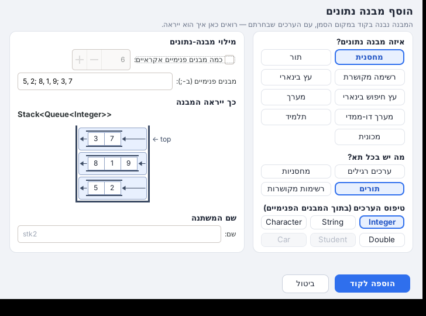


### שגיאה בזמן ריצה — מה קרה ומה חסר, בציור

כשהתוכנית נעצרת בשגיאה, הצעד האחרון בחלון ההרצה מראה כרטיס ורוד שמסביר אותה, עם ציור קטן, ומסמן את המבנה עצמו:

- **pop / top על מחסנית ריקה, remove / head על תור ריק** — המחסנית (או התור) מצוירת ריקה, ובמקום שבו היה צריך להיות איבר
  יש קופסה אדומה עם "?" ושם הפעולה. בכרטיס: למה (אין אף איבר) ומה עושים (`while (!s.isEmpty())`).
- **null** (`p.getValue()` כש-`p` הוא null, `t.getLeft()` מתחת לעלה) — ליד ה-null שבסוף הרשימה מופיע `p` באדום עם ✕,
  ובכרטיס: "p לא מצביע על אף חוליה — כנראה עברנו את סוף הרשימה", ואיך בודקים לפני.
- **תא שלא קיים במערך**, **רקורסיה שלא נעצרת**, **חלוקה ב-0** — כרטיס עם ציור והסבר משלהם.
- עובד גם ב-C# (Visual Studio / VS Code): `Pop()` על מחסנית ריקה, ו-null — שם המשתנה נלקח מהשורה שרצה.

### רשימה מקושרת — "איבדנו את הראש"

חוליה שאף משתנה כבר לא מצביע עליה (ואי אפשר להגיע אליה דרך חוליה אחרת) מצוירת **אפורה עם המילה "אבדה"** והחץ שלה באדום,
ומתחת לרשימה מוסבר מה קרה. הדוגמה הנפוצה: `lst = lst.getNext()` בלולאה במקום משתנה עזר — אז כתוב ש-`lst` הצביע על ראש
הרשימה וזז הלאה, ושצריך להתקדם עם `Node<Integer> p = lst;`. חוליות שעדיין מוחזקות (פרמטר של פעולה שקראה, תכונה של מחלקה,
משתנה סטטי, ערך שפעולה החזירה ועוד לא נשמר) לא מסומנות.

### לחצן כיבוי / הפעלה (Eclipse)

בסוף סרגל הכלים יש לחצן **כיבוי** אדום. לחיצה פותחת חלון שמסביר מה ייכבה, ואחרי אישור:
כל הכפתורים והתפריט "מבני נתונים" נעלמים, ההסברים בעברית וחלון ההסברים נעלמים, ההצעות לפתרון נעלמות, ולא נוספים יותר
ספרייה לפרויקטים ו-import לקבצים. נשאר Eclipse רגיל בלבד. הקוד והפרויקטים לא משתנים, וממשיכים לרוץ כרגיל.
במקום הלחצן האדום מופיע לחצן **הפעלה** ירוק שמחזיר הכול. המצב נשמר גם אחרי סגירת Eclipse.

### תמכו בפרויקט

בקצה סרגל השליטה של חלון ההרצה (ליד מונה הצעדים), בסרגל העליון של דפי ההדרכה ובאתר יש כפתור שקט **תמכו בפרויקט** — מסגרת דקה ולב קטן,
בלי להתחרות ב"הבא" — שפותח את דף התרומה ב-PayPal בדפדפן (`Donate.java` ו-`Theme.DONATE_URL` בספרייה, `DONATE_CSS`/`DONATE_HTML` ב-`vscode-extension/help.js`,
`.donate` ב-`site/assets/site.css`). בחלון הרצה צר (פחות מ-1100 פיקסלים) נשאר רק הלב.

### שליחת תרגיל — מדף התרגיל לקוד מוכן (Eclipse, VS Code ו-Visual Studio)

כפתור **שליחת תרגיל** בסרגל הכלים (וגם בתפריט "מבני נתונים"): מצרפים את דף התרגיל — **PDF**, **Word** (docx),
**תמונות**, או צילום מסך שמדביקים עם **Ctrl+V** (אפשר כמה, אחד אחרי השני; אפשר גם לגרור קבצים לחלון) —
ולוחצים **שליחה ויצירת התרגיל**. אחרי כמה שניות נפתח קובץ Java מוכן להרצה:

- **פעולה לכל סעיף** שצריך לכתוב בו קוד — רק הכותרת (השם, הפרמטרים וטיפוס ההחזרה, כמו בתרגיל), ובתוכה שורה אחת
  `// ====כאן כותבים את התשובה====` (כשיש כמה סעיפים: `// ====כאן עונים סעיף א'====` וכן הלאה) — **והסמן כבר מחכה מתחתיה**.
  בלי נוסח התרגיל, בלי הסברים, בלי משתנים ובלי `return` — התלמיד כותב הכול בעצמו (עד שיכתוב, Eclipse יסמן שחסר `return`).
  ב-Eclipse `main` ופעולות העזר שהתרגיל נותן **מכווצים** (לחיצה על ה-`+` בשוליים פותחת), ורק הפעולות שצריך לכתוב פתוחות;
- **המחלקות מהתרגיל** (למשל `Player`, `Team`) — כל אחת בקובץ משלה, עם התכונות, בנאי, get/set ו-toString,
  ופעולות שצריך להוסיף למחלקה — בתוך המחלקה;
- **פעולות שהתרגיל נותן לתלמיד** ("נתונה הפעולה...", "תוכל להשתמש בפעולה שלפניך ללא צורך לממש", טבלה עם תיאור וכותרת) —
  כתובות במלואן לפי התיאור, כדי שאפשר יהיה להשתמש בהן;
- **`main`** שבודק את הפתרון: בונה נתונים לדוגמה (מחסניות, תורים, שרשראות, עצים, מערכים — לפי התרגיל) וקורא לכל הסעיפים,
  ומעליו הערה **"אם פתרת נכון את התרגיל, צריך להיות מודפס על המסך"** עם הפלט המדויק (נבדק: זהה לפלט של פתרון נכון).

**כל תרגיל בתיקייה (חבילה) משלו, עם שם לפי סוג התרגיל ומספר רץ** — `src/ex01_stacks`, `src/ex02_binary_trees`,
`src/ex03_classes_team`... — קל למצוא, ובסוף פשוט מוחקים את התיקייה.
לפני שהקובץ נפתח, התוסף בודק שהכול מתקמפל, ואם לא — מבקש תיקון פעם אחת. אין בקוד שנוצר פתרון: רק המעטפת.

**הצעה לפתרון 💡** — Gemini כותב גם פתרון לכל סעיף, אבל הוא **לא נכנס לקוד** ולא מוצג מעצמו: הקובץ נפתח בדיוק כמו קודם,
עם מקום לתלמיד לפתור. מעל הכותרת של כל פעולה של סעיף מופיע כפתור קטן **"הצעה לפתרון"** עם מנורה, ולחיצה עליו פותחת חלון
(מימין לשמאל; הקוד משמאל לימין, עם צבעים כמו בעורך) עם הפעולה כולה — אפשר לקרוא, להשוות לקוד שכתבתם (החלון לא חוסם את
Eclipse) ולהעתיק בכפתור **העתקה** (או רק את מה שסימנתם). אפשר גם מהתפריט **מבני נתונים ← הצעה לפתרון** כשהסמן בתוך הפעולה.

- **ברמה של תיכון:** פתרון אינטואיטיבי, צעד אחרי צעד — `if`/`while`/`for`, משתנים עם שמות ברורים, מחסנית/תור עזר
  (ושחזור המבנה המקורי בסוף), רקורסיה רק כשהסעיף מבקש או בעצים; בלי `?:`, למבדות, `var`, אוספים של `java.util` או קיצורים
  מתוחכמים; עם הערות קצרות בעברית. מותר להשתמש בפעולות שהתרגיל נותן.
- **נבדק שהוא באמת נכון:** לפני שהתרגיל נפתח, התוסף בונה בצד (בתיקייה זמנית — לא בפרויקט) את התרגיל עם ההצעות במקום
  הפעולות הריקות, מקמפל, מריץ את `main` ומשווה את מה שהודפס לפלט הצפוי שבהערה מעל `main`. אם יש הבדל (או שגיאת קומפילציה,
  קריסה או לולאה אינסופית) — Gemini מקבל את הפלט שהתקבל מול הצפוי ומתקן את ההצעה, או את הפלט הצפוי אם הוא השגוי
  (ואז גם ההערה מעל `main` מתעדכנת), ובודקים שוב. בחלון כתוב אם ההצעה נבדקה ("✓ נבדק: ... הודפס בדיוק מה שצריך"),
  ואם לא הצלחנו לוודא — אזהרה לבדוק בעצמכם.
- ההצעות נשמרות בצד, בתיקייה של התוסף בסביבת העבודה (`.metadata/.plugins/il.lamerhav.dsviz/solutions.json`) — לא בפרויקט.

| הכפתור מעל כל פעולה של סעיף | החלון |
|---|---|
| 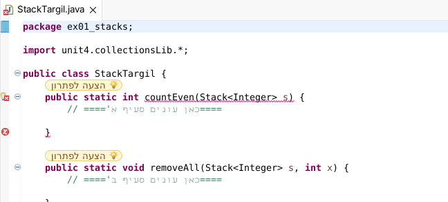 | 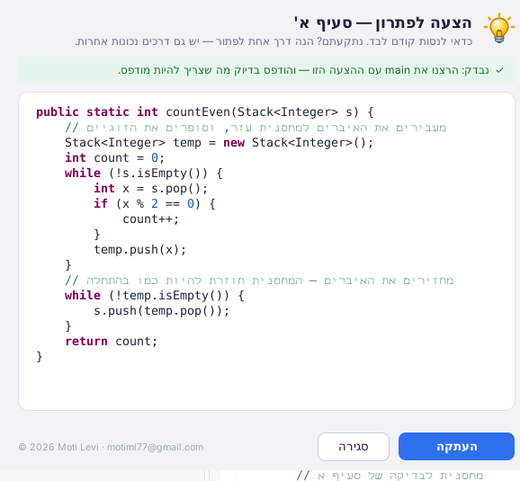 |

השליחה עוברת דרך שרת ביניים קטן (Cloudflare Worker) שמחזיק את המפתח של Gemini, כך שהמפתח לא נמצא אצל התלמידים —
**לפני השימוש צריך להתקין אותו פעם אחת:** [`worker/README.md`](worker/README.md).
השרת מותקן ופועל (`https://dsviz-exercise.motiml77.workers.dev`; הכתובת ב-`eclipse-plugin/ai.properties`), ולכן הכפתור מופיע בתוסף.

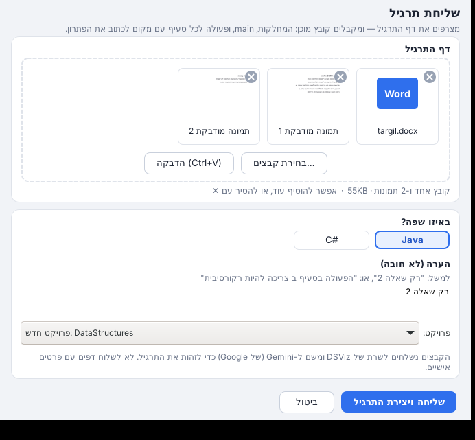

**בלי אינטרנט:** לחיצה על "שליחת תרגיל" בודקת קודם (בתוך כ-3 שניות) שיש חיבור. אם אין, מופיעה התראה שצריך אינטרנט —
והחלון לא נפתח בכלל. שאר הכלים עובדים גם בלי אינטרנט.

**ב-VS Code:** הכפתור **שליחת תרגיל** נמצא בשורת המצב, מעל העורך, בלחיצה ימנית ← "מבני נתונים", ובלוח "מבני נתונים".
- **החלון:** אותו חלון כמו ב-Eclipse. מדביקים (Ctrl+V), גוררים או בוחרים קבצים, כותבים הערה, ובוחרים שפה: Java או C#.
- **איפה נוצר התרגיל:** ב-Java נוצרת התיקייה `src/ex01_...`. ב-C# נוצר הפרויקט `Exercises/Ex01_...`.
- **הצעה לפתרון:** מעל כל סעיף מופיעה השורה **"💡 הצעה לפתרון"** (CodeLens). לחיצה עליה פותחת את ההצעה בצד, עם כפתור **העתקה**.

**ב-Visual Studio (C#):**
- **הקיצור "שליחת תרגיל ב-C#"** (שולחן העבודה ותפריט התחל): הפרויקט `Exercises\Ex01_...` נכנס לפתרון ב-Visual Studio.
- **הקיצור "הצעה לפתרון ב-C#":** בוחרים תרגיל וסעיף, ורואים את ההצעה. החלון נשאר פתוח ליד Visual Studio.

**אותו מנוע בכל הסביבות:** `ExercisePipeline` בתוך `dsviz.jar`, שמופעל דרך `SubmitCli` ב-VS Code ודרך `VsSubmit` ב-Visual Studio.
- **אותם שלבים:** בונים את הקוד, בודקים שהוא מתקמפל ומבקשים תיקון אחד אם לא. אחר כך בודקים את ההצעות לפתרון ומבקשים תיקון אחד אם צריך.
- **ההצעות נשמרות בצד, לא בקוד:** ב-VS Code בתיקיית התוסף, וב-Visual Studio ב-`~/.dsviz/solutions.json`.
- **ב-C# הקומפילציה וההרצה נעשות ב-dsviz-cs.**

**גם באתר:** בדף [שאלת בגרות לקוד](https://motiml77.github.io/java-lamerhav/bagrut.html) מעלים את השאלה מהדפדפן ומקבלים
את אותם קבצים (Java או C#) להורדה כ-ZIP, עם הצעות לפתרון סגורות עד שלוחצים.

### המורה בעברית — הסבר לכל שגיאה, במקום המדויק (Eclipse)

בזמן הכתיבה, ליד כל שגיאה של הקומפיילר מופיע **הסבר בעברית** — משפט קצר שאומר מה לא בסדר, ואחריו בסוגריים מרובעים
**[עצה: מה בדרך כלל הטעות, איך מזהים אותה ואיך מתקנים — והקוד המתוקן בסוף]**.

- **חלון "הסברים בעברית"** — נפתח לבד בצד ימין אחרי ההתקנה (ואחרי כל עדכון): מימין לשמאל, כרטיס לכל הערה — קודם ההתראה
  (השורה, שגיאה/אזהרה, וההסבר), אחריה שורת רווח, ורק אז **הצעה לתיקון**, והקוד המתוקן בשורה נפרדת משמאל לימין.
  ההערה של השורה שבה הסמן מודגשת, ולחיצה עוברת לשורה. מתעדכן בזמן הכתיבה.
  אם נסגר — פותחים שוב מהתפריט **מבני נתונים ← חלון ההסברים בעברית**.
- **עברית ואנגלית לא מתערבבות:** כל קטע קוד או מילה באנגלית בתוך ההסבר (`s.pop()`, `arr[i]`, `Stack<Integer>`, `i != 0`,
  `ArrayIndexOutOfBoundsException`) מוצג משמאל לימין כיחידה אחת, בתוך משפט שקוראים מימין לשמאל — גם כשההסבר מתחיל בקוד,
  וגם ב-Windows וגם ב-Linux (תווי כיווניות של Unicode — `RtlText`).
- ההסבר מופיע גם בריחוף מעל הקו האדום ובחלון Problems (אלה חלונות של Eclipse, שתמיד מיושרים לשמאל), עם אותו טיפול בכיווניות.

- **כל 946 ההודעות של הקומפיילר מתורגמות** (`eclipse-plugin/src/il/lamerhav/dsviz/problems_he.properties`).
- **במקום המדויק של הבעיה** — לא רק איפה ש-Eclipse מסמן: `}` חסר ← מסומן ה-`{` שלא נסגר ("חסר `}` לפני שורה 6");
  `return` חסר ← ה-`}` של הפעולה, עם הסבר איזה מסלול לא מחזיר; `else` בלי `if` ← ה-`;` שאחרי התנאי.
- **הסברים מיוחדים לטעויות הנפוצות:** אותיות גדולות וקטנות (`string`, `system`, `Count`), שמות של פעולות הספרייה
  (`size`/`peek`/`add`/`getLeftSon`...), `Stack<int>`, `=>`, פסיקים ב-`for`, טיפוס בתוך קריאה לפעולה, `s[0]` במחרוזת,
  משתנה מחוץ לבלוק שלו, תכונה פרטית (`p.next` ← `p.getNext()`), `static`, בנאי עם `void`, `import` חסר.
- **אזהרות על קוד שמתקמפל אבל לא עושה מה שרציתם** (בצהוב) — `==` במחרוזות או בין ערכים ממחסנית/תור (`Integer`),
  `;` אחרי `if`/`while`/`for`, לולאה שלא מתקדמת (מחסנית שלא מוציאים ממנה, `p` שלא מתקדם, מונה שלא משתנה),
  תור שמסובבים לנצח, שני `pop` בסיבוב אחד, `return` בתוך לולאה, `i <= arr.length`, חילוק שלמים, `top()` / `getNext()`
  שהערך שלהם הולך לאיבוד, מחרוזת שלא משתנה (`s.toUpperCase();`), רקורסיה בלי תנאי עצירה או בלי בדיקת `null` בעץ,
  פעולה שמרוקנת את המחסנית שקיבלה, `copy = s` (שאינו עותק), הדפסת מערך או עצם בלי `toString`.
  כל אזהרה מבוססת על המחקר על טעויות נפוצות של מתחילים (Altadmri & Brown, *37 Million Compilations*, 2015,
  ומחקרים על טעויות במבני נתונים), ונבדקה שהיא לא מופיעה על קוד תקין (הדוגמאות הפתורות).
- **הסידור אוטומטי:** חלון ההסברים נפתח בצד ימין של העורך, וסרגל הכלים של התוכנה נמצא בשורה נפרדת מהסרגלים האחרים — בלי לגרור כלום.
- מכבים ומדליקים בתפריט **מבני נתונים ← הסברים בעברית לשגיאות ולטעויות נפוצות**. ההודעה המקורית באנגלית נשארת לידה.

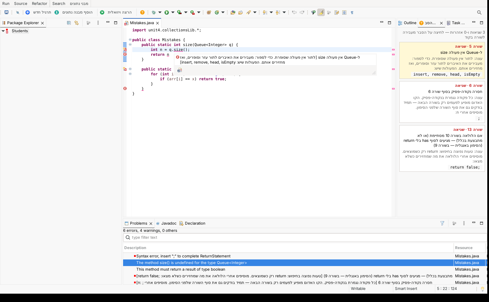

בדיקות: `tools/test/MentorTest.java` + `tools/test/mentor-cases.txt` (קוד של תלמידים עם הבדיקה של כל הסבר, בתוך `run-tests.sh`),
`tools/test/RtlTextTest.java` (כל הסבר, הצעה ותרגום מוצגים נכון מימין לשמאל — לפי האלגוריתם הדו-כיווני של Unicode),
ובדיקה בתוך Eclipse אמיתי (בנייה, כתיבה, כיבוי): `sh tools/test/eclipse-it/run.sh` (מוריד Eclipse; `SHOT=1` — גם צילומי מסך).

### בלי תוסף (הפרויקט הזה כמו שהוא)

- **Eclipse:** `File → Import → General → Existing Projects into Workspace` → בוחרים את `java-visualizer`.
- **VS Code:** `File → Open Folder` → בוחרים את `java-visualizer` (עם Extension Pack for Java).
- **שורת פקודה:** `run.bat` / `./run.sh` / `./run.sh examples.ListExamples`
- **פרויקט קיים:** מוסיפים את `release/dsviz.jar` ל-Build Path. אם כבר מחובר ה-jar המקורי של unit4 — יש להסיר אותו
  (אחרת יהיו שתי מחלקות `Stack` באותו שם). התוספים מזהים התנגשות כזו ומציעים להסיר אותה.

---

## C# — Visual Studio, VS Code ו-Rider

אותה הרצה ויזואלית, אותו חלון, אותה ספרייה — גם לתלמידים שלומדים **C#** (הספרייה `Unit4.CollectionsLib`: `Stack<T>`, `Queue<T>`, `Node<T>`, `BinNode<T>`, `Student`, `Car`
עם הפעולות באות גדולה: `Push`, `Pop`, `Top`, `IsEmpty`, `Insert`, `Remove`, `Head`, `GetValue`, `GetNext`, `SetNext`, `HasNext`, `GetLeft`...).

**מה מותקן (חבילת C# בהתקנה):** `dsviz-cs.exe` — כולל בתוכו את סביבת ההרצה של ‎.NET והמהדר (Roslyn), ולכן **לא צריך להתקין שום דבר אצל התלמיד**.
בנוסף: תיקיית `מסמכים\DataStructures-CS` (פתרון של Visual Studio עם תרגיל ושמונה דוגמאות פתורות), קיצור בשולחן העבודה, ותבנית פרויקט חדש ב-Visual Studio.

**איך מריצים:**
- **Visual Studio:** פותחים את הקיצור "תרגילי C#", ובתפריט שליד כפתור ההפעלה הירוק בוחרים **הרצה ויזואלית** (ואז לוחצים עליו).
  "הרצה רגילה" (F5) מריצה כרגיל, בקונסול, בלי חלון.
- **VS Code:** אותו תוסף כמו ל-Java — "תרגיל חדש" (שואל Java או C#), "הוסף מבנה נתונים", ו"הרצה ויזואלית" על קובץ ‎.cs. כל תרגיל הוא פרויקט בתיקייה `Exercises\<שם>`.
- **פרויקט משלכם ב-Visual Studio** (לא מהקיצור): מריצים פעם אחת ב-cmd את `dsviz-cs.exe` עם הפרויקט, ואז נוסף לפרויקט לבד **"הרצה ויזואלית"** לתפריט שליד כפתור ההפעלה הירוק.
  הפקודה: `%LOCALAPPDATA%\DSViz\cs\dsviz-cs.exe "<תיקיית הפרויקט>"`, או עם קובץ מסוים: `... "<תיקיית הפרויקט>\Recursion.cs"`.
  כשנותנים קובץ, כל הפרויקט מתקמפל עם ההגדרות שלו, ורץ ה-`Main` שבקובץ הזה. זה מתאים לפרויקט עם כמה תרגילים, כל אחד עם `Main` משלו.
  דרך נוספת: ב-Tools ← External Tools מוסיפים כלי עם Command = `C:\Users\<שם>\AppData\Local\DSViz\cs\dsviz-cs.exe`, Arguments = `"$(ItemPath)"`, Initial directory = `$(ProjectDir)`.
  כך הכלי מריץ את הקובץ הפתוח.
- **Rider / כל סביבה אחרת:** `dsviz-cs.exe <תיקיית הפרויקט או קובץ>`. ב-Rider אפשר להגדיר ב-Settings ← Tools ← External Tools:
  Program = `%LOCALAPPDATA%\DSViz\cs\dsviz-cs.exe`, Arguments = `"$FilePath$"`.
- **תוכנית בלי class ו-Main** ("top-level statements", מה שתבנית חדשה של Visual Studio יוצרת): עובדת שורה-שורה כמו כל תוכנית, כולל הפעולות שכתובות אחרי הקוד.
- **שגיאות נפוצות בפרויקט רגיל מקבלות הסבר בעברית:**
  - כמה `Main` בפרויקט: מריצים קובץ מסוים;
  - `Stack` של ‎.NET מול `Stack` של הספרייה (ImplicitUsings): `<ImplicitUsings>disable</ImplicitUsings>`;
  - חסר `using System;`.

**תרגיל חדש והוסף מבנה נתונים ב-Visual Studio / Rider:** אותם חלונות כמו ב-Eclipse וב-VS Code (מבנה, "מה יש בכל תא?", טיפוס, מה הפעולה מחזירה, רקורסיה, מילוי המבנה, תרשים חי) —
בקיצורים **"תרגיל חדש ב-C#"** (שולחן העבודה ותפריט התחל) ו**"הוסף מבנה נתונים ל-C#"** (שולחן העבודה ותפריט התחל). "תרגיל חדש" יוצר פרויקט בתיקייה `Exercises` שבתיקיית התרגילים, רושם אותו בפתרון ופותח אותו;
"הוסף מבנה נתונים" מעתיק ללוח קוד להדבקה (Ctrl+V) במקום הסמן. הקוד זהה בייט-בייט לזה של VS Code (נבדק על 3,426 קבצים).

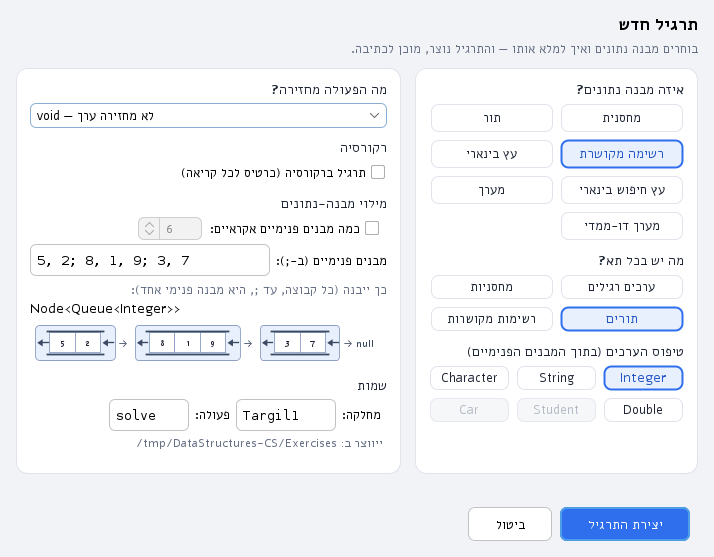

**איך זה עובד** (אין debugger ב-.NET כמו ב-Java, ולכן בדרך אחרת): `dsviz-cs` מקמפל את הקוד של התלמיד (שגיאות מוצגות כמו ב-Visual Studio), מכניס לפני כל שורה
דיווח על המשתנים והמבנים (בעזרת Roslyn), מריץ את התוכנית, וכותב את ההרצה לקובץ שהחלון הוויזואלי (Java) קורא. פירוט והפורמט: [csharp/README.md](csharp/README.md).
החלון זהה: הקוד צבוע, המבנים, מעקב משתנים, ומעקב רקורסיה שמופיע לבד כשיש רקורסיה (כרטיס לכל קריאה).

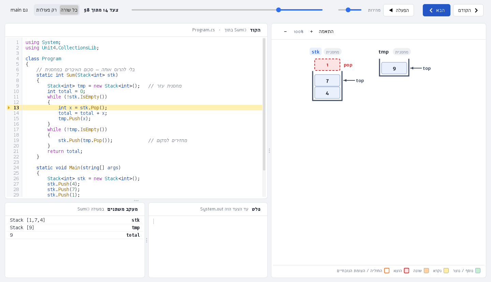

**מגבלות (גרסה ראשונה):**
- הרצה ויזואלית של C# נבדקה כאן בלינוקס ובמחשב Windows מדומה (Wine), ולא ב-Visual Studio / Rider אמיתיים: **הפרופיל "הרצה ויזואלית"**, **תבנית הפרויקט** וההתקנה ל-Visual Studio לא נבדקו שם.
- החלון נפתח בסיום ההרצה (לא תוך כדי) — חוץ מתוכנית שמחכה לקלט מהמקלדת: אז הוא נפתח כבר כשהיא מחכה, כדי שאפשר יהיה להקליד בו (ראו "קלט מהמקלדת").
- פעולות `async`, איטרטורים (`yield`) ופעולות מקומיות/למדות לא מתועדות שורה-שורה (רק הפעולות הרגילות של התלמיד).
- תוכנית "top-level" עם `await`, או עם פעולה שכתובה לפני הקוד או שמשתמשת במשתנה של התוכנית: רצה, אבל בלי מעקב שורה-שורה בקוד הראשי.

## מערכים חד ודו ממדיים

```java
int[] arr = {7, 3, 9, 1, 5};                                // מוצג בחלון ומתעדכן בכל צעד
int[][] mat = { {1, 2, 3}, {4, 5, 6} };
Student[] cls = new Student[4];
for (int i = 0; i < cls.length; i++) cls[i] = Student.random();
Viz.watch(other);                                           // מערך שנוצר אחרת — להציג גם אותו
```
התא שהשתנה מאז הצעד הקודם צבוע בכתום. **בהרצה שורה אחר שורה כל המערכים מוצגים לבד** (גם `int[] a = {...}` רגיל),
ומעל התאים מופיעים משתני האינדקס — `i`, `j`, `left`, `right`... — אבל רק כשבקוד באמת כתוב `arr[i]`.
במערך דו-ממדי: משתנה השורה ליד השורה ומשתנה העמודה מעל העמודה (`mat[r][c]`).
מערך של `main` מוצג גם כשנמצאים בתוך פעולה שקיבלה אותו (למשל `a, arr (main)`).

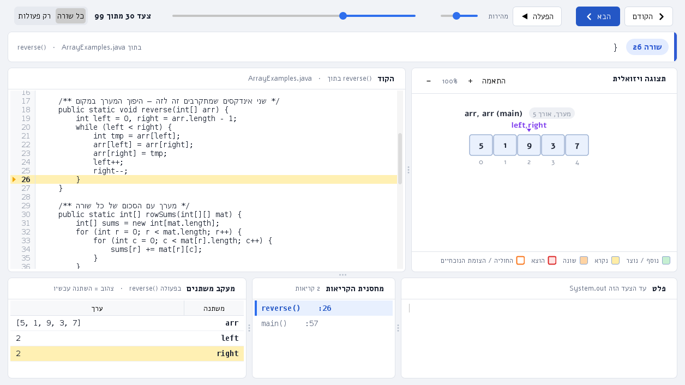


## מחלקת `Student`

```java
Student s = new Student("נועה לוי", "יא2", 90, 85, 77);   // שם, כיתה, ציונים (כמה שרוצים)
Student t = new Student("דני כהן", 88);                     // שם וציון אחד
Student r = Student.random();                               // תלמיד אקראי (נתוני דמה)
Queue<Student> q = new Queue<Student>();
for (int i = 0; i < 5; i++) q.insert(Student.random());   // 5 תלמידים אקראיים בתור
```

| פעולה | מה היא עושה |
|---|---|
| `getName()`, `getClassRoom()`, `getId()`, `getAge()` (וגם `set...`) | פרטים. תעודת זהות עם ספרת ביקורת תקינה |
| `getGrade(i)`, `setGrade(i, g)`, `addGrade(g)`, `getNumGrades()`, `getGrades()` | ציונים |
| `getAverage()`, `getMaxGrade()`, `getMinGrade()` | חישובים |
| `isExcellent()` (ממוצע ≥ 90), `isPassing()` (ממוצע ≥ 55) | בדיקות |
| `compareTo` (לפי ממוצע), `equals` (לפי ת"ז), `toString` | השוואה והצגה — אפשר גם עץ חיפוש של תלמידים |

## מה יש בתוך אובייקט — כרטיסים בכל המבנים

כשמבנה מכיל אובייקטים של מחלקה (`Student`, `Car`, או **מחלקה שהתלמיד כתב בעצמו**), כל איבר מוצג כ**כרטיס קטן** — שם בולט ושורת פרטים
(למשל `נועה` / `יא2 · 84`) — במערך, מערך דו-ממדי, מחסנית, תור, רשימה מקושרת ועץ. משתנה שמצביע על האובייקט מופיע כתג קטן על הכרטיס,
ושני מבנים שמחזיקים את אותו אובייקט מראים אותו אותו דבר. אובייקט שמשתנה מצביע אליו ואינו בתוך מבנה (`Student s = ...`) מוצג לבד כטבלת מאפיינים.
ריחוף עם העכבר על כרטיס מציג את כל המאפיינים שלו.

כשהקוד **פונה למאפיין** (`arr[0].getName()`, `s.setGrade(0, 100)`, `car.drive(50)`):
- הכרטיס מודגש (צהוב = נקרא, כתום = שונה) ומציג על עצמו `מאפיין=ערך` — למשל `average=82.5`;
- ברצועה קטנה בתחתית החלון נפתח **מבט פנימי** באובייקט: `Student · דני` + הפעולה (`getAverage()`) + טבלת כל המאפיינים, כשהשורה שנקראה מודגשת.
  הרצועה קטנה (עד שלוש עמודות) ונעלמת בצעדים שבהם אין גישה למאפיין — המבנה עצמו נשאר קומפקטי.

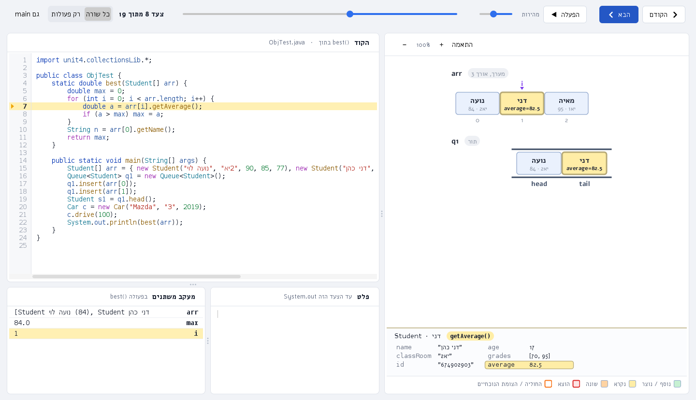

## מבנה בתוך מבנה — מחסנית של מחסניות, רשימה של תורים, עץ של מחסניות...

כל שילוב עובד, ברמות עומק (עד שלוש): `Stack<Stack<Integer>>`, `Queue<Stack<…>>`, `Node<Queue<…>>` (רשימה מקושרת של תורים),
`BinNode<Stack<…>>` (עץ של מחסניות), `Stack<Node<…>>` (מחסנית של רשימות), מערך של מחסניות (`Stack<Integer>[]`) — וגם מחסנית של מחסניות של מחסניות.
המבנה הפנימי **מצויר בתוך התא** של המבנה החיצוני, כמבנה קטן (עם `top`, `head / tail`, חיצים וחוליות), ולא כטקסט `[9,7]`:

- פעולה על המבנה הפנימי (`ss.top().push(9)`) צובעת את האיבר שהשתנה בתוכו, ומסמנת בכחול את התא החיצוני שמכיל אותו.
- מבנה פנימי שאין משתנה שמצביע עליו מוצג רק בתוך התא (לא גם לבד). אם יש לו משתנה (`a`), הוא מוצג גם לבד — כך רואים ששני המבנים הם אותו אובייקט.
- אובייקטים (`Student`, `Car`) שבתוך מבנה פנימי מוצגים ככרטיסים, וגישה למאפיין מודגשת גם שם.
- מבנה גדול מוקטן אוטומטית כדי להיכנס לתא; העכבר, הזום והגלילה עובדים כרגיל.

מגבלה: מטריצה (מערך דו-ממדי) של מבנים ושדה-מבנה בתוך מחלקה של התלמיד מוצגים כטקסט בלבד.

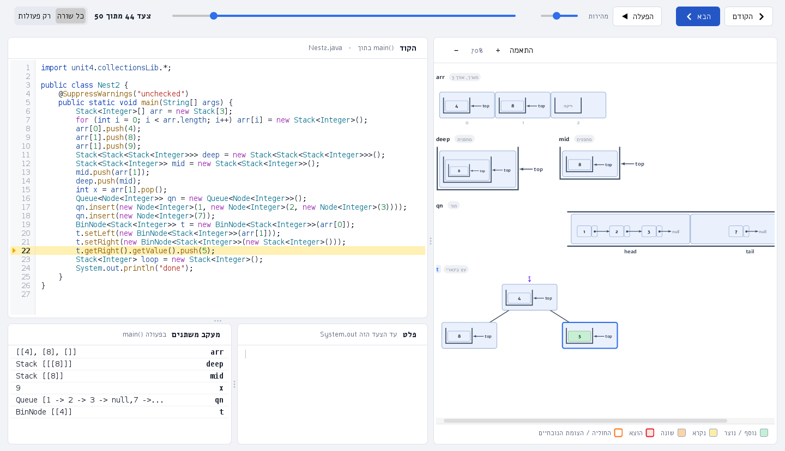

### יצירת תרגיל וקטע קוד עם מבנה בתוך מבנה

בחלון **"תרגיל חדש"** ובחלון **"הוסף מבנה נתונים"** יש בחירה נוספת, מתחת ל"איזה מבנה נתונים?": **"מה יש בכל תא?"** —
`ערכים רגילים` (ברירת המחדל) / `מחסניות` / `תורים` / `רשימות מקושרות`. כך בוחרים מחסנית של מחסניות, תור של מחסניות, רשימה מקושרת של תורים,
עץ בינארי של מחסניות, מערך של תורים... (5 מבנים חיצוניים × 3 פנימיים; בעץ חיפוש ובמערך דו-ממדי רק ערכים רגילים).

- **שדה הערכים:** כל קבוצה, עד `;`, היא מבנה פנימי אחד — למשל `5, 2; 8, 1, 9; 3, 7` = שלושה מבנים פנימיים. בעץ — הקבוצות לפי רמות (שורש, ילד שמאלי, ילד ימני...) ו-`null` = אין צומת.
- **תצוגה מקדימה חיה** (ב"תרגיל חדש" של Eclipse ושל Visual Studio, ובחלון "הוסף מבנה נתונים" בכל הסביבות): תרשים קטן של מה שייבנה — המבנה החיצוני עם המבנים הפנימיים בתוך התאים, ובאיזה סדר הם — מתעדכן תוך כדי הקלדה. ב-VS Code ההודעה מתחת לשדה מראה את הטיפוס והסדר.
- **הקוד שנוצר:** פעולה עם המבנה המקונן כפרמטר, תזכורת לפעולות של החיצוני ושל הפנימי (`Stack<Integer> inner = stk.top();`), ו-`main` שבונה את הכול בשורות קצרות (בונים מבנה פנימי, ומכניסים אותו לחיצוני).
- **בכל שלוש הסביבות** (Eclipse, VS Code, Visual Studio/C#): הקוד זהה, ובדוגמאות יש קובץ `NestedExamples` (סכום, שיטוח, רשימה של תורים, עץ של מחסניות).

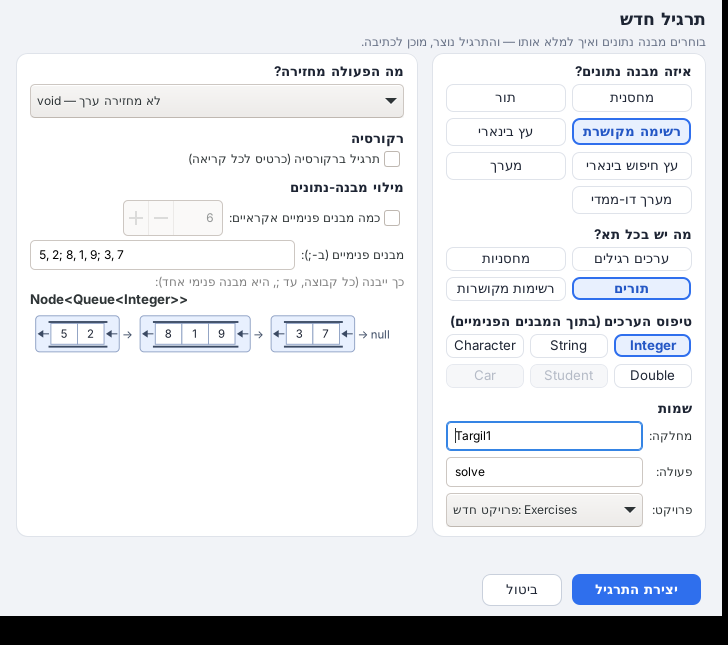

## מעקב רקורסיה

### תנאים בהרצה הוויזואלית (if / else, while, for)

הסימונים מופיעים בתוך הקוד עצמו, בחלון ההרצה (ב-Java וב-C#):

- **ברגע שבודקים תנאי** (`if`, `else if`, `while`, `for`, `do-while`), מימין לשורה מופיעים:
  - המשתנים שבתנאי בקטן, למשל `x = 7` או `s = Stack [8,3]`;
  - התנאי עם הערכים, למשל `→ 7 % 2 == 0` או `→ !false` (במקום `!s.isEmpty()`);
  - תגית צבעונית: ירוק **✓ מתקיים**, או אדום **✗ לא מתקיים**. בתגית כתוב גם מה קורה עכשיו: "נכנסים ל-if", "עוברים ל-else", "עוברים ל-else if", "מדלגים על ה-if", "ממשיכים לסיבוב", "יוצאים מהלולאה".
- **בזמן שרצים בתוך ענף:** ליד הענף שרץ יש פס צבעוני. ירוק אומר שרץ ה-if, וסגול אומר שרץ ה-else. בשורת ה-else או ה-if מופיע הסבר, למשל "רץ ה-else — כי התנאי בשורה 23 לא התקיים". הענף שמדלגים עליו מעומעם.
- **שרשרת `else if`:** ההסבר אומר אילו תנאים לא התקיימו ואיזה כן, למשל "רץ ה-else if — התנאים בשורות 55, 57 לא התקיימו, והתנאי בשורה 59 התקיים". כשאף תנאי לא מתקיים: "רץ ה-else — אף תנאי לא התקיים (שורות 55, 57, 59)". בבדיקה עצמה כתוב "נכנסים ל-else if" או "עוברים ל-else if".
- **התשובה (מתקיים / לא מתקיים) נקבעת לפי מה שבאמת רץ אחרי הבדיקה.** לכן היא נכונה גם כשבתנאי יש קריאה לפעולה. ב-`for` מוצג הערך שנבדק בפועל (אחרי ה-`i++`).

### יציאה לפעולת עזר וחזרה ממנה

כשפעולה קוראת לפעולת עזר (למשל `sumEven` קוראת ל-`isEven`), רואים בחלון ההרצה איך יוצאים אליה ואיך חוזרים. זה ב-Java וב-C#.
הקריאה מ-`main` לפעולה של התרגיל לא מסומנת. גם רקורסיה לא מסומנת כך (לרקורסיה יש תצוגה משלה, שמופיעה לבד).

- **פס מעל הקוד:** הפעולות שרצות, למשל `sumEven() · מחכה ← isEven()` (הפעולה שרצה עכשיו צבועה), ומשפט שמסביר את הרגע. הצבע משתנה לפי הרגע:
  - כחול ביציאה: "בשורה 29 sumEven() קוראת לפעולת העזר isEven() — יוצאים אליה עם x = 8", "יצאנו מ-sumEven() (שורה 29) לפעולת העזר isEven() עם x = 8";
  - כתום בהמתנה: "בתוך פעולת העזר isEven() · sumEven() מחכה בשורה 29 לתשובה";
  - ירוק בחזרה: "isEven() מחזירה true — חוזרים ל-sumEven() בשורה 29", "חזרנו ל-sumEven() בשורה 29 — isEven() החזירה true, ממשיכים מאותה נקודה".
- **בתוך הקוד:**
  - חץ מקווקו מהשורה שקוראת אל הכותרת של פעולת העזר, ובכותרת: "נכנסים עם x = 8";
  - השורה שמחכה צבועה בכתום, עם "מחכה ל-isEven()";
  - בחזרה: חץ ירוק מה-`return` אל השורה שקראה, עם "מחזירה true — חוזרים לשורה 29", ובשורה שקראה: "isEven() החזירה true".
- **פעולת עזר שקוראת לפעולת עזר נוספת** (`sumEven ← isEven ← rem`): כל השורות שמחכות מסומנות.
- **פעולה בלי ערך (`void`):** "report() הסתיימה". אחרי קריאה כזו Java ו-C# ממשיכים לשורה הבאה, וכתוב: "חזרנו ל-maxOf() מהקריאה בשורה 45 — ממשיכים בשורה 46".

### לולאות בהרצה הוויזואלית

כשהשורה הנוכחית נמצאת בתוך לולאה (`for`, `while`, `do-while`, `for-each`), מוצג כרטיס לכל לולאה. לולאה פנימית מוצגת מתחת לחיצונית, מוזחת ובצבע אחר. בכל כרטיס:

- **הכותרת** (הקוד של הלולאה) ו**מספר הסיבוב**.
- **התנאי עם הערכים**, למשל `i < n → 2 < 5 → true`. ברגע שבודקים אותו השורה צבועה ומופיע מה קורה עכשיו: "ממשיכים" או "יוצאים מהלולאה".
- **ב-for שסופר:** סרגל של כל הערכים שהמשתנה יקבל. מה שכבר עבר בירוק, הערך הנוכחי בכחול עם שם המשתנה, ובסוף "יציאה".
- **שתי לולאות for מקוננות:** טבלה של כל הזוגות (i, j). מה שכבר עבר מסומן ב-✓ והזוג הנוכחי בכחול. כשהגבול של הפנימית תלוי בחיצונית (למשל `j < i`), רואים את הצורה האמיתית.
- **המונים, זה בתוך זה:** בלולאות מקוננות מוצגת מסגרת של `i`, ובתוכה המסגרת של `j`, כל אחת עם הערך שלה. כך רואים שעל כל ערך של `i`, `j` עובר על כל הערכים שלו. כשהפנימית מתחילה מחדש מופיע: "הלולאה הפנימית מתחילה מחדש — כי i התקדם ל-1".
- **לולאה על מערך** (`i < arr.length`, `arr[i]`, `for (int x : arr)`): הסרגל מציג את כל המערך עם האיברים והאינדקסים. החלק שהלולאה לא עוברת עליו (למשל כשמתחילים מ-1) מעומעם.
- **while על תור / מחסנית / רשימה** (`!q.isEmpty()`, `p != null`): מה נשאר בתור או במחסנית ("יש עוד 2 איברים", "התור q ריק"), או על איזו חוליה המצביע מצביע.
- **while על מספר** (`n > 1`): הערך של המשתנה בתחילת כל סיבוב, למשל `20 → 10 → 5 → 2`.
- **חץ "חוזרים לראש הלולאה"** (בקוד, משמאל): בצעד שבו הלולאה חוזרת מסוף הגוף אל שורת הלולאה, חץ סגול-כחול "מצייר את עצמו" מהסוגר של הלולאה, עולה בשוליים ונכנס לשורת ה-`for` / `while` (ב-`do-while`: מה-`while` שבסוף אל תחילת הגוף). אחרי רגע הוא נעלם. בלולאות מקוננות, כשהפנימית נגמרת והחיצונית חוזרת, החץ עוטף את החיצונית. בהפעלה אוטומטית מהירה ההנפשה מתקצרת. ב-Java וב-C#.

### מחרוזות (String) בהרצה הוויזואלית

כל משתנה מחרוזת מוצג כשורת תאים: תו בכל תא, ומתחתיו האינדקס. לפני שכל שורה רצה מסומן מה היא עושה במחרוזת:

- `charAt(i)`: חץ אל התו (עם שם המשתנה, למשל `i`), והתו שמוחזר.
- `substring(a, b)`: החלק שנחתך צבוע ומסומן בסוגר, ומופיע מה מוחזר.
- `indexOf` / `lastIndexOf` / `contains` / `startsWith` / `endsWith`: החלק שנמצא, או "לא נמצא".
- `length()`: כל המחרוזת. `equals` / `compareTo`: חץ אל המקום הראשון שבו המחרוזות שונות.
- `toUpperCase` / `toLowerCase` / `trim` / `replace` / `concat`: המחרוזת החדשה. המחרוזת המקורית לא משתנה.
- חיתוך או גישה מחוץ לגבולות: הסבר בעברית למה תהיה שגיאה.

### קלט מהמקלדת (Scanner) בהרצה הוויזואלית

תוכנית שקוראת קלט (`in.nextInt()`, `in.nextLine()`, `br.readLine()`, `System.in.read()`) עוצרת ומחכה, ובחלון רואים בדיוק איפה:

- **השורה שקוראת** מסומנת בקוד, ובסופה תגית "⌨ מחכה לקלט מהמקלדת". החלון קופץ לצעד האחרון (התוכנית לא יכולה להמשיך בלי הקלט), ובמקום הספינר שליד מונה הצעדים מופיעה מקלדת.
- **מתחת לקוד נפתח פס הקלדה:** מה התוכנית מחכה לו ואיפה ("התוכנית מחכה שתקלידו מספר שלם — שורה 10: `in.nextInt()`"), השאלה שהתוכנית הדפיסה (למשל "כמה מספרים?"), ושדה שמקבל את המקלדת מיד. מקלידים ולוחצים Enter (או "שליחה").
- **אחרי השליחה** הפס נעלם והתוכנית ממשיכה. מה שהוקלד מופיע בפלט אחרי השאלה, מודגש בצבע של קלט, ונרשם כצעד: כשחוזרים אחורה, בשורה שקראה כתוב "⌨ הוקלד: 5".
- **שני ערכים בשורה אחת** (`4 5` לשתי קריאות של `nextInt`) ו**קריאה בלולאה** עובדים כמו בקונסול.
- **"סיום הקלט"** אומר לתוכנית שאין עוד קלט (כמו Ctrl+D / Ctrl+Z בקונסול) — למשל כדי לסיים `while (in.hasNextInt())`. בצעד הזה כתוב "⌨ סוף הקלט".
- **אפשר להקליד גם בקונסול** של Eclipse או בטרמינל של VS Code, כמו בהרצה רגילה. מה שמגיע קודם — נקלט.
- **הוקלד ערך מסוג אחר** (אותיות ל-`nextInt`) או שאין עוד קלט: כרטיס שגיאה שמסביר מה קרה, ומציע לבדוק קודם `in.hasNextInt()`.

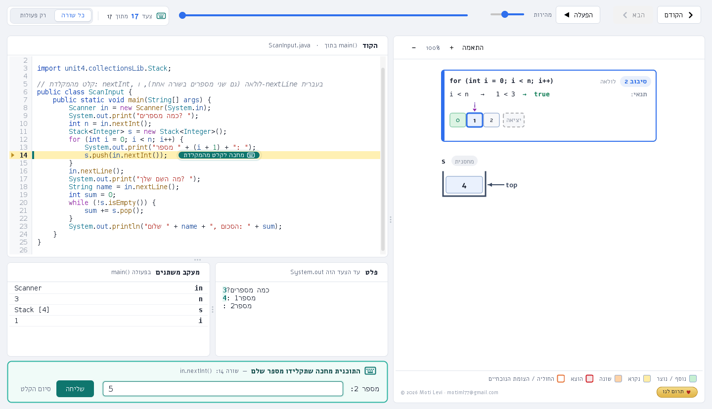

**ב-C#** (`Console.ReadLine()`, `Console.Read()`, `Console.In.ReadLine()`) — אותו דבר: כשהתוכנית מחכה לקלט, חלון ההרצה הוויזואלית נפתח כבר אז
(ולא רק בסוף ההרצה) עם כל הצעדים עד כאן, השורה שקוראת מסומנת ונפתח אותו פס הקלדה ("התוכנית מחכה שתקלידו מספר שלם" כשהשורה היא
`int.Parse(Console.ReadLine())`). אפשר להקליד גם בחלון הקונסול של Visual Studio / בטרמינל של VS Code. "סיום הקלט" — `ReadLine()` מחזירה `null`,
למשל כדי לסיים `while ((line = Console.ReadLine()) != null)`. בלי חלון: `dsviz-cs ... --input קובץ` או `DSVIZ_INPUT`.

לבדיקות בלי חלון: `-Ddsviz.input="3\n4 5"` (או `-Ddsviz.input=@קובץ`, או משתנה הסביבה `DSVIZ_INPUT`) מקליד את השורות לבד בכל פעם שהתוכנית מחכה, ו-`-Ddsviz.inputDelay=3000` מחכה לפני כל שורה.

### מחלקות שהתלמיד כתב בעצמו

"הרצה ויזואלית" על קובץ בלי `main` (למשל מחלקה חדשה שהתלמיד כתב) מריצה את המחלקה בפרויקט שמשתמשת בה. אם יש כמה כאלה, בוחרים מרשימה. אם אין אף אחת, ההרצה מציעה להוסיף בסוף המחלקה `main` קצרה לבדיקה, רק אם התלמיד מסכים. כל השאר לא משתנה.

כל מחלקה שהתלמיד כתב מוצגת בהרצה הוויזואלית כ"כרטיס" עם כל המאפיינים והערכים שלהם, בלי לשנות את הקוד שלו. זה כולל משתנה, `this` בתוך פעולה של המחלקה, ואובייקט בתוך מחסנית, תור או מערך. מאפיין שמצביע על אובייקט אחר מראה עליו מי הוא (`→ {x=3 · y=4}`). אם יש למחלקה `toString` משלה, משתמשים בה.

**פעולה שרצה בתוך אובייקט** (`d1.birthday()`, `d2.isOlderThan(d1)`), ב-Java וב-C#. ההמחשה מראה שהפעולה רצה בתוך האובייקט עצמו, בלי להעמיס על המסך:

- **הכרטיס של האובייקט נקרא בשם שלו אצל מי שקרא:** `d1` עם תג סגול `this`, במקום רק "this". הכרטיס מקבל מסגרת סגולה, ומתחתיו שורה קטנה: "birthday() רצה בתוך d1". מעל הקוד כתוב "בתוך d1.birthday()", ובמעקב המשתנים מופיע `this (d1)`.
- **פרמטר שהוא אובייקט** מקבל גם הוא את השם שלו אצל מי שקרא: `other ← d1`.
- **המאפיינים שהשורה משתמשת בהם מודגשים:** `age = age + 1` מסמן את `age` בכתום (שינוי), ו-`return age > other.age` מסמן את `age` בשני הכרטיסים בצהוב (קריאה). כך רואים ש-`age` לבד הוא `this.age`.
- **בבנאי:** "הבנאי Dog() בונה את d1", והכרטיס נקרא "d1 (בבנייה)". המאפיינים מתמלאים שורה אחרי שורה (`name = null` ואז `"רקס"`).
- **פעולה שקוראת לפעולה אחרת של אותו אובייקט** (`birthday()` קוראת ל-`bark()`): גם `bark()` רצה בתוך `d1`.
- **בשורה שקוראת** (`d1.birthday();` ב-`main`) הכרטיס של `d1` מסומן "נכנסים ל-birthday() של d1".
- **הערכים נכונים בכל רגע.** כל צעד שומר את ערכי המאפיינים כפי שהיו באותה שורה. לכן בבנאי לא מופיע כבר הגיל שהכלב יקבל רק אחר כך.

### הרצה ויזואלית בכל פרויקט

"הרצה ויזואלית" עובדת בכל פרויקט Java, גם בפרויקט שהתלמיד יצר בעצמו, בלי לשנות בו קבצים או הגדרות. אם אין בפרויקט ספריית קורס, נוספת לו רק `lib/dsviz.jar`. בזמן ההרצה הספרייה של התוסף באה ראשונה, ואחריה ה-classpath הרגיל של הפרויקט. כך ההרצה עובדת גם כשיש בפרויקט ספריית `unit4` אחרת (למשל המקורית של הקורס), בלי להסיר אותה.

### עדכון אוטומטי, סגירת Eclipse בזמן ההתקנה, ונעילה לתשלום

- **Eclipse פתוח בזמן ההתקנה:** ההתקנה מבקשת לסגור אותו (או סוגרת בשבילכם, ו-Eclipse שואל אם לשמור קבצים). אחרת התוסף לא נטען כמו שצריך.
- **עדכון אוטומטי ברקע:**
  - מתי בודקים: בכל כניסה ל-Windows, ובכל פעם ש-Eclipse נסגר.
  - איך: התוכנה בודקת ב-`release/version.json` אם יש גרסה חדשה. אם יש, היא מורידה אותה ובודקת שהקובץ שלם (SHA-256).
  - מתי מתקינים: רק אחרי ש-Eclipse סגור. ההתקנה שקטה, עם אותן שפות שנבחרו קודם.
  - מה לא נוגעים: עבודה של התלמיד.
  - יומן: `update.log` בתיקיית ההתקנה.
  - מה שמפעיל עדכון: כל בנייה חדשה ב-master (מספר הבנייה ב-`version.json`) מגיעה לכולם לבד.
- **נעילה לתשלום:** הקוד מוכן אבל כבוי לגמרי: אין פנייה לשרת והכול פתוח. כדי להפעיל בעתיד:
  1. משנים ל-`true` את `License.ENABLED` (בקובץ `src/unit4/collectionsLib/License.java`) ובונים מחדש. העדכון האוטומטי מביא את זה לכולם.
  2. בשרת מגדירים `PAYWALL = "on"` (ראו `worker/README.md`).

  הנעילה נועלת רק את החלון הוויזואלי.

### פעולות עזר מהספרייה: size ו-duplicate

שתי פעולות שנמצאות בספרייה עצמה (במחלקה `Helpers`, שהתלמיד לא צריך לראות או לכתוב). שולחים להן מבנה, והן מחזירות
תשובה **בלי לשנות את המבנה שנשלח**:

```java
int n = size(s);                           // כמה איברים: מחסנית, תור, רשימה מקושרת (חוליות), עץ (צמתים)
Stack<Integer> copy = duplicate(s);        // עותק באותו סדר / באותו מבנה
Queue<Stack<Integer>> qc = duplicate(qs);  // תור של מחסניות — העותק מאותו סוג, וגם המחסניות הפנימיות מועתקות
```

- **Java:** מוטמע אוטומטית. כותבים `size(s)` או `duplicate(s)`, ושורת `import static unit4.collectionsLib.Helpers.*;`
  נוספת לבד לראש הקובץ תוך שנייה (Eclipse וגם VS Code), רק בקבצים שמשתמשים בהן, כך שאין import מיותר ואין אזהרה צהובה.
  ב-Eclipse גם Ctrl+Space מציע אותן. אם התלמיד כותב בעצמו פעולה בשם `size` או `duplicate`, נקראת הפעולה שלו.
- **C#:** `Size(s)` / `Duplicate(s)`, בלי שום שורה בקובץ: תיקיית התרגילים (`Directory.Build.props`) וההרצה הוויזואלית
  מוסיפות את זה לכל הקבצים.
- רשימה או עץ ריקים (`null`): `size` מחזירה 0 ו-`duplicate` מחזירה `null`.
- בהרצה הוויזואלית כל קריאה היא **צעד אחד** (`size(s) → 3`, בלי כל ה-pop וה-push שבפנים), והעותק מקבל את שם המשתנה.

כשנוצר מבנה כזה, מופיעה בקוד הערה קצרה: `// עזר מהספרייה: size(stk) — כמה איברים,  duplicate(stk) — עותק (stk לא משתנה)`.
(בבגרות עצמה אין את הפעולות האלה — שם כותבים את הספירה וההעתקה בעצמם, וההצעות לפתרון לא משתמשות בהן.)

**תוכן אקראי מסומן מראש:** ב"תרגיל חדש" וב"הוסף מבנה נתונים" (Eclipse, VS Code, Visual Studio) התיבה "כמה ערכים אקראיים"
מסומנת מראש, והמבנה מתמלא בערכים אקראיים. מי שרוצה ערכים משלו מוריד את הסימון (והבחירה נשמרת כל עוד החלון פתוח).

**החלון מזהה רקורסיה לבד** — לא צריך לסמן כלום ואין לשונית לבחור. כל עוד הצעד בתוך פעולה רקורסיבית
(פעולה שקוראת לעצמה, או כמה פעולות שקוראות זו לזו), הצד הימני מציג את **מעקב הרקורסיה**; כשהרקורסיה מסתיימת — חוזרים לבד למבנים.
כל קריאה לפעולה היא **כרטיס נפרד** ("מסך" לכל ריצה), במדרגות — כמו שמציירים על הלוח:

- **בכותרת:** מספר הקריאה ומה היא קיבלה, למשל `fact(n = 3)`.
- **בגוף:** המשתנים של הקריאה הזו בלבד (`n`, `rest`...), ו**השורות שרצו בה**: תנאי `if` עם התוצאה (`true` / `false`),
  שורה שקוראת לפעולה עם מספר הקריאה ומה היא החזירה (`#5 → 0`), ושורת ה-`return` עם הערך שהוחזר (`→ 24`).
- **מתחת לכרטיסים:** המבנים (מערך, מחסנית, עץ...) בקטן — כמו שהם בשלב הזה.
- **בתחתית הכרטיס:** המצב — **פועלת עכשיו** (כחול) · **מחכה לתשובה מקריאה 4** (אפור) · **החזירה 6** (ירוק).
- **חץ כחול למטה** = קריאה לפעולה. **חץ ירוק מקווקו חזרה למעלה**, עם הערך בעיגול = מה שהקריאה החזירה למי שקרא לה.

כך רואים גם את "הירידה" (כל קריאה מחכה לבאה) וגם את "העלייה" (הערכים חוזרים ומחושבים בדרך).

**איזו רקורסיה זו?** החלון מזהה את סוג הרקורסיה לפי כל ההרצה. בראש מעקב הרקורסיה יש פס עם שם הסוג, הסבר במשפט, ואיפה אנחנו עכשיו. זה עובד ב-Java וב-C#.

| הסוג | דוגמה | מה מוצג |
|---|---|---|
| **רקורסיה פשוטה** — כל קריאה פותחת קריאה אחת | `return n * fact(n - 1);` | הכרטיסים במדרגות. בפס: "↓ ירידה", ואחר כך "↑ חזרה — כל קריאה משתמשת בתשובה שקיבלה". בשורה שקראה מופיע גם החישוב בדרך חזרה: `#4→2 ⇒ 6` (קריאה 4 החזירה 2, והשורה מחזירה 6) |
| **רקורסיית זנב** — הקריאה היא הדבר האחרון | `return sum(n - 1, acc + n);` | ליד כל חץ חזרה כתוב "אותו ערך", כי התשובה מתנאי העצירה עולה בלי שינוי. זה נכון גם לפעולת `void` שהקריאה היא השורה האחרונה בה |
| **רקורסיה כפולה / מרובה** — קריאה פותחת שתיים או יותר | `fib(n - 1) + fib(n - 2)`, `count(t.getLeft()) + count(t.getRight())` | **עץ קריאות** קטן וקבוע מעל הכרטיסים. כל צומת מראה מה הקריאה קיבלה ומה החזירה (`fib(2)` ומתחתיו `= 1`). הדרך אל הקריאה הנוכחית צבועה בכחול. מתחת לעץ מוצגים רק הכרטיסים של הדרך הזו, כדי שהתצוגה לא תהיה ארוכה |
| **רקורסיה הדדית** — פעולות שקוראות זו לזו | `isEven` ← `isOdd` ← `isEven` | צבע לכל פעולה: פס בצד הכרטיס ושם הפעולה. בפס העליון יש תג בצבע לכל פעולה |

- **תנאי העצירה:** הקריאה שהסתיימה בלי לקרוא שוב מסומנת בתג "תנאי עצירה". כשמגיעים אליה, בפס כתוב "■ תנאי העצירה — קריאה #5 מחזירה 1 בלי לקרוא שוב".
- **על איזה מבנה:** כשהרקורסיה מקבלת עץ בינארי, שרשרת חוליות, מחסנית, תור, מחרוזת או מערך, מופיע בפס תג כמו "על עץ בינארי".
בכל סיום של פעולה יש צעד **"חזרה"** ("הפעולה fact מחזירה 24"), והשורה של ה-`return` מודגשת בקוד.

| עצרת | ספירת צמתים בעץ |
|---|---|
| 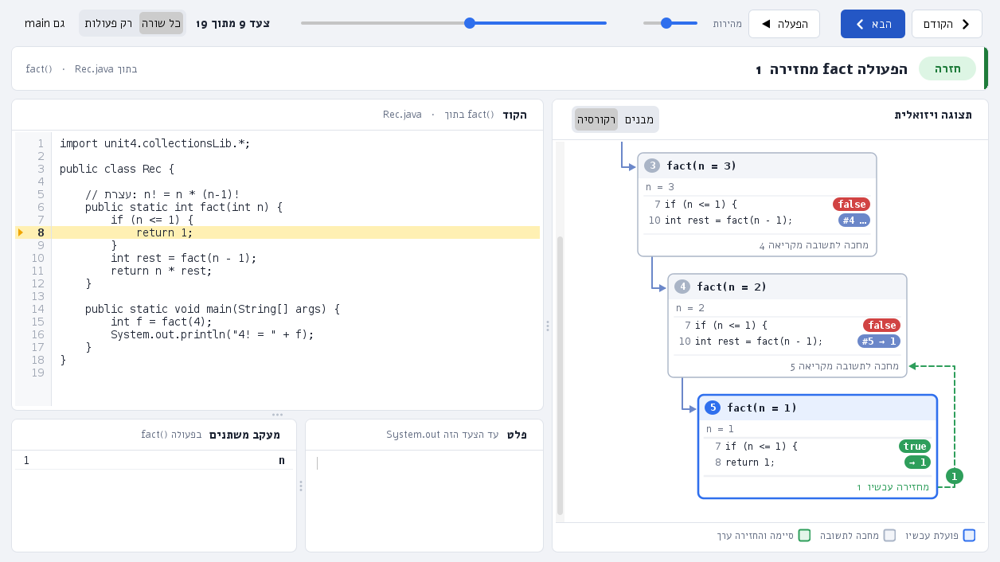 | 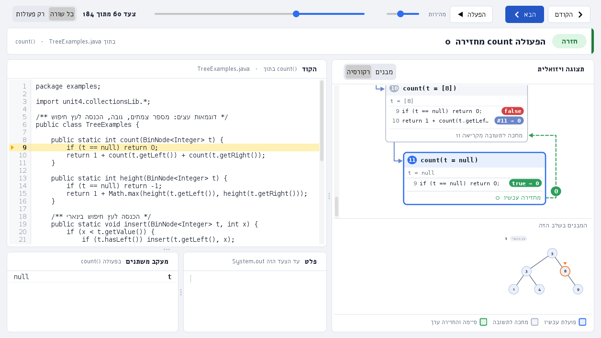 |

## שמות משתנים בקוד שנוצר

בקוד שהתוספים יוצרים ובדוגמאות שמות המשתנים קבועים ובעלי משמעות, כדי שיהיה קל לקרוא:

| מה | שם | דוגמה |
|---|---|---|
| מחסנית שהפעולה מקבלת | `stk` (שנייה: `stk2`, שלישית: `stk3`) | `Stack<Integer> stk` |
| תור שהפעולה מקבלת | `q1` (`q2`, `q3`) | `Queue<Integer> q1` |
| ראש רשימה מקושרת | `lst` | `Node<Integer> lst` |
| מצביע עזר ברשימה | `curr` | `Node<Integer> curr = lst;` |
| מחסנית / תור עזר | `tmp` | `Stack<Integer> tmp = new Stack<Integer>();` |
| תלמידים | `s1`, `s2`... | `Student s1 = Student.random();` |
| מכוניות | `c1`, `c2`... | `Car c1 = Car.random();` |

בחלון "תרגיל חדש" אפשר לבחור שהפעולה תקבל **עד שלושה מבנים** (למשל שלוש מחסניות). החלון מציג כל שורה שהתלמיד כתב —
גם `if` / `while` ומשתנים משלו, ומספר המבנים לא מוגבל — כי ההרצה עוקבת אחרי הקוד עצמו ולא אחרי תבנית קבועה.

## מה יש במחלקה (Student / Car)

כשיוצרים תלמיד או מכונית ("צור תלמיד" / "צור מכונית", או כשבוחרים `Student` / `Car` כטיפוס הערכים), נפתח חלון קטן שמראה
**איך יוצרים, אילו מאפיינים יש ואילו פעולות** — בטבלאות קצרות. ב-Eclipse זה חלון קטן; ב-VS Code — לשונית בצד.

## צבעי הקוד

הקוד בחלון ההרצה (ובכרטיסי הרקורסיה) צבעוני: מילים שמורות (`public`, `static`, `int`) בכחול, פקודות בקרה (`if`, `while`, `return`, `new`)
בסגול, טיפוסים (`Stack`, `Node`) בטורקיז, פעולות (`push()`, `getNext()`) בחום, משתנים בכחול כהה, מחרוזות באדום, מספרים בירוק והערות באפור.

## מחלקת Car (מכונית)

מחלקה מוכנה נוספת לתרגילים, בדיוק כמו `Student`: אפשר לבחור `Car` כטיפוס הערכים בכל מבנה ("תרגיל חדש"),
ולהוסיף לקוד "צור מכונית" עם נתוני דמה.

```java
Car c = new Car("Mazda", "3", 2019);          // יצרן, דגם, שנת ייצור
Car r = Car.random();                         // מכונית אקראית: יצרן, דגם, שנה, צבע, ק"מ ודלק
c.refuel(20);   c.accelerate(50);   int driven = c.drive(120);   c.brake(50);
c.getKm()   c.getFuel()   c.getSpeed()   c.getAge()   c.isOld()   c.needsFuel()   c.getYear() ...
```

| פרטים | פעולות |
|---|---|
| `getManufacturer`, `getModel`, `getYear`, `getColor`, `getPlate`, `getKm`, `getFuel`, `getTankSize`, `getSpeed` | `drive(km)` (נוסעת עד שנגמר הדלק, מחזירה כמה נסעה), `refuel(l)`, `accelerate(d)`, `brake(d)` |
| `compareTo` (לפי שנה), `equals` (לפי מספר רישוי), `toString` | `getAge()`, `isOld()` (10 שנים ומעלה), `needsFuel()`, `isMoving()` |

בחלון המכונית מוצגת כ"יצרן + שנה" (למשל `Mazda 2019`). בתפריט "דוגמאות פתורות" יש גם `CarExamples`.

בחלון תלמיד מוצג כ"שם פרטי + ממוצע" (למשל `נועה 84`), ובטבלת המשתנים — המלא.

## הרצה שורה אחר שורה

בכפתור **הרצה ויזואלית** (בשני התוספים) כל שורה שהתוכנית מבצעת היא צעד בחלון. המתג **כל שורה / רק פעולות** שבסרגל מסתיר את שורות הקוד ומשאיר רק את הפעולות על המבנים:

- **השורה עצמה** מודגשת בקוד ומופיעה בכותרת (למשל `שורה 20: total += x;`).
- **טבלת משתנים**: כל המשתנים המקומיים של הפעולה הנוכחית וערכיהם — מספרים, תווים, מחרוזות, מערכים ומבנים.
  ערך שהשתנה מאז השורה הקודמת צבוע **בצהוב**.
- **שמות המשתנים מעל המבנים**: `cur`, `prev`, `next` מעל החוליות שהם מצביעים עליהן, `temp` כשם המחסנית — לבד,
  בלי `Viz.point`. ברקורסיה רואים בכל קריאה את המשתנים שלה.
- הפעולות על המבנים (`push`, `setNext`...) מופיעות בין השורות, כך שרואים גם את השורה וגם מה היא עשתה.

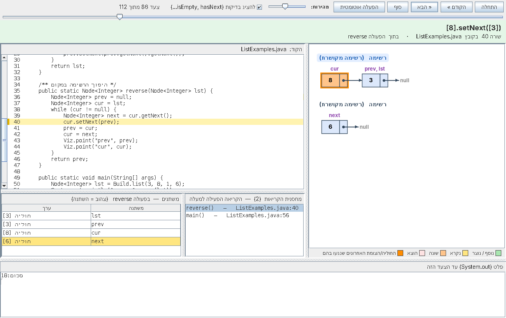

איך זה עובד: התוכנית רצה בתהליך נפרד תחת ממשק הדיבאג של Java (JDI), שעוצר אותה לפני כל שורה בקוד של התלמיד
וקורא את המשתנים. לכן זה איטי יותר מהרצה רגילה (בערך אלפית שנייה לשורה), ונעצר אחרי 5000 צעדים.
**בלי תוסף:** כותבים `Viz.lines();` כשורה הראשונה ב-`main` ומריצים כרגיל (או `Viz.show();` לחלון בלי שורות).
דורש JDK 11 ומעלה; בגרסה ישנה יותר התוכנית פשוט רצה רגיל (עם הודעה).

---

## איך נראה תרגיל

```java
import unit4.collectionsLib.*;

public class Main {

    // כאן כותבים את הפונקציה של התרגיל
    public static int sum(Stack<Integer> s) {
        Stack<Integer> temp = new Stack<Integer>();
        int total = 0;
        while (!s.isEmpty()) {
            int x = s.pop();
            total += x;
            temp.push(x);
        }
        while (!temp.isEmpty()) {
            s.push(temp.pop());
        }
        return total;
    }

    public static void main(String[] args) {
        Stack<Integer> s = new Stack<Integer>();
        s.push(4);
        s.push(7);
        s.push(1);
        s.push(9);   // האחרון שנכנס — בראש המחסנית
        System.out.println("הסכום: " + sum(s));
    }
}
```

בתיקייה `src/examples` יש דוגמאות מוכנות להרצה:

| קובץ | מה מודגם |
|---|---|
| `ArrayExamples` | מקום המקסימום, היפוך במקום (`left`/`right`), סכומי שורות במערך דו-ממדי, מיון בועות |
| `StudentExamples` | ספירת מצטיינים בתור של תלמידים, התלמיד הטוב ביותר במערך |
| `StackExamples` | היפוך מחסנית עם מחסנית עזר, הכנסה לתחתית ברקורסיה |
| `QueueExamples` | ספירת איברים בלי להרוס את התור, מחיקת כל המופעים של ערך |
| `ListExamples`  | סכום, מחיקת חוליה, היפוך רשימה במקום (עם תוויות `p`, `prev`, `cur`) |
| `TreeExamples`  | מספר צמתים, גובה, הכנסה לעץ חיפוש בינארי |

---

## החלון

| אזור | מה רואים |
|---|---|
| למעלה | כפתורי ניווט, מהירות, מונה "צעד X מתוך Y", המתג "כל שורה / רק פעולות" ו"גם main" |
| משמאל למעלה: קוד | הקובץ, עם השורה הנוכחית מודגשת |
| משמאל למטה | **מעקב משתנים** (מה שהשתנה — בצהוב) ו**פלט** (כל מה שהודפס עד הצעד הזה) |
| מימין, לכל הגובה | **המבנים** (המבנה שהצעד נגע בו מסומן בכחול). כשהצעד בתוך רקורסיה — **מעקב הרקורסיה** במקומם (לבד) |

**צבעים:** ירוק = נוסף / נוצר · צהוב = נקרא · כתום = שונה · אדום מקווקו = הוצא (pop / remove) ·
מסגרת כתומה ומשולש = החוליה / הצומת האחרונים שהקוד נגע בהם.

**מקלדת:** חץ שמאלה / רווח / Enter = צעד הבא · חץ ימינה = צעד קודם · Home / End = התחלה / סוף · P = הפעלה אוטומטית.
כשהתוכנית מחכה לקלט, המקשים שייכים לשדה ההקלדה (Enter = שליחה), ואחרי השליחה חוזרים לניווט.

**"להציג בדיקות"** — כשמבטלים את הסימון, הניווט מדלג על `isEmpty / hasNext / hasLeft / hasRight`
ורואים רק את הפעולות שמשנות או קוראות.

---

## פקודות עזר

### Build — קיצורים (לא חובה; הקוד שנוצר בתוספים לא משתמש בהם)
```java
Stack<Integer>   s = Build.stack(1, 2, 3);           // push לפי הסדר → 3 בראש
Queue<String>    q = Build.queue("a", "b", "c");      // insert לפי הסדר → "a" בראש התור
Node<Integer>  lst = Build.list(4, 7, 1);            // 4 -> 7 -> 1 -> null
BinNode<Integer> t = Build.tree(5, 3, 8, null, 4);    // לפי רמות, null = אין צומת
BinNode<Integer> b = Build.bst(5, 3, 8, 1, 4);        // עץ חיפוש בינארי
Stack<Integer>   r = Build.randomStack(6, 1, 20);     // וגם randomQueue / randomList / randomBst
int[]          arr = Build.array(5, 2, 8);           // מערך (גם double / char / String / Student)
int[][]        mat = Build.matrix(new int[][] {{1, 2}, {3, 4}});
int[]          ra  = Build.randomArray(6, 1, 20);    // וגם randomMatrix(3, 4, 1, 20)
Queue<Student>   s = Build.queue(Build.students(5)); // 5 תלמידים אקראיים
```

### Viz — שליטה בתצוגה (הכול אופציונלי)
```java
Viz.point("p", p);          // תווית "p" מעל החוליה ש-p מצביע עליה (לקרוא שוב אחרי כל p = p.getNext())
Viz.name(s, "מקורית");      // לתת שם למבנה
Viz.note("עכשיו מתחילים");  // הערה שמופיעה כצעד
Viz.off();  ...  Viz.on();  // לא לתעד קטע קוד (למשל לולאה ארוכה)
Viz.maxSteps(20000);        // ברירת המחדל: 5000 צעדים
Viz.textMode();             // בלי חלון — הצעדים מודפסים לקונסול
Viz.lines();                // בשורה הראשונה של main: הרצה ויזואלית שורה אחר שורה (כשמריצים בלי התוסף)
Viz.show();                 // בשורה הראשונה של main: חלון בלי שורות (רק הפעולות על המבנים)
Viz.watch(arr);             // להציג מערך כשמריצים בלי שורה-שורה (בהרצה ויזואלית מערכים מוצגים לבד)
Viz.text(x);                // מחרוזת של כל מבנה או מערך: "3 -> 8 -> null", "[1, 2]", "inorder: ..."
```

---

## דברים שכדאי לדעת

- **חוליה שנעלמת מהתצוגה** — כשאף משתנה כבר לא מצביע על חוליה (למשל אחרי מחיקה מהרשימה),
  היא נאספת ע"י ה-Garbage Collector ונעלמת, בדיוק כמו בזיכרון האמיתי. הזדמנות טובה להסביר GC 🙂
- **חוליה ראשונה שנשארת** — אחרי `lst = lst.getNext()` החוליה הישנה עדיין מצביעה הלאה, ולכן יכולה להופיע
  עד שינוי המצביעים הבא. `Viz.point("lst", lst)` מראה לאן `lst` מצביע עכשיו.
- **מחסנית/תור עזר ריקים** שלא נגעו בהם זמן רב מוסתרים, כדי שהמסך לא יתמלא במבני עזר ישנים.
- **שגיאות** (למשל `pop()` על מחסנית ריקה, `NullPointerException`, רקורסיה אינסופית) מופיעות כצעד אדום
  בשורה שגרמה להן.
- **לולאה אינסופית** — אחרי 5000 צעדים התיעוד נעצר והחלון מציג הודעה. סוגרים את החלון כדי לעצור את התוכנית.
- **הקוד לא מוצג?** החלון מחפש את קובץ המקור בתיקיית הפרויקט. ב-Eclipse וב-VS Code זה עובד אוטומטית;
  בשורת הפקודה צריך להריץ מתוך התיקייה `java-visualizer`.
- **עברית בקוד** — הקבצים שמורים ב-UTF-8 (הפרויקט כבר מוגדר כך ב-Eclipse וב-VS Code).

---

## מבנה הקבצים

```
java-visualizer/
├── release/                       ← קובצי ההתקנה (נבנים ע"י tools/build-all.sh)
│   ├── DSViz-Setup.exe            ← תוכנית ההתקנה ל-Windows
│   ├── dsviz-install.zip          ← הכול + התקנה ל-Mac/Linux + מדריך
│   ├── dsviz-1.0.1.vsix           ← תוסף VS Code
│   ├── il.lamerhav.dsviz_1.0.1.jar← תוסף Eclipse (לתיקיית dropins)
│   └── dsviz.jar                  ← הספרייה עצמה
├── src/
│   ├── Main.java                  ← תבנית לתרגיל
│   ├── examples/                  ← דוגמאות פתורות
│   └── unit4/collectionsLib/      ← הספרייה: Stack, Queue, Node, BinNode, Build, Viz + מנוע התצוגה
│                                     (LineByLine + JdiTracer = הרצה שורה אחר שורה)
├── vscode-extension/              ← קוד התוסף ל-VS Code (JavaScript)
├── eclipse-plugin/                ← קוד התוסף ל-Eclipse (Java)
├── worker/                        ← השרת של "שליחת תרגיל" (Cloudflare Worker → Gemini) + הוראות התקנה
├── site/                          ← האתר (GitHub Pages): דף אחד בעברית עם הדגמה חיה וקישור להורדה
├── csharp/                        ← C#: Unit4.CollectionsLib (ספרייה), DsViz.Runner (dsviz-cs), project (DataStructures-CS)
├── installer/                     ← setup.nsi (DSViz-Setup.exe), install.sh, README-he.html,
│                                     project/ (תבנית תיקיית התרגילים שההתקנה יוצרת)
└── tools/
    ├── build-all.sh               ← בונה את כל release/
    └── test/                      ← בדיקות: התאמת התבניות בין שני התוספים, ובדיקת התוסף של VS Code
```

### בנייה מחדש (רק למי שמשנה את הקוד)

```
tools/build-all.sh          # דורש JDK 11+, Python 3, Node.js, NSIS (makensis)
tools/test/run-tests.sh     # תבניות, קומפילציה, התוסף של VS Code, והרצה שורה-שורה
```

התבנית שיוצרת את קוד התרגיל ואת "הוספה לקוד" כתובה פעמיים — `vscode-extension/templates.js` ו-`eclipse-plugin/src/.../Scaffold.java`
(כולל מחולל מספרים אקראיים זהה). שינוי באחת צריך להיעשות גם בשנייה; `tools/test/combos.js` + `ScaffoldAll.java`
בודקים שהן מפיקות קוד זהה בכל 1,504 הצירופים, וכל הקוד שנוצר מתקמפל מול הספרייה.

## זכויות יוצרים

© 2026 Moti Levi · motiml77@gmail.com

הרכיבים של צד שלישי שבתוך התוכנה נשארים ברישיונות שלהם: FlatLaf (Apache 2.0) והגופן Alef (SIL OFL) — הרישיונות בתיקייה `third-party/`.
