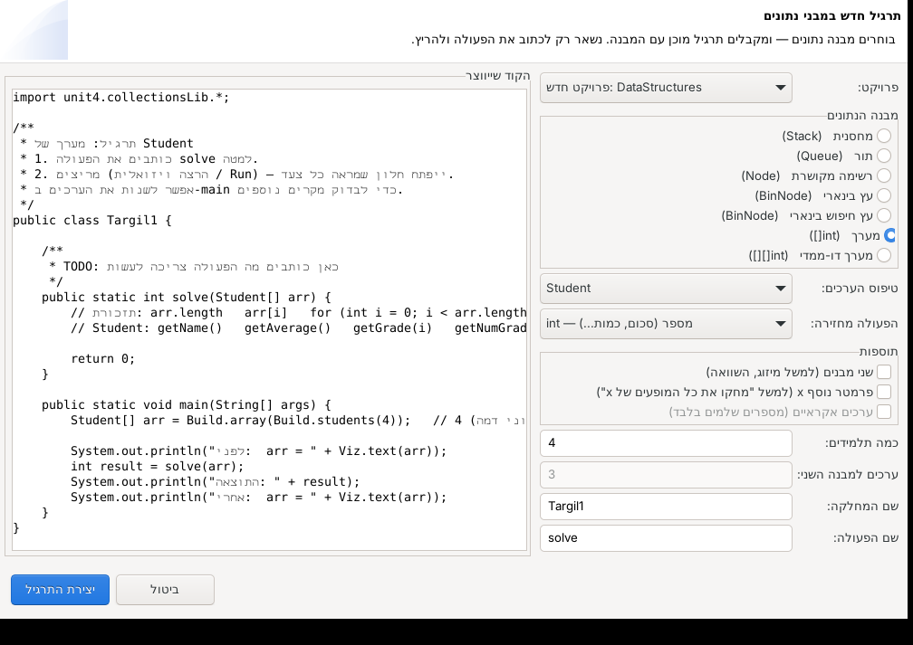

# מעטפת ויזואלית למבני נתונים — מחסנית, תור, רשימה מקושרת ועץ

כותבים פונקציה רגילה ב-Java, לוחצים **Run**, ונפתח חלון שמראה את ההרצה **צעד אחר צעד**:

- **המבנים עצמם** — מחסניות, תורים, רשימות מקושרות ועצים, מצוירים ומתעדכנים בכל צעד
- **שורת הקוד** שרצה עכשיו (מודגשת בצהוב)
- **מחסנית הקריאות** — רואים כל קריאה רקורסיבית
- **הפלט** (System.out) עד אותו צעד

אפשר לנוע קדימה ואחורה, להריץ אוטומטית, ולקפוץ לכל צעד עם פס הגלילה.

ויש גם **הרצה שורה אחר שורה**: כל שורה בקוד היא צעד, עם **כל המשתנים המקומיים וערכיהם**,
ושמות המשתנים האמיתיים (`p`, `prev`, `temp`...) מופיעים לבד מעל החוליות והמבנים.


| היפוך רשימה מקושרת | הכנסה לעץ חיפוש (רקורסיה) |
|---|---|
|  |  |

---

## למה זה נוח

- **אותו API בדיוק כמו בספריית הבגרות** (`unit4.collectionsLib`):
  `Stack`, `Queue`, `Node`, `BinNode` עם `push/pop/top/isEmpty`, `insert/remove/head`,
  `getValue/getNext/setNext/hasNext`, `getLeft/getRight/setLeft/setRight/hasLeft/hasRight`.
  קוד קיים רץ כמו שהוא — רק `import unit4.collectionsLib.*;`
- **אפס מעטפת בקוד של התלמידים.** אין צורך לקרוא לשום פונקציית ציור — כל פעולה מתועדת אוטומטית.
- **בניה בשורה אחת** של מבנים לבדיקה: `Build.stack(1, 2, 3)`, `Build.list(4, 7, 1)`, `Build.tree(...)`.
- **שמות המשתנים מזוהים אוטומטית** מהקוד (`Stack<Integer> temp = new Stack<>()` יוצג בשם temp).
- Java טהורה (8 ומעלה), בלי ספריות חיצוניות. עובד ב-**Eclipse**, ב-**VS Code** ומשורת הפקודה.

---

## התקנה בכל מחשב (תוסף ל-VS Code ול-Eclipse)

**Windows — [`release/DSViz-Setup.exe`](release/DSViz-Setup.exe):** לחיצה כפולה → הבא → התקן. זהו.

תוכנית ההתקנה (בעברית, בלי הרשאות מנהל):
- מוצאת לבד את VS Code ואת **כל** ההתקנות של Eclipse במחשב (בתיקיית המשתמש, בשולחן העבודה, בהורדות, ב-`C:\`, ב-Program Files...)
  ומתקינה בכל אחת. אם לא מצאה Eclipse — שואלת איפה הוא.
- מתקינה ל-VS Code גם את Extension Pack for Java (אם יש אינטרנט).
- בודקת שיש Java במחשב, ואם אין — מציעה לפתוח את דף ההורדה.
- נרשמת ב"אפליקציות ותכונות" של Windows, עם הסרה מלאה.
- **למעבדת מחשבים:** `DSViz-Setup.exe /S` מתקין בשקט, בלי שאלות (וגם `uninstall.exe /S`).


**Mac / Linux — [`release/dsviz-install.zip`](release/dsviz-install.zip):** פותחים, ומריצים `install-mac.command` (לחיצה כפולה ב-Mac) או `./install.sh`.

אחרי ההתקנה — סוגרים ופותחים מחדש את VS Code / Eclipse.

נדרש במחשב: **JDK** (Java 8 ומעלה; להרצה שורה אחר שורה — 11 ומעלה. מומלץ 17 או 21),
ו-VS Code ו/או Eclipse 2020 ומעלה. ב-Eclipse החדש Java כבר כלול.

### איך זה נראה בתוך התוכנה

**VS Code:** בסרגל הצד מופיע סמל **מבני נתונים** עם כפתורים: מחסנית · תור · רשימה מקושרת · עץ בינארי · עץ חיפוש.
בוחרים מבנה, עונים על כמה שאלות קצרות (טיפוס הערכים, מה הפעולה מחזירה, תוספות, ערכים, שמות),
ונפתח קובץ תרגיל מוכן עם הסמן במקום שבו כותבים. אחרי כתיבת הפעולה לוחצים **הרצה ויזואלית**
(כפתור למעלה מימין, בשורת המצב, או `Ctrl+Alt+R`) או **שורה אחר שורה** (`Ctrl+Alt+L`). אם התיקייה עוד לא מוגדרת — התוסף מגדיר אותה לבד
(מעתיק את הספרייה ל-`lib/` ומוסיף הגדרות Java).

**Eclipse:** בתפריט העליון מופיע **מבני נתונים** (וגם כפתורים בסרגל הכלים):
"תרגיל חדש: מחסנית / תור / רשימה / עץ…", "הרצה ויזואלית", "הרצה שורה אחר שורה" ו"דוגמאות פתורות".
בחלון "תרגיל חדש" בוחרים מבנה, טיפוס, מה הפעולה מחזירה ותוספות — ורואים **תצוגה מקדימה של הקוד**.
אם אין פרויקט מתאים נוצר פרויקט `DataStructures`, והספרייה נוספת ל-Build Path אוטומטית.

| בחירה | אפשרויות |
|---|---|
| מבנה | מחסנית, תור, רשימה מקושרת, עץ בינארי (לפי רמות), עץ חיפוש בינארי |
| טיפוס | `Integer`, `String`, `Character`, `Double` |
| הפעולה מחזירה | `void`, `int`, `boolean`, ערך מהמבנה, מבנה חדש |
| תוספות | שני מבנים (מיזוג/השוואה), פרמטר נוסף `x`, ערכים אקראיים |



### בלי תוסף (הפרויקט הזה כמו שהוא)

- **Eclipse:** `File → Import → General → Existing Projects into Workspace` → בוחרים את `java-visualizer`.
- **VS Code:** `File → Open Folder` → בוחרים את `java-visualizer` (עם Extension Pack for Java).
- **שורת פקודה:** `run.bat` / `./run.sh` / `./run.sh examples.ListExamples`
- **פרויקט קיים:** מוסיפים את `release/dsviz.jar` ל-Build Path. אם כבר מחובר ה-jar המקורי של unit4 — יש להסיר אותו
  (אחרת יהיו שתי מחלקות `Stack` באותו שם). התוספים מזהים התנגשות כזו ומציעים להסיר אותה.

---

## הרצה שורה אחר שורה

בכפתור **שורה אחר שורה** (בשני התוספים) כל שורה שהתוכנית מבצעת היא צעד בחלון:

- **השורה עצמה** מודגשת בקוד ומופיעה בכותרת (למשל `שורה 20: total += x;`).
- **טבלת משתנים**: כל המשתנים המקומיים של הפעולה הנוכחית וערכיהם — מספרים, תווים, מחרוזות, מערכים ומבנים.
  ערך שהשתנה מאז השורה הקודמת צבוע **בצהוב**.
- **שמות המשתנים מעל המבנים**: `cur`, `prev`, `next` מעל החוליות שהם מצביעים עליהן, `temp` כשם המחסנית — לבד,
  בלי `Viz.point`. ברקורסיה רואים בכל קריאה את המשתנים שלה.
- הפעולות על המבנים (`push`, `setNext`...) מופיעות בין השורות, כך שרואים גם את השורה וגם מה היא עשתה.


איך זה עובד: התוכנית רצה בתהליך נפרד תחת ממשק הדיבאג של Java (JDI), שעוצר אותה לפני כל שורה בקוד של התלמיד
וקורא את המשתנים. לכן זה איטי יותר מהרצה רגילה (בערך אלפית שנייה לשורה), ונעצר אחרי 5000 צעדים.
**בלי תוסף:** כותבים `Viz.lines();` כשורה הראשונה ב-`main` ומריצים כרגיל.
דורש JDK 11 ומעלה; בגרסה ישנה יותר התוכנית פשוט רצה רגיל (עם הודעה).

---

## איך נראה תרגיל

```java
import unit4.collectionsLib.*;

public class Main {

    // כאן כותבים את הפונקציה של התרגיל
    public static int sum(Stack<Integer> s) {
        Stack<Integer> temp = new Stack<Integer>();
        int total = 0;
        while (!s.isEmpty()) {
            int x = s.pop();
            total += x;
            temp.push(x);
        }
        while (!temp.isEmpty()) {
            s.push(temp.pop());
        }
        return total;
    }

    public static void main(String[] args) {
        Stack<Integer> s = Build.stack(4, 7, 1, 9);   // 9 בראש המחסנית
        System.out.println("הסכום: " + sum(s));
    }
}
```

בתיקייה `src/examples` יש דוגמאות מוכנות להרצה:

| קובץ | מה מודגם |
|---|---|
| `StackExamples` | היפוך מחסנית עם מחסנית עזר, הכנסה לתחתית ברקורסיה |
| `QueueExamples` | ספירת איברים בלי להרוס את התור, מחיקת כל המופעים של ערך |
| `ListExamples`  | סכום, מחיקת חוליה, היפוך רשימה במקום (עם תוויות `p`, `prev`, `cur`) |
| `TreeExamples`  | מספר צמתים, גובה, הכנסה לעץ חיפוש בינארי |

---

## החלון

| אזור | מה רואים |
|---|---|
| למעלה | כפתורי ניווט, מהירות, ומונה "צעד X מתוך Y" |
| פס צבעוני | מה קרה בצעד הזה (למשל `temp.push(9)`), באיזו שורה ובאיזו פעולה |
| מבנים | כל המבנים הקיימים כרגע. המבנה שהצעד נגע בו מסומן בכותרת כחולה |
| קוד | הקובץ, עם השורה הנוכחית מודגשת |
| מחסנית הקריאות | הקריאה הפעילה למעלה, `main` למטה |
| פלט | כל מה שהודפס עד הצעד הזה |

**צבעים:** ירוק = נוסף / נוצר · צהוב = נקרא · כתום = שונה · אדום מקווקו = הוצא (pop / remove) ·
מסגרת כתומה ומשולש = החוליה / הצומת האחרונים שהקוד נגע בהם.

**מקלדת:** חץ שמאלה / רווח / Enter = צעד הבא · חץ ימינה = צעד קודם · Home / End = התחלה / סוף · P = הפעלה אוטומטית.

**"להציג בדיקות"** — כשמבטלים את הסימון, הניווט מדלג על `isEmpty / hasNext / hasLeft / hasRight`
ורואים רק את הפעולות שמשנות או קוראות.

---

## פקודות עזר

### Build — בניה מהירה (נספרת כצעד אחד בלבד)
```java
Stack<Integer>   s = Build.stack(1, 2, 3);           // push לפי הסדר → 3 בראש
Queue<String>    q = Build.queue("a", "b", "c");      // insert לפי הסדר → "a" בראש התור
Node<Integer>  lst = Build.list(4, 7, 1);            // 4 -> 7 -> 1 -> null
BinNode<Integer> t = Build.tree(5, 3, 8, null, 4);    // לפי רמות, null = אין צומת
BinNode<Integer> b = Build.bst(5, 3, 8, 1, 4);        // עץ חיפוש בינארי
Stack<Integer>   r = Build.randomStack(6, 1, 20);     // וגם randomQueue / randomList / randomBst
```

### Viz — שליטה בתצוגה (הכול אופציונלי)
```java
Viz.point("p", p);          // תווית "p" מעל החוליה ש-p מצביע עליה (לקרוא שוב אחרי כל p = p.getNext())
Viz.name(s, "מקורית");      // לתת שם למבנה
Viz.note("עכשיו מתחילים");  // הערה שמופיעה כצעד
Viz.off();  ...  Viz.on();  // לא לתעד קטע קוד (למשל לולאה ארוכה)
Viz.maxSteps(20000);        // ברירת המחדל: 5000 צעדים
Viz.textMode();             // בלי חלון — הצעדים מודפסים לקונסול
Viz.lines();                // בשורה הראשונה של main: הרצה שורה אחר שורה (כשמריצים בלי התוסף)
```

---

## דברים שכדאי לדעת

- **חוליה שנעלמת מהתצוגה** — כשאף משתנה כבר לא מצביע על חוליה (למשל אחרי מחיקה מהרשימה),
  היא נאספת ע"י ה-Garbage Collector ונעלמת, בדיוק כמו בזיכרון האמיתי. הזדמנות טובה להסביר GC 🙂
- **חוליה ראשונה שנשארת** — אחרי `lst = lst.getNext()` החוליה הישנה עדיין מצביעה הלאה, ולכן יכולה להופיע
  עד שינוי המצביעים הבא. `Viz.point("lst", lst)` מראה לאן `lst` מצביע עכשיו.
- **מחסנית/תור עזר ריקים** שלא נגעו בהם זמן רב מוסתרים, כדי שהמסך לא יתמלא במבני עזר ישנים.
- **שגיאות** (למשל `pop()` על מחסנית ריקה, `NullPointerException`, רקורסיה אינסופית) מופיעות כצעד אדום
  בשורה שגרמה להן.
- **לולאה אינסופית** — אחרי 5000 צעדים התיעוד נעצר והחלון מציג הודעה. סוגרים את החלון כדי לעצור את התוכנית.
- **הקוד לא מוצג?** החלון מחפש את קובץ המקור בתיקיית הפרויקט. ב-Eclipse וב-VS Code זה עובד אוטומטית;
  בשורת הפקודה צריך להריץ מתוך התיקייה `java-visualizer`.
- **עברית בקוד** — הקבצים שמורים ב-UTF-8 (הפרויקט כבר מוגדר כך ב-Eclipse וב-VS Code).

---

## מבנה הקבצים

```
java-visualizer/
├── release/                       ← קובצי ההתקנה (נבנים ע"י tools/build-all.sh)
│   ├── DSViz-Setup.exe            ← תוכנית ההתקנה ל-Windows
│   ├── dsviz-install.zip          ← הכול + התקנה ל-Mac/Linux + מדריך
│   ├── dsviz-1.0.0.vsix           ← תוסף VS Code
│   ├── il.lamerhav.dsviz_1.0.0.jar← תוסף Eclipse (לתיקיית dropins)
│   └── dsviz.jar                  ← הספרייה עצמה
├── src/
│   ├── Main.java                  ← תבנית לתרגיל
│   ├── examples/                  ← דוגמאות פתורות
│   └── unit4/collectionsLib/      ← הספרייה: Stack, Queue, Node, BinNode, Build, Viz + מנוע התצוגה
│                                     (LineByLine + JdiTracer = הרצה שורה אחר שורה)
├── vscode-extension/              ← קוד התוסף ל-VS Code (JavaScript)
├── eclipse-plugin/                ← קוד התוסף ל-Eclipse (Java)
├── installer/                     ← setup.nsi (DSViz-Setup.exe), install.sh, README-he.html
└── tools/
    ├── build-all.sh               ← בונה את כל release/
    └── test/                      ← בדיקות: התאמת התבניות בין שני התוספים, ובדיקת התוסף של VS Code
```

### בנייה מחדש (רק למי שמשנה את הקוד)

```
tools/build-all.sh          # דורש JDK 11+, Python 3, Node.js, NSIS (makensis)
tools/test/run-tests.sh     # תבניות, קומפילציה, התוסף של VS Code, והרצה שורה-שורה
```

התבנית שיוצרת את קוד התרגיל כתובה פעמיים — `vscode-extension/templates.js` ו-`eclipse-plugin/src/.../Scaffold.java`.
שינוי באחת צריך להיעשות גם בשנייה; `tools/test/combos.js` + `ScaffoldAll.java` בודקים שהן מפיקות קוד זהה בכל 760 הצירופים.
