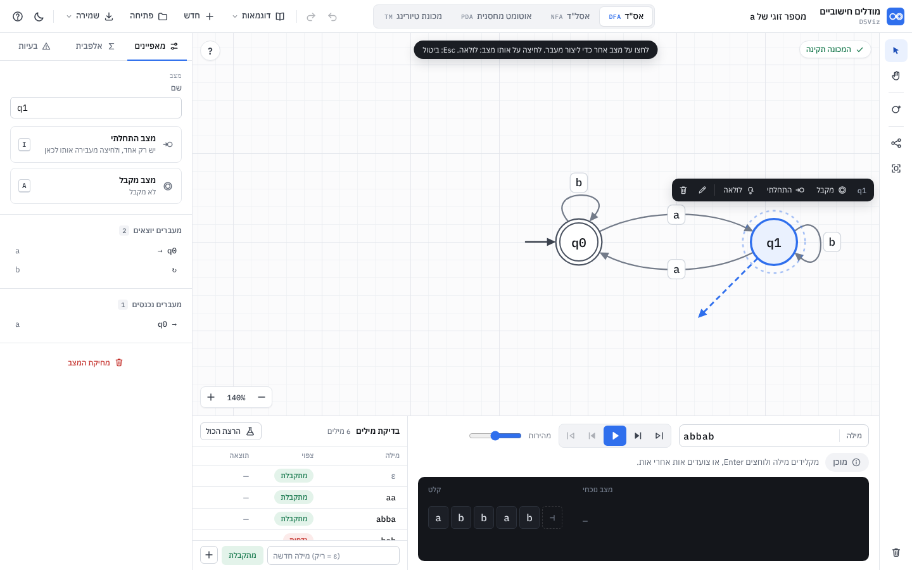
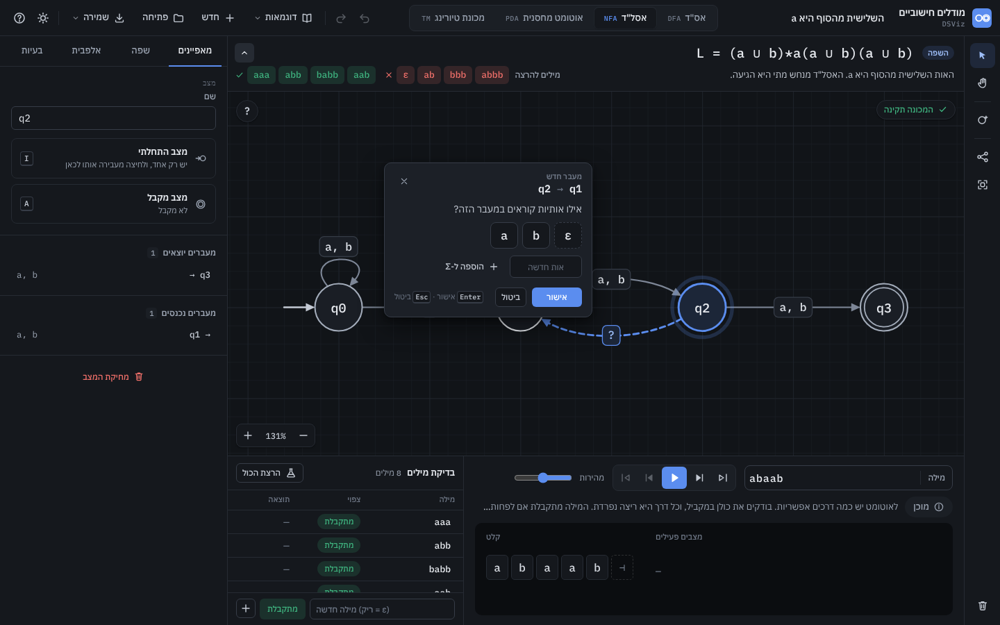
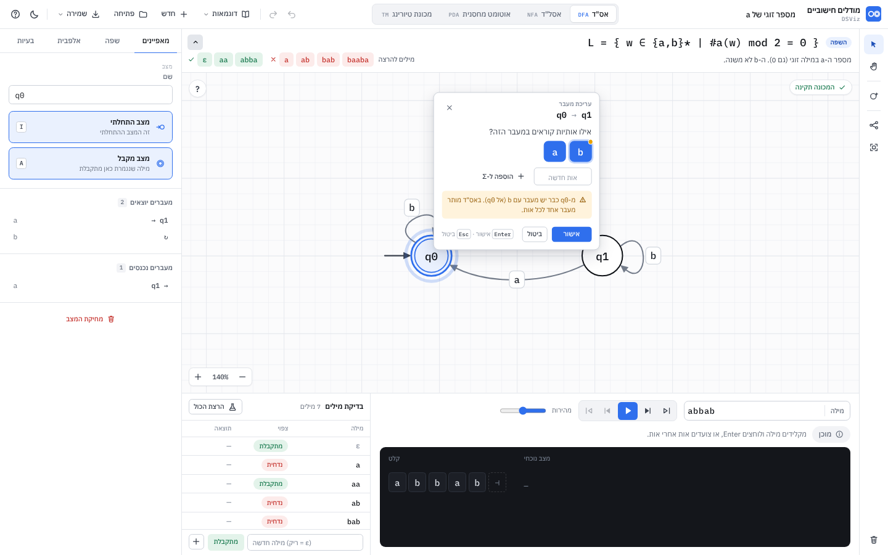
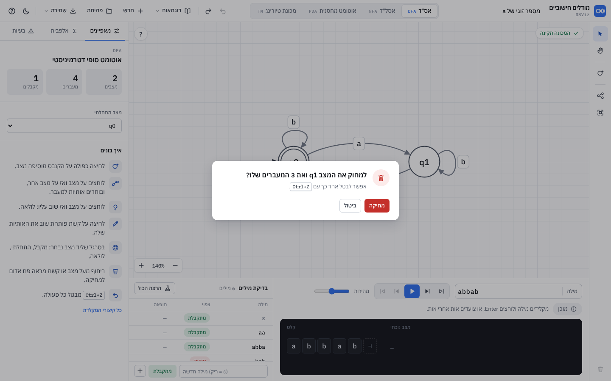
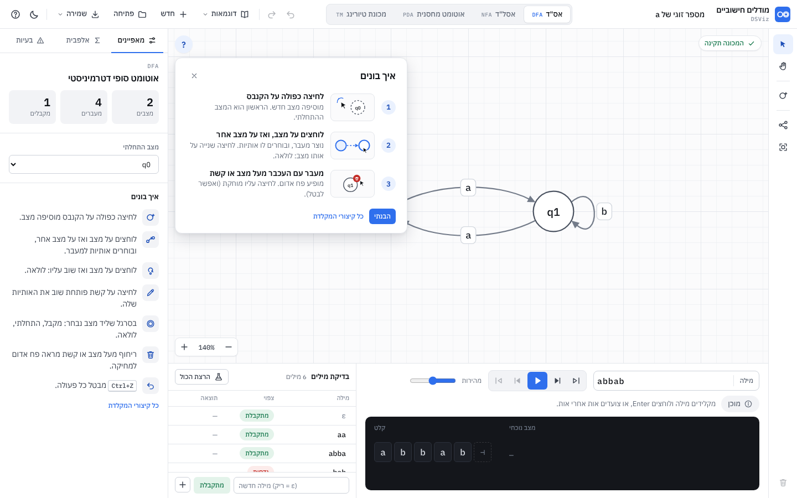
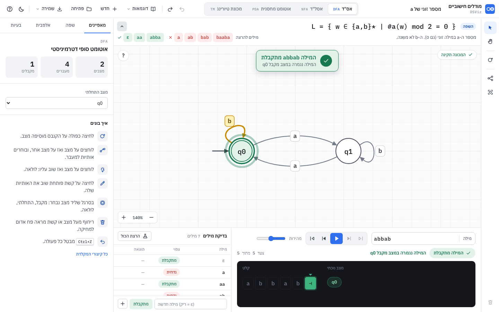
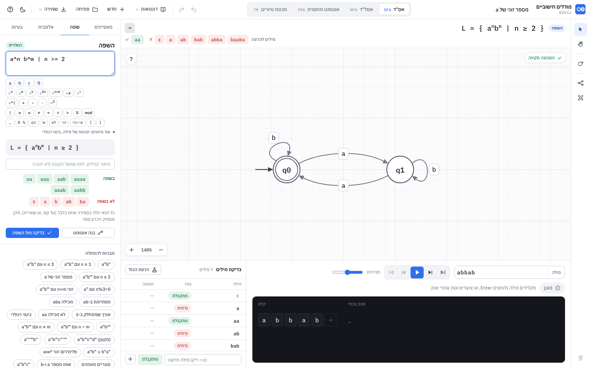
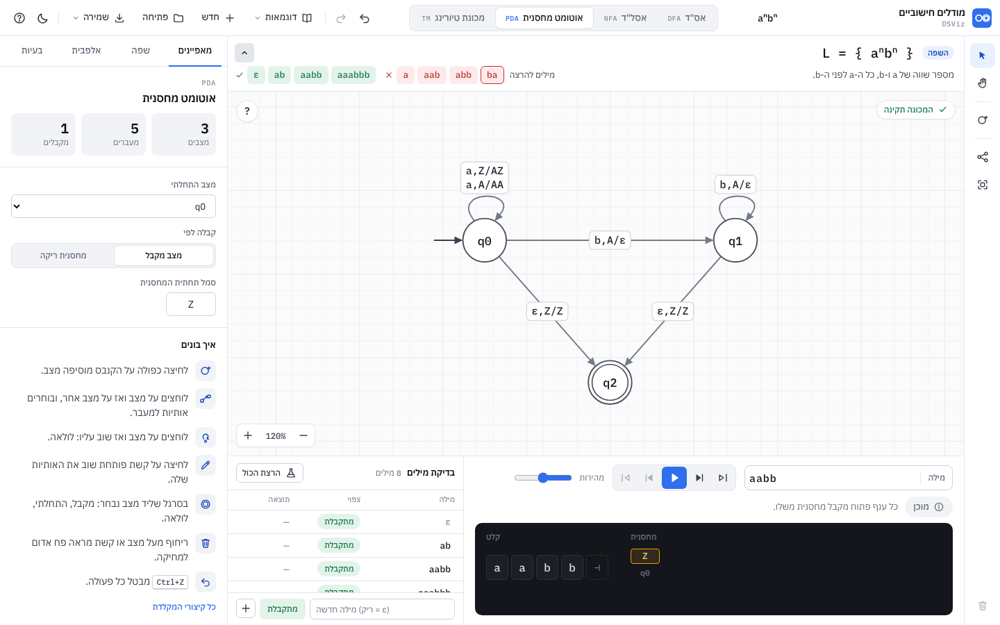
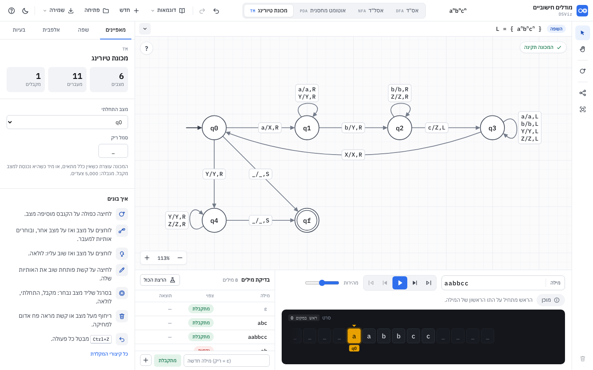

# מערכת העיצוב: מודלים חישוביים

המסמך הזה הוא מקור האמת לעיצוב. הקוד שלו: [`app/tokens.css`](../app/tokens.css) (אסימונים) ו-[`app/css/`](../app/css/) (רכיבים: `base`, `canvas`, `overlays`, `panels`, `run`).
כל צבע, גודל, רדיוס, צל וזמן בקוד חייב להגיע מאסימון. ערך קשיח מותר רק בתוך האזור הכהה של הסרט, שהוא כהה בשני המצבים.




## 1. עקרונות

1. **הדיאגרמה היא המסך.** הממשק מסביב שקט: אפורים עם גוון קל, קווים של 1px, צל רק על דברים שצפים (תפריט, סרגל ליד מצב, עורך, הודעה).
2. **שלושה צבעים עם משמעות, ולא יותר.** כחול = בחירה ופעולה ראשית. ענבר = "מה קורה עכשיו" בהרצה (המצב הפעיל, האות הנוכחית, הקשת שנלקחה). ירוק / אדום = התוצאה (מתקבלת / נדחית) ושגיאות. כל השאר אפור.
   זה ההמשך הישיר של DSViz: בחלון ההרצה של Java הצהוב הוא "השורה שרצה עכשיו", והכחול הוא "הבא".
3. **מתמטיקה נשארת LTR.** הממשק RTL, אבל הדיאגרמה, המילה, הסרט, המחסנית, תוויות המעברים ושמות המצבים הם LTR תמיד (פרק 8).
4. **תנועה רק כשהיא מסבירה.** נקודה שנוסעת על הקשת, טבעת שפועמת סביב המצב הפעיל, תא שנצבע. בלי אנימציות כניסה לאזורים.
5. **טקסט קצר שאומר מה קורה.** "אין מעבר מ-q1 עבור b, ולכן המילה נדחית". בלי מקף ארוך, בלי "חוויה", בלי סימני קריאה.

## 2. צבע

כל הערכים ב-`:root` (בהיר) וב-`:root[data-theme="dark"]` (כהה). ברירת המחדל: לפי `prefers-color-scheme`, ואחרי שהמשתמש בחר, לפי `localStorage['dsviz.automata.theme']`.
סקריפט קצר ב-`<head>` קובע את `data-theme` לפני הציור הראשון, כדי שלא יהבהב לבן.

### משטחים וקווים

| אסימון | בהיר | כהה | שימוש |
|---|---|---|---|
| `--bg` | `#F4F5F8` | `#0E1014` | רקע האפליקציה |
| `--panel` | `#FFFFFF` | `#15181D` | סרגלים, פאנלים |
| `--sunk` | `#F2F3F6` | `#1B1F25` | רקע שקוע: לשוניות, קבוצת כפתורים, ריחוף |
| `--raised` | `#FFFFFF` | `#1C2027` | תפריט, עורך, חלון |
| `--canvas` | `#FBFBFC` | `#111418` | הקנבס |
| `--grid` / `--grid-major` | `#EDEFF3` / `#E1E4EA` | `#191D23` / `#21262E` | משבצות 20px / 100px |
| `--line` | `#E3E6EB` | `#262B33` | קו מפריד 1px |
| `--line-strong` | `#CDD2DA` | `#363C47` | מסגרת שדה, תווית |
| `--overlay` | `rgba(14,17,22,.32)` | `rgba(0,0,0,.5)` | מאחורי חלון |

### טקסט

| אסימון | בהיר | כהה |
|---|---|---|
| `--ink` | `#0E1116` | `#E7EAEF` |
| `--ink-2` | `#3A414D` | `#C3C9D3` |
| `--muted` | `#646C7A` | `#9AA3B1` |
| `--faint` | `#8A92A0` | `#6F7887` |

### צבעים עם משמעות

| תפקיד | אסימונים | בהיר | כהה |
|---|---|---|---|
| הדגשה / בחירה | `--accent`, `-hover`, `-press`, `-soft`, `-ink` | `#2F6FED` `#2560D6` `#1D50B8` `#EAF1FE` `#1D4FB8` | `#5B8DEF` `#6F9BF2` `#4A7BDD` `rgba(91,141,239,.14)` `#9DBDF7` |
| עכשיו (הרצה) | `--now`, `-strong`, `-soft`, `-ink` | `#E8A100` `#C98A00` `#FFF1B8` `#6E4A00` | `#F2B33D` `#F5C15C` `rgba(242,179,61,.18)` `#F7CF7A` |
| מתקבלת | `--ok`, `--ok-soft` | `#18794E` `#E3F3EA` | `#3FB37F` `rgba(63,179,127,.16)` |
| נדחית / שגיאה | `--err`, `--err-soft` | `#C4302B` `#FCEBEA` | `#F0706A` `rgba(240,112,106,.15)` |
| אזהרה | `--warn`, `--warn-soft` | `#935800` `#FFF3DC` | `#E5A445` `rgba(229,164,69,.15)` |

**מילוי בתוך SVG:** בכהה ה-`-soft` שקופים, ובתוך הדיאגרמה שקיפות חושפת את הקו שמתחת לתווית. לכן יש גרסאות אטומות: `--accent-fill`, `--now-fill`, `--ok-fill`, `--err-fill` (בהיר: זהים ל-soft. כהה: `#1C2638`, `#3A301C`, `#16302A`, `#3A2124`).

### הדיאגרמה

| אסימון | בהיר | כהה |
|---|---|---|
| `--state-fill` | `#FFFFFF` | `#1A1E25` |
| `--state-stroke` | `#4B5361` | `#A3ACBA` |
| `--state-text` | `#0E1116` | `#E7EAEF` |
| `--edge` / `--edge-hover` | `#737B89` / `#3A414D` | `#7D8696` / `#C3C9D3` |
| `--label-bg` / `--label-line` / `--label-text` | `#FFFFFF` / `#D3D8DF` / `#1E232B` | `#1A1E25` / `#363C47` / `#DCE0E7` |

### משטחים הפוכים וכהים

- **סרגל צף** (ליד מצב נבחר, רמז, הודעה): `--float-bg` `#1A1D23` (כהה: `#2A2F38`), `--float-ink` `#E7EAEF`, `--float-muted` `#9AA3B1`, `--float-hover` `rgba(255,255,255,.1)`.
- **אזור הסרט** (בחלון ההרצה): כהה בשני המצבים, בגוון ה-IDE של DSViz. `--tape-bg` `#14161B` (כהה `#0B0D10`), `--tape-cell` `#1C1F26`, `--tape-line` `#2C313B`, `--tape-ink` `#D5D9E0`, `--tape-muted` `#6F7887`.
  בתוכו הצבעים קבועים: תא נוכחי `--now` עם טקסט `#1F1600`; ראש המחסנית `rgba(242,179,61,.13)` עם מסגרת `--now` וטקסט `#F7CF7A`; הצלחה `#3FB37F`, כישלון `#F0706A`.

**ניגודיות:** טקסט רגיל לפחות 4.5:1 מול הרקע שלו (נמדד בבהיר: `--muted` על `--panel` 5.3:1, `--ok` על `--ok-soft` 4.7:1, `--err` על `--err-soft` 4.8:1, `--warn` על `--warn-soft` 5.2:1, טקסט על תא נוכחי בסרט 8.1:1). `--faint` רק לטקסט משני שאינו הכרחי (מספרי עמודה, רמזים).

## 3. טיפוגרפיה

| תפקיד | גופן | הערות |
|---|---|---|
| ממשק | **IBM Plex Sans Hebrew** (`--sans`) | עברית אמיתית, תוכנן לממשקי תוכנה. אותו גופן כמו האתר של DSViz |
| סמלים, מילים, שמות מצבים, מספרים, תוויות | **IBM Plex Mono** (`--mono`) | מאותה משפחה, אז `q0` בתוך משפט בעברית לא "קופץ" |
| ε Σ Γ δ | JetBrains Mono, תת-קבוצה יוונית בלבד | ל-Plex Mono אין יוונית. `unicode-range: U+0370-03FF` |

הגופנים מקומיים ב-`app/fonts/` (woff2, כ-130KB בסך הכול), כי בכיתה לא תמיד יש אינטרנט והכלי נפתח מ-`file://`. משקלים: 400 / 500 / 600 בלבד.

| אסימון | גודל | שימוש |
|---|---|---|
| `--fs-11` | 11px | כותרות עמודה, תגיות |
| `--fs-12` | 12px | טקסט משני, כפתור קטן, רמזים |
| `--fs-13` | 13px | **ברירת המחדל של הממשק** |
| `--fs-14` | 14px | שדות, שם מכונה, שם מצב (mono) |
| `--fs-16` | 16px | כותרת בפאנל, תא בסרט (mono) |
| `--fs-20` | 20px | כותרת של מצב ריק |

גובה שורה 1.45. כותרות: משקל 600, `letter-spacing: -0.01em`. מספרים בטבלה ובמונים: mono.
גדלים בתוך ה-SVG (ביחידות עולם, מוכפלים בזום): שם מצב 14px (12px ל-5-6 תווים, 10.5px ל-7 ומעלה), תווית 12.5px.

## 4. ריווח, רדיוס, צל

**ריווח** (כפולות של 4): `--s-1` 4 · `--s-2` 8 · `--s-3` 12 · `--s-4` 16 · `--s-5` 20 · `--s-6` 24 · `--s-8` 32 · `--s-10` 40.
ריווח פנימי של פאנל: 16. בין שדות: 12. בין כפתורים בקבוצה: 2 (בתוך מסגרת) או 8 (חופשיים).

**רדיוס:** `--r-xs` 4 (תג, תא מחסנית) · `--r-sm` 6 (כפתור, שדה קטן, תווית קשת 5) · `--r-md` 8 (שדה, קבוצת כפתורים, תפריט פריט) · `--r-lg` 10 (פאנל צף, אזור הסרט, תפריט) · 12 (חלון) · `--r-full` (תג מצב, צ'יפ).
רדיוס מקונן: הפנימי = החיצוני פחות הריפוד (קבוצת כפתורים 8 עם ריפוד 2 → כפתור 6).

**צל:** `--shadow-1` (`0 1px 2px` 6%) לרכיבים שיושבים על הקנבס (זום, תג תקינות). `--shadow-float` לסרגל צף והודעות. `--shadow-pop` לתפריט, עורך וחלון. אין צל על פאנלים קבועים.
**פוקוס:** `--focus` = טבעת 3px בכחול 28%. כל רכיב אינטראקטיבי מראה אותה ב-`:focus-visible`.

## 5. פריסה

```
┌──────────────────────────────────────────────────────────── topbar 52 ─┐
│ [פעולות]            [ אס"ד | אסל"ד | אוטומט מחסנית | מכונת טיורינג ]   [שם] [מותג] │
├──────────── side 328 ─┬──────────────────── stage ──────────────┬ rail 52 ┤
│ מאפיינים|שפה|אלפבית|  │ [˄] פס השפה: [השפה] L = { aⁿbⁿ }         │  ▸ בחירה │
│ בעיות                │     מילים להרצה [ε][ab][aab]   תיאור     │  ✋ הזזה │
│                      ├──────────────────────────────────────────┤  ○ מצב+  │
│ איך בונים (רשימה)    │ [?]     [באנר תוצאה]      [תג תקינות]  │          │
│                      │       הקנבס (+ חלון צף, סרגל ליד מצב)    │          │
│                      │                                          │  ⋯       │
│                      │ [זום]                                     │          │
│                      ├──────────── run 244 ─────────────────────┤          │
│                      │ בדיקות 340 │ מילה · בקרה · מהירות          │  🗑      │
│                      │            │ מצב · הערה · צעד               │          │
│                      │            │ ███ סרט / מחסנית ███          │          │
└──────────────────────┴────────────┴──────────────────────────────┴──────────┘
```
(השרטוט כמו שהוא נראה על המסך: RTL, אז סרגל הכלים מימין והפאנל משמאל.)
פס השפה הוא שורה בפריסה (`.stage-col` הוא flex בעמודה: הפס, ומתחתיו הקנבס), ולא שכבה מעל הקנבס. כשאין למכונה שפה, הוא לא קיים והקנבס מקבל את כל הגובה.

`grid-template-columns: var(--rail-w) minmax(0,1fr) var(--side-w)` עם `dir="rtl"`, כך שהעמודה הראשונה (הכלים) יוצאת מימין.
**גודל (סבב 6):** כל הממשק מוצג ב-90%: `html { zoom: var(--ui-zoom) }` עם `--ui-zoom: 0.9`, וגובה `.app` הוא `calc(100vh / var(--ui-zoom))` כדי למלא את החלון. כל המידות בקבצים נשארות בפיקסלים של CSS; על המסך הן קטנות ב-10%. מיקום העכבר (clientX/Y, פיקסלים של המסך) מומר לפיקסלים של CSS ב-`CanvasView.local()` לפי `uiScale()` (היחס בין הרוחב על המסך לרוחב ב-CSS), וכך גם הזזת הקנבס והגלגלת. הזום של הקנבס (%) לא השתנה. חלון ההרצה: `--run-h: 292px` (היה 244), כך שבחלון של 1440×900 נכנסות לפחות חמש שורות דרכים שלמות.
מתחת ל-1280px: פאנל 280, בדיקות 300. מתחת ל-1120px: כפתורי הסרגל העליון בלי טקסט. מתחת ל-900px הכלי לא נתמך (כלי לשולחן עבודה; שלב 6 ב-SPEC).

## 6. רכיבים

### כפתורים

| וריאנט | רגיל | ריחוף | לחיצה | מושבת |
|---|---|---|---|---|
| `primary` | רקע `--accent`, טקסט לבן | `--accent-hover` | `--accent-press`, `translateY(1px)` | שקיפות 38% |
| `secondary` | `--panel`, מסגרת `--line-strong`, טקסט `--ink-2` | רקע `--sunk`, טקסט `--ink` | רקע `--line` | 38% |
| `ghost` | שקוף, `--ink-2` | `--sunk` | `--line` (גם כשהתפריט שלו פתוח) | 38% |
| `icon` | ריבוע 32 (או 28 ב-`sm`), אייקון 18-20 | לפי הווריאנט | | |
| `danger-ghost` | שקוף, טקסט `--err` | `--err-soft` | | |
| כלי (סרגל) | 36×36, רדיוס 8, `--ink-2` | `--sunk` | | פעיל (`aria-pressed=true`): `--accent-soft` + `--accent-ink` |

גובה: 32 (רגיל), 28 (`sm`). ריפוד צד 10 / 8. מעבר צבע `120ms var(--ease)`. כל כפתור אייקון חייב `aria-label` ו-`title` עם קיצור המקלדת בסוגריים.

### לשוניות סוג המכונה
מקטעים (segmented) על `--sunk` עם מסגרת. לשונית: גובה 30, ריפוד 0 14, טקסט 13/500 `--muted`. נבחרת: רקע `--panel`, צל `--shadow-1` + טבעת `--line`, טקסט `--ink`.
ליד השם העברי תג אנגלי קטן ב-mono 10px (`DFA`, `NFA`, `PDA`, `TM`), כחול בלשונית הנבחרת. מתחת ל-1120px התג נעלם.

### שדות
גובה 34, רדיוס 6, מסגרת `--line-strong`, ריפוד 0 10. פוקוס: מסגרת `--accent` + `--focus`. שגיאה: מסגרת `--err`, ובעורך שעל הקנבס גם רעידה (`shake .32s`). שדה של סמלים / מילה / שם מצב: `dir="ltr"` ו-mono 14-15.

### סרגל ליד מצב נבחר
משטח `--float-bg`, רדיוס 10, ריפוד 4, צל `--shadow-float`. 8px מעל המצב, ואם שם הוא מכסה תווית או מצב אחר, מתחתיו (`placeBox`). תוכן: שם המצב (mono, `--float-muted`), **מקבל**, **התחלתי**, **לולאה**, קו מפריד, שינוי שם, מחיקה.
כפתור פעיל (התחלתי/מקבל דלוקים): `rgba(91,141,239,.24)` וטקסט `#B9D0FA`. מחיקה בריחוף: אדום. נעלם בזמן גרירה, עריכה, חלון צף והרצה.

### החלון הצף של מעבר


`--raised`, מסגרת `--line-strong`, רדיוס 10, צל `--shadow-pop`, רוחב 300 (352 עם כללי PDA/TM), נכנס ב-`rise`. ליד התווית של הקשת, במקום שמכסה הכי מעט.
- כותרת: תווית קטנה "מעבר חדש" / "עריכת מעבר" (11/600 `--faint`) ומתחת `q0 → q1` (mono 15/600). × בפינה.
- שאלה: "אילו אותיות קוראים במעבר הזה?" (14px `--ink-2`).
- **צ'יפ אות:** 40×38 לפחות, רדיוס 8, mono 17/500, מסגרת 1.5px `--line-strong`. ריחוף: מסגרת כחולה. לחיצה: `scale(.96)`. נבחר: רקע ומסגרת `--accent`, טקסט לבן. `ε`: מסגרת מקווקוות עד שנבחר. הצעה (`+ a`): מקווקו, `--muted`, 14px. **התנגשות** באס"ד: נקודה ענברית 9px בפינה העליונה.
- שדה "אות חדשה": 104×32, ממורכז, mono 15. אזהרה: רקע `--warn-soft`, טקסט `--warn` 12px עם ⚠. שגיאה: `--err` 12px, והחלון רועד (`shake`).
- כללי PDA / TM: grid של שדות 34px ממורכזים (mono 15), כותרות עמודה 11/600; כיוון ב-TM: שלושה כפתורים `← L` `• S` `→ R` בקבוצה שקועה, הנבחר כחול.
- תחתית: "אישור" (ראשי, `sm`, לפחות 72px), "ביטול" (משני), ורמז מקשים 11px בצד.

### פח בריחוף
עיגול ברדיוס 10 ב-`--err`, מסגרת 2px בצבע הקנבס, ובתוכו פח לבן (קו 1.5). במצב: בפינה הימנית העליונה (‎+0.78R, ‎-0.78R). בתווית: 8px אחרי הקצה הימני שלה, באמצע הגובה. מופיע רק בריחוף (שקיפות 0 → 1 ב-120ms), בריחוף על הפח עצמו: `#A3221D`. לא מופיע בזמן מעבר שהתחיל, חלון צף או הרצה.

### חלון אישור


רקע `--overlay`, חלון 440px, רדיוס 12, ריפוד 20/22. אייקון בעיגול 40px (`--err-soft` / `--err` למחיקה), כותרת 16/600 שנשברת יפה (`text-wrap: pretty`), הסבר 13 `--muted`. כפתורים: "מחיקה" (`btn danger`: `--err`, לבן; ריחוף `#A3221D`) ראשון מימין עם פוקוס, ואחריו "ביטול".

### כרטיס ההדרכה


`--raised`, רדיוס 12, צל `--shadow-pop`, 420px. במצב ריק: במרכז הקנבס, `pointer-events: none` חוץ מהכפתורים (כדי שלחיצה כפולה עליו תוסיף מצב). כשנפתח מ-"?": בפינה השמאלית העליונה, מתחת לכפתור. כותרת 17/600. שלוש שורות: מספר בעיגול 26px (`--accent-soft`), איור 80×50 על `--canvas` עם מסגרת, כותרת 14/600 והסבר 13 `--muted`.
האיורים (SVG בקוד): מצבים בצבעי הקנבס, הסמן ב-`--ink`, החץ והבחירה בכחול, הפח באדום. כפתור "?": עיגול 32px, `--panel`, מסגרת `--line`; פתוח: `--accent-soft`.

### "איך בונים" בפאנל
רשימה, שורה לכל פעולה, רווח 10. אייקון 18 בריבוע 30×30 (`--sunk`, רדיוס 8, `--accent-ink`), טקסט 14px בגובה שורה 1.5, `--ink-2`, נשבר לשורות (`overflow-wrap: anywhere`) ואף פעם לא נחתך. מקשים: `<bdi class="kbd-iso"><kbd dir="ltr">`.

### באנר התוצאה


למעלה במרכז הקנבס, רדיוס 12, מסגרת 1px בצבע התוצאה, רקע `--ok-fill` / `--err-fill` / `--warn-soft`, צל `--shadow-float`. עיגול 34px בצבע התוצאה עם ✓ / ✗ / ⚠ לבן (בכהה: כהה), כותרת 16/600 ("המילה `abba` מתקבלת"), והסיבה 13px `--ink-2`. נכנס ב-`banner` (0.42s, קפיצה קלה). התג הקטן בחלון ההרצה נשאר, לקוראי מסך ולמי שמסתכל למטה.

### תג מצב ההרצה
גלולה בגובה 30: `idle` (`--sunk`, "מוכן"), `run` (`--accent-soft`, "בהרצה"), `ok` (`--ok-soft`, ✓ "המילה מתקבלת"), `err` (`--err-soft`, ✗ "המילה נדחית" / "יש לתקן את המכונה"), `warn` (`--warn-soft`, "לא הוכרע"). בסוף הרצה: `pop .4s`.

### תג תקינות על הקנבס
פינה ימנית עליונה של הקנבס. ✓ "המכונה תקינה" (ירוק, לא לחיץ) / ⚠ "2 אזהרות" (כתום) / ✗ "שגיאה אחת" (אדום על `--err-soft`). לחיצה פותחת את לשונית "בעיות".

### סרט, מחסנית, צ'יפים (באזור הכהה)
- **תא בסרט:** 32×36, רדיוס 5, mono 16/500. נקרא: טקסט `--tape-muted`, רקע שקוף. נוכחי: רקע `--now`, טקסט `#1F1600`, טבעת 3px ענבר 22%, ומשולש 5px מעליו (הראש). סוף המילה: תא מקווקו עם `⊣`; כשהראש מגיע אליו בסוף ההרצה הוא נצבע ירוק / אדום.
- **מכונת טיורינג:** אותו תא; ריק (`_`) בשקיפות 55%; מתחת לתא של הראש תג ענבר עם שם המצב. חלון של 19 תאים סביב הראש, עם דהייה בקצוות.
- **מחסנית:** עמודה לכל ענף (עד 6, ואז "+n"), 4 תאים גלויים (42×22, רדיוס 4) ומעליהם "+n" אם יש עוד. הראש למעלה, במסגרת ענבר. מתחת: שם המצב של הענף.
- **צ'יפ מצב פעיל:** גלולה 30, mono 13/600, ענבר שקוף; בסוף הרצה מקבלת: ירוק.

### טבלת הבדיקות
שורה 34. מילה ב-mono (לחיצה טוענת אותה לחלון ההרצה ומריצה). "צפוי": גלולה ירוקה "מתקבלת" / אדומה "נדחית" (לחיצה מחליפה). "תוצאה": ✓ ירוק / ✗ אדום עם מה שקרה, או "—" לפני הרצה. שורה שנכשלה: רקע `--err-soft`. מחיקה: × שמופיע בריחוף.

### לשונית "שפה"


- **שדה הנוסחה:** `textarea` משמאל לימין, mono 15/500, גובה מינימלי 58, מסגרת 1.5px `--line-strong` (במיקוד: `--accent` + טבעת; בשגיאה: `--err`). בקובץ תרגיל: לקריאה בלבד על `--sunk`.
- **מקלדת הסימנים:** כפתורים 23×23 (רדיוס `--r-sm`, mono 11), בקבוצות עם רווח 6 ביניהן; אזור הלחיצה גדול ב-2px לכל צד (`::after`), לפחות 24px על המסך. האותיות של Σ בצבע `--accent-ink`. חזקות מוצגות כ-`x` אפור עם החזקה מעליו (`xⁿ`, `xⁿ⁺ᵐ`), כדי שיהיה ברור מה נכנס. שורה נפרדת לחזקה מורכבת: `x^(`, `+`, `−`, `·`, `n²`; ו-`%` ליד `mod`. "עוד סימנים" נפתח מתחת (`details`). לחיצה לא גונבת את הפוקוס מהשדה.
- **כתיבה יפה:** קופסה על `--sunk` (רדיוס `--r-md`), mono 16/500, משמאל לימין, חזקות ב-`<sup>` (72%), גם חזקה מורכבת (`aⁿ⁺ᵐ`, `a^(n²)` עם `<sup>` בתוך `<sup>`). איחוד ושרשור: כל חלק בסוגריים מסולסלים, `∪` או `·` ביניהם. מילים בעברית בתוכה ב-sans 82% בצבע `--ink-2`. בשגיאה הקופסה על `--err-soft`: הטקסט המקורי עם המקום מסומן בקו תחתון אדום, ההודעה (13/600) וההצעה (12).
- **תיאור במילים:** שדה נמוך (30) מתחת לכתיבה היפה, רשות.
- **סיווג:** גלולה 20 ליד הכותרת: רגולרית = `--ok-soft` / `--ok`; חסרת הקשר (גם "חסרת הקשר" בלי טענה על רגולריות) = `--accent-soft` / `--accent-ink`; לא חסרת הקשר = `--warn-soft` / `--warn`; לא סווגה = `--sunk` / `--muted`. ההסבר בשורה אפורה מתחת למילים.
- **צ'יפ של מילה** (`.w-chip`): גובה 26, רדיוס `--r-sm`, mono 13/500. בשפה: `--ok-soft` / `--ok`. לא בשפה: `--err-soft` / `--err`. בריחוף: מסגרת בצבע הטקסט. המילה הריקה מוצגת `ε`. אותו רכיב בלשונית, בתוצאת הבדיקה ובפס השפה.
- **תוצאה:** קופסה עם אייקון (רדיוס `--r-md`): הצלחה על `--ok-soft`, כישלון על `--err-soft`, מידע על `--sunk`. כותרת 14/600, הסבר 12. מתחת לכישלון שתי רשימות של צ'יפים עם כותרת ירוקה / אדומה.
- **תבניות:** גלולות 28 עם מסגרת, 12/500. בריחוף: `--accent-soft`.

### פס השפה (מעל הקנבס)


רקע `--panel`, קו תחתון `--line`, ריפוד 10 / 14. שתי שורות:
1. **תגית** (גלולה 20, `--accent-soft` / `--accent-ink`, 11/600: "השפה" או "תרגיל"), **הנוסחה** (mono 19/500, משמאל לימין, חזקות 68%, מילים בעברית ב-sans 80%), ובקצה **כפתור הקיפול** (אייקון חץ, מסתובב 180° כשהפס פתוח).
2. **התיאור** (13, `--ink-2`, שורה אחת) ובקצה השני **"מילים להרצה"** (12/500 אפור) עם הצ'יפים, בשתי קבוצות: ✓ ירוק ואחריו המילים שבשפה, ✗ אדום ואחריו המילים שאינן בה. האייקון שם כדי שהצבע לא יהיה הסימן היחיד. במסך צר השורה נשברת, והצ'יפים יורדים שורה.

מקופל: שורה אחת, ריפוד 4, הנוסחה ב-14 עם `…` אם היא ארוכה. הגובה הפתוח כ-84, המקופל כ-36.
הנוסחה היא כפתור (ריחוף: `--sunk`) שפותח את לשונית "שפה".



### תפריט הדוגמאות
ארבע עמודות (רוחב עד 920), אחת לכל סוג מכונה. כותרת העמודה: תג הסוג (DFA / NFA / PDA / TM) והשם בעברית. העמודה של הלשונית הפעילה על `--sunk`. פריט: שם (13/600) ומתחתיו הנוסחה (mono 12, `--muted`, משמאל לימין, `…` אם ארוכה). הדגמת הניתוב מופרדת בקו בתחתית העמודה שלה. מתחת ל-1100px: שתי עמודות.

### הודעות
- **הודעה קצרה (toast):** למטה במרכז הקנבס, `--float-bg`, עד 3 בבת אחת, 2.4 שניות (שגיאה: 4.2).
- **רמז:** גלולה למעלה במרכז הקנבס, כל עוד הוא רלוונטי ("לחצו על מצב אחר כדי ליצור מעבר. לחיצה על אותו מצב: לולאה. Esc: ביטול").

### מאגר השאלות (סבב 9)
- **החלון:** `min(1180px, 96vw)` על `min(820px, 92vh)`, רדיוס 12, `--shadow-pop`, מעל `--overlay`. שורת כותרת 42 (`--sunk`, אייקון המאגר ב-`--accent`, "מאגר שאלות: מודלים חישוביים", X).
  מימין עמודה של 340: כותרת 20/700, כרטיס התקדמות (`--sunk`, רדיוס 10, פס 6 לכל רמה בירוק), חיפוש 34, צ'יפים של רמה (26, גלולה; נבחר: `--accent-soft`), עץ: נושא 40 (תג הסוג 34×24 בצבעים של `.type-tag`, שם 14/600, `d/n` ב-mono, פס 44×4), שאלה 32 (נקודה 10, שם 13, V).
  במרכז: שורת הסבר 12 `--muted`, השם 22/700 עם נקודה 12, "נושא · רמה" 13/600 בצבע הרמה, כרטיסים (`--panel`, מסגרת `--line`, רדיוס 10, 14/1.65), נוסחה בתיבה `--sunk` 16px משמאל לימין, Σ ו"נדרש" 12, צ'יפים של מילים 24. כפתורים בתחתית: ראשי ראשון (מימין).
- **צבעי הרמות** (כמו ב-Java): קל `#2E9E5B`, בינוני `#F08C00`, קשה `#D92D20` (בכהה: `#4CC07D`, `#F5A63A`, `#F0706A`). V: עיגול 18 ירוק עם וי לבן.
- **החלון הצף "השאלה":** 384 רוחב, מ-12 עד 12 מהקצוות של הקנבס בצד שמאל, `--raised`, רדיוס 12, `--shadow-pop`. כותרת 40 (נגררת: אייקון, "השאלה: <שם>", רשימה, מזעור, X).
  תיבת "על הקנבס" ב-`--accent-soft`; ניווט סעיפים בגלולות 28; הסעיף שעל הקנבס במסגרת `--accent` ותג "על הקנבס"; רמז בתיבה צהובה רכה; תוצאות בתיבות של לשונית "שפה" (`.lr-box`, `.w-chip`).
  בתחתית "סיימתי את התרגיל": 40 גובה, ירוק מלא, לבן; אחרי סיום: `--ok-soft` עם מסגרת ירוקה ("עשיתי את התרגיל"). האישור הוא כרטיס בתוך החלון עם שתי אפשרויות רדיו (נבחרת: `--accent-soft`).
  כשהחלון פתוח, הזום וה-? זזים לצדו, וכרטיס "שלושה צעדים" זז לחצי הפנוי.
- **מימין לשמאל:** כל קטע לטיני או מתמטי בנוסח הוא `<bdi dir="ltr">` ב-mono (BankView.rtl); מילים, קלטים ופלטים תמיד משמאל לימין.

### הכניסה (סבב 10)
- **הכפתור של החשבון:** בסוף הסרגל העליון, אחרי קו מפריד: כפתור ghost עם אייקון אדם, התווית 13/600 (עד 240, `…`), וחץ. מורה: האייקון ב-`--accent`; תלמיד / עמדה: `--ok`; לא מחובר / מחכה: `--muted`; הושבתה: `--warn`.
  התפריט (280): כותרת עם התפקיד (12 אפור), השם (14/600) והמייל (12, משמאל לימין), הערה קצרה אם יש, ואז פריטים כמו בתפריטי הסרגל (אייקון, שם, שורת הסבר).
- **מסך הכניסה:** חלון `min(760px, 94vw)` על `--sunk`, רדיוס 14; כותרת 52 על `--panel` עם הלוגו (ריבוע 30, `--accent`, אייקון המאגר בלבן) ו"מאגר שאלות". כותרת המסך 24/700, הסבר 15 `--muted`.
  שלושה כרטיסים (`--panel`, רדיוס 16, גובה 230): שם 18/700, תיאור 14 `--muted`, כפתור ראשי 40 בתחתית. שדה הקוד 48, mono 22/700 במרכז; שגיאה 13 `--err`.
  הודעות בתיבה רכה (רדיוס 14): הצלחה `--ok-soft` עם כותרת ירוקה, אזהרה צהוב רך עם כותרת חומה, מידע `--accent-soft`; כותרת 21/700. "ממשיכים בדפדפן" עם סמן טעינה עגול. החלון עולה בתנועה רק בפתיחה.

### סבב 11: אזור ההרצה, חלון המעבר, ההדרכה
- **אזור ההרצה:** כל האזור ב-`zoom: 0.9` (על ה-90% של הממשק), גובה `--run-h` 248. אין שורת מצב: הצעד, ההסבר, התוצאה והשגיאה בבלוק `.mv-step` בקצה הימני של האזור הכהה
  (כותרת כמו שאר הכותרות שם, טקסט 12.5 עד 4 שורות; מתקבלת ירוק בהיר, נדחית ורוד, שגיאה עם כותרת ורודה).
- **חלון המעבר:** 236 רוחב (292 עם כללים), ריפוד 8/10, רדיוס 8. כותרת mono 13/600 ו"מעבר חדש" 10.5; שורת הסבר 12; צ'יפים 28 (mono 14); שדות וכפתורים 26 (12); X של 22.
- **כרטיס ההדרכה:** `position: fixed` ב-`body`, `z-index: 80`, גובה מקסימלי לפי החלון וגלילה בפנים; במרכז כשהקנבס ריק, ליד הקצה השמאלי של הקנבס אחרת.

## 7. הקנבס

| אלמנט | מפרט |
|---|---|
| רשת | משבצת 20px בקו `--grid`, ומשבצת 100px בקו `--grid-major`. `vector-effect: non-scaling-stroke`: הקווים נשארים 1px בכל זום. הרשת זזה ומתקרבת עם התצוגה (`patternTransform`) |
| מצב | עיגול ברדיוס 26 (קוטר 52), מילוי `--state-fill`, קו `--state-stroke` 1.6. שם במרכז (mono 14/500) |
| מצב מקבל | עיגול פנימי ברדיוס 21.5 (פנימה ב-4.5), קו 1.4 |
| מצב התחלתי | חץ משמאל באורך 34 + ראש חץ, `--ink-2` 1.8. הלולאה העצמית של המצב ההתחלתי לא תצויר משמאל |
| ריחוף על מצב | הקו הופך ל-`--ink` |
| מצב מקור (אחרי לחיצה) | קו `--accent` 2.4, מילוי `--accent-fill`, והילה מקווקוות כחולה שפועמת (`halo`). כל הקנבס מקבל סמן `crosshair` |
| יעד (ריחוף כשיש מקור) | קו `--accent` 2.6, מילוי `--accent-fill`, והילה כחולה 30% ברוחב 5 |
| בחירה | קו `--accent` 2.2, מילוי `--accent-fill`, והילה ברדיוס 33 בכחול 22% |
| מעבר | קו `--edge` 1.6, ראש חץ משולש 10×9.2 מלא. בזייה מעוקבת מ-`routing.js`: ישרה כשאפשר; זוג הפוך מתעקל כ-28px לצד שמאל של כיוון הנסיעה (a→b למעלה, b→a למטה); קשת שהייתה עוברת ליד מצב אחר מתעקלת כך שתעבור לפחות R+8 ממנו, לצד שבו יש פחות מצבים |
| קשתות שחולקות מסדרון | שתי קשתות לא רצות יחד: כשהן קרובות מ-22px לאורך קטע, או מתכנסות לאותו מצב באותה זווית, הן מקבלות עיקולים שונים בבירור. הארוכה מתעקלת יותר, והקצרה נשארת צמודה לקו. עדיף עיקול אחד רחב וחלק על כמה עיקולים צפופים ומקבילים |
| ריחוף על קשת או על התווית שלה | כל הקשת, הקו (2.4) וראש החץ, ב-`--accent`; התווית עם מסגרת `--accent` 1.6 וטקסט `--accent-ink`. שאר הקשתות ב-32% ושאר התוויות ב-50% (מעבר של `--t-fast`). חץ הכניסה והקשת של הצעד הנוכחי בהרצה לא מתעמעמים |
| קשת חדשה (לפני אישור) | כחולה, מקווקוות 6 4 ברוחב 2.2, עם תווית `?` כחולה. קשת שהחלון שלה פתוח: כחולה מלאה |
| לולאה עצמית | בזייה מעוקבת, יוצאת ונכנסת ב-±0.48 רדיאן מכיוון הלולאה, נקודות בקרה במרחק 2.9R. כיוון: נשמר במצב (`loopAngle`), אחרת הכיוון (מתוך 16) הכי רחוק מהקשתות של המצב ומחץ ההתחלה, ולא קרוב למצב אחר, עם העדפה ללמעלה |
| תווית | מלבן `--label-bg` עם מסגרת `--label-line` ורדיוס 5, **ממורכז על הקשת שלו** (מסתיר את הקו), בנקודה שבה הקשת רחוקה מכל קשת אחרת: בין רבע לשלושה רבעים מאורכה, כמה שיותר קרוב לאמצע. אף קשת אחרת לא עוברת קרוב למרכז התווית (10px לפחות). רק כשאין מקום כזה התווית זזה לקצה הקשת או לצד שלה. mono 12.5/500. FA: הסמלים בשורה עם פסיקים (עד 5 בשורה). PDA/TM: כלל בכל שורה, 16px לשורה |
| בחירת קשת | קו ותווית `--accent`, מילוי התווית `--accent-fill` |
| שגיאה | מצב / קשת שמעורבים בשגיאה: קו `--err` מקווקו 4 3 |
| המצב הפעיל | מילוי `--now-fill`, קו `--now-strong` 2.6, והילה מקווקוות (3 4) ב-`--now` שפועמת: `halo 1.6s` (scale 1→1.08, שקיפות .9→.35) |
| הקשת שנלקחה | קו `--now-strong` 2.6, תווית עם מסגרת ענבר; ב-PDA/TM רק השורה של הכלל שנלקח מקבלת רקע `--now-fill` ומשקל 600 |
| נקודה נוסעת | עיגול ברדיוס 4.2 ב-`--now-strong` שנוסע על הקשת (`animateMotion`), 70% מזמן הצעד ולא יותר מ-420ms, ונעלם בסוף |
| סוף הרצה | מתקבלת: המצבים המקבלים שבהם הסתיימה הריצה ב-`--ok-fill` / `--ok` עם הילה מלאה 35%. נדחית: המצבים הפעילים האחרונים ב-`--err` |
| גומי (אחרי לחיצה על מצב) | קו כחול מקווקו 6 4 ברוחב 2 עם ראש חץ, מהשפה של המקור אל הסמן; נצמד לשפת המצב שמתחת לסמן; מעל המקור עצמו: לולאה |
| מלבן בחירה | מילוי `--accent-soft`, מסגרת כחולה מקווקוות 1px |
| מצב ריק | כרטיס ההדרכה במרכז (פרק 6) עם "מצב חדש" (ראשי) ו"טעינת דוגמה" (משני) |
| הצמדה | מצבים נצמדים לרשת 20 (כמו המשבצת הקטנה) בגרירה ובהוספה; Alt מבטל |

## 8. RTL ו-LTR

| מה | כיוון | איך |
|---|---|---|
| כל הממשק | RTL | `<html lang="he" dir="rtl">`, ריווח ומיקום רק בתכונות לוגיות (`inset-inline-start`, `margin-inline-end`, `border-inline-start`) |
| הדיאגרמה (מצבים, קשתות, תוויות) | LTR | `.viewport, .viewport text { direction: ltr; unicode-bidi: isolate }`. בלי זה `1/0,L` מוצג `L,1/0`. המצב ההתחלתי נכנס משמאל, כמו בספרי הלימוד |
| שדה המילה, שדות סמלים, שם מצב, Σ ו-Γ | LTR | `dir="ltr"` על השדה, mono |
| הסרט והמחסנית | LTR | `dir="ltr"` על `.machine-view`: המילה נקראת משמאל לימין |
| כפתורי ההרצה | LTR | ⏮ ◀ ▶ ▶| ⏭ באותו סדר כמו בכל נגן (כפתורי מדיה לא מתהפכים), ומתאים לסרט שזז ימינה. → = צעד קדימה, ← = צעד אחורה |
| סמל או שם בתוך משפט עברי | מבודד | `<bdi class="sym">` (למשל "האות `c` אינה באלפבית") |
| נוסחה של שפה (בשדה, בכתיבה היפה, בפס השפה, בתפריט הדוגמאות) | LTR | `dir="ltr"` על השדה ועל הנוסחה. בפס ובתפריט הנוסחה מיושרת לימין (צמוד לשם או לתגית), אבל נקראת משמאל לימין |
| מילה בעברית בתוך נוסחה (`וגם`, `או`, `מסתיימת ב-ab`) | RTL בתוך LTR | `<bdi class="he" dir="rtl">` לכל תכונה כיחידה אחת, והמילה הלטינית שבתוכה ב-`<bdi dir="ltr">`. בלי זה "מסתיימת ב-ab" מוצג "ab-מסתיימת ב" |
| צ'יפים של מילים, מקלדת הסימנים | LTR | `dir="ltr"` על הקבוצה: המילים הקצרות משמאל, כמו ברשימה מתמטית |
| לשוניות סוג המכונה | RTL | חצים במקלדת: ← = הלשונית הבאה (משמאל) |
| אייקונים | לא מתהפכים | ביטול/חזרה הם חצים מעוגלים שמשמעותם לא תלויה בכיוון |

## 9. תנועה

| מה | זמן | עקומה |
|---|---|---|
| ריחוף, צבע, מסגרת | 120ms (`--t-fast`) | `--ease` = `cubic-bezier(.22,1,.36,1)` |
| מילוי מצב / תא בהרצה | 180ms (`--t`) | `--ease` |
| תפריט, עורך, חלון נכנסים | 180ms, `rise` (6px למעלה + שקיפות) | `--ease` |
| מצב חדש | 360ms, `pop` (0.86 → 1.06 → 1) | `cubic-bezier(.34,1.56,.64,1)` |
| פח בריחוף | 120ms, שקיפות | `--ease` |
| באנר התוצאה | 420ms, `banner` (8px למטה + scale .96 → 1) | `cubic-bezier(.34,1.56,.64,1)` |
| הילת מצב מקור | 1.6s, אינסופי (כמו המצב הפעיל, בכחול) | `ease-in-out` |
| הילת המצב הפעיל | 1.6s, אינסופי | `ease-in-out` |
| נקודה נוסעת | עד 420ms | ליניארי |
| תג תוצאה | 400ms, `pop` | כמו מצב חדש |
| שגיאה בשדה | 320ms, `shake` | `ease-in-out` |
| קצב הרצה | 1400 / 900 / 600 / 340 / 160ms לצעד (מהירות 1-5, ברירת מחדל 3) | |

רק `transform`, `opacity` וצבע. ב-`prefers-reduced-motion: reduce` כל הזמנים מתאפסים והנקודה הנוסעת לא מוצגת; ההדגשה עצמה (צבע) נשארת.

## 10. אייקונים

מקוריים, ב-[`app/js/icons.js`](../app/js/icons.js): רשת 20×20, קו 1.6, קצוות וחיבורים מעוגלים, `currentColor`. מלאים רק play / pause / next / prev (כמו בנגנים) והסמן של "בחירה".
גודל: 18 בכפתורים, 16 בסרגל הצף ובתגים, 20 בסרגל הכלים. אייקון חדש: אותה רשת ואותו עובי, בלי אימוג'י ובלי ספריות.

## 11. מה לא עושים

- בלי גרדיאנטים, זכוכית, זוהר, כתמי צבע. (הדהייה בקצות סרט הטיורינג היא היחידה, והיא פונקציונלית.)
- בלי סגול: הוא הצבע של כלי ההשראה, ושל "אתרים שנוצרו ב-AI". הכחול והענבר הם של DSViz.
- בלי צל על פאנלים קבועים, בלי פס צבע בצד של כרטיס, בלי `hover:scale`.
- בלי מקף ארוך בטקסט. בלי "חוויה", "בקלות ובמהירות", "מושלם".
- בלי טקסט ממלא, בלי מספרים מומצאים.
- בלי צבע כמידע יחיד: כל תוצאה מגיעה עם אייקון (✓ / ✗ / ⚠) ומילה.
