# מפרט: סביבת "מודלים חישוביים" ב-DSViz

למי: המפתח (או המודל) שממשיך את הבנייה. המסמך מתאר את המוצר המלא, מסמן מה כבר בנוי, ומחלק את מה שנשאר לשלבים שאפשר לבדוק כל אחד לבד.
מסמכים קשורים: [`research.md`](research.md) (מה עושה כלי ההשראה), [`research-language.md`](research-language.md) (איך כלים אחרים מקבלים תיאור של שפה), [`DESIGN.md`](DESIGN.md) (צבעים, גדלים, רכיבים).

**סימון מצב** בכל המסמך: ✅ בנוי ונבדק · 🟡 בנוי חלקית (מה חסר כתוב לידו) · ⬜ עוד לא.

---

## 0. תמונת מצב (נובמבר 2026, סבב 10)

| | |
|---|---|
| איפה | `java-visualizer/automata/app/` |
| איך מריצים | פותחים את `index.html` בלחיצה כפולה (עובד מ-`file://`), או מגישים את התיקייה בכל שרת סטטי |
| בדיקות | `cd java-visualizer/automata/app && node --test` (125 בדיקות: מודל 14, סימולציה 12, גאומטריה 5, ניתוב 7, שפה 40, דוגמאות 23, דרכים 4, מלכודת 3, מאגר שאלות 9, כניסה 8) |
| בדיקת אינטראקציה | `node e2e/flow.js` (Playwright, 13 שלבים עם assert: לחיצה כפולה, לחיצה-לחיצה, חלון צף, פח + אישור + ביטול, Delete, Esc, הרצה) |
| | `node e2e/lang.js` (10 שלבים: לשונית "שפה", 13.7) · `node e2e/lang2.js` (7 שלבים: סבב 4, 13.9) · `node e2e/examples.js` (8 שלבים: הדוגמאות, פס השפה, ריחוף על קשת, 10) |
| | `node e2e/bank.js` (15 שלבים: מאגר שאלות, 14) · `node e2e/access.js` (11 שלבים: הכניסה, 15). שניהם מול `e2e/mock-launcher.js` |
| צילומי מסך | `node e2e/screens.js` (כותב ל-`docs/shots/ours-*.png`, נכשל על שגיאות בקונסול). שני התסריטים האחרים מצלמים `lang-*.png` ו-`ex-*.png` |
| תלויות | אין. HTML + CSS + JS רגיל, גופנים מקומיים |

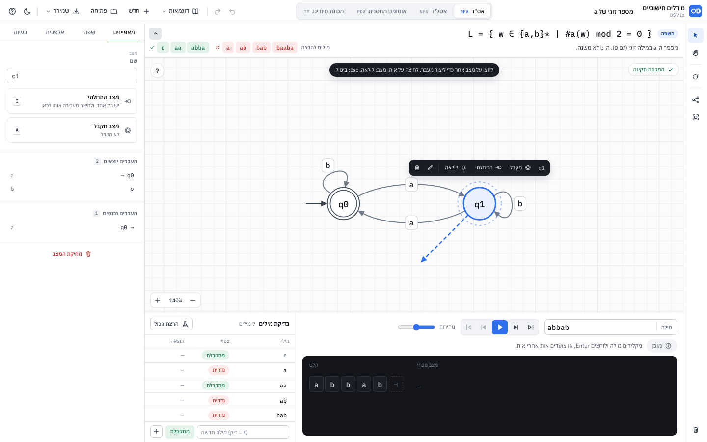

**מה השתנה בסבב 10:** הכניסה המשותפת של DSViz (15): כפתור חשבון בסרגל העליון, ומסך הכניסה של Java לפני המאגר.

**מה השתנה בסבב 9:** "מאגר שאלות" (14): 32 שאלות בארבעה נושאים, חלון כמו במאגר של Java, תרגיל עם חלון צף "השאלה", בדיקה לכל סעיף, התקדמות עם V.

**מה השתנה בסבב 4:** חזקות בכמה משתנים (`a^(n+m) b^n`, `a^n b^m c^(n+m)`, `a^(n+m) b^(n-m) | n ≥ m`), תנאי שארית בכל כתיב (`n%3=0`, `n ≡ 1 (mod 3)`), מכפלות וריבועים (שייכות וסיווג), ואיחוד ושרשור של שפות (`aⁿbⁿ ∪ bⁿaⁿ`, `{aⁿbⁿ} · {cᵏ}`). סיווג חדש לפי העמודות של המשתנים, עם הוכחות, ובנייה של אס"ד ואוטומט מחסנית. פירוט ב-13.9.

**מה השתנה בסבב 3:** לשונית "שפה": כותבים שפה כמו בספר, בונים ממנה אוטומט ובודקים מולה את האוטומט שעל הקנבס (13); 20 דוגמאות, חמש לכל סוג מכונה, לכל אחת נוסחה שהמכונה נבדקת מולה (10); פס השפה מעל הקנבס (13.8); ניתוב שמפריד קשתות שרצות יחד, תוויות שיושבות על הקשת שלהן במקום הכי פנוי, והדגשה של קשת שלמה בריחוף (8.6).

**מה השתנה בסבב 2** (בעקבות משוב על צילום המסך): מעבר נוצר בלחיצה על מצב ואז על מצב אחר, ונפתח חלון צף עם צ'יפים של Σ (4.3); פח אדום בריחוף ומחיקה עם חלון אישור (4.5); ניתוב קשתות שעוקף מצבים (8.6); כרטיס הדרכה של שלושה צעדים ו"איך בונים" חדש (4.8); באנר תוצאה גדול (5.2); השלמה עם מצב מלכודת (6); הצמדה לרשת 20. הקבצים פוצלו כך שאף קובץ לא עובר כ-350 שורות.

### קבצים

| קובץ | תפקיד | DOM? |
|---|---|---|
| `index.html` | המעטפת: סרגל עליון, סרגל כלים, קנבס, פאנל צד, חלון הרצה | |
| `tokens.css` | אסימוני העיצוב (בהיר + כהה) ו-`@font-face` | |
| `css/base.css` | בסיס, פריסה, כפתורים, סרגל עליון, תפריטים, סרגל כלים, חלון העזרה, תנועה | |
| `css/canvas.css` | רשת, קשתות, תוויות, מצבים, פחים, גומי, תג תקינות, זום, כפתור "?" | |
| `css/overlays.css` | סרגל ליד מצב, עורך שם, רמז, הודעות, החלון הצף, חלון האישור, ההדרכה, באנר התוצאה | |
| `css/panels.css` · `css/run.css` | פאנל הצד · חלון ההרצה | |
| `css/lang.css` | לשונית "שפה" ופס השפה שמעל הקנבס | |
| `css/bank.css` | מאגר השאלות: החלון והחלון הצף "השאלה" | |
| `css/access.css` | הכפתור של החשבון ומסך הכניסה | |
| `js/model.js` | מבנה הנתונים, עריכה, פענוח תוויות, שמירה/טעינה, סידור אוטומטי | לא |
| `js/validate.js` | בדיקות תקינות בעברית, בדיקת מילה מול Σ, `completeWithTrap` (מרחיב את `AutomataModel`) | לא |
| `js/sim.js` | הסימולטורים: DFA, NFA (סגור ε), PDA (BFS), TM | לא |
| `js/geometry.js` | פרימיטיבים: ראש חץ, חץ התחלה, גומי, גודל תווית | לא |
| `js/routing.js` · `js/routing-labels.js` | ניתוב: קשתות שעוקפות מצבים ומתרחקות זו מזו, לולאות בצד הפנוי · תוויות על הקשת שלהן, והרשת המרחבית | לא |
| `js/lang/*.js` | המנוע של השפה הפורמלית (`AutomataLang`): פענוח, שייכות, סיווג, בנייה, בדיקה. פירוט ב-13 (ובסבב 4: `vec.js`, `vec-build.js`, `combine.js`, ב-13.9) | לא |
| `js/examples-fa.js` · `js/examples-pt.js` · `js/examples.js` | המפרט הקצר של 20 הדוגמאות (ועוד הדגמת ניתוב) · הפיכתו לקובצי מכונה, עם בדיקות שמחושבות מהנוסחה | לא |
| `js/icons.js` | אייקונים מקוריים (SVG בקוד) | |
| `js/dialogs.js` | `Dialogs.confirm` (חלון אישור, Promise), תוכן חלון הקיצורים | כן |
| `js/guide.js` | `Guide`: כרטיס שלושת הצעדים על הקנבס, ורשימת "איך בונים" בפאנל | כן |
| `js/canvas.js` | `CanvasView`: תצוגה (זום, הזזה), ציור SVG, סרגל ליד מצב, עורך שם, ייצוא SVG | כן |
| `js/canvas-input.js` | העכבר על הקנבס (מרחיב את `CanvasView`): לחיצה-לחיצה, גרירה, פחים, הזזה | כן |
| `js/popover.js` | `TransitionPopover`: החלון הצף של מעבר (צ'יפים של Σ / כללי PDA ו-TM) | כן |
| `js/side-panel.js` · `js/run-panel.js` | `SidePanel` (מאפיינים / שפה / אלפבית / בעיות) · `RunPanel` (מילה, בקרה, סרט, מחסנית, בדיקות, באנר) | כן |
| `js/lang-panel.js` · `js/lang-strip.js` | `LangPanel`: לשונית "שפה" · `LangStrip`: פס השפה שמעל הקנבס | כן |
| `js/bank/data.js` · `js/bank/core.js` | השאלות (נוצר מ-`bank/**/*.json` על ידי `tools/bank-build.js`) · `AutomataBank`: מכונות, בדיקות, התקדמות, שער הגישה (14) | לא |
| `js/access-client.js` · `js/access.js` · `js/access-ui.js` | `DSVizAccess` (מ-feature/login-access, לא משנים כאן) · `AutomataAccess`: מצבים, נוסחים, הבקר · `AccessUI`: הכפתור ומסך הכניסה (15) | · לא · כן |
| `js/bank/window.js` · `js/bank/float.js` | `BankWindow`: חלון "מאגר שאלות" (ו-`BankView`, כתיבה מימין לשמאל) · `BankFloat`: החלון הצף "השאלה" | כן |
| `js/app.js` · `js/app-run.js` · `js/app-ui.js` | הבקר `App`: מצב, היסטוריה, עריכה, מחיקה · הרצה · סרגל עליון, קבצים, מקלדת (והאתחול) | כן |
| `test/*.test.js` | `node:test` לקבצים הטהורים | |
| `e2e/flow.js` · `e2e/lang.js` · `e2e/examples.js` · `e2e/screens.js` | Playwright: אינטראקציה עם assert (עריכה · שפה · דוגמאות) · צילומי מסך | |

**למה לא ES modules:** Chrome חוסם `<script type="module">` מ-`file://` (CORS), והדרישה היא שהכלי ייפתח בלחיצה כפולה. לכן כל קובץ הוא סקריפט רגיל בתבנית UMD:
הוא נרשם על `globalThis` וגם מייצא `module.exports` כש-Node טוען אותו. קבצי "הרחבה" (`validate.js`, `canvas-input.js`, `app-run.js`, `app-ui.js`) מוסיפים פונקציות לאובייקט קיים. סדר הטעינה ב-`index.html` חשוב, ו-`app-ui.js` אחרון (הוא מפעיל את `App.init`).
`app/package.json` מגדיר `"type": "commonjs"` כדי ש-`package.json` של שורש המאגר לא ישפיע.

---

## 1. מונחים

| עברית | אנגלית | בממשק | הערות |
|---|---|---|---|
| אוטומט סופי דטרמיניסטי (אס"ד) | DFA | לשונית "אס"ד" | |
| אוטומט סופי לא דטרמיניסטי (אסל"ד) | NFA / ε-NFA | לשונית "אסל"ד" | כולל מעברי ε |
| אוטומט מחסנית | PDA | לשונית "אוטומט מחסנית" | לא דטרמיניסטי (NPDA) |
| מכונת טיורינג | TM | לשונית "מכונת טיורינג" | סרט אחד, דטרמיניסטית |
| מצב | state | "מצב", ובקנבס `q0` | |
| מצב התחלתי | start / initial state | "מצב התחלתי", חץ משמאל | בדיוק אחד |
| מצב מקבל | accepting / final state | "מצב מקבל", עיגול כפול | |
| מעבר | transition | "מעבר", קשת עם חץ | |
| תווית | label | הטקסט על הקשת | |
| סמל / אות | symbol | "אות" במילה, "סמל" בתווית | תו אחד |
| אלפבית (הקלט) | alphabet, Σ | "אלפבית", `Σ` | |
| אלפבית המחסנית | stack alphabet, Γ | "אלפבית המחסנית", `Γ` | |
| אלפבית הסרט | tape alphabet, Γ | "אלפבית הסרט", `Γ` | כולל Σ והריק |
| מילה | word / string | "מילה" | |
| המילה הריקה | empty word, ε | `ε` (מילה ריקה) | |
| מעבר ε | ε-transition | `ε` | ב-NFA וב-PDA |
| סגור ε | ε-closure | "סגור ε" | |
| מתקבלת / נדחית | accepted / rejected | "המילה מתקבלת" / "המילה נדחית" | |
| לא הוכרע | undecided (limit) | "לא הוכרע" | הגענו למגבלת צעדים |
| מצב בור | trap / dead state | "מצב בור" | ב-DFA חלקי הוא משתמע |
| ענף | branch / configuration | "ענף", "ענפים פתוחים" | NFA, PDA |
| קונפיגורציה | configuration | (בתיעוד בלבד) | מצב + מקום במילה + מחסנית |
| מחסנית / ראש המחסנית / תחתית | stack / top / bottom | "מחסנית", "ראש", "תחתית" | ברירת מחדל לתחתית: `Z` |
| דחיפה / שליפה | push / pop | "דוחפים" / "שולפים" | |
| סרט / ראש / תא | tape / head / cell | "סרט", "ראש", "תא" | |
| סמל ריק | blank | "סמל ריק" | ברירת מחדל: `_` |
| ימינה / שמאלה / נשאר | R / L / S | `R` `L` `S` | |
| צעד | step | "צעד 3 מתוך 8" | |
| הרצה | run | "הרצה" | |
| בדיקת מילים | batch tests | "בדיקת מילים" | |
| לא דטרמיניזם | non-determinism | "יש 2 מעברים עם a" | |

---

## 2. פריסת המסך

```
                         ← כיוון הקריאה של הממשק (RTL)
┌───────────────────────────────────────────────────────────────────────────────────┐
│ ? ☾ │ שמירה▾ פתיחה חדש דוגמאות▾ │ ↷ ↶   [מכונת טיורינג|אוטומט מחסנית|אסל"ד|אס"ד]   [שם המכונה] ◉ מודלים חישוביים │ 52
├──────────────────────┬────────────────────────────────────────────────────┬──────┤
│ בעיות·אלפבית·מאפיינים│ [?]          [✓ המילה abba מתקבלת]  [✓ המכונה תקינה] │  ▸   │
│──────────────────────│                                                    │  ✋  │
│ (תוכן לפי הבחירה)    │          ┌──────────────────────┐                  │ ──── │
│ איך בונים:           │          │ שם·מקבל·התחלתי·לולאה │ ← סרגל ליד מצב  │  ○+  │
│ ○ לחיצה כפולה...     │          └──────────────────────┘                  │  ⋔   │
│ ↗ לוחצים על מצב...   │      →(q0)────a────▶(q1)🗑 ← פח בריחוף              │  ⛶   │
│                      │             ┌ חלון צף: [a][b][ε] +אות  אישור ┐     │      │
│                      │ [− 100% +]                                         │      │
│                      ├───────────────────────────┬────────────────────────┤      │
│                      │ בדיקת מילים  5/6   [הרצה] │ [מילה|abba ] ⏮◀▶▶|⏭ ─○─ │  🗑  │
│                      │ מילה   צפוי     תוצאה     │ (מתקבלת✓) הערה…  צעד 2/4│      │
│                      │ ab   [מתקבלת]  ✓ מתקבלת  │ ┌────────────────────┐ │      │
│                      │ …                         │ │ קלט [a][b][b][a][⊣]│ │      │
│                      │ [+][מתקבלת][מילה חדשה ]  │ └────────────────────┘ │      │
└──────────────────────┴───────────────────────────┴────────────────────────┴──────┘
       side 304                    run 244 גובה                                rail 52
```

- `body` לא נגלל. ה-grid ממלא את החלון (`100vh`). רק פאנל הצד, טבלת הבדיקות ואזור הסרט נגללים בתוכם.
- הקנבס תופס את כל מה שנשאר. כל מה שצף עליו (תג תקינות, זום, סרגל ליד מצב, עורך, רמז, הודעות) ממוקם בתוך `.stage`.
- גדלים: `--topbar-h: 52px`, `--rail-w: 52px`, `--side-w: 304px` (280 מתחת ל-1280px), `--run-h: 244px`, עמודת הבדיקות 340px (300).

---

## 3. כפתורים ופקודות

כל כפתור: תווית עברית, אייקון מ-`icons.js`, `title` עם הקיצור בסוגריים, ו-`aria-label` אם אין טקסט.
קיצורי אותיות נבדקים לפי `event.code` (`KeyA`) ולא לפי `event.key`, כדי שיעבדו גם כשהמקלדת בעברית (שם `A` מקליד `ש`).
קיצורים בלי Ctrl לא פועלים כשהפוקוס בשדה טקסט.

### 3.1 סרגל עליון

| כפתור | אייקון | title / קיצור | פעולה | מושבת כש | מצב |
|---|---|---|---|---|---|
| ביטול | `undo` | "ביטול: <שם הפעולה> (Ctrl+Z)" | מחזיר את המכונה למצב שלפני השינוי האחרון בלשונית הזו. הודעה: "בוטל: הוספת מצב" | אין היסטוריה | ✅ |
| חזרה | `redo` | "חזרה: … (Ctrl+Shift+Z / Ctrl+Y)" | ההפך | אין מה לשחזר | ✅ |
| דוגמאות ▾ | `book` | | תפריט מקובץ לפי סוג: תג סוג, שם, תיאור. בחירה טוענת ללשונית של הסוג (ועוברת אליה), שמה את `sampleWord` בשדה המילה, ומתאימה תצוגה. נכנס להיסטוריה | | ✅ |
| חדש | `plus` | "מכונה חדשה וריקה בלשונית הזו" | מחליף את המכונה בלשונית במכונה ריקה. נכנס להיסטוריה (אפשר לבטל) | | ✅ |
| פתיחה | `open` | "פתיחת קובץ JSON (Ctrl+O)" | בוחר קובץ, טוען ללשונית של הסוג שבקובץ. גם גרירת קובץ אל החלון | | ✅ |
| שמירה ▾ | `save` | "(Ctrl+S)" | תפריט: "שמירה כקובץ" (JSON, `<שם>.automaton.json`), "ייצוא תמונה" (SVG) | | ✅ |
| | | | ⬜ PNG (פי 2), ⬜ LaTeX TikZ (העתקה ללוח) | | ⬜ |
| מצב כהה/בהיר | `moon` / `sun` | "מצב כהה" / "מצב בהיר" | מחליף ושומר ב-`localStorage` | | ✅ |
| עזרה | `help` | "קיצורי מקלדת (?)" | חלון עם כל הקיצורים | | ✅ |
| שם המכונה | | "שם המכונה" | שדה. שינוי נשמר ב-blur / Enter, נכנס להיסטוריה. ריק → "מכונה ללא שם" | | ✅ |
| לשוניות סוג | | "אוטומט סופי דטרמיניסטי (Alt+1)" וכו' | לכל סוג מכונה משלו (נשמרת). מעבר עוצר הרצה ומנקה בחירה. ←/→ כשהפוקוס בלשוניות (ב-RTL ← = הבאה) | | ✅ |

### 3.2 סרגל כלים (אנכי, מימין)

| כלי | אייקון | קיצור | התנהגות | מצב |
|---|---|---|---|---|
| בחירה ועריכה | `select` | V | ברירת המחדל. כל העריכה קורית כאן (4.1) | ✅ |
| הזזת תצוגה | `hand` | H (או רווח + גרירה) | כל גרירה מזיזה את התצוגה | ✅ |
| מצב חדש | `state` | S / N | **כפתור, לא מצב עבודה**: מוסיף מצב במקום פנוי ליד מרכז התצוגה. (לחיצה כפולה על הקנבס עושה אותו דבר במקום הסמן) | ✅ |
| סידור אוטומטי | `layout` | L | שכבות BFS מהמצב ההתחלתי, משמאל לימין, ואז התאמה למסך. נכנס להיסטוריה. מושבת בלי מצבים | ✅ |
| התאמה למסך | `fit` | F | זום (0.4-1.4) ומרכוז כך שכל המצבים נראים | ✅ |
| מחיקה | `trash` | Delete / Backspace | שואל (חלון אישור) ומוחק את הבחירה. מושבת בלי בחירה | ✅ |
| Esc | | Esc | סוגר חלון / תפריט ← עוצר הרצה ← מבטל מעבר שהתחיל ← חוזר לכלי בחירה ← מנקה בחירה (הראשון שרלוונטי) | ✅ |

בסבב 1 היו גם כלי "מצב" וכלי "מעבר" (מצבי עבודה). הם הוסרו: לחיצה-לחיצה בכלי הבחירה עושה את העבודה, ומצב עבודה נוסף רק מבלבל תלמיד שלא שם לב שהוא דלוק.

### 3.3 על הקנבס

| רכיב | פעולה | מצב |
|---|---|---|
| תג תקינות (פינה ימנית עליונה) | ✓ "המכונה תקינה" / ⚠ "n אזהרות" / ✗ "n שגיאות". לחיצה פותחת "בעיות" | ✅ |
| כפתור "?" (פינה שמאלית עליונה) | פותח / סוגר את כרטיס ההדרכה (4.8) | ✅ |
| זום (פינה שמאלית תחתונה) | − (`-`), אחוז (לחיצה = 100%, `0`), + (`+`). פי 1.2 בכל לחיצה, טווח 30%-300% | ✅ |
| סרגל ליד מצב נבחר | שם · **מקבל** (A) · **התחלתי** (I) · **לולאה** · ✎ שינוי שם (F2) · 🗑 מחיקה. מעל המצב, ואם שם הוא מכסה תווית או מצב, מתחתיו (`placeBox`). לא בזמן גרירה, עריכה, חלון צף או הרצה | ✅ |
| פח בריחוף | מצב: עיגול אדום ברדיוס 10 בפינה הימנית העליונה של המצב (‎+0.78R, ‎-0.78R). קשת: אותו עיגול בקצה הימני של התווית. מופיע בריחוף על המצב / הקשת / התווית, לא בזמן מעבר שהתחיל, חלון צף או הרצה. לחיצה: חלון אישור (4.5) | ✅ |
| באנר תוצאה (למעלה במרכז) | בסוף הרצה (5.2) | ✅ |
| תפריט לחיצה ימנית | על מצב: כמו הסרגל. על קשת: עריכה, היפוך כיוון, מחיקה. על רקע: מצב חדש כאן, הדבקה, סידור | ⬜ |

### 3.4 חלון ההרצה

| רכיב | קיצור | התנהגות | מושבת כש | מצב |
|---|---|---|---|---|
| שדה "מילה" | | LTR, mono. ריק = ε. כל שינוי עוצר הרצה ומעדכן את הסרט. Enter = הרצה מההתחלה. נשמר לכל לשונית | | ✅ |
| ⏮ להתחלה | Home | צעד 0 | אין הרצה / בצעד 0 | ✅ |
| ◀ צעד אחורה | ← | צעד קודם (עוצר ניגון) | אין הרצה / בצעד 0 | ✅ |
| ▶ הרצה / ⏸ עצירה | P, Enter בשדה | בלי הרצה: מתחיל ומנגן. בסוף: מתחיל מחדש. בזמן ניגון: עוצר | | ✅ |
| ▶| צעד קדימה | → | בלי הרצה: מתחיל ומראה צעד 0. אחרת צעד הבא | בסוף / שגיאה | ✅ |
| ⏭ לסוף | End | הצעד האחרון | בסוף / שגיאה | ✅ |
| מהירות | | 1-5 (ברירת מחדל 3). 1400/900/600/340/160ms לצעד. נשמר | | ✅ |
| תג מצב | | "מוכן" / "בהרצה" / "רץ" / "המילה מתקבלת" ✓ / "המילה נדחית" ✗ / "לא הוכרע" ⚠ / "יש לתקן את המכונה" ✗ / "אות לא באלפבית" ✗. ב-TM: "המכונה קיבלה" / "המכונה דחתה" | | ✅ |
| הערה | | תיאור הצעד ("קראנו a: q0 → q1"), ובסוף הסיבה. ב-TM גם "פלט על הסרט: 1100" | | ✅ |
| "צעד i מתוך n" | | | | ✅ |
| בדיקת מילים: "הרצת הכול" | | מריץ את כל השורות, מעדכן ✓/✗ וסיכום "5/6 עברו", והודעה | יש שגיאה במכונה (אז הודעה + לשונית בעיות) | ✅ |
| שורה: מילה | | טוען את המילה לשדה ומריץ | | ✅ |
| שורה: "צפוי" | | מחליף מתקבלת ↔ נדחית (נכנס להיסטוריה, לא עוצר הרצה) | | ✅ |
| שורה: × | | מוחק | | ✅ |
| הוספה | Enter בשדה | מילה + "מתקבלת/נדחית" (לחיצה מחליפה) + ➕ | | ✅ |

---

## 4. תהליכי עבודה

### 4.1 קנבס, כלי "בחירה"

| פעולה | תוצאה | מצב |
|---|---|---|
| לחיצה כפולה על רקע | מצב חדש במקום הסמן (מיושר לרשת 20; אם תפוס, המקום הפנוי הקרוב), בשם הפנוי הקטן (`q0`, `q1`…). הראשון הוא ההתחלתי. המצב נבחר ו"קופץ" (`pop`). עובד גם דרך כרטיס ההדרכה של המצב הריק (הכרטיס `pointer-events: none` חוץ מהכפתורים) | ✅ |
| **לחיצה על מצב** | בוחר אותו, והוא הופך ל**מקור**: הילה כחולה מקווקוות שפועמת, וחץ "גומי" כחול מקווקו מהשפה שלו אל הסמן. רמז למעלה: "לחצו על מצב אחר כדי ליצור מעבר. לחיצה על אותו מצב: לולאה. Esc: ביטול". הסרגל השחור מופיע לידו | ✅ |
| ריחוף על מצב אחר (כשיש מקור) | המצב מודגש (קו כחול 2.6 + הילה), והגומי נצמד לשפה שלו. מעל המקור עצמו: הגומי מצויר כלולאה | ✅ |
| **ואז לחיצה על מצב** | פותח את החלון הצף של המעבר (4.3). על המקור עצמו: לולאה. אם כבר יש קשת באותו כיוון: החלון עורך אותה | ✅ |
| Esc / לחיצה על רקע | מבטל את המקור (לחיצה על רקע גם מנקה בחירה) | ✅ |
| גרירת מצב | מזיז את כל המצבים הנבחרים (אם המצב שנגרר לא נבחר: רק אותו), נצמד לרשת 20 (Alt: בלי). התחלת גרירה (4px) מבטלת מקור. רשומה אחת בהיסטוריה בשחרור. הציור בזמן גרירה ב-`requestAnimationFrame` | ✅ |
| Shift + לחיצה על מצב | מוסיף / מסיר מהבחירה, בלי מקור | ✅ |
| לחיצה על קשת או תווית | בוחר אותה ופותח את החלון הצף שלה | ✅ |
| ריחוף על מצב / קשת / תווית | קו כהה יותר + פח אדום (3.3) | ✅ |
| גרירת רקע | הזזת תצוגה. לחיצה בלי תזוזה = ניקוי בחירה וביטול מקור | ✅ |
| Shift + גרירת רקע | מלבן בחירה (מוסיף לבחירה הקיימת) | ✅ |
| גלגלת | זום סביב הסמן (`exp(-deltaY·0.0015)`; עם Ctrl/צביטה: ‎0.01) | ✅ |
| גלגל אמצעי / רווח + גרירה / כלי הזזה | הזזת תצוגה | ✅ |
| חצים | מזיז את המצבים הנבחרים 5px (Shift: 20). רשומה אחת אחרי 400ms בלי הקשה | ✅ |
| שינוי שם | ✎ בסרגל, F2 / Enter, או השדה בפאנל. עורך קטן על המצב (עד 12 תווים, ייחודי, לא ריק) | ✅ |
| גרירה מהשפה של מצב (סבב 1) | **הוסר**: התנגש בהזזה (מי שתפס מצב קרוב לשפה קיבל חץ במקום הזזה). לחיצה-לחיצה מכסה את אותו צורך | |
| גרירת התווית של קשת | משנה את העיקול (נשמר כ-`bend` על המעבר, ועוקף את הנתב) | ⬜ |
| גרירת לולאה עצמית | משנה את הכיוון שלה (`loopAngle`, ב-16 כיוונים) | ⬜ |
| Ctrl+C / Ctrl+V / Ctrl+D | העתקה, הדבקה (היסט 40), שכפול של מצבים נבחרים והמעברים ביניהם | ⬜ |

**פרטי מימוש** (`canvas-input.js`): לחיצה כפולה מזוהה ידנית ב-`onDown` (שתי לחיצות על רקע, תוך 400ms, עד 6px), כי הקנבס מצויר מחדש בין הלחיצות והדפדפן לא שולח `dblclick`. "מה מתחת לסמן" נבדק ב-`document.elementFromPoint`, כי בזמן גרירה ה-SVG תופס את המצביע. סדר הבדיקה: פח → מצב → קשת → רקע.
לחיצה על מצב נרשמת כ-`press`, ורק בשחרור בלי תזוזה היא הופכת ל"מקור" או ל"יעד". ריחוף מסומן במחלקה `hover` בלי לצייר הכול מחדש (`setHover`).

### 4.2 מצב התחלתי ומקבל

- **התחלתי:** בדיוק אחד. המצב הראשון שנוסף הוא ההתחלתי. מעבירים: I, "התחלתי" בסרגל ליד המצב, הכפתור בפאנל, או הבחירה "מצב התחלתי" בפאנל כשאין בחירה. אי אפשר "לכבות". מחיקת ההתחלתי מעבירה את ההתחלה למצב הראשון שנשאר. ✅
- **מקבל:** A מחליף לכל המצבים הנבחרים (אם כולם מקבלים: כולם מפסיקים; אחרת כולם מקבלים). גם בסרגל, בפאנל, ובבחירה מרובה. ✅

### 4.3 החלון הצף של מעבר (`popover.js`)

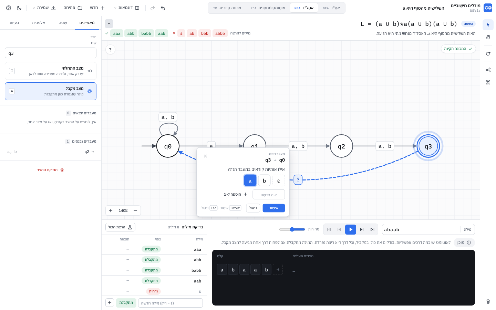

נפתח אחרי לחיצה-לחיצה, בלחיצה על קשת קיימת, ומ"לולאה" בסרגל. **מעבר חדש לא נוצר עד האישור**: בינתיים מצוירת קשת מקווקוות כחולה (`canvas.preview`, מנותבת כמו כל קשת) עם תווית `?`.
מיקום: ליד התווית (מתחת, מעל, מימין, משמאל ובאלכסונים), במקום שמכסה הכי מעט מצבים ותוויות (`canvas.placeBox`). חלון אחד בלבד; לחיצה על הקנבס בזמן שהוא פתוח = ביטול.

**אס"ד / אסל"ד:**
- כותרת: "מעבר חדש" / "עריכת מעבר", ומתחת `q0 → q1` (או `q1 ↻`) ב-mono.
- "אילו אותיות קוראים במעבר הזה?" וצ'יפים של Σ (`Model.inputAlphabet`: המוצהר, או הנגזר מהתוויות) לפי הסדר, בחירה מרובה (`aria-pressed`). נבחר = כחול מלא.
- באסל"ד: צ'יפ `ε` (מסגרת מקווקוות כשלא נבחר).
- כשהאלפבית היה ריק בפתיחה: "עוד אין אותיות באלפבית…" והצעות `+ a` `+ b` `+ 0` `+ 1` (נשארות עד סוף החלון).
- שדה "אות חדשה" (תו אחד) + "הוספה ל-Σ": מוסיף ומסמן. אם האלפבית מוצהר, האות נוספת אליו; אם הוא אוטומטי ונוספה אות שלא נבחרה, האלפבית מתקבע (אחרת האות הייתה נעלמת).
- מקלדת: הקשה על אות ש-Σ מכיל מסמנת / מבטלת אותה (גם כשהמקלדת בעברית: נבדקים `e.key` וגם `e.code`, כך ש-`ש` על המקש A מסמן `a`). אות לטינית או ספרה שאינה ב-Σ נוספת. Enter = אישור (בשדה "אות חדשה" עם ערך: הוספה), Esc = ביטול.
- **אזהרה באס"ד:** אם אות שנבחרה כבר יוצאת מהמצב הזה בקשת אחרת: נקודה ענברית על הצ'יפ, ושורה "מ-q0 כבר יש מעבר עם b (אל q0). באס"ד מותר מעבר אחד לכל אות." (לא חוסם; אם מאשרים, `validate` מסמן שגיאה).
- אישור בלי אותיות: "בחרו לפחות אות אחת" ורעידה.

**אוטומט מחסנית:** שורה לכל כלל: "קוראים" · "שולפים" · "דוחפים" (שדות LTR, ממורכזים), × למחיקת שורה, "כלל נוסף". "שדה ריק = ε. בדחיפה, התו השמאלי יהיה בראש המחסנית."
**מכונת טיורינג:** "קוראים" · "כותבים" · "זזים" (שלושה כפתורים `← L` `• S` `→ R`, ברירת מחדל R). "שדה ריק = הסמל הריק `_`".
בשני המקרים האימות הוא `Model.parseLabels` על הטקסט שנבנה מהשורות, וההודעות שלו (טבלה למטה) מוצגות בחלון.

**אישור:** רשומה אחת בהיסטוריה ("מעבר חדש" / "עריכת מעבר"), כולל שינוי באלפבית. אחרי האישור הקשת נבחרת.
**עורך טקסט:** אותן תוויות אפשר לערוך גם כטקסט בפאנל (מאפייני מעבר), עם כפתורי "הוספת ε" ו-"Z תחתית" / "_ ריק". ✅ כל הסעיף.

הודעות הפענוח (בעברית, מ-`parseLabels`):

| מקרה | הודעה |
|---|---|
| ריק | "צריך לפחות סמל אחד" / "צריך לפחות כלל אחד" |
| יותר מתו | `הסמל "ab" צריך להיות תו אחד` (ב-NFA: "…תו אחד (או ε)") |
| ε ב-DFA | `באס"ד אין מעברי ε` |
| תו שמור | `התו "," שמור ואי אפשר להשתמש בו כסמל` (גם `/` ו-`|`) |
| כלל PDA שבור | `הכלל "aZAZ" צריך להיראות כך: a,Z/AZ (קוראים a, שולפים Z, דוחפים AZ)` |
| כלל TM שבור | `הכלל "1/0" צריך להיראות כך: 1/0,R (קוראים 1, כותבים 0, זזים ימינה)` |

### 4.4 אלפבית (לשונית "אלפבית")

- **Σ אוטומטי** (ברירת מחדל, `alphabet: []`): נגזר מהתוויות לפי סדר הופעה, מוצג בצ'יפים מקווקווים. "קיבוע האלפבית" מעתיק אותו ל-`alphabet`. ✅
- **Σ מוגדר:** צ'יפים עם ×, שדה הוספה, "חזרה לאוטומטי". אות בתווית שאינה ב-Σ: הערה אדומה כאן, ושגיאה `SYMBOL_NOT_IN_ALPHABET`. מילה עם אות שאינה ב-Σ לא רצה. ✅
- **Γ במחסנית / בטיורינג:** צ'יפים; התחתית / הריק מסומנים ואי אפשר למחוק אותם. ✅

### 4.5 מחיקה, ביטול וחזרה

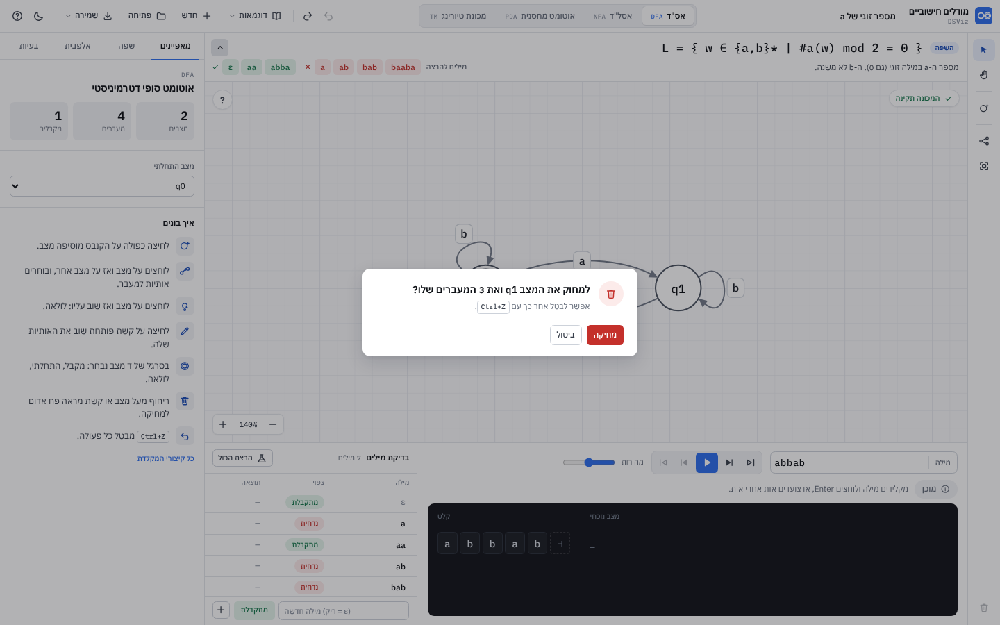

- **כל מחיקה שואלת** (`App.confirmDelete` → `Dialogs.confirm`): מהפח, מהסרגל, מהפאנל, ומ-Delete / Backspace על הבחירה. ✅
- הטקסט: "למחוק את המצב q1?" / "…ואת המעבר שלו?" / "…ואת 3 המעברים שלו?" · "למחוק את המעבר q0 → q1 (a, b)?" · "למחוק 2 מצבים ו-1 מעברים?". מתחת: "אפשר לבטל אחר כך עם Ctrl+Z." שמות וסמלים ב-`<bdi dir="ltr">`. ✅
- החלון: אייקון פח באדום, "מחיקה" (אדום, מקבל פוקוס, Enter) ו"ביטול" (Esc, או לחיצה על הרקע). Tab נשאר בתוך החלון. אחרי המחיקה: הודעה "מחיקת מצב. Ctrl+Z מחזיר." ✅
- מחיקת מצב מוחקת את המעברים שלו. מחיקה מרובה = רשומה אחת. ✅
- היסטוריה **לכל לשונית** בנפרד, עד 100 צעדים, בלי `view`. מה לא נכנס: תצוגה, בחירה, המילה בשדה, ההרצה. כל שינוי במכונה עוצר הרצה (חוץ מטבלת הבדיקות). ✅

### 4.6 בחירה מרובה
Shift+לחיצה, מלבן עם Shift, Ctrl+A. בפאנל: "נבחרו n מצבים ו-m מעברים", "כולם מקבלים", "אף אחד לא מקבל", "מחיקת הבחירה". ✅

### 4.7 זום, הזזה, סידור
התצוגה (`view`) נשמרת עם המכונה. בפעם הראשונה שלשונית מוצגת: התאמה למסך. סידור אוטומטי: `Model.autoLayout` (שכבות BFS, רווח 180×130), ואז התאמה. הקשתות מנותבות מחדש בכל ציור (8.6), אז גם אחרי סידור הן לא עוברות דרך מצבים. ✅
⬜ סידור עם פחות חציות (מיון בכל שכבה לפי ממוצע השכנים, 2-3 סבבים).

### 4.8 הדרכה: כרטיס שלושת הצעדים, ו"איך בונים"

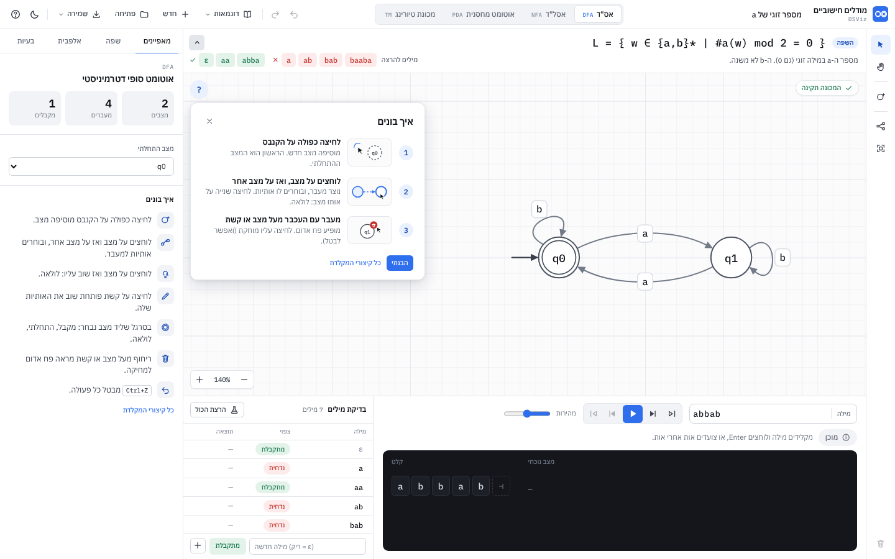

- **כרטיס על הקנבס** (`guide.js`): "בונים מכונה בשלושה צעדים", שלוש שורות ממוספרות, לכל אחת איור קטן (72×44, SVG, בצבעי הממשק) וטקסט: (1) **לחיצה כפולה על הקנבס** · מוסיפה מצב חדש. הראשון הוא המצב ההתחלתי. (2) **לוחצים על מצב, ואז על מצב אחר** · נוצר מעבר, ובוחרים לו אותיות. לחיצה שנייה על אותו מצב: לולאה. (3) **מעבר עם העכבר מעל מצב או קשת** · מופיע פח אדום. לחיצה עליו מוחקת (ואפשר לבטל). ✅
- **מתי:** כשאין מצבים, הכרטיס במרכז עם "מצב חדש" ו"טעינת דוגמה" (ונעלם מעצמו כשנוסף מצב). בכניסה הראשונה לכלי (`localStorage['dsviz.automata.guide']`) הוא צף בפינה עם "הבנתי" ו"כל קיצורי המקלדת". כפתור "?" בפינת הקנבס מחזיר אותו. ✅
- **"איך בונים" בפאנל** (כשאין בחירה): רשימה, פעולה אחת בכל שורה, אייקון בריבוע 30px וטקסט 14px שנשבר לשורות (בלי חיתוך): לחיצה כפולה מוסיפה מצב · לוחצים על מצב ואז על מצב אחר · לוחצים על מצב ואז שוב עליו: לולאה · לחיצה על קשת פותחת את האותיות · בסרגל שליד מצב נבחר: מקבל, התחלתי, לולאה · ריחוף מראה פח אדום · `Ctrl+Z` מבטל. מקשים בתוך `<bdi class="kbd-iso">` (`unicode-bidi: isolate`), כדי שלא ישברו את סדר המשפט. ✅
- **רמז לפי מה שחסר** (`App.coach`, ✅): גלולה למעלה במרכז, רק כשאין מקור, הרצה או חלון צף. מצב אחד: "עוד לחיצה כפולה במקום אחר על הקנבס מוסיפה מצב שני". שני מצבים ואין מעברים: "עכשיו מעבר: לוחצים על מצב, ואז על מצב אחר". יש מעברים ואין מקבל: "אין מצב מקבל: לוחצים על מצב, ובסרגל השחור בוחרים "מקבל"".
- בפעם הראשונה בכלל, כל לשונית נטענת עם הדוגמה הראשונה של הסוג שלה. ✅

---

## 5. הרצה

### 5.1 התחלה
1. אם יש **שגיאה** (`validate` ברמת `error`): לא רצים. התג "יש לתקן את המכונה", ההערה = השגיאה הראשונה ("(ועוד n)"), לשונית "בעיות" נפתחת, והמצבים/הקשתות של השגיאה נבחרים. אזהרות לא עוצרות.
2. אם במילה יש אות שאינה ב-Σ (`checkWord`): לא רצים. "אות לא באלפבית", ההערה "האות c (במקום 3) אינה באלפבית Σ = {a, b}", והתא שלה בסרט אדום.
3. אחרת מחשבים את כל המעקב מראש (`Sim.run`) ומציגים את צעד 0.
✅

### 5.2 מה מודגש בכל צעד
| | צעד i |
|---|---|
| מצבים פעילים | `steps[i].active`: מילוי ענבר + הילה פועמת |
| קשתות שנלקחו | `steps[i].edges` (`{t, l}` = מזהה קשת + אינדקס כלל): קו ענבר, תווית ענבר (ב-PDA/TM רק השורה של הכלל), ונקודה שנוסעת כשהגענו לצעד קדימה |
| סרט הקלט | תאים שנקראו מעומעמים, התא הבא לקריאה (`pos`) ענבר עם ראש מעליו. אחרי האות האחרונה הראש על תא `⊣` |
| צעד אחרון, מתקבלת | המצבים ב-`acceptedStates` ירוקים, תא `⊣` ירוק, תג "המילה מתקבלת" |
| צעד אחרון, נדחית | המצבים הפעילים האחרונים אדומים, `⊣` אדום (אם הגענו אליו), תג "המילה נדחית" + הסיבה |
| **באנר התוצאה** | בצעד האחרון, למעלה במרכז הקנבס: עיגול 34px עם ✓ / ✗ / ⚠, כותרת 16px "המילה `abba` מתקבלת" / "המילה `ab` נדחית" / "המילה הריקה ε מתקבלת" (TM: "המכונה קיבלה את `1011`"), ומתחת הסיבה (ב-TM גם הפלט). רקע `--ok-fill` / `--err-fill`, מסגרת בצבע, כניסה קופצת. נעלם כשחוזרים אחורה או משנים משהו |
✅

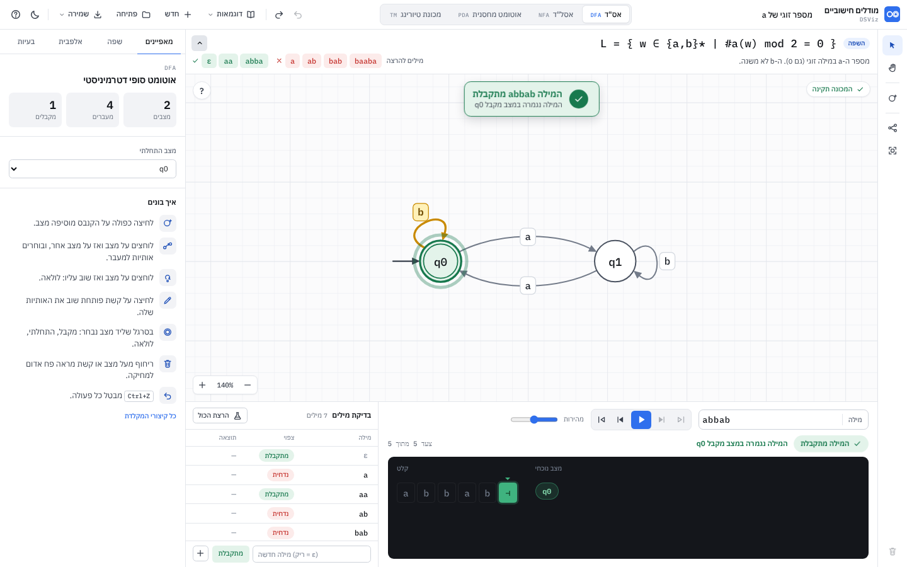

### 5.3 לפי סוג
- **DFA:** "מצב נוכחי" (צ'יפ אחד). ✅
- **NFA:** "מצבים פעילים n" עם צ'יפ לכל מצב בסגור. ✅ ⬜ תצוגת "עץ ענפים" (מי נולד ממי, אילו ענפים מתו ובאיזו אות) בלשונית נפתחת.
- **PDA:** קלט + "מחסנית" (עמודה לכל ענף, עד 6, ראש למעלה, 4 תאים גלויים ו-"+n"). כותרת "n ענפים" כשיש יותר מאחד. ✅ ⬜ לחיצה על עמודה מדגישה רק את הענף הזה בקנבס ובסרט (שדה `parent` כבר קיים בכל קונפיגורציה).
- **TM:** אין סרט קלט נפרד: הסרט עצמו, חלון 19 תאים סביב הראש, תג המצב מתחת לראש, "ראש במקום n". בסוף "פלט על הסרט". ✅ ⬜ אנימציה של הראש בין תאים (transform של 36px) במקום קפיצה.

**דרכים (סבב 5).** באסל"ד ובאוטומט מחסנית ההסבר לפני ההרצה: "לאוטומט יש כמה דרכים אפשריות. בודקים את כולן במקביל, וכל דרך היא ריצה נפרדת (עם המחסנית שלה). המילה מתקבלת אם לפחות דרך אחת מגיעה למצב מקבל." כשיש יותר מדרך אחת, האזור הכהה מראה שורה לכל דרך (`paths.js`, מתוך ה-trace: לכל קונפיגורציה הורה והמעבר שהביא אליה): "דרך N", המצב, כמה מהמילה נקרא (מודגש), המחסנית (הראש משמאל, מסומן "ראש"), ומצב הדרך: פעילה / נתקעה באות x / הגיעה למצב מקבל / המילה נגמרה, המצב לא מקבל. קונפיגורציות כפולות מופיעות פעם אחת; עד 8 שורות ואחריהן "ועוד N דרכים", והרשימה נגללת. לחיצה על שורה מדגישה על הקנבס רק את המצב של הדרך ואת המעברים שהיא עברה (לחיצה נוספת, או צעד, מבטלת). בסוף: "המילה מתקבלת: דרך 2 הגיעה ל-q6", או "המילה נדחית: כל הדרכים נתקעו או הסתיימו במצב לא מקבל". בדיקות: `test/paths.test.js` (4), `e2e/paths.js` (6 שלבים, צילומי `r5-*.png`).

**"הצג מצב מלכודת" (סבב 8).** תיבת סימון קטנה (11px) בפינה הימנית העליונה של הקנבס, מתחת לתג התקינות. מופיעה רק כשיש במכונה מצב מלכודת, ומסומנת כברירת מחדל (ההעדפה נשמרת ב-`localStorage['dsviz.automata.trap']`). מצב מלכודת (`trapStates` ב-`validate.js`, אס"ד / אסל"ד / אוטומט מחסנית): מצב לא מקבל שנקרא "מלכודת", או מצב לא מקבל ולא התחלתי שכל המעברים ממנו חוזרים אליו, עם לולאה על כל אות של Σ. כבוי: המלכודת, הלולאה שלה והקשתות אליה (עם התוויות) לא מצוירות, ושאר המצבים לא זזים. זו אפשרות תצוגה בלבד: המכונה, ההרצה, הבדיקה מול השפה, השמירה והביטול לא משתנים. כשהרצה נכנסת למלכודת מוסתרת, חלון ההרצה מראה "מלכודת (מוסתר)". בדיקות: `test/trap.test.js` (3), `e2e/trap.js` (4 שלבים, צילומי `r8-*.png`).

### 5.4 בדיקת מילים
`Sim.runTests(m, tests)` בלי שמירת צילומי סרט (`record: false`). התוצאות נשמרות לפי מילה, עם "חתימה" של המכונה (`App.machineSig()`: מצבים, מקבלים, התחלה, מעברים, אלפבית). כל שינוי במכונה מבטל את התוצאות ("—"), ושינוי של "צפוי" מחשב מחדש עבר/נכשל בלי להריץ. "לא הוכרע" (limit) נחשב כישלון. ✅

---

## 6. בדיקות תקינות והודעות

`Model.validate(m)` מחזיר `[{level, code, text, states, transitions}]`. רץ אחרי כל שינוי. **שגיאה** חוסמת הרצה; **אזהרה** לא.
בקנבס: מצבים וקשתות של שגיאות מסומנים בקו אדום מקווקו. בפאנל "בעיות": רשימה (שגיאות קודם), לחיצה בוחרת את מה שמעורב. בלשונית: תג עם המספר (אדום אם יש שגיאה).

| קוד | רמה | סוג | הטקסט | מצב |
|---|---|---|---|---|
| `NO_STATES` | שגיאה | כולם | אין עדיין מצבים. לחיצה כפולה על הקנבס מוסיפה מצב. | ✅ |
| `NO_START` | שגיאה | כולם | אין מצב התחלתי. בחרו מצב וסמנו אותו כהתחלתי. | ✅ |
| `NONDETERMINISTIC` | שגיאה | DFA | מהמצב q0 יש 2 מעברים עם a. באס"ד מותר מעבר אחד לכל אות. | ✅ |
| `EPSILON_IN_DFA` | שגיאה | DFA | באס"ד אין מעברי ε (במצב q0) | ✅ |
| `MISSING_TRANSITIONS` | אזהרה | DFA | למצב q1 חסר מעבר עבור b. מילה שתגיע לכאן עם האות הזו תידחה (כאילו יש מצב בור). | ✅ |
| `SYMBOL_NOT_IN_ALPHABET` | שגיאה | כש-Σ מוגדר | הסמל c במעבר q0 → q1 אינו באלפבית Σ | ✅ |
| `STACK_SYMBOL_NOT_IN_GAMMA` | שגיאה | PDA, כש-Γ מוגדר | הסמל B במעבר q0 → q1 אינו באלפבית המחסנית Γ | ✅ |
| `TM_NONDETERMINISTIC` | שגיאה | TM | מהמצב q0 יש 2 כללים שקוראים 1. במכונת טיורינג מותר כלל אחד. | ✅ |
| `BAD_MOVE` | שגיאה | TM | כיוון תזוזה לא חוקי "X" (מותר L, R או S) | ✅ |
| `EMPTY_LABEL` | שגיאה | כולם | למעבר q0 → q1 אין סמלים | ✅ |
| `NO_ACCEPTING` | אזהרה | כולם (לא PDA במחסנית ריקה) | אין מצב מקבל, ולכן אף מילה לא תתקבל. | ✅ |
| `UNREACHABLE` | אזהרה | כולם | אי אפשר להגיע מהמצב ההתחלתי אל: q3, q4 | ✅ |

**השלמה עם מצב מלכודת** (✅): כשיש `MISSING_TRANSITIONS` באס"ד, בלשונית "בעיות" יש הסבר קצר וכפתור "השלמה עם מצב מלכודת". `Model.completeWithTrap(m)` מוסיף מצב לא מקבל בשם "מלכודת" (או "מלכודת2"…) מימין למכונה, לולאה עליו עם כל Σ, ומעבר אליו מכל מצב עם האותיות שחסרות לו. השפה לא משתנה (נבדק ב-`model.test.js`). רשומה אחת בהיסטוריה.
| `DUPLICATE_NAME` | שגיאה | כולם | (קבצים ישנים או עריכה ידנית) שני מצבים בשם q1 | ⬜ |

הודעות סוף הרצה (`trace.reason.text`):

| קוד | הטקסט |
|---|---|
| `ACCEPT_STATE` (DFA) | המילה נגמרה במצב מקבל q0 |
| `NOT_ACCEPTING` (DFA) | המילה נגמרה במצב q1, שאינו מקבל |
| `NO_TRANSITION` (DFA) | אין מעבר מ-q1 עבור b, ולכן המילה נדחית |
| `ACCEPT_STATE` (NFA) | לפחות ענף אחד הסתיים במצב מקבל (q2) |
| `NOT_ACCEPTING` (NFA) | המילה נגמרה במצבים {q0, q1}, ואף אחד מהם אינו מקבל |
| `ALL_BRANCHES_DEAD` (NFA) | כל הענפים נתקעו באות b (מקום 3), ולכן המילה נדחית |
| `ACCEPT_STATE` / `ACCEPT_EMPTY` (PDA) | המילה נקראה כולה ויש ענף במצב מקבל (q2) / המילה נקראה כולה והמחסנית ריקה |
| `ALL_BRANCHES_DEAD` (PDA) | אין מעבר שמתאים לאות b ולראש המחסנית, ולכן המילה נדחית |
| `NOT_ACCEPTING` / `STACK_NOT_EMPTY` (PDA) | המילה נקראה כולה, אבל אף ענף לא הגיע למצב מקבל / המחסנית לא התרוקנה |
| `STEP_LIMIT` / `CONFIG_LIMIT` / `STACK_LIMIT` (PDA) | הגענו למגבלה של 500 צעדים בלי הכרעה. ייתכן שיש לולאת ε. / יותר מ-2000 ענפים פתוחים בבת אחת. עצרנו. / המחסנית עברה 200 סמלים בלי הכרעה |
| `ACCEPT_STATE` (TM) | המכונה הגיעה למצב מקבל qf |
| `HALT_NOT_ACCEPTING` (TM) | אין כלל מ-q1 עבור 0: המכונה עצרה במצב שאינו מקבל |
| `STEP_LIMIT` (TM) | המכונה רצה 5000 צעדים ולא עצרה. ייתכן שהיא לא עוצרת על המילה הזו. |
| `NO_START` | אין מצב התחלתי |

הודעות קצרות (toast): "נשמר: <קובץ>", "נפתח: <שם>", "לא ניתן לפתוח: הקובץ אינו JSON תקין", "בוטל: <פעולה>", "שוחזר: <פעולה>", "אין מה לבטל", "לא נבחר כלום למחיקה", "כל 6 הבדיקות עברו", "4 מתוך 6 בדיקות עברו", "לא ניתן לשמור בדפדפן הזה. שמרו לקובץ כדי לא לאבד עבודה.".

---

## 7. מבנה הנתונים

### 7.1 קובץ מכונה (`*.automaton.json`, גם השמירה האוטומטית)

```jsonc
{
  "format": "dsviz-automaton",   // חובה בקובץ שנשמר; קובץ בלי format מתקבל (גרסה ידנית)
  "version": 1,
  "type": "dfa",                 // "dfa" | "nfa" | "pda" | "tm"
  "name": "מספר זוגי של a",
  "alphabet": ["a", "b"],        // Σ. [] = אוטומטי (נגזר מהתוויות)
  "states": [
    { "id": "q0", "name": "q0", "x": -110, "y": 0, "accepting": true },
    { "id": "q1", "name": "q1", "x": 110, "y": 0, "accepting": false, "loopAngle": -90 }
  ],
  "start": "q0",                 // id, או null
  "transitions": [
    { "id": "t1", "from": "q0", "to": "q1", "labels": [ { "read": "a" } ] }
  ],
  "tests": [ { "word": "abba", "expect": true } ],
  "view": { "x": 0, "y": 0, "zoom": 1 },
  "language": {                  // רשות: השפה שהמכונה אמורה לקבל (13)
    "text": "w ∈ {a,b}* | #a(w) זוגי",          // הנוסחה, כמו שהוקלדה
    "desc": "מספר ה-a במילה זוגי (גם 0).",      // רשות: תיאור של שורה אחת, לפס שמעל הקנבס
    "allowBuild": true, "locked": false          // קובץ תרגיל של מורה (13.6)
  }
}
```

| שדה | כללים |
|---|---|
| `states[].id` | מזהה פנימי יציב, ייחודי. לא מוצג. מצבים חדשים: `Model.uid('s')` |
| `states[].name` | מוצג. ייחודי, 1-12 תווים |
| `states[].x/y` | קואורדינטות עולם (מספרים שלמים). y למטה |
| `states[].loopAngle` | אופציונלי, במעלות (‎-90 = למעלה). בלי: נבחר אוטומטית |
| `transitions` | לכל זוג (from, to) **קשת אחת לכל היותר**; כמה סמלים = כמה תוויות. `labels` בלי כפילויות |
| `transitions[].bend` | ⬜ אופציונלי: עיקול בפיקסלים (חיובי = שמאלה לכיוון הנסיעה) |
| סמל | תו אחד (נקודת קוד אחת, אז גם `ε` או אות עברית). `,` `/` `|` שמורים |
| ε | **מחרוזת ריקה** `""` בכל מקום (קלט, שליפה, דחיפה). מוצג `ε` |
| `language` | רשות. `text` נשמר כמו שהוקלד (גם אם יש בו שגיאה), ומפוענח מחדש בכל טעינה. קובץ בלי השדה נטען כרגיל |

### 7.2 תוויות לפי סוג

| סוג | תווית | דוגמה | מוצג |
|---|---|---|---|
| DFA | `{ read }` (לא ריק) | `{ "read": "a" }` | `a` (כמה: `a, b`) |
| NFA | `{ read }` (`""` = ε) | `{ "read": "" }` | `ε` |
| PDA | `{ read, pop, push }` | `{ "read": "a", "pop": "Z", "push": "AZ" }` | `a,Z/AZ` |
| TM | `{ read, write, move }` | `{ "read": "1", "write": "0", "move": "L" }` | `1/0,L` |

PDA: `pop: ""` = לא שולפים (מתאים לכל ראש, גם מחסנית ריקה). `push` היא מחרוזת של סמלי מחסנית, **התו הראשון הוא הראש החדש** (`AZ`: A למעלה). `push: ""` = לא דוחפים.

### 7.3 שדות נוספים לפי סוג

| סוג | שדה | ברירת מחדל | משמעות |
|---|---|---|---|
| PDA | `stackAlphabet` | `["Z"]` | Γ |
| PDA | `stackStart` | `"Z"` | מה יש במחסנית בהתחלה |
| PDA | `acceptBy` | `"final"` | `"final"` (מצב מקבל בסוף המילה) או `"empty"` (מחסנית ריקה בסוף המילה) |
| TM | `tapeAlphabet` | `["_"]` | Γ (כולל הריק) |
| TM | `blank` | `"_"` | הסמל הריק |

### 7.4 שמירה אוטומטית
- מפתח `localStorage['dsviz.automata.v1']` = `{ v: 1, active: "dfa", machines: { dfa, nfa, pda, tm }, words: { dfa: "abba", … }, speed: 3 }`. כותבים 250ms אחרי כל שינוי (debounce), גם אחרי זום/הזזה. ✅
- `localStorage['dsviz.automata.theme']` = `"light"` / `"dark"`. ✅
- טעינה: לכל סוג, `deserialize` של מה שנשמר; אם אין או שבור: הדוגמה הראשונה של הסוג. ✅
- אם `localStorage` לא זמין (מצב פרטי, `file://` בדפדפנים מסוימים): הכלי עובד, ומופיעה פעם אחת ההודעה "לא ניתן לשמור בדפדפן הזה…". ✅
- ⬜ שיתוף בלי שרת: "העתקת קישור" שמקודד את המכונה ב-`#m=<base64url של JSON דחוס>`; פתיחת קישור כזה טוענת אותה ללשונית (עם אישור אם יש שם עבודה).

### 7.5 טעינה (`Model.deserialize`)
מקבל מחרוזת או אובייקט. דוחה: JSON שבור ("הקובץ אינו JSON תקין"), `format` אחר ("זה לא קובץ מכונה של DSViz"), `type` לא מוכר, `version` גבוה מ-1 ("הקובץ נשמר בגרסה חדשה יותר של הכלי").
מדלג (עם הודעה ב-`errors`) על מצב בלי `id` או כפול, ועל מעבר שמצביע על מצב חסר. משלים ברירות מחדל. ממזג קשתות כפולות לאותו זוג. ✅

---

## 8. אלגוריתמי הסימולציה (`sim.js`)

מבנה מעקב משותף:

```js
{
  type, word: ['a','b'],
  steps: [ { pos, active: [ids], edges: [{t, l}], read, note, configs?, tm? } ],  // steps[0] = התחלה
  result: 'accept' | 'reject' | 'limit',
  reason: { code, text, ... },
  acceptedStates: [ids],
  output?, finalTape?, finalHead?        // TM
}
```

### 8.1 DFA (`runDFA`) ✅
```
cur ← start
לכל אות a במקום i:
    מחפשים בקשתות היוצאות מ-cur את הראשונה שיש לה תווית a
    אין → reject, NO_TRANSITION (pos=i)             // מצב בור משתמע
    cur ← היעד; צעד {pos: i+1, active:[cur], edges:[{t,l}]}
accept אם cur מקבל, אחרת NOT_ACCEPTING
```
סיבוכיות O(|w|·deg). לא דטרמיניזם לא אמור להגיע לכאן (שגיאה ב-validate), ואם כן: הקשת הראשונה.

### 8.2 NFA עם ε (`epsilonClosure`, `runNFA`) ✅
```
closure(S): BFS על מעברי ε בלבד; מחזיר את המצבים (לפי סדר גילוי) ואת קשתות ה-ε שנלקחו
A ← closure({start})
לכל אות a:
    M ← { t.to : s ∈ A, t יוצאת מ-s, יש לה תווית a }
    A ← closure(M)
    A ריקה → reject, ALL_BRANCHES_DEAD
accept אם A ∩ F ≠ ∅ (acceptedStates = החיתוך)
```
הקשתות של צעד = קשתות ה-a + קשתות ה-ε של הסגור. לולאות ε לא נתקעות (BFS עם `seen`).

### 8.3 PDA (`runPDA`) ✅
קונפיגורציה = `(state, pos, stack)`; `stack` מחרוזת, התו הראשון הוא הראש. BFS בשכבות:
```
F ← [(start, 0, stackStart)];  seen ← {key(F₀)}
חוזרים:
    אם יש c ∈ F שמקבלת (pos = |w| וגם: final → state ∈ F / empty → stack = "") → accept
    אם עברנו maxSteps (500) → limit, STEP_LIMIT
    N ← []
    לכל c ∈ F, לכל קשת יוצאת t, לכל כלל (read, pop, push):
        read ≠ ε וגם (pos = |w| או w[pos] ≠ read) → דלג
        pop ≠ ε וגם pop ≠ top(stack) → דלג
        stack' ← push + (pop = ε ? stack : stack בלי הראש)
        |stack'| > maxStack (200) → דלג, truncated ← true
        c' ← (t.to, pos + (read = ε ? 0 : 1), stack')
        key(c') ∈ seen → דלג;  אחרת seen += key, N += c'
    N ריקה → truncated ? limit (STACK_LIMIT) : reject (ALL_BRANCHES_DEAD / NOT_ACCEPTING / STACK_NOT_EMPTY)
    |N| > maxConfigs (2000) → limit, CONFIG_LIMIT
    F ← N
```
כל צעד שומר `configs: [{id, parent, state, pos, stack}]`, כך שאפשר לשחזר את עץ הענפים. ה-`seen` הגלובלי מונע לולאות ε שלא משנות את המחסנית; המגבלות עוצרות לולאות שמגדילות אותה.
הגבולות ב-`Sim.LIMITS` וניתנים להעברה ב-`opts`.

### 8.4 TM (`runTM`) ✅
סרט = `Map<index, symbol>` (תא שלא קיים = ריק; כתיבת ריק מוחקת), אינסופי לשני הצדדים. ראש מתחיל ב-0.
```
חוזרים:
    haltOnAccept וגם state מקבל → accept
    n ≥ maxSteps (5000) → limit
    sym ← tape[head] ?? blank
    כלל ראשון מ-state שקורא sym; אין → state מקבל ? accept : reject (HALT_NOT_ACCEPTING)
    tape[head] ← write;  head += R:+1 / L:-1 / S:0;  state ← t.to
```
כל צעד שומר `tm: { state, head, tape: {start, cells[]} }` (ב-`record: false` לא שומרים, לבדיקות). בסוף: `output` = הסרט בלי הריקים בקצוות.

### 8.5 ⬜ המרות (שלב 5)
| המרה | אלגוריתם | הצגה |
|---|---|---|
| NFA → DFA | בניית תת-קבוצות, כולל סגור ε; מצב בור כשצריך | שם כל מצב חדש = הקבוצה `{q0,q1}`; צעד = מצב חדש או מעבר חדש |
| מזעור DFA | הסרת לא ישיגים, ואז חלוקה (Moore / Hopcroft) | צבע לכל מחלקה; צעד = פיצול; בסוף מיזוג |
| הסרת ε | סגור ε לכל מצב, ומעברים חדשים במקום ה-ε | |
| ביטוי רגולרי → NFA | Thompson | |
ההמרה פותחת את התוצאה כמכונה חדשה בלשונית המתאימה (ב-NFA → DFA: לשונית אס"ד, אחרי אישור כי יש שם מכונה).

### 8.6 ניתוב קשתות ותוויות (`routing.js`, `routing-labels.js`) ✅

| לפני (סבב 2) | אחרי (סבב 3) |
|---|---|
| 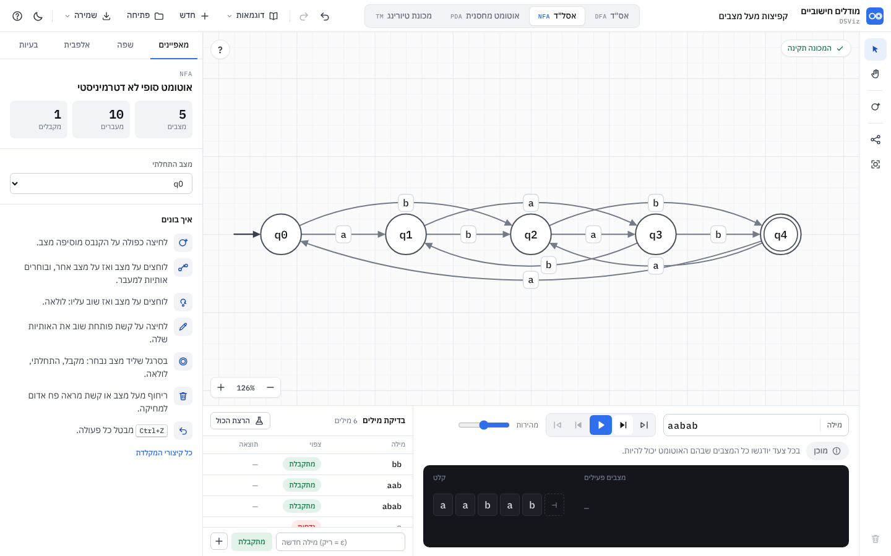 | 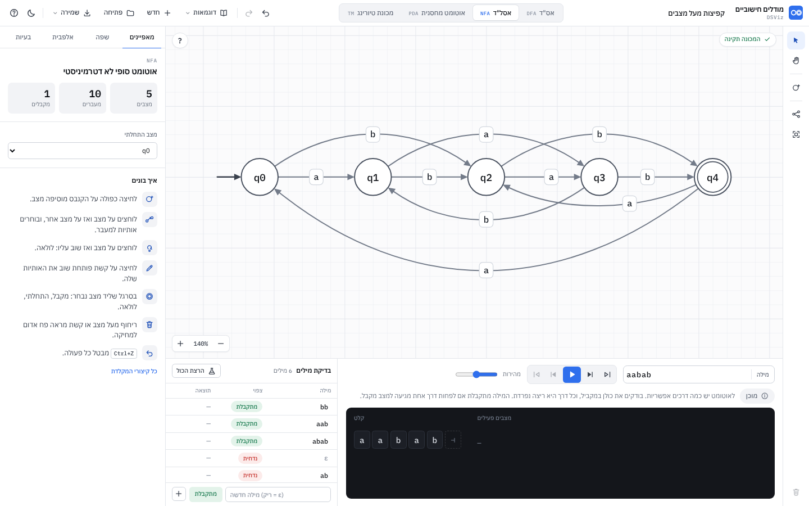 |

בסבב 2 שלוש הקשתות שמתחת לשורה התכנסו ליד q3 ו-q4, והתווית `a` ישבה במקום שבו שתיים מהן רצות יחד. עכשיו לכל קשת עיקול משלה, והתווית יושבת בנקודה שבה הקשת שלה לבד.

`Routing.route(states, edges, { startId, fast })` מחזיר לכל קשת `{ d, arrow, pts: {p0,c1,c2,p3}, loop, label: {x,y,w,h,cx,cy} }`. הקנבס קורא לו בכל ציור. התוצאה האחרונה נשמרת, כך שציור בלי שינוי בגאומטריה (ריחוף, צעד בהרצה) לא מנתב שוב. זמנים: דוגמה רגילה 1-3ms, "קפיצות מעל מצבים" (10 קשתות) כ-4ms, 22 קשתות על 6 מצבים 45 עד 70ms (ובזמן גרירה, עם `fast`, כ-25ms).

1. **צורה:** כל קשת היא בזייה מעוקבת. נקודות הבקרה על שליש ושני שליש מהקו, מוזזות לשמאל כיוון הנסיעה ב-`h1` / `h2` (שלילי = ימינה). ישרה = `h1 = h2 = 0`.
2. **מועמדים:** זוגות מתוך `[0, 30, 37, 50, 75, 100, 130, 170, 220, 280, 350]` בשני הצדדים, כששתי נקודות הבקרה ברמות סמוכות (כדי שהקשת תהיה חלקה), וגם צורת S. מחיר בסיסי: `max(|h1|,|h2|) + 0.4·|h1−h2|` (ועוד 80 לצורת S), כפול `√(320 / אורך)` לקשת ארוכה מ-320: לקשת ארוכה עיקול גדול זול יותר, ולכן היא זו שמתרחקת והקצרות נשארות צמודות.
3. **מצבים:** מועמד עובר רק אם העקומה רחוקה לפחות `R + MARGIN + 4` מכל מצב שאינו קצה (MARGIN = 8). ועוד 20 למחיר על כל מצב שקרוב לקו בצד שנבחר. לכל קשת נשמרים 22 המועמדים הזולים שעוברים.
4. **מסדרון משותף:** לכל מועמד מחשבים את האורך (בפיקסלים) של החלקים שנמצאים פחות מ-`SEP = 22` (בערך גובה של תווית) מקשת אחרת, משוקלל ב-`(1 − מרחק/SEP)²`, וכל פיקסל כזה עולה 4. לכן שתי קשתות שרצות יחד, או שמתכנסות לאותו מצב באותה זווית, מקבלות עיקולים שונים בבירור; חצייה בזווית חדה כמעט לא עולה. המרחקים נשאלים מרשת מרחבית (`Grid`, תאים של 22px) שמחזיקה את נקודות כל הקשתות, את חץ הכניסה, ואת המקום של תווית של לולאה.
5. **זוג הפוך** (a→b וגם b→a): שניהם לפחות `h = 37` לשמאל כיוון הנסיעה, אז הם נפרדים (כ-28px לכל צד).
6. **סדר:** קשתות קצרות קודם (הן נשארות ישרות), אחר כך ארוכות, אחר כך הלולאות. ואז עד שני סבבי שיפור: כל קשת נבחרת מחדש מול כל האחרות (רק אם משהו השתנה מאז שנבחרה), ואחריהם הלולאות שוב.
7. **לולאות:** 16 כיוונים; ציון = המרחק הזוויתי מהקשתות שיוצאות / נכנסות למצב (ומחץ ההתחלה, שבא משמאל), פחות המסדרון המשותף עם קשתות אחרות, ועוד הציון של המקום של התווית שלה. עונש גדול אם הלולאה קרובה למצב אחר. העדפה קלה ללמעלה. `loopAngle` שמור במצב גובר.
8. **תוויות** (`routing-labels.js`): תווית יושבת **על הקשת שלה**. לכל מקום אפשרי לאורך הקשת (`t` מ-0.25 עד 0.75 בצעדים של 0.025, ובעונש קטן גם 0.15-0.85) ניתן ציון: כמה רחוקה מהמלבן הקשת האחרת הקרובה ביותר (פעמיים, עד 20px), כמה רחוקה ממרכז התווית (עד 26px), המרחק מתוויות אחרות וממצבים, והעדפה לאמצע הקשת. מקום שבו קשת אחרת קרובה למרכז התווית פחות מ-13px, או שנוגע במצב או בתווית, נפסל כמעט תמיד. רק אם אין אף מקום טוב על הקשת, נבדקים גם מקומות קרוב לקצה (0.1, 0.9) וליד הקשת. תווית של לולאה: מעבר לקצה הלולאה, בכיוון שלה. הסדר: לולאות, ואז מהקשת הקצרה לארוכה; ובסבב שני כל תווית ממוקמת שוב מול כל האחרות.
9. **תיקון:** אם נשארה תווית שהקשת האחרת הקרובה למרכז שלה קרובה מ-13px (קורה רק במכונות צפופות מאוד), עד שלושה סבבים: הקשת שלה מקבלת את העיקול שנותן לתווית הכי הרבה מרווח (מתוך רשימה רחבה יותר, 60 מועמדים), המקום שנבחר נכנס לרשת, והקשתות שעוברות דרכו מנותבות מחדש. נשארים עם הסבב הטוב ביותר. `fast: true` (בזמן גרירה של מצב) מדלג על השלב הזה.
10. **ריחוף** (`canvas.css`): ריחוף על קשת או על התווית שלה צובע את כל הקשת, הקו וראש החץ, בצבע המותג, נותן לתווית מסגרת באותו צבע, ומעמעם את שאר הקשתות (32%) והתוויות (50%). כך הבעלות ברורה גם במכונה צפופה. חץ הכניסה והקשתות של הצעד הנוכחי בהרצה לא מתעמעמים.

**בדיקות** (`test/routing.test.js`, 7):

| פריסה | מצבים (80 דגימות לקשת) | בעלות על תוויות | מסדרון |
|---|---|---|---|
| שורה של 5 מצבים, 11 קשתות שמדלגות מעל האמצעיים | ≥ `R + MARGIN` | מרכז ≥ 10, מלבן ≥ 10 | ≤ 45px |
| "קפיצות מעל מצבים" | כנ"ל | מרכז ≥ 18, מלבן ≥ 14 | ≤ 30px |
| כל 21 הדוגמאות | כנ"ל, ואין תוויות חופפות | מרכז ≥ 10, מלבן ≥ 10 | ≤ 30px |
| 30 פריסות אקראיות עם זרע קבוע (5-8 מצבים, 8-14 קשתות) | כנ"ל | מרכז ≥ 10 | ≤ 45px |
| אסל"ד צפוף: 6 מצבים, 22 קשתות | כנ"ל, ואין תוויות חופפות | **מרכז ≥ 8** | ≤ 60px |

- "בעלות, מרכז ≥ N": לכל תווית, המרחק מהמרכז שלה לכל קשת אחרת גדול ב-N פיקסלים לפחות מהמרחק לקשת שלה (200 דגימות לקשת). "מלבן ≥ N": אותו דבר מהמלבן של התווית, כלומר אף קשת אחרת לא עוברת דרך התווית או צמוד אליה.
- "מסדרון": בחצי האמצעי של כל קשת, האורך של החלקים שנמצאים פחות מ-8px מקשת אחרת.
- האסל"ד הצפוף הוא מקרה קיצון (כמעט כל זוג מחובר בשני הכיוונים, ואין מקום פנוי): שם ההפרש המובטח הוא 8 ולא 10. בפועל נמדד 9.
- ב"קפיצות מעל מצבים" נבדק גם ש-q4→q0 היא הקשת הרחבה ביותר מתחת לשורה, ושלשתי האחרות שם עומק שונה.

---

## 9. נגישות ומקלדת

### 9.1 מפת מקלדת

| מקש | פעולה | הקשר |
|---|---|---|
| V / H | כלי בחירה / הזזת תצוגה | |
| S / N | מצב חדש (במקום פנוי ליד מרכז התצוגה) | |
| T | מתחיל מעבר מהמצב הנבחר (כמו לחיצה עליו) | מצב אחד נבחר |
| A | מקבל (מחליף לנבחרים) | יש מצב נבחר |
| I | התחלתי | מצב אחד נבחר |
| F2 / Enter | שינוי שם / החלון הצף של המעבר | מצב או מעבר אחד נבחר |
| Delete / Backspace | מחיקת הבחירה (עם אישור) | |
| Ctrl+A | בחירת כל המצבים | |
| חצים (Shift: ×4) | הזזת המצבים הנבחרים | אין הרצה |
| → / ← | צעד קדימה / אחורה | יש הרצה |
| Home / End | להתחלה / לסוף | יש הרצה |
| P | הרצה / עצירה | |
| Enter | הרצה מההתחלה | בשדה המילה |
| אות / ספרה | מסמנת את האות בצ'יפים (או מוסיפה) | בחלון הצף (FA) |
| Enter / Esc | אישור / ביטול | בחלון הצף ובחלון האישור |
| Esc | ראו 3.2 | |
| Ctrl+Z / Ctrl+Shift+Z / Ctrl+Y | ביטול / חזרה | גם בעברית (לפי `code`) |
| Ctrl+S / Ctrl+O | שמירה / פתיחה | |
| L / F | סידור / התאמה | |
| + / − / 0 | זום / 100% | |
| Alt+1…4 | מעבר בין הסוגים | |
| ? | חלון הקיצורים | |
| רווח (החזקה) | הזזת תצוגה בגרירה | |

### 9.2 דרישות
- ✅ כל כפתור אייקון עם `aria-label` ו-`title`. כפתורי מצב עם `aria-pressed`. לשוניות עם `role=tablist/tab` ו-`aria-selected`, ומעבר בחצים.
- ✅ `role=status aria-live=polite` על תג ההרצה, על הרמז ועל ההודעות. `role=alert` על שגיאות בעורך.
- ✅ פוקוס נראה (`--focus`) על כל רכיב. קישור "דילוג לחלון ההרצה".
- ✅ צבע לא לבד: כל תוצאה עם אייקון ומילה; מצב מקבל = עיגול כפול (לא צבע); שגיאה בקנבס = קו מקווקו.
- ✅ `prefers-reduced-motion`.
- ⬜ **ניווט בקנבס במקלדת:** Tab נכנס לקנבס, חצים עוברים בין מצבים (לפי מיקום), Enter בוחר, ושורה מוקראת: "מצב q1, מקבל, 2 מעברים יוצאים: a אל q2, b אל q0".
- ⬜ **הקראת צעד:** בכל צעד, `aria-live` מקריא את ההערה ("קראנו a: q0 → q1").
- ⬜ **חלופה טקסטואלית:** טבלת מעברים (δ) ניתנת לעריכה, כמו בספר (שורות = מצבים, עמודות = אותיות), בלשונית נוספת בפאנל. משמשת גם לקוראי מסך וגם למורים שמעדיפים טבלה.
- ✅ חלון האישור: `role=alertdialog`, Tab נשאר בפנים, הפוקוס חוזר למקום שבו היה. ⬜ אותו דבר בחלון העזרה ובחלון הצף.

---

## 10. דוגמאות (`examples-fa.js`, `examples-pt.js`, `examples.js`) ✅

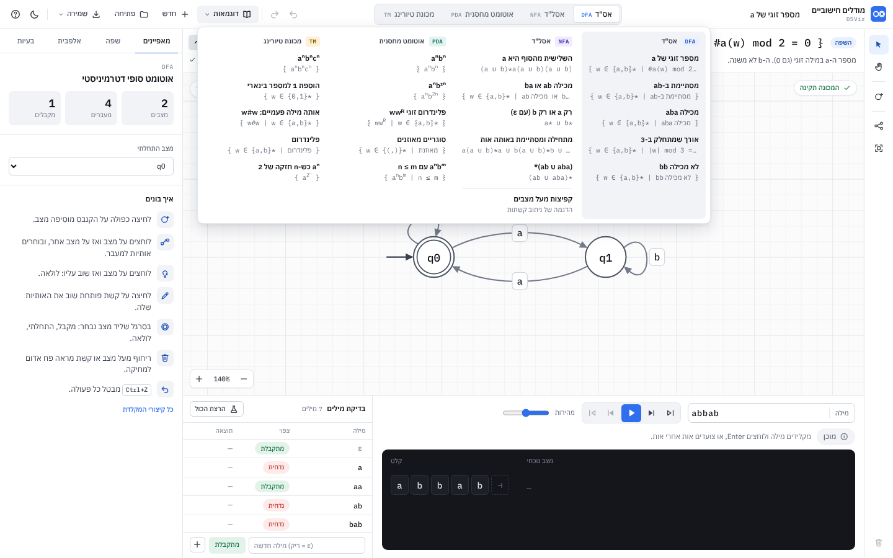

חמש דוגמאות לכל סוג מכונה, ועוד הדגמת ניתוב אחת. לכל דוגמה **נוסחה** (13.1), תיאור של שורה אחת, ו-6 עד 9 מילים לבדיקה.

| id | סוג | שם | הנוסחה | מצבים | מילים |
|---|---|---|---|---|---|
| `even-a` | DFA | מספר זוגי של a | `w ∈ {a,b}* \| #a(w) זוגי` | 2 | 7 |
| `ends-ab` | DFA | מסתיימת ב-ab | `w ∈ {a,b}* \| מסתיימת ב-ab` | 3 | 8 |
| `has-aba` | DFA | מכילה aba | `w ∈ {a,b}* \| מכילה aba` | 4 | 8 |
| `len-mod3` | DFA | אורך שמתחלק ב-3 | `w ∈ {a,b}* \| \|w\| mod 3 = 0` | 3 | 7 |
| `no-bb` | DFA | לא מכילה bb | `w ∈ {a,b}* \| לא מכילה bb` | 3 | 8 |
| `third-last-a` | NFA | השלישית מהסוף היא a | `(a+b)*a(a+b)(a+b)` | 4 | 8 |
| `ab-or-ba` | NFA | מכילה ab או ba | `w ∈ {a,b}* \| מכילה ab או מכילה ba` | 4 | 8 |
| `only-a-or-b` | NFA | רק a או רק b (עם ε) | `a* + b*` | 3 | 7 |
| `same-ends` | NFA | מתחילה ומסתיימת באותה אות | `a(a+b)*a + b(a+b)*b + a + b` | 4 | 9 |
| `ab-aba-star` | NFA | (ab ∪ aba)* | `(ab + aba)*` | 3 | 9 |
| `anbn` | PDA | aⁿbⁿ | `a^n b^n` | 3 | 8 |
| `anb2n` | PDA | aⁿb²ⁿ | `a^n b^2n` | 3 | 8 |
| `wwr` | PDA | פלינדרום זוגי wwᴿ | `w w^R` | 3 | 9 |
| `balanced` | PDA | סוגריים מאוזנים | `w ∈ {(,)}* \| מאוזנת` | 2 | 9 |
| `an-le-bm` | PDA | aⁿbᵐ עם n ≤ m | `a^n b^m \| n <= m` | 3 | 9 |
| `anbncn` | TM | aⁿbⁿcⁿ | `a^n b^n c^n` | 6 | 8 |
| `binary-inc` | TM | הוספת 1 למספר בינארי | `w ∈ {0,1}*` | 4 | 6 |
| `w-hash-w` | TM | אותה מילה פעמיים: w#w | `w#w` | 9 | 9 |
| `tm-palindrome` | TM | פלינדרום | `w ∈ {a,b}* \| פלינדרום` | 7 | 9 |
| `pow2` | TM | aⁿ כש-n חזקה של 2 | `a^(2^n)` | 6 | 8 |
| `jumps` | NFA | קפיצות מעל מצבים | אין: הדגמה של ניתוב (8.6) | 5 | 6 |

- **המפרט** (`examples-fa.js`, `examples-pt.js`) קצר: `lang`, `desc`, `words`, `states: [שם, x, y, 'A' אם מקבל, זווית לולאה]` (הראשון התחלתי), `edges: [מ, אל, האותיות או הכללים]`. `examples.js` הופך אותו לקובץ מכונה רגיל (7.1), ועוד `id`, `description`, `sampleWord`.
- **התוצאה הצפויה של כל מילה לא נכתבת ביד:** היא מחושבת מהנוסחה (`AutomataLang.accepts`) כשהדוגמה נבנית. המילים נטענות לטבלת הבדיקות, ו-`sampleWord` לשדה המילה בחלון ההרצה.
- **אף דוגמה לא יכולה לסתור את הנוסחה שלה:** `test/examples.test.js` (23 בדיקות) מריץ כל מכונה מול הנוסחה שלה על **כל** המילים עד אורך 10 (אלפבית של שתי אותיות: 2,047 מילים), עד אורך 9 לשלוש אותיות (29,524 מילים; `aⁿbⁿcⁿ` ו-`w#w`), ועד אורך 40 לאות אחת (`pow2`). בנוסף: בדיוק חמש דוגמאות עם נוסחה לכל סוג, 6-9 מילים בכל אחת עם מתקבלות ונדחות, ואין שגיאות תקינות.
- **מכונה מחשבת:** `binary-inc` מקבלת כל מילה בינארית, ולכן הנוסחה שלה היא `w ∈ {0,1}*`. מה שהיא מחשבת נבדק בנפרד: לכל מילה עד אורך 9, המספר שנשאר על הסרט הוא המספר ועוד 1.
- **התפריט** (`renderExamplesMenu`): ארבע עמודות, אחת לכל סוג מכונה, והעמודה של הלשונית הפעילה מודגשת. בכל פריט השם והנוסחה בכתיבה יפה. בחירה בדוגמה מסוג אחר עוברת ללשונית שלה. במסך צר: שתי עמודות.
- **מה הוחלף מההצעה המקורית:** במקום "היפוך מילה" ו"העתקת מילה" כמכונות מחשבות, נבחרו מכונות מכריעות עם שפה שאפשר לבדוק מולה (`w#w`, פלינדרום). למכונה מחשבת אין שפה מעניינת, ולכן נשארה אחת כזו בלבד (הוספת 1).

---

## 11. שלבים

כל שלב נבדק לבד: `node --test` ירוק, `node e2e/flow.js` ירוק, `node e2e/screens.js` בלי שגיאות קונסול, ובדיקה ידנית לפי "קבלה".

### שלב 0: לוגיקה ✅
model.js, sim.js, geometry.js, examples.js + 29 בדיקות.
**קבלה:** `node --test` עובר; כל הדוגמאות עוברות את הבדיקות שלהן; PDA עם לולאת ε נעצר ב-`limit`; TM שרץ לנצח נעצר ב-`limit`.

### שלב 1: מעטפת + DFA/NFA מקצה לקצה ✅
**קבלה:** בונים מאפס את "מסתיים ב-ab" בעכבר בלבד (לחיצה כפולה × 3, לחיצה-לחיצה × 3 עם בחירת אותיות, לולאה, A), מריצים `abab` צעד אחרי צעד ורואים 2 מצבים פעילים בצעד 3, והתוצאה "המילה מתקבלת". Ctrl+Z מבטל כל פעולה אחת-אחת. רענון הדף משאיר הכול.

### שלב 2: PDA ו-TM מקצה לקצה ✅
**קבלה:** `aabb` ב-aⁿbⁿ: המחסנית `Z` → `AZ` → `AAZ` → `AZ` → `Z`, מתקבלת. `1011` ב-TM: הסרט מסתיים ב-`1100`, הראש חוזר למקום 0, "המכונה קיבלה". עריכת כלל PDA לא חוקי מראה את ההודעה ולא נשמרת.

### שלב 2.5: עריכה פשוטה יותר (סבב 2) ✅
לחיצה-לחיצה + חלון צף עם צ'יפים של Σ (4.3), פח בריחוף + חלון אישור (4.5), ניתוב שעוקף מצבים (8.6), כרטיס הדרכה ו"איך בונים" (4.8), באנר תוצאה (5.2), מצב מלכודת (6), הצמדה לרשת 20, דוגמה צפופה.
**קבלה:** `node e2e/flow.js` עובר את 13 השלבים (כולל: הפח גלוי בריחוף, מחיקה עם אישור, Ctrl+Z מחזיר; Esc מבטל; קשת קיימת נערכת בלי כפילות); `test/routing.test.js` ירוק.

### שלב 2.6: שפה פורמלית, דוגמאות, ניתוב ברור (סבב 3) ✅
לשונית "שפה" והמנוע שלה (13), 20 דוגמאות עם נוסחה (10), פס השפה (13.8), ניתוב שמפריד קשתות ותוויות עם בעלות ברורה (8.6).
**קבלה:** `node --test` (89) ירוק; `node e2e/lang.js` (10 שלבים) ו-`node e2e/examples.js` (8 שלבים) עוברים: מקלידים `a^n b^m | n >= 2`, רואים כתיבה יפה ומילים לדוגמה, בונים אס"ד של 5 מצבים, בודקים ("זו הוכחה"), משנים את הנוסחה ורואים מילים שנכשלות, לוחצים על אחת והיא רצה. כל 20 הדוגמאות נטענות מהתפריט וכל הבדיקות שלהן עוברות.

### שלב 2.7: שפות עם חזקות בכמה משתנים, שארית, איחוד ושרשור (סבב 4) ✅
13.9. **קבלה:** `node --test` (97) ירוק; `node e2e/lang2.js` (7 שלבים) עובר: `a^n b^m c^(n+m)` נבנה לאוטומט מחסנית ו-`aabccc` מתקבלת; `a^n | n%3=0` נבנה לאס"ד של 3 מצבים והבדיקה מולו היא הוכחה.

### שלב 3: גימור עריכה ⬜
1. תפריט לחיצה ימנית (3.3).
2. גרירת תווית לשינוי עיקול (`bend`), גרירת לולאה לשינוי כיוון (`loopAngle`).
3. העתקה / הדבקה / שכפול.
4. לחיצה על רקע כשיש מקור: אפשרות (בהגדרה) ליצור שם מצב חדש ומעבר אליו, אחרי בדיקה עם 3 תלמידים.
5. סידור אוטומטי עם פחות חציות.
6. `DUPLICATE_NAME`.
7. חלון ההרצה ניתן לשינוי גובה (גרירת הקו העליון, 180-420px, נשמר).
**קבלה:** כל פעולה נכנסת להיסטוריה ומתבטלת; עיקול ולולאה נשמרים בקובץ ונטענים; בדיקות יחידה ל-`bend` ב-geometry.

### שלב 4: ייצוא ושיתוף ⬜
1. PNG (פי 2, רקע לפי ערכת הנושא או לבן).
2. LaTeX TikZ (ספריית `automata`: `\node[state,initial]`, `accepting`, `loop above`, `bend left`), העתקה ללוח.
3. קישור עם המכונה ב-hash (7.4).
4. לוח פקודות Ctrl+K (חיפוש בכל הפקודות של פרק 3, ↑↓ Enter Esc).
**קבלה:** הקובץ שנוצר ב-TikZ מתקמפל ב-`pdflatex` (בדיקה ידנית); קישור שנפתח בחלון פרטי טוען את אותה מכונה; Ctrl+K מוצא "סידור" ו-"שמירה".

### שלב 5: המרות צעד אחרי צעד ⬜
NFA → DFA, מזעור, הסרת ε (8.5), עם אותה בקרה כמו ההרצה (צעד, אחורה, ניגון, מהירות) ועם כיתוב לכל צעד.
**קבלה:** בדיקות יחידה: NFA "מסתיים ב-ab" → DFA עם 3 מצבים ישיגים; מזעור של DFA עם מצבים שקולים מחזיר את המספר המינימלי; השפה נשמרת (השוואה על כל המילים עד אורך 8).

### שלב 6: נגישות, יציבות, שילוב ⬜
1. ניווט בקנבס במקלדת, הקראת צעדים, טבלת δ (9.2).
2. מחרוזות הממשק בקובץ אחד (`js/strings.js`), בלי טקסט עברי מפוזר בקוד.
3. תמיכה במסך מגע (צביטה לזום, לחיצה ארוכה = תפריט).
4. להריץ את `e2e/flow.js` ב-CI, ולהוסיף לו שמירה וטעינה, PDA ו-TM בחלון הצף, ומצב מלכודת.
5. קישור מאתר DSViz (`site/`) ומהתוסף.
**קבלה:** axe-core בלי הפרות ברמת serious; כל תהליך בשלב 1 אפשרי במקלדת בלבד; e2e ירוק.

---

## 12. החלטות שכדאי לא לשנות בלי סיבה

1. **קשת אחת לכל זוג מצבים**, עם כמה תוויות. כך עושים בספרים ובכלי ההשראה, וזה פותר את רוב ההתנגשויות בציור.
2. **ε = מחרוזת ריקה** בנתונים. פשוט לאלגוריתמים, ו-`ε` רק בתצוגה.
3. **סמל = תו אחד.** מילים מוקלדות בלי מפרידים (`abba`).
4. **DFA חלקי מותר** (אזהרה, מצב בור משתמע). רוב הספרים בישראל מקבלים אותו; מי שרוצה DFA מלא לוחץ "השלמה עם מצב מלכודת".
8. **מעבר = לחיצה, ואז לחיצה**, והאותיות נבחרות מצ'יפים ולא מוקלדות. תלמיד לא צריך לדעת תחביר כדי לבנות אס"ד.
9. **כל מחיקה שואלת**, וגם אפשר לבטל. הפח מופיע רק בריחוף, כך שהדיאגרמה נקייה.
5. **TM נעצרת בכניסה למצב מקבל** (`haltOnAccept`), ובמצב לא מקבל כשאין כלל. אין מצב דחייה מפורש.
6. **הדיאגרמה LTR** והמצב ההתחלתי נכנס משמאל, גם בממשק עברי.
7. **הכול מקומי.** בלי חשבון, בלי שרת, כמו שאר DSViz.

---

## 13. שפה פורמלית: כתיבה, בנייה ובדיקה (סבב 3) ✅

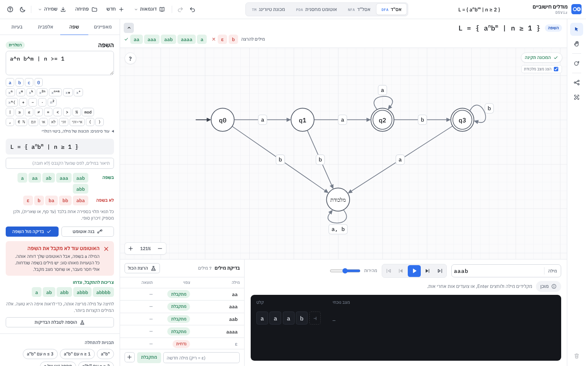

לשונית "שפה" בפאנל הצד. כותבים שפה כמו בספר, רואים מיד מה היא אומרת, בונים ממנה אוטומט, ובודקים מולה את האוטומט שעל הקנבס.
המנוע טהור (בלי DOM) ב-`js/lang/`, כולו על האובייקט `AutomataLang` (ב-Node: `require('./js/lang/index.js')`). הממשק: `js/lang-panel.js`, `css/lang.css`. מחקר: [`research-language.md`](research-language.md).

| קובץ | תפקיד |
|---|---|
| `lang/lex.js` | אסימונים. מקבל ASCII (`^`, `>=`, `!=`, `mod`, `%`, `#a`) וסימנים (`ⁿ`, `≥`, `≠`, `∈`, `∪`) |
| `lang/parse.js` · `lang/regex.js` | מפענח לעץ (שלוש הצורות), שגיאות `LangError { message, pos, end, hint }` |
| `lang/oracle.js` | `accepts(ast, word)` ישירות מההגדרה, `sample` (המילים הקצרות), `pretty` (כתיבה יפה) |
| `lang/classify.js` | `analyze(ast)` → `{ cls, label, why }` |
| `lang/fa.js` | Thompson, תת-קבוצות, מזעור, `compare` (מכפלה + דוגמאות נגדיות), `dfaToMachine` |
| `lang/build.js` · `lang/pda.js` · `lang/tm.js` | `build(ast)`: אס"ד מינימלי / אוטומט מחסנית / מכונת טיורינג, עם בדיקה עצמית |
| `lang/extra.js` | תבנית של מילה (`w wᴿ`, `ww`, `w#w`): פענוח, שייכות, סיווג. אוטומט מחסנית ל-`wwᴿ`, ל-`w c wᴿ`, לפלינדרום ולסוגריים מאוזנים |
| `lang/check.js` | `check(machine, ast)`, `checker` (בחלקים), `hint` |
| `lang/templates.js` | 18 התבניות של הגלריה |

### 13.1 מה אפשר לכתוב

שדה אחד, והצורה מזוהה לבד. עטיפה של `L = { … }` רשות.

| צורה | דוגמאות | כללים |
|---|---|---|
| **בלוקים** | `a^n b^m \| n >= 2, m = 2n` · `aⁿb²ⁿ` · `(ab)^n c^3` · `a* b+` · `a^(2n+1) b^n` · `0^n 1^n` · `a^(2^n)` | בלוק = אות או `(מילה)`, ואחריו חזקה: מספר, משתנה, `2n`, `n+1`, `(2n+1)`, `*` (אפס או יותר), `+` (אחד או יותר), או חזקה של מספר: `(2^n)`. חזקה נדבקת לאות האחרונה (`ab^n` = a·bⁿ). משתנים הם ≥ 0. אחרי `\|` (או `:` או פסיק) באים התנאים |
| תנאים | `n >= 2` · `0 < n < m` · `n != m` · `m = 2n + 1` · `n mod 3 = 1` (או `%`) · `n זוגי` / `אי-זוגי` · `n מתחלק ב-3` · `(n + m) mod 2 = 0` | השוואות `= ≠ < > ≤ ≥` בין ביטויים ליניאריים. חיבור: פסיק או `וגם` (גם `∧`, `&`), `או` (`∨`), `לא` (`¬`, `!`), סוגריים. פסיק חלש מ"או" |
| **תכונה של מילה** | `w ∈ {a,b}* \| #a(w) mod 2 = 0 וגם מסתיימת ב-ab` · `\|w\| מתחלק ב-3` · `#a(w) = #b(w)` · `לא מכילה aa` · `פלינדרום` · `w ∈ {(,)}* \| מאוזנת` | `\|w\|` = אורך, `#a(w)` (או `#a`, `\|w\|_a`) = כמה a. תכונות: `מתחילה ב-`, `מסתיימת ב-`, `מכילה`, `פלינדרום`, `מאוזנת` (סוגריים מאוזנים: `(` ו-`)` מותרים כאותיות של האלפבית; אם הם לא בו, האות הראשונה פותחת והשנייה סוגרת). בלי `w ∈ {…}*` האלפבית הוא האותיות שהוזכרו ו-Σ של המכונה (ואם יוצא פחות משתיים: `{a,b}`); הוא תמיד מוצג בכתיבה היפה |
| **תבנית של מילה** | `w w^R` (או `wwᴿ`) · `ww` · `w#w` · `w c w^R` · `w#w \| w ∈ {0,1}*` | רצף של `w`, `wᴿ` (היפוך) ואותיות, עם לפחות שני `w`. `w` היא מילה כלשהי מעל `{a,b}` (או מעל Σ של המכונה, או מעל מה שנכתב אחרי `\|`). בצורה הזו `#` היא אות |
| **ביטוי רגולרי** | `(a\|b)*abb` · `(a+b)*abb` · `(ab)⁺ ∪ ε` · `a*b*` | איחוד: `\|`, `∪`, או `+` **בין שני ביטויים** (כמו בספרים). חזרות: `*`, `⁺`, `^+`, או `+` בסוף ביטוי. `ε`, `∅`, `Σ` (אות כלשהי) |

**שגיאות** (כולן בעברית, עם מיקום מדויק בטקסט המקורי והצעה): "אחרי ^ צריך לבוא מספר או משתנה" (למשל a^n או a^3), "התנאי נקטע באמצע", "המשתנה x לא מופיע באף חזקה", "כאן חסרה השוואה", "חסר סוגר סוגר )", "התו ? לא מוכר כאן", "האות n משמשת גם כאות באלפבית וגם כמשתנה", "האות c מופיעה בתנאי אבל לא באלפבית {a,b}", "בחזקה אפשר מספר, משתנה אחד, או צירוף כמו 2n+1", "אי אפשר לחלק ב-0", "לא הצלחתי להבין את ההמשך מכאן" (תנאים מפרידים בפסיק או ב"וגם").

**מה עוד לא נתמך בכתיבה** (המפענח יגיד שגיאה):
- חזקה בתוך חזקה: `(a^n b)^m`. בתוך סוגריים בבלוקים מותר רק רצף אותיות.
- מאז סבב 4 נתמכים: חזקה בכמה משתנים (`a^(n+m)`), מכפלה וריבוע (`n·m`, `n²`), ואיחוד ושרשור של שפות (13.9). עדיין לא: חזקה של מספר חוץ מ-`מספר^משתנה` (`a^(2^n + 1)`), mod בתוך חזקה, חילוק, ודקדוק חסר הקשר.
- תבנית של מילה עם תנאים (`ww | |w| > 2`), עם שני משתני מילה (`u v uᴿ`), או עם חזקות (`wⁿ`).
- אותיות של האלפבית שהן יותר מתו אחד.
- שמות המשתנים n, m, k, i, j, l, p, q, r, t לא יכולים לשמש גם כאותיות באותה נוסחה.

### 13.2 הממשק

| רכיב | התנהגות |
|---|---|
| שדה הנוסחה | `textarea` LTR, mono 15px. כל הקלדה נשמרת ב-`machine.language.text` (ובשמירה האוטומטית), ואחרי 120ms מתעדכן כל מה שמתחת |
| מקלדת הסימנים | שורות קומפקטיות מתחת לשדה: האותיות של Σ (ועוד `c`, `0`), חזקות (`xⁿ xᵐ xᵏ x²ⁿ x* x⁺`), `\|`, `≥ ≤ ≠ = < >`, `mod`, `וגם או לא זוגי אי-זוגי ( )`. ב"עוד סימנים": `w ∈ Σ*`, `\|w\|`, `#a(w)`, `מתחילה ב-`, `מסתיימת ב-`, `מכילה`, `פלינדרום`, `מאוזנת`, `ε`, `∪`, `wᴿ`, `2ⁿ`. לחיצה מכניסה במקום הסמן והפוקוס נשאר בשדה (`mousedown` לא גונב פוקוס), כך שאפשר לכתוב נוסחה שלמה בלי להחליף שפת מקלדת |
| כתיבה יפה | `L = { aⁿbᵐ \| n ≥ 2 }` עם `<sup>`. תכונות בעברית הן יחידה אחת מימין לשמאל ("מסתיימת ב-ab") בתוך השורה שמשמאל לימין |
| סיווג | תגית ליד הכותרת: "רגולרית" (ירוק), "חסרת הקשר, לא רגולרית" (כחול), "לא חסרת הקשר" (ענבר), "לא הצלחתי לסווג" (אפור). מתחת למילים: משפט אחד שמסביר למה |
| מילים לדוגמה | "בשפה" (עד 6 הקצרות) ו"לא בשפה" (עד 5). כך רואים מיד אם הנוסחה אומרת את מה שהתכוונו (למשל שהמילה הריקה בפנים). לחיצה על מילה מריצה אותה |
| שגיאה | השדה באדום, ומתחתיו: הטקסט עם המקום מסומן בקו אדום, ההודעה, וההצעה |
| "בנה אוטומט" | 13.4. אם בלשונית היעד יש מכונה: חלון אישור ("המכונה שעכשיו בלשונית … תוחלף"). נכנס להיסטוריה, Ctrl+Z מחזיר |
| "בדיקה מול השפה" | 13.5 |
| תיאור במילים | שדה רשות מתחת לכתיבה היפה. נשמר ב-`machine.language.desc` ומוצג בפס השפה. תיאור שבא עם דוגמה או עם קובץ נמחק כשמשנים את הנוסחה (הוא כבר לא מתאר אותה); תיאור שנכתב כאן נשאר |
| תבניות להתחלה | 18 כפתורים (aⁿbⁿ, aⁿbᵐ עם n ≥ 2, מספר זוגי של a, מסתיימת ב-ab, מכילה aba, אורך שמתחלק ב-3, לא מכילה aa, ביטוי רגולרי, aⁿb²ⁿ, n < m, n ≠ m, aⁿbᵐcᵐdⁿ, wwᴿ, סוגריים מאוזנים, אותו מספר a ו-b, aⁿbⁿcⁿ, w#w, a^(2ⁿ)) |
| פס השפה | מעל הקנבס: 13.8 |

### 13.3 סיווג (`classify.js`)

הסיווג מוצג לתלמידים, ולכן הוא שמרני: טוענים רק מה שיש לו הצדקה, ובכל מקרה אחר "לא הצלחתי לסווג" (הנוסחה עדיין חוקית, ואפשר לבדוק מולה).

**מושג עזר, "מחלקה":** לכל משתנה יש סף T ומחזור P (מהקבועים וה-mod שבתנאים). ערך עד T מיוצג בדיוק; מעליו, רק השארית mod P. תנאי הוא "בטוח" אם האמת שלו נקבעת מהמחלקות: תנאי על משתנה אחד, תנאי שכל המשתנים בו בתוך mod, או סכום שכל המקדמים בו באותו סימן (`n + m ≥ 5`). תנאי הוא "קשר" אם הוא ליניארי עם מקדמים בסימנים מנוגדים על שני משתנים או יותר (`n = m`, `n < 2m`).

| מסקנה | מתי | הצדקה |
|---|---|---|
| רגולרית | ביטוי רגולרי | הגדרה |
| רגולרית | בלוקים: כל משתנה בבלוק אחד, וכל התנאים בטוחים (עם כל מבנה של וגם / או / לא) | השפה היא איחוד סופי, על צירופי המחלקות שמקיימים את התנאי, של שרשורים של שפות רגולריות. הבנייה ב-13.4 היא בדיוק זו |
| רגולרית | בלוקים: המשתנים שמפריעים (משותפים לכמה בלוקים, או בתוך קשר) חסומים מלמעלה בתנאי ברמה העליונה (`n = m, n ≤ 3`) | מציבים את כל הערכים שלהם: איחוד סופי של מקרים רגולריים |
| רגולרית | תכונה: כל ההשוואות בטוחות (אחרי פתיחת `\|w\|` לסכום הספירות) | מכפלה של מונים סופיים ושל אס"דים ל"מתחילה / מסתיימת / מכילה" |
| חסרת הקשר, לא רגולרית | בלוקים: צירוף פשוט של תנאים (בלי "או"); בלוקים שאפשר להבדיל ביניהם (אותיות בודדות ששכנות שונות, או אלפביתים זרים); כל הקשרים הם זוגות (אותו משתנה בשני בלוקים, או קשר בין שני משתנים), כל משתנה בקשר אחד, והזוגות מקוננים או עוקבים; ונמצא "עד" | מחסנית: 13.4. לא רגולרית: העד הוא הצבה שבה כל הבלוקים לא ריקים והמשתנים המקושרים מעבר לסף; הזזה של שניהם לאורך הקשר נותנת אינסוף פתרונות, ולכל ערך של הראשון קבוצה אחרת של המשכים (Myhill-Nerode) |
| חסרת הקשר, לא רגולרית | תכונה: השוואה ליניארית אחת עם סימנים מנוגדים (`#a(w) = #b(w)`, `#a(w) > #b(w)`, `#a + #c = #b`), או "פלינדרום" (עם שתי אותיות ומעלה) | מונה אחד (שלם) במחסנית. ב-`=` ו-`≠` נבדק גם שהמשוואה פתירה (gcd), אחרת "לא הצלחתי לסווג" |
| חסרת הקשר, לא רגולרית | תבנית `w wᴿ` (עם שתי אותיות ומעלה) או `w c wᴿ` כש-c לא באלפבית של w; תכונה שהיא רק `מאוזנת` | מחסנית: 13.4. לא רגולריות: שפות קלאסיות (Myhill-Nerode: לכל רישא aⁿb, או `(ⁿ`, המשך אחר) |
| לא חסרת הקשר | תבנית `ww` (עם שתי אותיות ומעלה) או `w c w` כש-c לא באלפבית של w | שפת ההעתקה: למת הניפוח לשפות חסרות הקשר |
| לא חסרת הקשר | בלוק יחיד עם חזקה של מספר ובלי תנאים (`a^(2^n)`, `(ab)^(3^n)`) | אחרי הומומורפיזם הפוך זו שפה מעל אות אחת; שם כל שפה חסרת הקשר היא רגולרית (Parikh), והשפה הזו לא רגולרית כי המרווחים בין אורכי המילים גדלים בלי סוף |
| לא חסרת הקשר | בלוקים: אותו משתנה בשלושה בלוקים ומעלה (`aⁿbⁿcⁿ`); שרשרת של שוויונות על שלושה משתנים (`n = m, m = k`); שרשרת `n < m < k`; שני זוגות שוויון מצטלבים (`aⁿbᵐcⁿdᵐ`). בכולם עם עד | המשפחות הקלאסיות (למת הניפוח לשפות חסרות הקשר), אחרי חיתוך עם שפה רגולרית |
| לא חסרת הקשר | תכונה: צירוף של שני שוויונות בלתי תלויים `#x = #y` או יותר (`#a = #b וגם #b = #c`) | חיתוך עם `a*b*c*` נותן `aⁿbⁿcⁿ` |
| לא הצלחתי לסווג | כל השאר. למשל: קשר בתוך "או" (`n = m או n ≠ m`), `n ≠ m, m ≠ k`, `n < 2m, m < 2n`, `a^(n·m)`, משוואה בלי פתרון (`2n = 2m + 1`), קשר ועוד תנאי בתכונה (`#a = #b וגם \|w\| < 5`), תבנית מעל אות אחת (`ww \| w ∈ {a}*`), `www`, `לא מאוזנת`, חזקה של מספר על אותה אות עם בלוק נוסף (`a^(2^n) aⁿ`). מה שכאן היה "לא ידוע" בסבב 3 ומוכרע היום (`n + m = k`, `aⁿaⁿ`, `a^(2^n) bⁿ`) מוכרע בכללים של 13.9 | |

`test/lang-build.test.js` מחזיק טבלה של 49 נוסחאות עם הסיווג הנכון, כולל המקרים המנוונים (שפה ריקה, תנאי שתמיד נכון), ו-`test/lang-extra.test.js` עוד 17 לתוספות.

### 13.4 בנייה (`build.js`, `pda.js`, `tm.js`)

| סיווג | מה נבנה | איך |
|---|---|---|
| רגולרית | **אס"ד מינימלי**, מלא (עם מצב "מלכודת" אם צריך), מצבים `q0, q1…` לפי BFS, פריסה בשכבות והמלכודת מתחת | ביטוי רגולרי → Thompson → תת-קבוצות → מזעור. בלוקים → ביטוי רגולרי: איחוד על צירופי המחלקות (ערך מדויק: `u^k`; מחלקה מחזורית: `u^k (u^{cP})*`). תכונה → מכפלה עצלה של מוני מחלקות ושל אס"דים קטנים לתכונות המחרוזת |
| חסרת הקשר (בלוקים) | **אוטומט מחסנית** (מצב מקבל). `aⁿbⁿ` יוצא בשלושה מצבים | הבלוק הפותח דוחף a אסימונים `A` לכל יחידה, הסוגר שולף b. מתחתם סמן (`Z` לזוג חיצוני, `M` לזוג מקונן). `=`: בסוף שולפים בדיוק k (k שלילי: דוחפים `\|k\|` מראש). `≥`: ואז מותר לשלוף את השאר. `≤`: כל שליפה היא רשות. `≠`: איחוד של `>` ו-`<`. תנאי על משתנה אחד (`n ≥ 2`, `n זוגי`): אוטומט אונרי ממוזער בתוך הבלוק |
| חסרת הקשר (תבנית, תכונה) | **אוטומט מחסנית** ל-`w wᴿ` ול-`w c wᴿ` (דוחפים, מנחשים את האמצע או קוראים את c, שולפים ומשווים; 3 מצבים), ל`פלינדרום` (כמו `wwᴿ`, ובאמצע מותרת גם אות אחת), ול`מאוזנת` (2 מצבים) | `lang/extra.js` |
| לא חסרת הקשר | **מכונת טיורינג** למשפחה `aⁿbⁿcⁿ` (שלוש אותיות ומעלה, עם `n ≥ 0` או `n ≥ 1`) | מסמנים אות אחת מכל בלוק בכל סיבוב, ובסוף בודקים שנשארו רק סימונים |
| כל השאר | "בנייה אוטומטית לשפה כזו עוד לא נתמכת. אפשר לבנות לבד, ולבדוק מול השפה." | |

**מה לא נבנה אוטומטית** (אבל אפשר לבדוק מולו, ולשלוש האחרונות יש דוגמה מוכנה): תכונות ספירה שאינן רגולריות (`#a(w) = #b(w)`); אוטומט מחסנית כשיש חזקה עם קבוע שלילי (`a^(n-1)`), יותר משני קשרי `≠`, או קשר עם מקדמים שאינם 1 משני הצדדים (`n < 2m, m < 2n`); וחזקות לא ליניאריות (`n·m`, `n²`); מכונת טיורינג לכל דבר חוץ מ-`aⁿbⁿcⁿ…`, ובפרט `ww`, `w#w` ו-`a^(2^n)`; וכל מה שסווג "לא הצלחתי לסווג".

**בדיקה עצמית:** לפני שמכונה מוצגת, `verify` משווה אותה ל-`accepts` על כל המילים עד אורך שנקבע לפי תקציב (אס"ד: 3,000 מילים; מחסנית וטיורינג: 700), ובבלוקים גם על כל המילים "בצורה הנכונה" עד אורך 12. מכונה שנכשלת **לא מוצגת** (מוחזר "עוד לא נתמכת"). ההודעה אחרי הבנייה אומרת על כמה מילים היא נבדקה.
למכונה מצורפות בדיקות (4 מילים בשפה, 3 מחוצה לה), השם (הכתיבה היפה) והשפה.

### 13.5 בדיקת האוטומט של התלמיד (`check.js`)

| מתי | איך | מה נאמר |
|---|---|---|
| שפה שסווגה רגולרית + אס"ד / אסל"ד | **מדויק.** האוטומט של התלמיד → אס"ד (תת-קבוצות, כולל ε) → מכפלה עם האס"ד המינימלי של השפה, על כל הזוגות הישיגים | "האוטומט מקבל בדיוק את השפה. זו הוכחה: האוטומט הושווה במלואו לאס"ד המינימלי של השפה." |
| כל השאר (מחסנית, טיורינג, שפה לא רגולרית או לא מסווגת) | **חסום.** כל המילים מעל האלפבית, מהקצרה לארוכה, עד תקציב (אס"ד 20,000; אסל"ד 12,000; מחסנית 2,500; טיורינג 1,500 מילים) או 6 שניות. רץ בחלקים של 30ms כדי שהממשק לא ייתקע, עם "בודק… N מילים" | "נבדקו כל 2,047 המילים עד אורך 10. לא נמצאה טעות. זו בדיקה, לא הוכחה: ייתכן שיש טעות במילה ארוכה יותר." |

האלפבית של הבדיקה: של הנוסחה, ועוד כל אות שהמכונה מכירה (מילה עם אות כזו אינה בשפה, ואסור שתתקבל). הרצה שלא הוכרעה (מגבלת צעדים) נחשבת "לא התקבלה", והמספר שלהן מוצג.

**כישלון:** "האוטומט עוד לא מקבל את השפה", רמז של שורה אחת, ושתי רשימות, מהקצרה לארוכה, עד 5 בכל אחת:
- "צריכות להתקבל, ונדחו" (ירוק) · "צריכות להידחות, והתקבלו" (אדום).
- בבדיקה המדויקת אלה באמת הקצרות ביותר (מרחק BFS במכפלה, ואז מניית מילים לפי אורך וסדר האלפבית). בחסומה עוצרים אורך אחד אחרי הטעות הראשונה.
- לחיצה על מילה טוענת אותה לחלון ההרצה ומנגנת, כך שרואים איפה היא נתקעת.
- "הוספה לטבלת הבדיקות" מוסיף את כל המילים עם הציפייה הנכונה (נכנס להיסטוריה).
- הרמז (`hint`) מדבר רק על מילים, לא על מבנה הפתרון: "האוטומט שלך מקבל את המילה הריקה, אבל היא לא בשפה." / "המילה ab בשפה, אבל האוטומט שלך דוחה אותה." ועוד משפט לפי סוג הטעויות (רק נדחות / רק מתקבלות / שני הסוגים).

אם האוטומט או הנוסחה השתנו אחרי הבדיקה, התוצאה מוחלפת ב"האוטומט או השפה השתנו מאז הבדיקה. אפשר לבדוק שוב."

### 13.6 קובץ תרגיל (למורים)

- השפה נשמרת בקובץ המכונה: `"language": { "text": "a^n b^m | n >= 2", "desc": "…", "allowBuild": true, "locked": false }` (7.1). קובץ בלי השדה נטען כרגיל.
- "שמירת קובץ תרגיל": קובץ `תרגיל - <השפה>.automaton.json` עם קנבס ריק (בסוג המכונה של הלשונית הנוכחית), האלפבית של הנוסחה, התיאור במילים אם נכתב, ו-`locked: true`.
- כשנטען קובץ נעול: נפתחת לשונית "שפה", השדה לקריאה בלבד, אין מקלדת, תבניות או אזור למורים, והתגית בפס השפה אומרת "תרגיל".
- "לאפשר לתלמיד את 'בנה אוטומט'": אם כבוי (`allowBuild: false`), הכפתור לא מופיע בקובץ הנעול.
- "ביטול הנעילה (למורים)" מחזיר עריכה. זו לא הגנה (הקובץ הוא JSON פתוח), רק ברירת מחדל נוחה.

### 13.7 בדיקות

- `test/lang-linear.test.js` (8) ו-`e2e/lang2.js` (7 שלבים): סבב 4, ב-13.9.
- `test/lang-extra.test.js` (5): תבנית של מילה (פענוח, כתיבה יפה, שייכות, `#` כאות), "מאוזנת", `a^(2^n)`, טבלת סיווג של 17 נוסחאות, ואוטומטי המחסנית החדשים מול הנוסחה על כל המילים עד אורך 10.
- `test/lang-parse.test.js` (6): שלוש הצורות, חזקות, תנאים, תכונות, `+` בביטוי רגולרי, ו-12 שגיאות עם מיקום.
- `test/lang-build.test.js` (8): בדיקת השייכות; טבלת הסיווג; כל 18 התבניות (סיווג, בנייה, שקילות לנוסחה על כל המילים הקצרות, בלי שגיאות תקינות); מספר המצבים של אס"דים מוכרים; 20 משפחות של אוטומטי מחסנית; מכונת טיורינג; מה שלא נתמך; ו-**fuzz עם זרע קבוע**: 150 נוסחאות רגולריות אקראיות משלוש הצורות, האס"ד מול בדיקת השייכות על כל המילים עד אורך 8.
- `test/lang-check.test.js` (9): שקילות מדויקת (כולל אסל"ד עם ε); הדוגמה הנגדית באמת הקצרה ביותר ובאמת מבדילה; הבדל שמתגלה רק במילה באורך 7; אות זרה; בדיקה חסומה למחסנית ולטיורינג; בדיקה בחלקים; הרמז; וכל מכונה שנבנית עוברת את הבדיקה מול השפה שלה.
- `e2e/lang.js` (10 שלבים): הקלדה ותצוגה, מקלדת הסימנים, שגיאה, בנייה והרצה, הוכחה, כישלון ולחיצה על דוגמה נגדית, מחסנית ובדיקה חסומה, שפה בלי בנייה, קובץ תרגיל, מצב כהה. מצלם `docs/shots/lang-*.png`.

### 13.8 פס השפה שמעל הקנבס (`lang-strip.js`)

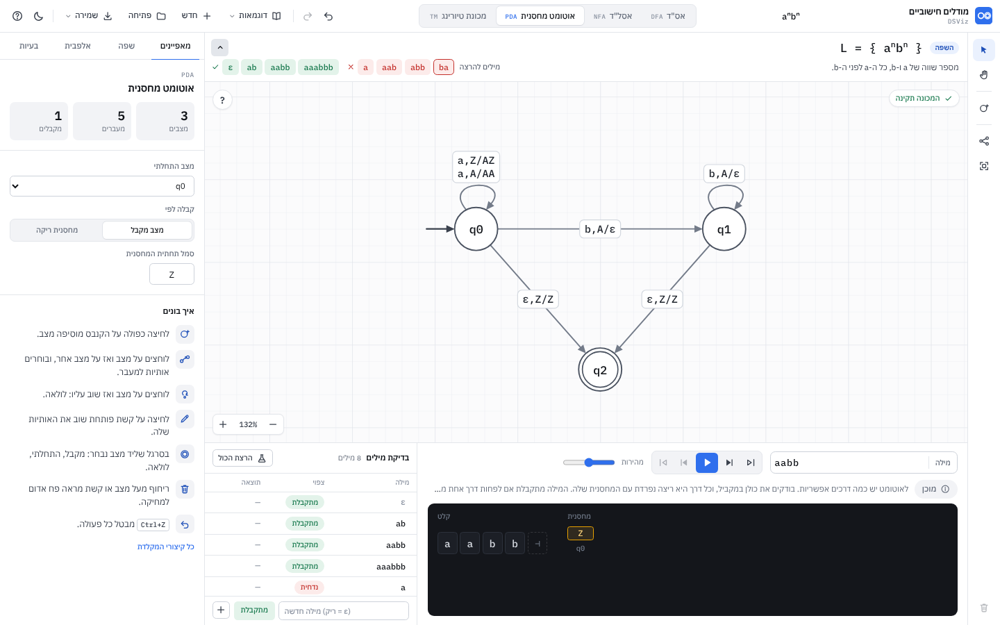

רכיב אחד, `LangStrip`, לשלושה מצבים: דוגמה מוכנה, שפה שהמשתמש כתב בלשונית "שפה", וקובץ תרגיל. הוא שורה אמיתית בפריסה, מעל הקנבס ולא עליו, כך שהוא לא מסתיר את השרטוט.

| חלק | התנהגות |
|---|---|
| תגית | "השפה", או "תרגיל" בקובץ נעול |
| הנוסחה | הכתיבה היפה (`L = { aⁿbⁿ }`), mono 19px, משמאל לימין. לחיצה פותחת את לשונית "שפה" |
| תיאור | `language.desc`, שורה אחת בעברית. אם אין, השורה לא מוצגת |
| מילים להרצה | המילים שבטבלת הבדיקות של המכונה (עד 9); אם הטבלה ריקה, 4 הקצרות שבשפה ו-3 שמחוצה לה. שתי קבוצות: ✓ ואחריו המילים שבשפה (ירוק), ✗ ואחריו המילים שאינן בה (אדום), **לפי הנוסחה** ולא לפי המכונה. לחיצה מריצה את המילה מההתחלה |
| קיפול | כפתור חץ בקצה. מקופל: שורה דקה (כ-36px) עם התגית והנוסחה בלבד. ההעדפה נשמרת ב-`localStorage['dsviz.automata.strip']` |
| מתי מוצג | כשיש למכונה נוסחה שמתפענחת. נוסחה ריקה או שבורה: הפס נעלם |
| שינוי גובה | כשהפס מופיע, נעלם או מתקפל באותה מכונה, התצוגה זזה בחצי ההפרש כדי שהשרטוט יישאר במרכז הקנבס |

`e2e/examples.js` (8 שלבים): התפריט; דוגמה עם פס; מילה בלחיצה; כל 20 הדוגמאות (פס, כל הבדיקות עוברות, כל השרטוט בתוך הקנבס); קיפול והעדפה שנשמרת; אותו פס לשפה של המשתמש, תיאור שנמחק כשהנוסחה משתנה; ריחוף על קשת; מצב כהה. מצלם `docs/shots/ex-*.png`.

### 13.9 סבב 4: חזקות בכמה משתנים, שארית, מכפלות, איחוד ושרשור

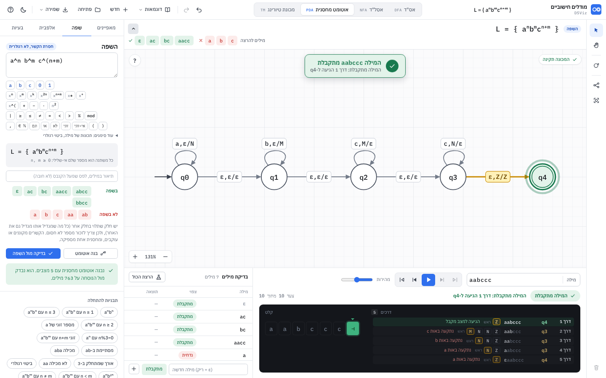

קבצים: `lang/vec.js` (צורה נורמלית וסיווג), `lang/vec-build.js` (אס"ד ואוטומט מחסנית), `lang/combine.js` (איחוד ושרשור). בדיקות: `test/lang-linear.test.js` (8) ו-`e2e/lang2.js` (7 שלבים, צילומי `r4-*.png`).

**כתיב חדש**

| מה | דוגמאות | כללים |
|---|---|---|
| חזקה ליניארית בכמה משתנים | `a^(n+m)` · `a^(2n+m+1)` · `aⁿ⁺ᵐbⁿ` · `a^n+m b^n` · `a^n b^m c^(n+m)` · `a^(n+m) b^(n-m) \| n ≥ m` | בסוגריים, בחזקה עילית, או בלי סוגריים כשאין רווח (`a^n+m`). מקדמים שלמים. מינוס מותר, אבל כל משתנה צריך להופיע לפחות פעם אחת עם פלוס. הצבה שנותנת חזקה שלילית לא נותנת מילה |
| מכפלה וריבוע | `a^(n*m)` · `a^(n·m)` · `a^(n^2)` · `a^(n²)` · `aⁿb^(n^2)` | `*`, `·` או `×`. בתנאים מותר, ואז התנאי "לא בטוח" (13.3) |
| שארית | `n%3=0` · `n mod 3 = 0` · `n ≡ 0 (mod 3)` · `n ≡ 1 mod 3` · `(n+m)%2=1` · `n ≡ m (mod 2)` · `\|w\| % 3 = 0` · `#a(w) mod 2 = #b(w) mod 2` | `x ≡ y (mod k)` נקרא `x mod k = y mod k`. שארית על סכום של משתנים היא תנאי "בטוח": היא נקבעת מהמחלקה של כל משתנה |
| איחוד ושרשור של שפות | `a^n b^n ∪ b^n a^n` · `{a^n b^n} ∪ {b^n a^n}` · `{a^n b^n} · {c^k}` · `{a^n b^n}{c^k}` | כל חלק בכל צורה, עם משתנים משלו. ∪ חלש משרשור. שרשור רק בין חלקים בסוגריים מסולסלים: `aⁿ·bⁿ` בלי סוגריים זו שפה אחת, עם אותו n. ∪ בין ביטויים רגולריים נשאר ביטוי רגולרי |

**שייכות.** בחזקה כללית עוברים על כל הערכים של המשתנים שעוד לא נקבעו, מ-0 עד `|w| + C`, כש-C הוא 2 ועוד סכום הקבועים והמודולים שבנוסחה. משתנה שמופיע בחזקה עם פלוס כבר חסום באורך המילה; C נוגע רק למקרים כמו `a^(n·m)` עם n = 0, שבהם המילה לא קובעת את m. איחוד: חלק אחד לפחות מקבל. שרשור של בלוקים: שפת בלוקים אחת (המשתנים של כל חלק מקבלים שם משלו). שרשור אחר: חיפוש של נקודת חלוקה.

**צורה נורמלית** (`vec.js`). בלוקים u_i עם חזקה E_i = k_i + Σ c_iv·v, כל c_iv ≥ 0. מגיעים אליה בהצבות שלא משנות את השפה (כל הצבה של המשתנים החדשים נותנת הצבה של הישנים, ולהפך):

| הצבה | דוגמה |
|---|---|
| שוויון ברמה העליונה, y = ביטוי עם מקדמים אי-שליליים | `k = n + m`: k מוחלף ב-n + m |
| אי-שוויון, y ≥ ביטוי: y = ביטוי + s, עם משתנה חדש s ≥ 0 | `n ≤ m`: m מוחלף ב-n + s. `n < m`: ב-n + 1 + s |
| חזקה עם מינוס, y − m + d = p: y = p + m − d | `aⁿ⁺ᵐbⁿ⁻ᵐ`: `a²ᵐ⁺ᵖbᵖ` |

אם הביטוי שהוצב עלול להיות שלילי, נוסף תנאי "ביטוי ≥ 0" (תמיד בטוח: כל המקדמים בו חיוביים). אחר כך בלוקים סמוכים עם אותה מילה מתאחדים (uⁿuᵐ = uⁿ⁺ᵐ), ומשתנים עם אותה עמודה שלא מופיעים בתנאי מתאחדים (הסכום שלהם מקבל כל ערך). אם אחרי זה נשאר תנאי לא בטוח, או חזקה עם מינוס שאי אפשר להציב: "לא הצלחתי לסווג".

**כללי הסיווג.** מופעלים כשיש חזקה כללית, או כשהכללים של 13.3 לא הכריעו. העמודה של משתנה v היא (c_1v, …, c_kv), והתמיכה שלו היא הבלוקים שבהם c_iv > 0. U: המשתנים שיכולים לגדול בלי גבול, כלומר שבצירוף מחלקות כלשהו שמקיים את התנאי הם במחלקה מחזורית; כל משתנה אחר מקבל מספר סופי של ערכים. S: קבוצת וקטורי החזרות (N_1, …, N_k) של המילים בשפה.

| כלל | מתי | הצדקה |
|---|---|---|
| R1 רגולרית | כל משתנה ב-U בבלוק אחד לכל היותר (`a^(n+m)`, `aⁿbᵐ \| (n+m)%2=0`) | לכל צירוף מחלקות, כל בלוק הוא u_i^(קבוע)(u_i^(c·P))*. השפה היא איחוד סופי של שרשורים של שפות רגולריות |
| R3 רגולרית | משתנה v ב-U בכמה בלוקים, ובכל בלוק שלו יש "ממלא": משתנה ב-U שנמצא רק בבלוק הזה ולא מופיע בתנאי (`aⁿ⁺ᵐbᵐ⁺ᵏ`) | אם v ≥ T + K·P, מורידים מ-v את K·P ומוסיפים לכל ממלא בדיוק את מה שחסר (K היא כפולה משותפת של המקדמים של הממלאים). המחלקה של v לא משתנה והממלאים לא בתנאי, אז ההצבה החדשה עדיין מקיימת אותו, ונותנת אותה מילה. לכן מספיק ש-v יקבל ערכים עד T + K·P, וזה R1 |
| C1 חסרת הקשר | כל משתנה ב-U בשני בלוקים לכל היותר, ואין שני משתנים עם זוגות מצטלבים (i < k < j < l) | הבנייה שלמטה. זה הכיוון הקל של משפט Ginsburg-Spanier: קבוצה "מרובדת" נותנת שפה חסרת הקשר |
| NR לא רגולרית (יחד עם C1) | יש בלוקים i ≠ j כך שכל משתנה ב-U שמגדיל את N_j מגדיל גם את N_i, ויש לפחות אחד כזה (`aⁿ⁺ᵐbⁿ`, `aⁿbᵐcⁿ⁺ᵐ`) | אז N_j ≤ C·N_i + D על כל S, ו-N_j לא חסום. אם השפה רגולרית, גם ההטלה של S על (i, j) "מזוהה" (איחוד סופי של מכפלות A×B של קבוצות מחזוריות). באחת מהן B אינסופית, ואז (min A, b) ∈ S עם b גדול כרצוננו, בסתירה לחסם |
| NC1 לא חסרת הקשר | יש משתנה v ב-U בשלושה בלוקים ומעלה, והעמודה שלו אינה צירוף אי-שלילי של עמודות של משתנים ב-U שנמצאים בשני בלוקים לכל היותר (`aⁿbⁿcⁿ`, `aⁿ⁺ᵐbⁿcⁿ`, `aⁿbⁿ⁺ᵐcⁿ⁺ᵏ`, `aⁿ⁺ᵐbⁿ⁺ᵐcⁿ⁺ᵐ`) | לפי Ginsburg, אם השפה חסרת הקשר אז S איחוד סופי של קבוצות ליניאריות מרובדות (כל מחזור בשני בלוקים לכל היותר). הקרן N₀ + t·col_v נמצאת ב-S, אז אינסוף מהנקודות שלה בקבוצה אחת, ו-col_v בקונוס של המחזורים שלה. כל מחזור כזה בקונוס של עמודות U, ובגלל שהכול אי-שלילי, הוא צירוף של עמודות שהתמיכה שלהן בתוך התמיכה שלו, כלומר בשני בלוקים לכל היותר. סתירה. החישוב: אלימינציה של Fourier-Motzkin במספרים שלמים, בלי עיגול |
| NC2 לא חסרת הקשר | שני משתנים ב-U עם זוגות מצטלבים, ואף משתנה אחר ב-U לא נוגע בארבעת הבלוקים (`aⁿbᵐcⁿdᵐ`) | אחרי מחיקת שאר הבלוקים, S איחוד סופי של קבוצות עם שני כיווני מחזור מצטלבים. קבוצה מרובדת יכולה להכיל רק אחד מהם, וכך אי אפשר לכסות נקודות ששני הפרמטרים בהן גדולים |
| NL לא חסרת הקשר | בלוק שמספר החזרות שלו תלוי במשתנה אחד בלבד וגדל כמו פולינום ממעלה 2 ומעלה עם מקדם מוביל חיובי, או כמו 2ⁿ; המשתנה לא חסום; אין מינוס בחזקות, והתנאים על משתנה אחד בכל פעם (`a^(n²)`, `aⁿb^(n²)`, `a^(2^n) bⁿ`) | מוחקים את שאר הבלוקים (הומומורפיזם) ומקבלים u^T. המרווחים בין איברי T גדלים בלי סוף, אז T לא מחזורית מנקודה מסוימת ו-u^T לא רגולרית. מעל אות אחת (אחרי הומומורפיזם הפוך) כל שפה חסרת הקשר היא רגולרית (Parikh). המעלה נקבעת מהפרשים סופיים של 14 ערכים |
| איחוד | כל החלקים רגולריים: רגולרית. כולם חסרי הקשר: "חסרת הקשר". "לא רגולרית" או "לא חסרת הקשר" רק כשיש חלק בלוקים L₁ שהוכח עליו, וכל שאר החלקים נותנים בתוך המעטפת u₁*…u_k* שלו רק מספר סופי של מילים (`aⁿbⁿ ∪ bⁿaⁿ`) | (L₁ ∪ L₂) ∩ u₁*…u_k* = L₁ ∪ F, עם F סופית. אם האיחוד רגולרי (חסר הקשר), גם L₁ ∪ F כזו, ואז גם L₁ = (L₁ ∪ F) ∖ (F ∖ L₁). כדי לבדוק ש-F סופית: לחלק רגולרי, האס"ד שלו; לחלק בלוקים, קבוצה רגולרית שמכילה אותו (לכל בחירה אילו משתנים חיוביים: u^(מינימום)u* בכל בלוק שגדל); חיתוך עם המעטפת, ובדיקה שאין מעגל במכפלה |
| שרשור | של בלוקים: שפת בלוקים אחת, וכל הכללים חלים (`{aⁿbⁿ}·{cᵏ}` חסרת הקשר ולא רגולרית). אחרת: רגולרית · רגולרית = רגולרית, חסרות הקשר: "חסרת הקשר" | סגירות |

הטענות השליליות (NR, NC1, NC2, NL) רק כשאפשר לפרק כל מילה לבלוקים בדרך אחת, כלומר כשלכל שני בלוקים אין אות משותפת. אז השפה היא תמונה הומומורפית של שפה מעל a₁*…a_k* עם אותה S, ושני הכיוונים שומרים על רגולריות ועל חסרות הקשר.

**תווית חדשה: "חסרת הקשר"** (`cfany`, בכחול): חסרת הקשר בוודאות, בלי טענה על רגולריות. למשל `aⁿbⁿ ∪ aⁿb²ⁿ` ו-`aⁿ⁺ᵐbⁿ⁺ᵏcᵐ⁺ᵏ`.

**בנייה**

| סיווג | מה נבנה | איך |
|---|---|---|
| R1, R3 | אס"ד מינימלי | איחוד על צירופי המחלקות של u_i^(קבוע)(u_i^(c·P))* (ב-R3 המשתנים שבכמה בלוקים מקבלים ערכים מדויקים עד החסם), ואז Thompson, תת-קבוצות ומזעור. `aⁿ \| n%3=0`: 3 מצבים. `aⁿbᵐ \| n%3=0`: 5. `(ab)ⁿ \| n%3=0`: 7. `a^(2n+m+1)`: 2 |
| C1 | אוטומט מחסנית | כל בלוק מתפרק לתתי-בלוקים (uⁿ⁺ᵐ = uᵐuⁿ, כי זו אותה מילה): קודם המשתנים שנסגרים בו (האחרון שנדחף נשלף ראשון), אחר כך הקבוע והמשתנים החופשיים, ובסוף המשתנים שנפתחים בו (זה שנסגר מאוחר יותר נדחף ראשון). משתנה שנפתח קורא u^c ודוחף סמל משלו (האות הגדולה של שמו) על כל יחידה, ועוקב אחרי המחלקה שלו באוטומט אונרי. משתנה שנסגר שולף את הסמל שלו על כל יחידה. בסוף ε,Z/Z למצב המקבל, כך שסמל שנשאר חוסם את הקבלה, וכל יחידה שנדחפה נשלפת בדיוק פעם אחת. תנאי על כמה משתנים (`(n+m)%2=0`): איחוד של אוטומט לכל צירוף מחלקות, עד 24. `aⁿbᵐcⁿ⁺ᵐ`: 5 מצבים, `aⁿ⁺ᵐbⁿ`: 4 |
| איחוד, שרשור | אס"ד או אוטומט מחסנית | אס"ד: אסל"ד עם ε מהחלקים, תת-קבוצות ומזעור. מחסנית: מצב התחלה חדש עם ε לכל חלק. בשרשור, כל חלק אחרי הראשון מתחיל בדחיפת "תחתית" חדשה (ה-Z שלו מוחלף בה), כך שהוא לא רואה את מה שהחלק הקודם השאיר. `aⁿbⁿ ∪ bⁿaⁿ`: 7 מצבים |
| NC1, NC2, NL | לא נבנה | "בנייה אוטומטית לשפה כזו עוד לא נתמכת". אפשר לבנות לבד ולבדוק בבדיקה החסומה |

כל מכונה עוברת את הבדיקה העצמית של 13.4 לפני שהיא מוצגת. **הבדיקה מול השפה** כמו 13.5: מדויקת (הוכחה) כשהשפה רגולרית והמכונה אס"ד או אסל"ד, גם באיחוד ושרשור. חסומה בכל השאר, גם במכפלות ובריבועים.

**ממשק.** במקלדת שורה חדשה: `x^(`, `+`, `−`, `·`, `n²`; ובשורת החזקות `xⁿ⁺ᵐ`; `%` ליד mod. ב"עוד סימנים": `≡`, `(mod 3)`, `{ }·{ }`. חמש תבניות חדשות: aⁿbᵐcⁿ⁺ᵐ, aⁿ⁺ᵐbⁿ, aⁿbⁿ ∪ bⁿaⁿ, aⁿ עם n%3=0, aⁿbᵐ עם n+m זוגי. שגיאות חדשות, כל אחת עם הצעה: "המשתנה m מופיע רק עם מינוס" (`a^(n+m) b^(n−m)`), "בחזקה צריך לפחות משתנה אחד עם פלוס", "בחזקה אי אפשר mod" (כותבים תנאי אחרי |), "אחרי ≡ צריך לכתוב לפי איזה מספר" (`n ≡ 1 (mod 3)`), "חסרה שפה לפני / אחרי ה∪".


**מה עוד לא נתמך**
- בכתיבה: mod או חילוק בתוך חזקה, חזקה של מספר חוץ מ-`מספר^משתנה`, חזקה בתוך סוגריים של בלוק (`(a^n b)^m`), דקדוק חסר הקשר, ותבניות של מילה עם תנאים.
- בסיווג ("לא הצלחתי לסווג"): קשר שלא נפתח בהצבה (`n < 2m, m < 2n`, `n ≠ m + k`); מכפלה (`a^(n·m)`, גם כשהשפה בעצם רגולרית); ריבוע ועוד משתנה באותו בלוק (`a^(n²+m)`); איחוד שבו החלק שהוכח מכוסה בחלק אחר (`{aⁿbⁿcⁿ} ∪ {aⁿbᵐ}`, שהוא באמת לא חסר הקשר).
- בבנייה: כל מה שלא חסר הקשר (אין מכונת טיורינג אוטומטית מעבר ל-`aⁿbⁿcⁿ…`), חזקה עם קבוע שלילי, ויותר מ-24 צירופי מחלקות.

**בדיקות.** `test/lang-linear.test.js` (8): פענוח וכתיבה יפה; שבעה כתיבים של שארית נותנים אותו אס"ד של 3 מצבים, ומספרי מצבים ידועים; שייכות; טבלת סיווג של 40 נוסחאות עם התשובה הידועה; בנייה של 16 משפחות ושקילות לנוסחה על כל המילים עד אורך 10 (שתי אותיות), 7 (שלוש) או 30 (אחת); איחוד ושרשור; בדיקה מול השפה; ו-fuzz עם זרע קבוע: 70 שפות בלוקים אקראיות עם חזקות בכמה משתנים, כל מכונה שנבנית מול השייכות. מחוץ לבדיקות הרצתי את אותו fuzz על 900 שפות (שלושה זרעים): אף מכונה לא נכשלה בבדיקה העצמית, ו-6 נשארו "לא הצלחתי לסווג". שינויים בטבלאות הקודמות: `aⁿaⁿ`, `n + m = k`, `n = m, 2n = 2m` ו-`a^(2^n) bⁿ` הוכרעו (קודם "לא ידוע"). `e2e/lang2.js` (7 שלבים): הקלדה של `a^n b^m c^(n+m)` עם המקלדת, בנייה והרצה של `aabccc`; `a^n | n%3=0` לאס"ד של 3 מצבים והוכחה בשלושה כתיבים; מקלדת; איחוד; ריבוע; שגיאה.

### 13.10 סבב 7: תנאים על המשתנים, ומקלדת קטנה יותר

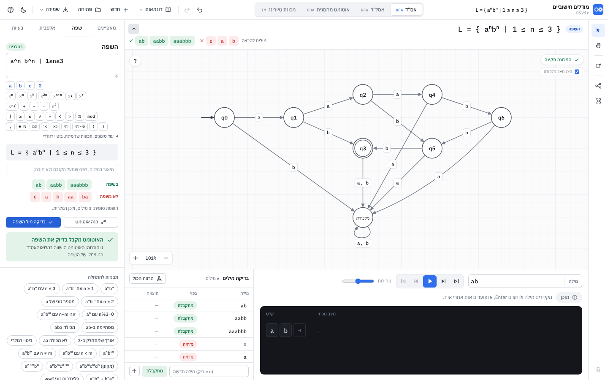

**כתיב התנאים** (אחרי `|`, `:` או `/`, עם רווחים או בלי, או אחרי "כאשר"):

| מה | דוגמאות | הערה |
|---|---|---|
| גבול אחד | `n<1` · `n>2` · `n≥1` / `n>=1` · `n≤5` / `n<=5` · `n=3` · `n≠0` / `n!=0` | |
| טווח | `1≤n≤5` · `1<n<4` · `2 ≤ n < m` | נשמר כשרשרת בכתיבה היפה |
| יחס בין משתנים | `n<m` · `n>m` · `n≤m` · `n≥m+2` · `m=2n` · `n=m+1` · `n≠m` · `n+m≥3` · `2n≤m` | |
| כמה תנאים | `n≥1, m≥1` · `n>m ∧ m≥2` · `… and …` · `… וגם …` | |
| "או" | `n>m או m>3` · `… ∨ …` | השפה היא איחוד של שתי שפות עם אותם בלוקים (combine.js): רגולרית אם שתיהן רגולריות, אחרת "חסרת הקשר" |
| הצהרות | `n,m ≥ 0` · `n,m≥1` · `n ∈ ℕ` · `n ∈ ℕ⁺` · `n,m ∈ N` · `n>0 , m>0` · `k ≥ 1` | `ℕ` (או N) הוא n ≥ 0, ו-`ℕ⁺` הוא n ≥ 1. בכתיבה היפה ההצהרה נשמרת כמו שנכתבה |

**ברירת מחדל:** בלי תנאי, כל משתנה ≥ 0. מתחת לכתיבה היפה מופיע: "כל משתנה הוא מספר שלם אי-שלילי: n, m ≥ 0".

**שפה ריקה או סופית:** לשפה רגולרית בודקים באס"ד המינימלי אם יש מילה בכלל, ואם יש מעגל. אז ההסבר הוא "השפה ריקה (∅): אף מילה לא מקיימת את התנאים" (`aⁿ | n<0`), או "השפה סופית: 4 מילים, ולכן רגולרית" (`aⁿbⁿ | n≤3`). `aⁿbⁿ | n<1` היא { ε }.

**הודעות:** משתנה בתנאי שלא מופיע בחזקה: "המשתנה k לא מופיע באף חזקה" (גם בהצהרה `n,k ≥ 1`). `∈` עם משהו אחר: "אחרי ∈ בתנאי צריך לבוא ℕ (או N)". תנאי לא ליניארי (`n·m<5`, `n²<m`): השפה נבדקת מולו, הסיווג "לא הצלחתי לסווג" וההסבר: "תנאי לא ליניארי … אפשר לבדוק מולו, אבל לא לסווג או לבנות. נתמכים: השוואות של צירופים ליניאריים (n < m, 2n ≤ m + 1), שארית (n mod 3 = 0), והצירופים שלהם".

**בנייה:** הצבות של 13.9 פותחות את היחסים (`n<m`: m = n + 1 + s). שני תיקונים לאוטומט המחסנית: חזקה עם קבוע שלילי שנוצר מהצבה (`n ≤ m + 1`) מתפצלת למקרים (v ≥ t, או v = 0, …, t−1), ותנאי על סכום (`n + m ≥ 4`) מתפצל לפי משתנה אחד עד שכל תנאי על משתנה אחד. לכל מקרה אוטומט, ואיחוד שלהם (עד 24 מקרים). כל מכונה עוברת את הבדיקה העצמית.

**מקלדת:** קטנה ב-20% (23px במקום 28, גופן 11 במקום 13, רווחים קטנים יותר). אזור הלחיצה גדל ב-2px לכל צד (`::after`), כך שהוא לפחות 24px על המסך. בשורת "וגם / או": `,` ו-`∈ ℕ`. שתי תבניות חדשות: aⁿbⁿ עם n ≥ 1, aⁿbⁿ עם n ≤ 3.

**בדיקות:** `test/lang-cond.test.js` (4): טבלה של 44 צורות (כתיבה יפה, מילים בשפה ומחוצה לה, סיווג, ובנייה שקולה לנוסחה על כל המילים הקצרות); שפה ריקה וסופית; הודעות; ו-fuzz של 60 שפות עם גבולות ויחסים אקראיים. `e2e/lang3.js` (5 שלבים, צילומי `r7-*.png`).

---

## 14. מאגר שאלות (סבב 9) ✅

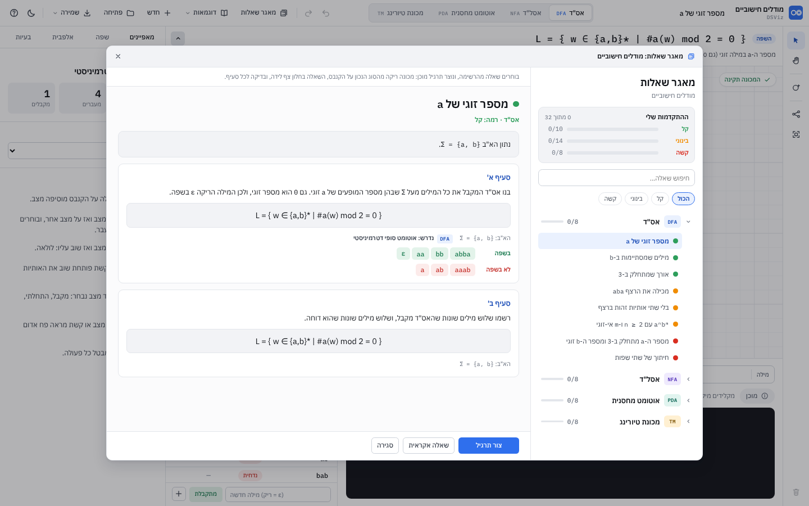

אותו מאגר כמו בתוכנות של Java ו-C# (BankWindow, BankFloat, BankProgress), עם ארבעה נושאים: אס"ד, אסל"ד, אוטומט מחסנית, מכונת טיורינג.
32 שאלות, 8 בכל נושא, מקל לקשה, בסגנון בגרות. הנתונים והוראות ההוספה: [`bank/README.md`](../bank/README.md).

### 14.1 החלון

כפתור "מאגר שאלות" בסרגל העליון (אייקון של רשימה עם קלפים, כמו בסרגל של Java). החלון (מעל הכול, Esc או לחיצה בחוץ סוגרים):

- **מימין:** "מאגר שאלות" / "מודלים חישוביים", כרטיס "ההתקדמות שלי" (X מתוך 32, ופס לכל רמה), חיפוש (בשם, בנוסח ובנוסחאות), סינון לפי רמה (הכול / קל / בינוני / קשה),
  ועץ: לכל נושא תג הסוג, השם, כמה סומנו מתוך כמה ופס קטן. נושא נפתח לשאלות: נקודה בצבע הקושי (ירוק #2E9E5B, כתום #F08C00, אדום #D92D20), השם, ו-V ירוק למי שסיים.
- **במרכז:** השאלה שנבחרה: השם עם הנקודה וה-V, "נושא · רמה", הפתיחה, וכרטיס לכל סעיף: הנוסח, השפה בתצוגה היפה (`L.pretty`), Σ, "נדרש: <סוג המכונה>",
  מילים בשפה ומחוצה לה, ולמכונה שמחשבת טבלת קלט ופלט. V לכל סעיף שנפתר.
- **למטה:** "צור תרגיל" (או "פתח את התרגיל" ו"התחלה מחדש" אם כבר התחלתם), "שאלה אקראית" (מתוך מה שמסונן), "סגירה". בפתיחה הבאה נבחרת השאלה האחרונה.

### 14.2 התרגיל והחלון הצף "השאלה"

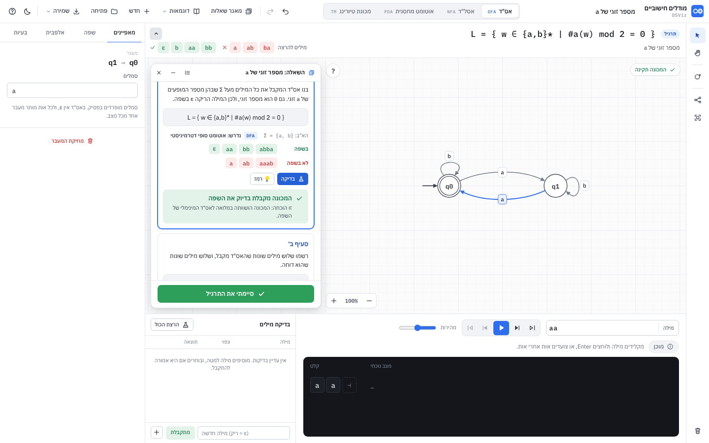

"צור תרגיל" פותח על הקנבס מכונה ריקה מהסוג הנכון עם הא"ב של השאלה. השפה של הסעיף נעולה במכונה (`language.locked`), ולכן היא בפס שמעל הקנבס ובלשונית "שפה", כמו קובץ תרגיל.
החלון "השאלה" צף בצד שמאל של הקנבס (נגרר בכותרת, מתמזער, נסגר; המכונה מוזזת כדי שלא תוסתר). בו:

- השם והרמה, "על הקנבס: <סוג> של סעיף א'", ניווט בין הסעיפים (כל כפתור עם V משלו), הפתיחה, וכרטיס לכל סעיף. הסעיף שעל הקנבס מסומן.
- **בדיקה** (`build`): קודם תקינות (שגיאה במכונה: מה לתקן). לאס"ד ואסל"ד מול שפה רגולרית: הוכחה (`L.checkExact`). אחרת `L.checker` בחלקים, עד 6 שניות, כמו בלשונית "שפה".
  תוצאה: "המכונה מקבלת בדיוק את השפה" (הוכחה) או "נבדקו כל N המילים עד אורך k" (בדיקה), או רשימות "צריכות להתקבל, ונדחו" / "צריכות להידחות, והתקבלו" עם הרמז של `L.hint`.
  לחיצה על מילה מריצה אותה על הקנבס.
- **בדיקה** (`tm-output`): הקלטים הם הדוגמאות ועוד כל הקלטים ב-`domain` עד אורך 7. נכון: המכונה עוצרת במצב מקבל (עד 5,000 צעדים), ועל הסרט, בלי הריקים בקצוות, בדיוק הפלט.
  טעות: "המכונה טועה ב-N מתוך M קלטים" וטבלה: קלט (לחיצה מריצה), צריך, התקבל (או "לא עצרה" / "עצרה במצב שאינו מקבל").
- **מילים** (`words`): שלושה שדות למילים בשפה ושלושה למילים מחוצה לה (ε למילה הריקה). כל מילה מסומנת עם הסיבה: לא בשפה, דווקא בשפה, אות שלא בא"ב, כבר הופיעה.
- **הסבר** (`explain`): שדה טקסט, ו"סיימתי את הסעיף" (אין בדיקה אוטומטית; ב-💡 "תשובה לדוגמה").
- **💡 רמז** בכל סעיף, ובסעיפי מכונה גם "הצגת פתרון לדוגמה על הקנבס" (אחרי אישור; Ctrl+Z מחזיר).
- **"הכן סעיף ב'"**: לסעיף הבא שבונים בו מכונה. המכונה של הסעיף הקודם נשמרת, ומכונה חדשה של הסעיף נפתחת. "לסעיף א'" מחזיר אליה.
- **"סיימתי את התרגיל"** (כפתור ירוק בתחתית): כרטיס בתוך החלון, בלי חלון שמכסה: "להתחיל נקי (מומלץ)" (הקנבס מתרוקן, והמכונות, המילים וההסברים של השאלה נמחקים) או "לשמור את המכונה".
  אחרי האישור לשאלה יש V במאגר. אחרי סיום הכפתור הוא "עשיתי את התרגיל", ולחיצה עליו מבטלת את הסימון.

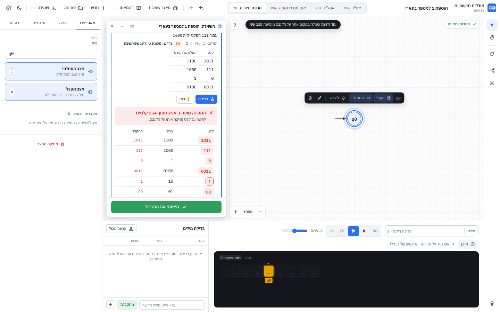

### 14.3 התקדמות

כמו BankProgress: V לשאלה רק דרך "סיימתי"; V לסעיף כשהבדיקה שלו עוברת (או כשמסמנים הסבר); המכונה של כל סעיף, המילים וההסברים. הכול ב-`localStorage['dsviz.automata.bank.v1']`
(עטוף ב-try/catch; בלי אחסון זה נשאר בזיכרון). המכונה של הסעיף הפעיל נשמרת בכל שינוי (דרך `App.autosave`). אחרי טעינה מחדש החלון חוזר עם אותו תרגיל.
דוגמה, קובץ או "חדש" סוגרים את התרגיל (העבודה נשמרת, ו"פתח את התרגיל" מחזיר אותה).

### 14.4 שער גישה

כל פתיחה של המאגר ויצירה של תרגיל עוברות דרך פעולה אחת: `AutomataBank.access(action, question)` (`action`: `'open'` או `'create'`).
`AutomataBank.setAccess(gate, deny)` מחליף אותה; כשהיא מחזירה false, `AutomataBank.denied(action, q, retry)` מעביר ל-`deny` (מסך הכניסה), ו-`retry` נקרא אחרי כניסה מוצלחת.
מסבב 10 השער מחובר לכניסה המשותפת של DSViz (15).

### 14.5 בדיקות

`test/bank.test.js` (9): `data.js` מעודכן; לפחות 8 שאלות בכל נושא, מקל לקשה, סעיפים א/ב/ג, כללי הכתיבה מימין לשמאל (בלי קו ארוך, בלי סימן קריאה, בלי נקודה אחרי מספר בסוף שורה);
כל שפה נקראת וכל דוגמה מתאימה לשייכות; כל פתרון שמור מקבל בדיוק את השפה (הוכחה לאס"ד ואסל"ד, כל המילים עד אורך 9 או 6 לאחרים); פתרונות ה-`tm-output` נותנים את הפלט של הכלל;
בדיקת המילים; בדיקה של סוג שגוי ומכונה שגויה; ההתקדמות (שמירה, ניקוי, אחסון שבור); חיפוש ושער הגישה.
`e2e/bank.js` (15 שלבים, צילומי `r9-*.png`): פתיחה, עץ וסינון, שאלה, "צור תרגיל", רמז, בנייה בעכבר של אס"ד שגוי ואז נכון (הוכחה, V לסעיף), סעיף ב' במילים, טעינה מחדש,
"סיימתי" עם הכרטיס ו-V במאגר, מכונת טיורינג שגויה לשאלה מחשבת (טבלת הקלטים שנכשלו), ודוגמה שסוגרת את התרגיל.

---

## 15. הכניסה המשותפת של DSViz (סבב 10) ✅

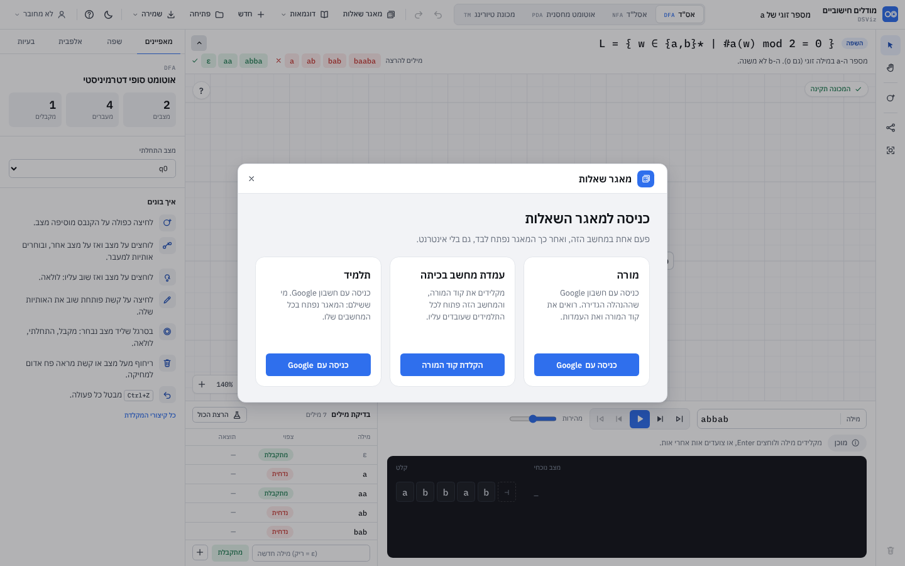

"מודלים חישוביים" מותקן עם DSViz-Setup.exe. התוכנה המקומית (`AutomataLauncher`, בענף feature/login-access) מגישה את `app/` על 127.0.0.1, ונותנת לדף ממשק
שמשתף את הכניסה עם Eclipse, IntelliJ ו-Visual Studio: מי שנכנס באחת מחובר בכולן, והתנתקות באחת מגיעה לכאן מיד. החוזה: `java-visualizer/access/README.md`.
הלקוח בדף: `js/access-client.js` (`DSVizAccess`, ES module, מועתק כמו שהוא מ-feature/login-access; לא משנים את ה-API שלו כאן).

### 15.1 טעינה

ב-`index.html` סקריפט קטן לפני כל השאר: כשהדף מוגש ב-http הוא טוען את `js/access-client.js` ב-`import()`, ושם את ההבטחה ב-`window.DSVizAccessReady`.
מ-`file://` לא טוענים (Chrome חוסם מודולים מקובץ ומדפיס שגיאה), וההבטחה היא null. הכתובת `js/access-client.js` כבר בדף, ולכן התוכנה לא מוסיפה עותק שני
(`AutomataLauncher.inject` בודק אותה). המודול נטען פעם אחת בכל מקרה, כי אותה כתובת היא אותו מודול.

### 15.2 הכפתור של החשבון

בסוף הסרגל העליון: אייקון ו"מורה: <שם>" / "תלמיד: <שם>" / "עמדה: <שם>" / "לא מחובר" (ו"מחכה לכניסה", "הגישה הושבתה"). מתעדכן מיד דרך `onChange`, גם כשהכניסה
או ההתנתקות נעשו ב-Eclipse. בתפריט: השם והמייל, "עמדת ניהול" (רק למורה: `openTeacherPanel()` פותח את החלון של DSViz), "התנתקות" (רק מורה / תלמיד; עמדת מחשב:
"את העמדה משחרר המורה מעמדת הניהול."), ולמי שלא מחובר "כניסה למאגר השאלות". ההתנתקות שואלת כמו ב-Java ("להתנתק מהחשבון <מייל> במחשב הזה? ...").
כדי שהכפתור ייכנס ב-1440 (הממשק ב-90%): הלשוניות לא נשברות לשתי שורות, ושם המכונה מתכווץ קודם.

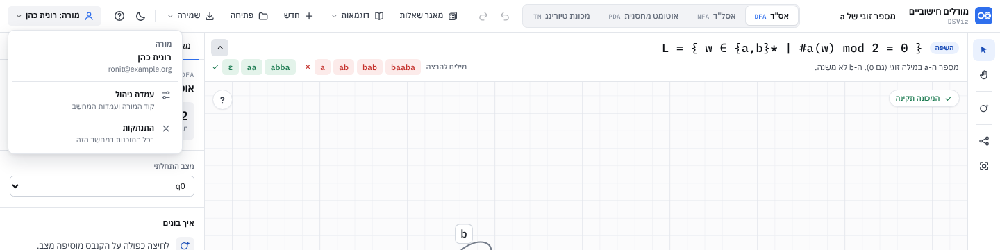

### 15.3 מסך הכניסה של המאגר

`AutomataBank.setAccess(gate, deny)`: השער פתוח למורה, לתלמיד ולעמדת מחשב. אחרת "מאגר שאלות" (וגם "צור תרגיל") פותח את מסך הכניסה, כמו AccessGate של Java:
"כניסה למאגר השאלות", שלושה כרטיסים (מורה / עמדת מחשב בכיתה / תלמיד) עם הנוסחים של Java. "כניסה עם Google": "ממשיכים בדפדפן" ו"ביטול" (`cancelSignIn`).
"הקלדת קוד המורה": קוד המורה (4 תווים) ושם למחשב, "חיבור המחשב" / "חזרה". התוצאות: "נכנסת בהצלחה" / "המחשב מחובר" (ואחרי רגע המאגר נפתח), "החשבון עוד לא מוגדר כמורה",
"הגישה של החשבון הושבתה", "החשבון כבר מחובר בכל המחשבים המותרים", "מחכים לתשלום" (ו"התשלום התקבל" כשהמצב מתעדכן), "אין עוד היתרים", קוד שגוי בשורה מתחת לשדות,
והודעה של התוכנה כמו שהיא (בלי אינטרנט, סינון אינטרנט שחוסם את החיבור המאובטח). אם הכניסה נעשתה בתוכנה אחרת בזמן שהמסך פתוח, הוא מראה "נכנסת בהצלחה" ופותח את המאגר.

הנוסחים כמו ב-Java, עם שני הבדלים: "מאגר התרגילים" הוא כאן "מאגר השאלות" (כמו הכפתור), וקו מפריד ארוך הוחלף בפסיק או בנקודתיים (כלל הכתיבה של הכלי).
גם הודעות שמגיעות מהתוכנה עוברות את אותו ניקוי (`AutomataAccess.clean`).

**התנתקות בזמן עבודה** (כאן או ב-Eclipse): חלון המאגר והחלון "השאלה" נסגרים, העבודה נשמרת, והודעה "התנתקת במחשב הזה. המאגר נסגר." תרגיל שהיה פתוח לפני טעינה מחדש
חוזר רק אחרי שהכניסה ידועה ופתוחה.

**בלי התוכנה** (קובץ שנפתח ישירות, אתר): אין כפתור חשבון ואין מסך כניסה. העורך, הדוגמאות והשפה עובדים כרגיל, ו"מאגר שאלות" מסביר בחלון קטן שהמאגר עובד בתוכנה המותקנת.

### 15.4 קבצים ובדיקות

`js/access.js` (`AutomataAccess`, טהור): המצבים, הנוסחים, המסכים לכל תוצאה, והבקר (`controller(client, {change, gained, lost})`). `js/access-ui.js` (`AccessUI`): הכפתור,
התפריט ומסך הכניסה. `css/access.css`. `test/access.test.js` (8, עם DSVizAccess מדומה): בלי התוכנה; לא מחובר מעביר למסך הכניסה ומורה נפתח; התנתקות חיה סוגרת
ומעדכנת את הכפתור; עמדת מחשב; הודעות; ביטול; התנתקות; בלי קו ארוך. `e2e/mock-launcher.js`: שרת node שמגיש את האפליקציה עם `/api/*` ו-SSE לפי החוזה.
`e2e/access.js` (11 שלבים, צילומי `r10-*.png`), ו-`e2e/bank.js` רץ עכשיו מול אותו שרת עם מורה מחובר.
