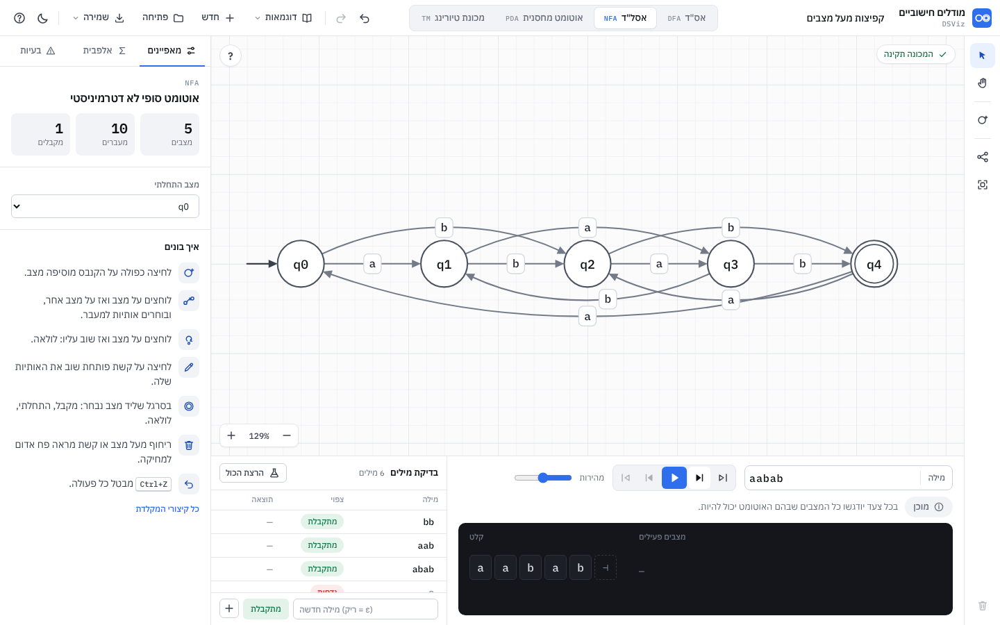

# מפרט: סביבת "מודלים חישוביים" ב-DSViz

למי: המפתח (או המודל) שממשיך את הבנייה. המסמך מתאר את המוצר המלא, מסמן מה כבר בנוי, ומחלק את מה שנשאר לשלבים שאפשר לבדוק כל אחד לבד.
מסמכים קשורים: [`research.md`](research.md) (מה עושה כלי ההשראה), [`DESIGN.md`](DESIGN.md) (צבעים, גדלים, רכיבים).

**סימון מצב** בכל המסמך: ✅ בנוי ונבדק · 🟡 בנוי חלקית (מה חסר כתוב לידו) · ⬜ עוד לא.

---

## 0. תמונת מצב (נובמבר 2026, סבב 2)

| | |
|---|---|
| איפה | `java-visualizer/automata/app/` |
| איך מריצים | פותחים את `index.html` בלחיצה כפולה (עובד מ-`file://`), או מגישים את התיקייה בכל שרת סטטי |
| בדיקות | `cd java-visualizer/automata/app && node --test` (35 בדיקות: מודל, סימולציה, גאומטריה, ניתוב) |
| בדיקת אינטראקציה | `node e2e/flow.js` (Playwright, 13 שלבים עם assert: לחיצה כפולה, לחיצה-לחיצה, חלון צף, פח + אישור + ביטול, Delete, Esc, הרצה) |
| צילומי מסך | `node e2e/screens.js` (כותב ל-`docs/shots/ours-*.png`, נכשל על שגיאות בקונסול) |
| תלויות | אין. HTML + CSS + JS רגיל, גופנים מקומיים |


**מה השתנה בסבב 2** (בעקבות משוב על צילום המסך): מעבר נוצר בלחיצה על מצב ואז על מצב אחר, ונפתח חלון צף עם צ'יפים של Σ (4.3); פח אדום בריחוף ומחיקה עם חלון אישור (4.5); ניתוב קשתות שעוקף מצבים (8.6); כרטיס הדרכה של שלושה צעדים ו"איך בונים" חדש (4.8); באנר תוצאה גדול (5.2); השלמה עם מצב מלכודת (6); הצמדה לרשת 20. הקבצים פוצלו כך שאף קובץ לא עובר כ-350 שורות.

### קבצים

| קובץ | תפקיד | DOM? |
|---|---|---|
| `index.html` | המעטפת: סרגל עליון, סרגל כלים, קנבס, פאנל צד, חלון הרצה | |
| `tokens.css` | אסימוני העיצוב (בהיר + כהה) ו-`@font-face` | |
| `css/base.css` | בסיס, פריסה, כפתורים, סרגל עליון, תפריטים, סרגל כלים, חלון העזרה, תנועה | |
| `css/canvas.css` | רשת, קשתות, תוויות, מצבים, פחים, גומי, תג תקינות, זום, כפתור "?" | |
| `css/overlays.css` | סרגל ליד מצב, עורך שם, רמז, הודעות, החלון הצף, חלון האישור, ההדרכה, באנר התוצאה | |
| `css/panels.css` · `css/run.css` | פאנל הצד · חלון ההרצה | |
| `js/model.js` | מבנה הנתונים, עריכה, פענוח תוויות, שמירה/טעינה, סידור אוטומטי | לא |
| `js/validate.js` | בדיקות תקינות בעברית, בדיקת מילה מול Σ, `completeWithTrap` (מרחיב את `AutomataModel`) | לא |
| `js/sim.js` | הסימולטורים: DFA, NFA (סגור ε), PDA (BFS), TM | לא |
| `js/geometry.js` | פרימיטיבים: ראש חץ, חץ התחלה, גומי, גודל תווית | לא |
| `js/routing.js` | ניתוב: קשתות שעוקפות מצבים, לולאות בצד הפנוי, תוויות בלי חפיפה | לא |
| `js/examples.js` | 6 מכונות לדוגמה | לא |
| `js/icons.js` | אייקונים מקוריים (SVG בקוד) | |
| `js/dialogs.js` | `Dialogs.confirm` (חלון אישור, Promise), תוכן חלון הקיצורים | כן |
| `js/guide.js` | `Guide`: כרטיס שלושת הצעדים על הקנבס, ורשימת "איך בונים" בפאנל | כן |
| `js/canvas.js` | `CanvasView`: תצוגה (זום, הזזה), ציור SVG, סרגל ליד מצב, עורך שם, ייצוא SVG | כן |
| `js/canvas-input.js` | העכבר על הקנבס (מרחיב את `CanvasView`): לחיצה-לחיצה, גרירה, פחים, הזזה | כן |
| `js/popover.js` | `TransitionPopover`: החלון הצף של מעבר (צ'יפים של Σ / כללי PDA ו-TM) | כן |
| `js/side-panel.js` · `js/run-panel.js` | `SidePanel` (מאפיינים / אלפבית / בעיות) · `RunPanel` (מילה, בקרה, סרט, מחסנית, בדיקות, באנר) | כן |
| `js/app.js` · `js/app-run.js` · `js/app-ui.js` | הבקר `App`: מצב, היסטוריה, עריכה, מחיקה · הרצה · סרגל עליון, קבצים, מקלדת (והאתחול) | כן |
| `test/*.test.js` | `node:test` לקבצים הטהורים | |
| `e2e/flow.js` · `e2e/screens.js` | Playwright: אינטראקציה עם assert · צילומי מסך | |

**למה לא ES modules:** Chrome חוסם `<script type="module">` מ-`file://` (CORS), והדרישה היא שהכלי ייפתח בלחיצה כפולה. לכן כל קובץ הוא סקריפט רגיל בתבנית UMD:
הוא נרשם על `globalThis` וגם מייצא `module.exports` כש-Node טוען אותו. קבצי "הרחבה" (`validate.js`, `canvas-input.js`, `app-run.js`, `app-ui.js`) מוסיפים פונקציות לאובייקט קיים. סדר הטעינה ב-`index.html` חשוב, ו-`app-ui.js` אחרון (הוא מפעיל את `App.init`).
`app/package.json` מגדיר `"type": "commonjs"` כדי ש-`package.json` של שורש המאגר לא ישפיע.

---

## 1. מונחים

| עברית | אנגלית | בממשק | הערות |
|---|---|---|---|
| אוטומט סופי דטרמיניסטי (אס"ד) | DFA | לשונית "אס"ד" | |
| אוטומט סופי לא דטרמיניסטי (אסל"ד) | NFA / ε-NFA | לשונית "אסל"ד" | כולל מעברי ε |
| אוטומט מחסנית | PDA | לשונית "אוטומט מחסנית" | לא דטרמיניסטי (NPDA) |
| מכונת טיורינג | TM | לשונית "מכונת טיורינג" | סרט אחד, דטרמיניסטית |
| מצב | state | "מצב", ובקנבס `q0` | |
| מצב התחלתי | start / initial state | "מצב התחלתי", חץ משמאל | בדיוק אחד |
| מצב מקבל | accepting / final state | "מצב מקבל", עיגול כפול | |
| מעבר | transition | "מעבר", קשת עם חץ | |
| תווית | label | הטקסט על הקשת | |
| סמל / אות | symbol | "אות" במילה, "סמל" בתווית | תו אחד |
| אלפבית (הקלט) | alphabet, Σ | "אלפבית", `Σ` | |
| אלפבית המחסנית | stack alphabet, Γ | "אלפבית המחסנית", `Γ` | |
| אלפבית הסרט | tape alphabet, Γ | "אלפבית הסרט", `Γ` | כולל Σ והריק |
| מילה | word / string | "מילה" | |
| המילה הריקה | empty word, ε | `ε` (מילה ריקה) | |
| מעבר ε | ε-transition | `ε` | ב-NFA וב-PDA |
| סגור ε | ε-closure | "סגור ε" | |
| מתקבלת / נדחית | accepted / rejected | "המילה מתקבלת" / "המילה נדחית" | |
| לא הוכרע | undecided (limit) | "לא הוכרע" | הגענו למגבלת צעדים |
| מצב בור | trap / dead state | "מצב בור" | ב-DFA חלקי הוא משתמע |
| ענף | branch / configuration | "ענף", "ענפים פתוחים" | NFA, PDA |
| קונפיגורציה | configuration | (בתיעוד בלבד) | מצב + מקום במילה + מחסנית |
| מחסנית / ראש המחסנית / תחתית | stack / top / bottom | "מחסנית", "ראש", "תחתית" | ברירת מחדל לתחתית: `Z` |
| דחיפה / שליפה | push / pop | "דוחפים" / "שולפים" | |
| סרט / ראש / תא | tape / head / cell | "סרט", "ראש", "תא" | |
| סמל ריק | blank | "סמל ריק" | ברירת מחדל: `_` |
| ימינה / שמאלה / נשאר | R / L / S | `R` `L` `S` | |
| צעד | step | "צעד 3 מתוך 8" | |
| הרצה | run | "הרצה" | |
| בדיקת מילים | batch tests | "בדיקת מילים" | |
| לא דטרמיניזם | non-determinism | "יש 2 מעברים עם a" | |

---

## 2. פריסת המסך

```
                         ← כיוון הקריאה של הממשק (RTL)
┌───────────────────────────────────────────────────────────────────────────────────┐
│ ? ☾ │ שמירה▾ פתיחה חדש דוגמאות▾ │ ↷ ↶   [מכונת טיורינג|אוטומט מחסנית|אסל"ד|אס"ד]   [שם המכונה] ◉ מודלים חישוביים │ 52
├──────────────────────┬────────────────────────────────────────────────────┬──────┤
│ בעיות·אלפבית·מאפיינים│ [?]          [✓ המילה abba מתקבלת]  [✓ המכונה תקינה] │  ▸   │
│──────────────────────│                                                    │  ✋  │
│ (תוכן לפי הבחירה)    │          ┌──────────────────────┐                  │ ──── │
│ איך בונים:           │          │ שם·מקבל·התחלתי·לולאה │ ← סרגל ליד מצב  │  ○+  │
│ ○ לחיצה כפולה...     │          └──────────────────────┘                  │  ⋔   │
│ ↗ לוחצים על מצב...   │      →(q0)────a────▶(q1)🗑 ← פח בריחוף              │  ⛶   │
│                      │             ┌ חלון צף: [a][b][ε] +אות  אישור ┐     │      │
│                      │ [− 100% +]                                         │      │
│                      ├───────────────────────────┬────────────────────────┤      │
│                      │ בדיקת מילים  5/6   [הרצה] │ [מילה|abba ] ⏮◀▶▶|⏭ ─○─ │  🗑  │
│                      │ מילה   צפוי     תוצאה     │ (מתקבלת✓) הערה…  צעד 2/4│      │
│                      │ ab   [מתקבלת]  ✓ מתקבלת  │ ┌────────────────────┐ │      │
│                      │ …                         │ │ קלט [a][b][b][a][⊣]│ │      │
│                      │ [+][מתקבלת][מילה חדשה ]  │ └────────────────────┘ │      │
└──────────────────────┴───────────────────────────┴────────────────────────┴──────┘
       side 304                    run 244 גובה                                rail 52
```

- `body` לא נגלל. ה-grid ממלא את החלון (`100vh`). רק פאנל הצד, טבלת הבדיקות ואזור הסרט נגללים בתוכם.
- הקנבס תופס את כל מה שנשאר. כל מה שצף עליו (תג תקינות, זום, סרגל ליד מצב, עורך, רמז, הודעות) ממוקם בתוך `.stage`.
- גדלים: `--topbar-h: 52px`, `--rail-w: 52px`, `--side-w: 304px` (280 מתחת ל-1280px), `--run-h: 244px`, עמודת הבדיקות 340px (300).

---

## 3. כפתורים ופקודות

כל כפתור: תווית עברית, אייקון מ-`icons.js`, `title` עם הקיצור בסוגריים, ו-`aria-label` אם אין טקסט.
קיצורי אותיות נבדקים לפי `event.code` (`KeyA`) ולא לפי `event.key`, כדי שיעבדו גם כשהמקלדת בעברית (שם `A` מקליד `ש`).
קיצורים בלי Ctrl לא פועלים כשהפוקוס בשדה טקסט.

### 3.1 סרגל עליון

| כפתור | אייקון | title / קיצור | פעולה | מושבת כש | מצב |
|---|---|---|---|---|---|
| ביטול | `undo` | "ביטול: <שם הפעולה> (Ctrl+Z)" | מחזיר את המכונה למצב שלפני השינוי האחרון בלשונית הזו. הודעה: "בוטל: הוספת מצב" | אין היסטוריה | ✅ |
| חזרה | `redo` | "חזרה: … (Ctrl+Shift+Z / Ctrl+Y)" | ההפך | אין מה לשחזר | ✅ |
| דוגמאות ▾ | `book` | | תפריט מקובץ לפי סוג: תג סוג, שם, תיאור. בחירה טוענת ללשונית של הסוג (ועוברת אליה), שמה את `sampleWord` בשדה המילה, ומתאימה תצוגה. נכנס להיסטוריה | | ✅ |
| חדש | `plus` | "מכונה חדשה וריקה בלשונית הזו" | מחליף את המכונה בלשונית במכונה ריקה. נכנס להיסטוריה (אפשר לבטל) | | ✅ |
| פתיחה | `open` | "פתיחת קובץ JSON (Ctrl+O)" | בוחר קובץ, טוען ללשונית של הסוג שבקובץ. גם גרירת קובץ אל החלון | | ✅ |
| שמירה ▾ | `save` | "(Ctrl+S)" | תפריט: "שמירה כקובץ" (JSON, `<שם>.automaton.json`), "ייצוא תמונה" (SVG) | | ✅ |
| | | | ⬜ PNG (פי 2), ⬜ LaTeX TikZ (העתקה ללוח) | | ⬜ |
| מצב כהה/בהיר | `moon` / `sun` | "מצב כהה" / "מצב בהיר" | מחליף ושומר ב-`localStorage` | | ✅ |
| עזרה | `help` | "קיצורי מקלדת (?)" | חלון עם כל הקיצורים | | ✅ |
| שם המכונה | | "שם המכונה" | שדה. שינוי נשמר ב-blur / Enter, נכנס להיסטוריה. ריק → "מכונה ללא שם" | | ✅ |
| לשוניות סוג | | "אוטומט סופי דטרמיניסטי (Alt+1)" וכו' | לכל סוג מכונה משלו (נשמרת). מעבר עוצר הרצה ומנקה בחירה. ←/→ כשהפוקוס בלשוניות (ב-RTL ← = הבאה) | | ✅ |

### 3.2 סרגל כלים (אנכי, מימין)

| כלי | אייקון | קיצור | התנהגות | מצב |
|---|---|---|---|---|
| בחירה ועריכה | `select` | V | ברירת המחדל. כל העריכה קורית כאן (4.1) | ✅ |
| הזזת תצוגה | `hand` | H (או רווח + גרירה) | כל גרירה מזיזה את התצוגה | ✅ |
| מצב חדש | `state` | S / N | **כפתור, לא מצב עבודה**: מוסיף מצב במקום פנוי ליד מרכז התצוגה. (לחיצה כפולה על הקנבס עושה אותו דבר במקום הסמן) | ✅ |
| סידור אוטומטי | `layout` | L | שכבות BFS מהמצב ההתחלתי, משמאל לימין, ואז התאמה למסך. נכנס להיסטוריה. מושבת בלי מצבים | ✅ |
| התאמה למסך | `fit` | F | זום (0.4-1.4) ומרכוז כך שכל המצבים נראים | ✅ |
| מחיקה | `trash` | Delete / Backspace | שואל (חלון אישור) ומוחק את הבחירה. מושבת בלי בחירה | ✅ |
| Esc | | Esc | סוגר חלון / תפריט ← עוצר הרצה ← מבטל מעבר שהתחיל ← חוזר לכלי בחירה ← מנקה בחירה (הראשון שרלוונטי) | ✅ |

בסבב 1 היו גם כלי "מצב" וכלי "מעבר" (מצבי עבודה). הם הוסרו: לחיצה-לחיצה בכלי הבחירה עושה את העבודה, ומצב עבודה נוסף רק מבלבל תלמיד שלא שם לב שהוא דלוק.

### 3.3 על הקנבס

| רכיב | פעולה | מצב |
|---|---|---|
| תג תקינות (פינה ימנית עליונה) | ✓ "המכונה תקינה" / ⚠ "n אזהרות" / ✗ "n שגיאות". לחיצה פותחת "בעיות" | ✅ |
| כפתור "?" (פינה שמאלית עליונה) | פותח / סוגר את כרטיס ההדרכה (4.8) | ✅ |
| זום (פינה שמאלית תחתונה) | − (`-`), אחוז (לחיצה = 100%, `0`), + (`+`). פי 1.2 בכל לחיצה, טווח 30%-300% | ✅ |
| סרגל ליד מצב נבחר | שם · **מקבל** (A) · **התחלתי** (I) · **לולאה** · ✎ שינוי שם (F2) · 🗑 מחיקה. מעל המצב, ואם שם הוא מכסה תווית או מצב, מתחתיו (`placeBox`). לא בזמן גרירה, עריכה, חלון צף או הרצה | ✅ |
| פח בריחוף | מצב: עיגול אדום ברדיוס 10 בפינה הימנית העליונה של המצב (‎+0.78R, ‎-0.78R). קשת: אותו עיגול בקצה הימני של התווית. מופיע בריחוף על המצב / הקשת / התווית, לא בזמן מעבר שהתחיל, חלון צף או הרצה. לחיצה: חלון אישור (4.5) | ✅ |
| באנר תוצאה (למעלה במרכז) | בסוף הרצה (5.2) | ✅ |
| תפריט לחיצה ימנית | על מצב: כמו הסרגל. על קשת: עריכה, היפוך כיוון, מחיקה. על רקע: מצב חדש כאן, הדבקה, סידור | ⬜ |

### 3.4 חלון ההרצה

| רכיב | קיצור | התנהגות | מושבת כש | מצב |
|---|---|---|---|---|
| שדה "מילה" | | LTR, mono. ריק = ε. כל שינוי עוצר הרצה ומעדכן את הסרט. Enter = הרצה מההתחלה. נשמר לכל לשונית | | ✅ |
| ⏮ להתחלה | Home | צעד 0 | אין הרצה / בצעד 0 | ✅ |
| ◀ צעד אחורה | ← | צעד קודם (עוצר ניגון) | אין הרצה / בצעד 0 | ✅ |
| ▶ הרצה / ⏸ עצירה | P, Enter בשדה | בלי הרצה: מתחיל ומנגן. בסוף: מתחיל מחדש. בזמן ניגון: עוצר | | ✅ |
| ▶| צעד קדימה | → | בלי הרצה: מתחיל ומראה צעד 0. אחרת צעד הבא | בסוף / שגיאה | ✅ |
| ⏭ לסוף | End | הצעד האחרון | בסוף / שגיאה | ✅ |
| מהירות | | 1-5 (ברירת מחדל 3). 1400/900/600/340/160ms לצעד. נשמר | | ✅ |
| תג מצב | | "מוכן" / "בהרצה" / "רץ" / "המילה מתקבלת" ✓ / "המילה נדחית" ✗ / "לא הוכרע" ⚠ / "יש לתקן את המכונה" ✗ / "אות לא באלפבית" ✗. ב-TM: "המכונה קיבלה" / "המכונה דחתה" | | ✅ |
| הערה | | תיאור הצעד ("קראנו a: q0 → q1"), ובסוף הסיבה. ב-TM גם "פלט על הסרט: 1100" | | ✅ |
| "צעד i מתוך n" | | | | ✅ |
| בדיקת מילים: "הרצת הכול" | | מריץ את כל השורות, מעדכן ✓/✗ וסיכום "5/6 עברו", והודעה | יש שגיאה במכונה (אז הודעה + לשונית בעיות) | ✅ |
| שורה: מילה | | טוען את המילה לשדה ומריץ | | ✅ |
| שורה: "צפוי" | | מחליף מתקבלת ↔ נדחית (נכנס להיסטוריה, לא עוצר הרצה) | | ✅ |
| שורה: × | | מוחק | | ✅ |
| הוספה | Enter בשדה | מילה + "מתקבלת/נדחית" (לחיצה מחליפה) + ➕ | | ✅ |

---

## 4. תהליכי עבודה

### 4.1 קנבס, כלי "בחירה"

| פעולה | תוצאה | מצב |
|---|---|---|
| לחיצה כפולה על רקע | מצב חדש במקום הסמן (מיושר לרשת 20; אם תפוס, המקום הפנוי הקרוב), בשם הפנוי הקטן (`q0`, `q1`…). הראשון הוא ההתחלתי. המצב נבחר ו"קופץ" (`pop`). עובד גם דרך כרטיס ההדרכה של המצב הריק (הכרטיס `pointer-events: none` חוץ מהכפתורים) | ✅ |
| **לחיצה על מצב** | בוחר אותו, והוא הופך ל**מקור**: הילה כחולה מקווקוות שפועמת, וחץ "גומי" כחול מקווקו מהשפה שלו אל הסמן. רמז למעלה: "לחצו על מצב אחר כדי ליצור מעבר. לחיצה על אותו מצב: לולאה. Esc: ביטול". הסרגל השחור מופיע לידו | ✅ |
| ריחוף על מצב אחר (כשיש מקור) | המצב מודגש (קו כחול 2.6 + הילה), והגומי נצמד לשפה שלו. מעל המקור עצמו: הגומי מצויר כלולאה | ✅ |
| **ואז לחיצה על מצב** | פותח את החלון הצף של המעבר (4.3). על המקור עצמו: לולאה. אם כבר יש קשת באותו כיוון: החלון עורך אותה | ✅ |
| Esc / לחיצה על רקע | מבטל את המקור (לחיצה על רקע גם מנקה בחירה) | ✅ |
| גרירת מצב | מזיז את כל המצבים הנבחרים (אם המצב שנגרר לא נבחר: רק אותו), נצמד לרשת 20 (Alt: בלי). התחלת גרירה (4px) מבטלת מקור. רשומה אחת בהיסטוריה בשחרור. הציור בזמן גרירה ב-`requestAnimationFrame` | ✅ |
| Shift + לחיצה על מצב | מוסיף / מסיר מהבחירה, בלי מקור | ✅ |
| לחיצה על קשת או תווית | בוחר אותה ופותח את החלון הצף שלה | ✅ |
| ריחוף על מצב / קשת / תווית | קו כהה יותר + פח אדום (3.3) | ✅ |
| גרירת רקע | הזזת תצוגה. לחיצה בלי תזוזה = ניקוי בחירה וביטול מקור | ✅ |
| Shift + גרירת רקע | מלבן בחירה (מוסיף לבחירה הקיימת) | ✅ |
| גלגלת | זום סביב הסמן (`exp(-deltaY·0.0015)`; עם Ctrl/צביטה: ‎0.01) | ✅ |
| גלגל אמצעי / רווח + גרירה / כלי הזזה | הזזת תצוגה | ✅ |
| חצים | מזיז את המצבים הנבחרים 5px (Shift: 20). רשומה אחת אחרי 400ms בלי הקשה | ✅ |
| שינוי שם | ✎ בסרגל, F2 / Enter, או השדה בפאנל. עורך קטן על המצב (עד 12 תווים, ייחודי, לא ריק) | ✅ |
| גרירה מהשפה של מצב (סבב 1) | **הוסר**: התנגש בהזזה (מי שתפס מצב קרוב לשפה קיבל חץ במקום הזזה). לחיצה-לחיצה מכסה את אותו צורך | — |
| גרירת התווית של קשת | משנה את העיקול (נשמר כ-`bend` על המעבר, ועוקף את הנתב) | ⬜ |
| גרירת לולאה עצמית | משנה את הכיוון שלה (`loopAngle`, ב-16 כיוונים) | ⬜ |
| Ctrl+C / Ctrl+V / Ctrl+D | העתקה, הדבקה (היסט 40), שכפול של מצבים נבחרים והמעברים ביניהם | ⬜ |

**פרטי מימוש** (`canvas-input.js`): לחיצה כפולה מזוהה ידנית ב-`onDown` (שתי לחיצות על רקע, תוך 400ms, עד 6px), כי הקנבס מצויר מחדש בין הלחיצות והדפדפן לא שולח `dblclick`. "מה מתחת לסמן" נבדק ב-`document.elementFromPoint`, כי בזמן גרירה ה-SVG תופס את המצביע. סדר הבדיקה: פח → מצב → קשת → רקע.
לחיצה על מצב נרשמת כ-`press`, ורק בשחרור בלי תזוזה היא הופכת ל"מקור" או ל"יעד". ריחוף מסומן במחלקה `hover` בלי לצייר הכול מחדש (`setHover`).

### 4.2 מצב התחלתי ומקבל

- **התחלתי:** בדיוק אחד. המצב הראשון שנוסף הוא ההתחלתי. מעבירים: I, "התחלתי" בסרגל ליד המצב, הכפתור בפאנל, או הבחירה "מצב התחלתי" בפאנל כשאין בחירה. אי אפשר "לכבות". מחיקת ההתחלתי מעבירה את ההתחלה למצב הראשון שנשאר. ✅
- **מקבל:** A מחליף לכל המצבים הנבחרים (אם כולם מקבלים: כולם מפסיקים; אחרת כולם מקבלים). גם בסרגל, בפאנל, ובבחירה מרובה. ✅

### 4.3 החלון הצף של מעבר (`popover.js`)


נפתח אחרי לחיצה-לחיצה, בלחיצה על קשת קיימת, ומ"לולאה" בסרגל. **מעבר חדש לא נוצר עד האישור**: בינתיים מצוירת קשת מקווקוות כחולה (`canvas.preview`, מנותבת כמו כל קשת) עם תווית `?`.
מיקום: ליד התווית (מתחת, מעל, מימין, משמאל ובאלכסונים), במקום שמכסה הכי מעט מצבים ותוויות (`canvas.placeBox`). חלון אחד בלבד; לחיצה על הקנבס בזמן שהוא פתוח = ביטול.

**אס"ד / אסל"ד:**
- כותרת: "מעבר חדש" / "עריכת מעבר", ומתחת `q0 → q1` (או `q1 ↻`) ב-mono.
- "אילו אותיות קוראים במעבר הזה?" וצ'יפים של Σ (`Model.inputAlphabet`: המוצהר, או הנגזר מהתוויות) לפי הסדר, בחירה מרובה (`aria-pressed`). נבחר = כחול מלא.
- באסל"ד: צ'יפ `ε` (מסגרת מקווקוות כשלא נבחר).
- כשהאלפבית היה ריק בפתיחה: "עוד אין אותיות באלפבית…" והצעות `+ a` `+ b` `+ 0` `+ 1` (נשארות עד סוף החלון).
- שדה "אות חדשה" (תו אחד) + "הוספה ל-Σ": מוסיף ומסמן. אם האלפבית מוצהר, האות נוספת אליו; אם הוא אוטומטי ונוספה אות שלא נבחרה, האלפבית מתקבע (אחרת האות הייתה נעלמת).
- מקלדת: הקשה על אות ש-Σ מכיל מסמנת / מבטלת אותה (גם כשהמקלדת בעברית: נבדקים `e.key` וגם `e.code`, כך ש-`ש` על המקש A מסמן `a`). אות לטינית או ספרה שאינה ב-Σ נוספת. Enter = אישור (בשדה "אות חדשה" עם ערך: הוספה), Esc = ביטול.
- **אזהרה באס"ד:** אם אות שנבחרה כבר יוצאת מהמצב הזה בקשת אחרת: נקודה ענברית על הצ'יפ, ושורה "מ-q0 כבר יש מעבר עם b (אל q0). באס"ד מותר מעבר אחד לכל אות." (לא חוסם; אם מאשרים, `validate` מסמן שגיאה).
- אישור בלי אותיות: "בחרו לפחות אות אחת" ורעידה.

**אוטומט מחסנית:** שורה לכל כלל: "קוראים" · "שולפים" · "דוחפים" (שדות LTR, ממורכזים), × למחיקת שורה, "כלל נוסף". "שדה ריק = ε. בדחיפה, התו השמאלי יהיה בראש המחסנית."
**מכונת טיורינג:** "קוראים" · "כותבים" · "זזים" (שלושה כפתורים `← L` `• S` `→ R`, ברירת מחדל R). "שדה ריק = הסמל הריק `_`".
בשני המקרים האימות הוא `Model.parseLabels` על הטקסט שנבנה מהשורות, וההודעות שלו (טבלה למטה) מוצגות בחלון.

**אישור:** רשומה אחת בהיסטוריה ("מעבר חדש" / "עריכת מעבר"), כולל שינוי באלפבית. אחרי האישור הקשת נבחרת.
**עורך טקסט:** אותן תוויות אפשר לערוך גם כטקסט בפאנל (מאפייני מעבר), עם כפתורי "הוספת ε" ו-"Z תחתית" / "_ ריק". ✅ כל הסעיף.

הודעות הפענוח (בעברית, מ-`parseLabels`):

| מקרה | הודעה |
|---|---|
| ריק | "צריך לפחות סמל אחד" / "צריך לפחות כלל אחד" |
| יותר מתו | `הסמל "ab" צריך להיות תו אחד` (ב-NFA: "…תו אחד (או ε)") |
| ε ב-DFA | `באס"ד אין מעברי ε` |
| תו שמור | `התו "," שמור ואי אפשר להשתמש בו כסמל` (גם `/` ו-`|`) |
| כלל PDA שבור | `הכלל "aZAZ" צריך להיראות כך: a,Z/AZ (קוראים a, שולפים Z, דוחפים AZ)` |
| כלל TM שבור | `הכלל "1/0" צריך להיראות כך: 1/0,R (קוראים 1, כותבים 0, זזים ימינה)` |

### 4.4 אלפבית (לשונית "אלפבית")

- **Σ אוטומטי** (ברירת מחדל, `alphabet: []`): נגזר מהתוויות לפי סדר הופעה, מוצג בצ'יפים מקווקווים. "קיבוע האלפבית" מעתיק אותו ל-`alphabet`. ✅
- **Σ מוגדר:** צ'יפים עם ×, שדה הוספה, "חזרה לאוטומטי". אות בתווית שאינה ב-Σ: הערה אדומה כאן, ושגיאה `SYMBOL_NOT_IN_ALPHABET`. מילה עם אות שאינה ב-Σ לא רצה. ✅
- **Γ במחסנית / בטיורינג:** צ'יפים; התחתית / הריק מסומנים ואי אפשר למחוק אותם. ✅

### 4.5 מחיקה, ביטול וחזרה


- **כל מחיקה שואלת** (`App.confirmDelete` → `Dialogs.confirm`): מהפח, מהסרגל, מהפאנל, ומ-Delete / Backspace על הבחירה. ✅
- הטקסט: "למחוק את המצב q1?" / "…ואת המעבר שלו?" / "…ואת 3 המעברים שלו?" · "למחוק את המעבר q0 → q1 (a, b)?" · "למחוק 2 מצבים ו-1 מעברים?". מתחת: "אפשר לבטל אחר כך עם Ctrl+Z." שמות וסמלים ב-`<bdi dir="ltr">`. ✅
- החלון: אייקון פח באדום, "מחיקה" (אדום, מקבל פוקוס, Enter) ו"ביטול" (Esc, או לחיצה על הרקע). Tab נשאר בתוך החלון. אחרי המחיקה: הודעה "מחיקת מצב. Ctrl+Z מחזיר." ✅
- מחיקת מצב מוחקת את המעברים שלו. מחיקה מרובה = רשומה אחת. ✅
- היסטוריה **לכל לשונית** בנפרד, עד 100 צעדים, בלי `view`. מה לא נכנס: תצוגה, בחירה, המילה בשדה, ההרצה. כל שינוי במכונה עוצר הרצה (חוץ מטבלת הבדיקות). ✅

### 4.6 בחירה מרובה
Shift+לחיצה, מלבן עם Shift, Ctrl+A. בפאנל: "נבחרו n מצבים ו-m מעברים", "כולם מקבלים", "אף אחד לא מקבל", "מחיקת הבחירה". ✅

### 4.7 זום, הזזה, סידור
התצוגה (`view`) נשמרת עם המכונה. בפעם הראשונה שלשונית מוצגת: התאמה למסך. סידור אוטומטי: `Model.autoLayout` (שכבות BFS, רווח 180×130), ואז התאמה. הקשתות מנותבות מחדש בכל ציור (8.6), אז גם אחרי סידור הן לא עוברות דרך מצבים. ✅
⬜ סידור עם פחות חציות (מיון בכל שכבה לפי ממוצע השכנים, 2-3 סבבים).

### 4.8 הדרכה: כרטיס שלושת הצעדים, ו"איך בונים"


- **כרטיס על הקנבס** (`guide.js`): "בונים מכונה בשלושה צעדים", שלוש שורות ממוספרות, לכל אחת איור קטן (72×44, SVG, בצבעי הממשק) וטקסט: (1) **לחיצה כפולה על הקנבס** · מוסיפה מצב חדש. הראשון הוא המצב ההתחלתי. (2) **לוחצים על מצב, ואז על מצב אחר** · נוצר מעבר, ובוחרים לו אותיות. לחיצה שנייה על אותו מצב: לולאה. (3) **מעבר עם העכבר מעל מצב או קשת** · מופיע פח אדום. לחיצה עליו מוחקת (ואפשר לבטל). ✅
- **מתי:** כשאין מצבים, הכרטיס במרכז עם "מצב חדש" ו"טעינת דוגמה" (ונעלם מעצמו כשנוסף מצב). בכניסה הראשונה לכלי (`localStorage['dsviz.automata.guide']`) הוא צף בפינה עם "הבנתי" ו"כל קיצורי המקלדת". כפתור "?" בפינת הקנבס מחזיר אותו. ✅
- **"איך בונים" בפאנל** (כשאין בחירה): רשימה, פעולה אחת בכל שורה, אייקון בריבוע 30px וטקסט 14px שנשבר לשורות (בלי חיתוך): לחיצה כפולה מוסיפה מצב · לוחצים על מצב ואז על מצב אחר · לוחצים על מצב ואז שוב עליו: לולאה · לחיצה על קשת פותחת את האותיות · בסרגל שליד מצב נבחר: מקבל, התחלתי, לולאה · ריחוף מראה פח אדום · `Ctrl+Z` מבטל. מקשים בתוך `<bdi class="kbd-iso">` (`unicode-bidi: isolate`), כדי שלא ישברו את סדר המשפט. ✅
- **רמז לפי מה שחסר** (`App.coach`, ✅): גלולה למעלה במרכז, רק כשאין מקור, הרצה או חלון צף. מצב אחד: "עוד לחיצה כפולה במקום אחר על הקנבס מוסיפה מצב שני". שני מצבים ואין מעברים: "עכשיו מעבר: לוחצים על מצב, ואז על מצב אחר". יש מעברים ואין מקבל: "אין מצב מקבל: לוחצים על מצב, ובסרגל השחור בוחרים "מקבל"".
- בפעם הראשונה בכלל, כל לשונית נטענת עם הדוגמה הראשונה של הסוג שלה. ✅

---

## 5. הרצה

### 5.1 התחלה
1. אם יש **שגיאה** (`validate` ברמת `error`): לא רצים. התג "יש לתקן את המכונה", ההערה = השגיאה הראשונה ("(ועוד n)"), לשונית "בעיות" נפתחת, והמצבים/הקשתות של השגיאה נבחרים. אזהרות לא עוצרות.
2. אם במילה יש אות שאינה ב-Σ (`checkWord`): לא רצים. "אות לא באלפבית", ההערה "האות c (במקום 3) אינה באלפבית Σ = {a, b}", והתא שלה בסרט אדום.
3. אחרת מחשבים את כל המעקב מראש (`Sim.run`) ומציגים את צעד 0.
✅

### 5.2 מה מודגש בכל צעד
| | צעד i |
|---|---|
| מצבים פעילים | `steps[i].active`: מילוי ענבר + הילה פועמת |
| קשתות שנלקחו | `steps[i].edges` (`{t, l}` = מזהה קשת + אינדקס כלל): קו ענבר, תווית ענבר (ב-PDA/TM רק השורה של הכלל), ונקודה שנוסעת כשהגענו לצעד קדימה |
| סרט הקלט | תאים שנקראו מעומעמים, התא הבא לקריאה (`pos`) ענבר עם ראש מעליו. אחרי האות האחרונה הראש על תא `⊣` |
| צעד אחרון, מתקבלת | המצבים ב-`acceptedStates` ירוקים, תא `⊣` ירוק, תג "המילה מתקבלת" |
| צעד אחרון, נדחית | המצבים הפעילים האחרונים אדומים, `⊣` אדום (אם הגענו אליו), תג "המילה נדחית" + הסיבה |
| **באנר התוצאה** | בצעד האחרון, למעלה במרכז הקנבס: עיגול 34px עם ✓ / ✗ / ⚠, כותרת 16px "המילה `abba` מתקבלת" / "המילה `ab` נדחית" / "המילה הריקה ε מתקבלת" (TM: "המכונה קיבלה את `1011`"), ומתחת הסיבה (ב-TM גם הפלט). רקע `--ok-fill` / `--err-fill`, מסגרת בצבע, כניסה קופצת. נעלם כשחוזרים אחורה או משנים משהו |
✅


### 5.3 לפי סוג
- **DFA:** "מצב נוכחי" (צ'יפ אחד). ✅
- **NFA:** "מצבים פעילים n" עם צ'יפ לכל מצב בסגור. ✅ ⬜ תצוגת "עץ ענפים" (מי נולד ממי, אילו ענפים מתו ובאיזו אות) בלשונית נפתחת.
- **PDA:** קלט + "מחסנית" (עמודה לכל ענף, עד 6, ראש למעלה, 4 תאים גלויים ו-"+n"). כותרת "n ענפים" כשיש יותר מאחד. ✅ ⬜ לחיצה על עמודה מדגישה רק את הענף הזה בקנבס ובסרט (שדה `parent` כבר קיים בכל קונפיגורציה).
- **TM:** אין סרט קלט נפרד: הסרט עצמו, חלון 19 תאים סביב הראש, תג המצב מתחת לראש, "ראש במקום n". בסוף "פלט על הסרט". ✅ ⬜ אנימציה של הראש בין תאים (transform של 36px) במקום קפיצה.

### 5.4 בדיקת מילים
`Sim.runTests(m, tests)` בלי שמירת צילומי סרט (`record: false`). התוצאות נשמרות לפי מילה, עם "חתימה" של המכונה (`App.machineSig()`: מצבים, מקבלים, התחלה, מעברים, אלפבית). כל שינוי במכונה מבטל את התוצאות ("—"), ושינוי של "צפוי" מחשב מחדש עבר/נכשל בלי להריץ. "לא הוכרע" (limit) נחשב כישלון. ✅

---

## 6. בדיקות תקינות והודעות

`Model.validate(m)` מחזיר `[{level, code, text, states, transitions}]`. רץ אחרי כל שינוי. **שגיאה** חוסמת הרצה; **אזהרה** לא.
בקנבס: מצבים וקשתות של שגיאות מסומנים בקו אדום מקווקו. בפאנל "בעיות": רשימה (שגיאות קודם), לחיצה בוחרת את מה שמעורב. בלשונית: תג עם המספר (אדום אם יש שגיאה).

| קוד | רמה | סוג | הטקסט | מצב |
|---|---|---|---|---|
| `NO_STATES` | שגיאה | כולם | אין עדיין מצבים. לחיצה כפולה על הקנבס מוסיפה מצב. | ✅ |
| `NO_START` | שגיאה | כולם | אין מצב התחלתי. בחרו מצב וסמנו אותו כהתחלתי. | ✅ |
| `NONDETERMINISTIC` | שגיאה | DFA | מהמצב q0 יש 2 מעברים עם a. באס"ד מותר מעבר אחד לכל אות. | ✅ |
| `EPSILON_IN_DFA` | שגיאה | DFA | באס"ד אין מעברי ε (במצב q0) | ✅ |
| `MISSING_TRANSITIONS` | אזהרה | DFA | למצב q1 חסר מעבר עבור b. מילה שתגיע לכאן עם האות הזו תידחה (כאילו יש מצב בור). | ✅ |
| `SYMBOL_NOT_IN_ALPHABET` | שגיאה | כש-Σ מוגדר | הסמל c במעבר q0 → q1 אינו באלפבית Σ | ✅ |
| `STACK_SYMBOL_NOT_IN_GAMMA` | שגיאה | PDA, כש-Γ מוגדר | הסמל B במעבר q0 → q1 אינו באלפבית המחסנית Γ | ✅ |
| `TM_NONDETERMINISTIC` | שגיאה | TM | מהמצב q0 יש 2 כללים שקוראים 1. במכונת טיורינג מותר כלל אחד. | ✅ |
| `BAD_MOVE` | שגיאה | TM | כיוון תזוזה לא חוקי "X" (מותר L, R או S) | ✅ |
| `EMPTY_LABEL` | שגיאה | כולם | למעבר q0 → q1 אין סמלים | ✅ |
| `NO_ACCEPTING` | אזהרה | כולם (לא PDA במחסנית ריקה) | אין מצב מקבל, ולכן אף מילה לא תתקבל. | ✅ |
| `UNREACHABLE` | אזהרה | כולם | אי אפשר להגיע מהמצב ההתחלתי אל: q3, q4 | ✅ |

**השלמה עם מצב מלכודת** (✅): כשיש `MISSING_TRANSITIONS` באס"ד, בלשונית "בעיות" יש הסבר קצר וכפתור "השלמה עם מצב מלכודת". `Model.completeWithTrap(m)` מוסיף מצב לא מקבל בשם "מלכודת" (או "מלכודת2"…) מימין למכונה, לולאה עליו עם כל Σ, ומעבר אליו מכל מצב עם האותיות שחסרות לו. השפה לא משתנה (נבדק ב-`model.test.js`). רשומה אחת בהיסטוריה.
| `DUPLICATE_NAME` | שגיאה | כולם | (קבצים ישנים או עריכה ידנית) שני מצבים בשם q1 | ⬜ |

הודעות סוף הרצה (`trace.reason.text`):

| קוד | הטקסט |
|---|---|
| `ACCEPT_STATE` (DFA) | המילה נגמרה במצב מקבל q0 |
| `NOT_ACCEPTING` (DFA) | המילה נגמרה במצב q1, שאינו מקבל |
| `NO_TRANSITION` (DFA) | אין מעבר מ-q1 עבור b, ולכן המילה נדחית |
| `ACCEPT_STATE` (NFA) | לפחות ענף אחד הסתיים במצב מקבל (q2) |
| `NOT_ACCEPTING` (NFA) | המילה נגמרה במצבים {q0, q1}, ואף אחד מהם אינו מקבל |
| `ALL_BRANCHES_DEAD` (NFA) | כל הענפים נתקעו באות b (מקום 3), ולכן המילה נדחית |
| `ACCEPT_STATE` / `ACCEPT_EMPTY` (PDA) | המילה נקראה כולה ויש ענף במצב מקבל (q2) / המילה נקראה כולה והמחסנית ריקה |
| `ALL_BRANCHES_DEAD` (PDA) | אין מעבר שמתאים לאות b ולראש המחסנית, ולכן המילה נדחית |
| `NOT_ACCEPTING` / `STACK_NOT_EMPTY` (PDA) | המילה נקראה כולה, אבל אף ענף לא הגיע למצב מקבל / המחסנית לא התרוקנה |
| `STEP_LIMIT` / `CONFIG_LIMIT` / `STACK_LIMIT` (PDA) | הגענו למגבלה של 500 צעדים בלי הכרעה. ייתכן שיש לולאת ε. / יותר מ-2000 ענפים פתוחים בבת אחת. עצרנו. / המחסנית עברה 200 סמלים בלי הכרעה |
| `ACCEPT_STATE` (TM) | המכונה הגיעה למצב מקבל qf |
| `HALT_NOT_ACCEPTING` (TM) | אין כלל מ-q1 עבור 0: המכונה עצרה במצב שאינו מקבל |
| `STEP_LIMIT` (TM) | המכונה רצה 5000 צעדים ולא עצרה. ייתכן שהיא לא עוצרת על המילה הזו. |
| `NO_START` | אין מצב התחלתי |

הודעות קצרות (toast): "נשמר: <קובץ>", "נפתח: <שם>", "לא ניתן לפתוח: הקובץ אינו JSON תקין", "בוטל: <פעולה>", "שוחזר: <פעולה>", "אין מה לבטל", "לא נבחר כלום למחיקה", "כל 6 הבדיקות עברו", "4 מתוך 6 בדיקות עברו", "לא ניתן לשמור בדפדפן הזה. שמרו לקובץ כדי לא לאבד עבודה.".

---

## 7. מבנה הנתונים

### 7.1 קובץ מכונה (`*.automaton.json`, גם השמירה האוטומטית)

```jsonc
{
  "format": "dsviz-automaton",   // חובה בקובץ שנשמר; קובץ בלי format מתקבל (גרסה ידנית)
  "version": 1,
  "type": "dfa",                 // "dfa" | "nfa" | "pda" | "tm"
  "name": "מספר זוגי של a",
  "alphabet": ["a", "b"],        // Σ. [] = אוטומטי (נגזר מהתוויות)
  "states": [
    { "id": "q0", "name": "q0", "x": -110, "y": 0, "accepting": true },
    { "id": "q1", "name": "q1", "x": 110, "y": 0, "accepting": false, "loopAngle": -90 }
  ],
  "start": "q0",                 // id, או null
  "transitions": [
    { "id": "t1", "from": "q0", "to": "q1", "labels": [ { "read": "a" } ] }
  ],
  "tests": [ { "word": "abba", "expect": true } ],
  "view": { "x": 0, "y": 0, "zoom": 1 }
}
```

| שדה | כללים |
|---|---|
| `states[].id` | מזהה פנימי יציב, ייחודי. לא מוצג. מצבים חדשים: `Model.uid('s')` |
| `states[].name` | מוצג. ייחודי, 1-12 תווים |
| `states[].x/y` | קואורדינטות עולם (מספרים שלמים). y למטה |
| `states[].loopAngle` | אופציונלי, במעלות (‎-90 = למעלה). בלי: נבחר אוטומטית |
| `transitions` | לכל זוג (from, to) **קשת אחת לכל היותר**; כמה סמלים = כמה תוויות. `labels` בלי כפילויות |
| `transitions[].bend` | ⬜ אופציונלי: עיקול בפיקסלים (חיובי = שמאלה לכיוון הנסיעה) |
| סמל | תו אחד (נקודת קוד אחת, אז גם `ε` או אות עברית). `,` `/` `|` שמורים |
| ε | **מחרוזת ריקה** `""` בכל מקום (קלט, שליפה, דחיפה). מוצג `ε` |

### 7.2 תוויות לפי סוג

| סוג | תווית | דוגמה | מוצג |
|---|---|---|---|
| DFA | `{ read }` (לא ריק) | `{ "read": "a" }` | `a` (כמה: `a, b`) |
| NFA | `{ read }` (`""` = ε) | `{ "read": "" }` | `ε` |
| PDA | `{ read, pop, push }` | `{ "read": "a", "pop": "Z", "push": "AZ" }` | `a,Z/AZ` |
| TM | `{ read, write, move }` | `{ "read": "1", "write": "0", "move": "L" }` | `1/0,L` |

PDA: `pop: ""` = לא שולפים (מתאים לכל ראש, גם מחסנית ריקה). `push` היא מחרוזת של סמלי מחסנית, **התו הראשון הוא הראש החדש** (`AZ`: A למעלה). `push: ""` = לא דוחפים.

### 7.3 שדות נוספים לפי סוג

| סוג | שדה | ברירת מחדל | משמעות |
|---|---|---|---|
| PDA | `stackAlphabet` | `["Z"]` | Γ |
| PDA | `stackStart` | `"Z"` | מה יש במחסנית בהתחלה |
| PDA | `acceptBy` | `"final"` | `"final"` (מצב מקבל בסוף המילה) או `"empty"` (מחסנית ריקה בסוף המילה) |
| TM | `tapeAlphabet` | `["_"]` | Γ (כולל הריק) |
| TM | `blank` | `"_"` | הסמל הריק |

### 7.4 שמירה אוטומטית
- מפתח `localStorage['dsviz.automata.v1']` = `{ v: 1, active: "dfa", machines: { dfa, nfa, pda, tm }, words: { dfa: "abba", … }, speed: 3 }`. כותבים 250ms אחרי כל שינוי (debounce), גם אחרי זום/הזזה. ✅
- `localStorage['dsviz.automata.theme']` = `"light"` / `"dark"`. ✅
- טעינה: לכל סוג, `deserialize` של מה שנשמר; אם אין או שבור: הדוגמה הראשונה של הסוג. ✅
- אם `localStorage` לא זמין (מצב פרטי, `file://` בדפדפנים מסוימים): הכלי עובד, ומופיעה פעם אחת ההודעה "לא ניתן לשמור בדפדפן הזה…". ✅
- ⬜ שיתוף בלי שרת: "העתקת קישור" שמקודד את המכונה ב-`#m=<base64url של JSON דחוס>`; פתיחת קישור כזה טוענת אותה ללשונית (עם אישור אם יש שם עבודה).

### 7.5 טעינה (`Model.deserialize`)
מקבל מחרוזת או אובייקט. דוחה: JSON שבור ("הקובץ אינו JSON תקין"), `format` אחר ("זה לא קובץ מכונה של DSViz"), `type` לא מוכר, `version` גבוה מ-1 ("הקובץ נשמר בגרסה חדשה יותר של הכלי").
מדלג (עם הודעה ב-`errors`) על מצב בלי `id` או כפול, ועל מעבר שמצביע על מצב חסר. משלים ברירות מחדל. ממזג קשתות כפולות לאותו זוג. ✅

---

## 8. אלגוריתמי הסימולציה (`sim.js`)

מבנה מעקב משותף:

```js
{
  type, word: ['a','b'],
  steps: [ { pos, active: [ids], edges: [{t, l}], read, note, configs?, tm? } ],  // steps[0] = התחלה
  result: 'accept' | 'reject' | 'limit',
  reason: { code, text, ... },
  acceptedStates: [ids],
  output?, finalTape?, finalHead?        // TM
}
```

### 8.1 DFA (`runDFA`) ✅
```
cur ← start
לכל אות a במקום i:
    מחפשים בקשתות היוצאות מ-cur את הראשונה שיש לה תווית a
    אין → reject, NO_TRANSITION (pos=i)             // מצב בור משתמע
    cur ← היעד; צעד {pos: i+1, active:[cur], edges:[{t,l}]}
accept אם cur מקבל, אחרת NOT_ACCEPTING
```
סיבוכיות O(|w|·deg). לא דטרמיניזם לא אמור להגיע לכאן (שגיאה ב-validate), ואם כן: הקשת הראשונה.

### 8.2 NFA עם ε (`epsilonClosure`, `runNFA`) ✅
```
closure(S): BFS על מעברי ε בלבד; מחזיר את המצבים (לפי סדר גילוי) ואת קשתות ה-ε שנלקחו
A ← closure({start})
לכל אות a:
    M ← { t.to : s ∈ A, t יוצאת מ-s, יש לה תווית a }
    A ← closure(M)
    A ריקה → reject, ALL_BRANCHES_DEAD
accept אם A ∩ F ≠ ∅ (acceptedStates = החיתוך)
```
הקשתות של צעד = קשתות ה-a + קשתות ה-ε של הסגור. לולאות ε לא נתקעות (BFS עם `seen`).

### 8.3 PDA (`runPDA`) ✅
קונפיגורציה = `(state, pos, stack)`; `stack` מחרוזת, התו הראשון הוא הראש. BFS בשכבות:
```
F ← [(start, 0, stackStart)];  seen ← {key(F₀)}
חוזרים:
    אם יש c ∈ F שמקבלת (pos = |w| וגם: final → state ∈ F / empty → stack = "") → accept
    אם עברנו maxSteps (500) → limit, STEP_LIMIT
    N ← []
    לכל c ∈ F, לכל קשת יוצאת t, לכל כלל (read, pop, push):
        read ≠ ε וגם (pos = |w| או w[pos] ≠ read) → דלג
        pop ≠ ε וגם pop ≠ top(stack) → דלג
        stack' ← push + (pop = ε ? stack : stack בלי הראש)
        |stack'| > maxStack (200) → דלג, truncated ← true
        c' ← (t.to, pos + (read = ε ? 0 : 1), stack')
        key(c') ∈ seen → דלג;  אחרת seen += key, N += c'
    N ריקה → truncated ? limit (STACK_LIMIT) : reject (ALL_BRANCHES_DEAD / NOT_ACCEPTING / STACK_NOT_EMPTY)
    |N| > maxConfigs (2000) → limit, CONFIG_LIMIT
    F ← N
```
כל צעד שומר `configs: [{id, parent, state, pos, stack}]`, כך שאפשר לשחזר את עץ הענפים. ה-`seen` הגלובלי מונע לולאות ε שלא משנות את המחסנית; המגבלות עוצרות לולאות שמגדילות אותה.
הגבולות ב-`Sim.LIMITS` וניתנים להעברה ב-`opts`.

### 8.4 TM (`runTM`) ✅
סרט = `Map<index, symbol>` (תא שלא קיים = ריק; כתיבת ריק מוחקת), אינסופי לשני הצדדים. ראש מתחיל ב-0.
```
חוזרים:
    haltOnAccept וגם state מקבל → accept
    n ≥ maxSteps (5000) → limit
    sym ← tape[head] ?? blank
    כלל ראשון מ-state שקורא sym; אין → state מקבל ? accept : reject (HALT_NOT_ACCEPTING)
    tape[head] ← write;  head += R:+1 / L:-1 / S:0;  state ← t.to
```
כל צעד שומר `tm: { state, head, tape: {start, cells[]} }` (ב-`record: false` לא שומרים, לבדיקות). בסוף: `output` = הסרט בלי הריקים בקצוות.

### 8.5 ⬜ המרות (שלב 5)
| המרה | אלגוריתם | הצגה |
|---|---|---|
| NFA → DFA | בניית תת-קבוצות, כולל סגור ε; מצב בור כשצריך | שם כל מצב חדש = הקבוצה `{q0,q1}`; צעד = מצב חדש או מעבר חדש |
| מזעור DFA | הסרת לא ישיגים, ואז חלוקה (Moore / Hopcroft) | צבע לכל מחלקה; צעד = פיצול; בסוף מיזוג |
| הסרת ε | סגור ε לכל מצב, ומעברים חדשים במקום ה-ε | |
| ביטוי רגולרי → NFA | Thompson | |
ההמרה פותחת את התוצאה כמכונה חדשה בלשונית המתאימה (ב-NFA → DFA: לשונית אס"ד, אחרי אישור כי יש שם מכונה).

### 8.6 ניתוב קשתות ותוויות (`routing.js`) ✅



`Routing.route(states, edges, { startId })` מחזיר לכל קשת `{ d, arrow, pts: {p0,c1,c2,p3}, loop, label: {x,y,w,h,cx,cy} }`. הקנבס קורא לו בכל ציור (כ-6ms ל-30 קשתות, כ-20ms ל-42 קשתות על שורה של 7 מצבים).

1. **צורה:** כל קשת היא בזייה מעוקבת. נקודות הבקרה על שליש ושני שליש מהקו, מוזזות לשמאל כיוון הנסיעה ב-`h1` / `h2` (שלילי = ימינה). ישרה = `h1 = h2 = 0`. נקודות הקצה על שפת המצבים בכיוון נקודת הבקרה הקרובה.
2. **מועמדים:** כל הזוגות מתוך `[0, 30, 37, 50, 75, 100, 130, 170, 220, 280, 350]` בשני הצדדים, גם בצורת S, ממוינים לפי מחיר: `max(|h1|,|h2|) + 0.4·|h1−h2|` (ועוד 80 לצורת S).
3. **בדיקה:** דוגמים את העקומה (צעד של עד 10px) ומודדים את המרחק לכל מצב שאינו קצה. מועמד עובר אם הוא רחוק לפחות `R + MARGIN + 4` (MARGIN = 8). המחיר הסופי מוסיף 20 לכל מצב שקרוב לקו בצד שנבחר (הצד עם פחות מצבים עדיף), ו-3 לכל דגימה שקרובה (10px) לקשת שכבר נותבה (כדי שקשתות לא יתלכדו). לוקחים את הזול מבין 6 העוברים הראשונים.
4. **זוג הפוך** (a→b וגם b→a): שניהם לפחות `h = 37` לשמאל כיוון הנסיעה, אז הם נפרדים (כ-28px לכל צד).
5. **סדר:** קשתות קצרות קודם (הן נשארות ישרות), אחר כך ארוכות.
6. **לולאות:** אחרי הקשתות. 16 כיוונים; ציון = המרחק הזוויתי מהקשתות שיוצאות / נכנסות למצב (ומחץ ההתחלה, שבא משמאל), ועונש גדול אם הלולאה קרובה למצב אחר. העדפה קלה ללמעלה. `loopAngle` שמור במצב גובר.
7. **תוויות:** לולאות קודם. מועמדים לאורך העקומה (`t` = 0.5, 0.42, 0.58, …) ובכל אחד גם הזזה לשני צדי הקו; בלולאה, החוצה בכיוון הלולאה. נבחר הראשון שלא נוגע במצב (R+2) ולא חופף תווית קודמת (3px). אם אין, זה עם הכי מעט חפיפות.
8. **בדיקות** (`test/routing.test.js`): שורה של 5 מצבים עם 11 קשתות שמדלגות מעל האמצעיים; אסל"ד צפוף עם 6 מצבים ו-22 קשתות; 30 פריסות אקראיות עם זרע קבוע (5-8 מצבים במרחק 120 לפחות, 8-14 קשתות כולל לולאות וזוגות); וכל הדוגמאות. בכולן: 80 דגימות לכל קשת, כל אחת לפחות `R + MARGIN` מכל מצב שאינו קצה. בשורה, באסל"ד הצפוף ובדוגמאות: אין תווית על מצב ואין שתי תוויות חופפות.

---

## 9. נגישות ומקלדת

### 9.1 מפת מקלדת

| מקש | פעולה | הקשר |
|---|---|---|
| V / H | כלי בחירה / הזזת תצוגה | |
| S / N | מצב חדש (במקום פנוי ליד מרכז התצוגה) | |
| T | מתחיל מעבר מהמצב הנבחר (כמו לחיצה עליו) | מצב אחד נבחר |
| A | מקבל (מחליף לנבחרים) | יש מצב נבחר |
| I | התחלתי | מצב אחד נבחר |
| F2 / Enter | שינוי שם / החלון הצף של המעבר | מצב או מעבר אחד נבחר |
| Delete / Backspace | מחיקת הבחירה (עם אישור) | |
| Ctrl+A | בחירת כל המצבים | |
| חצים (Shift: ×4) | הזזת המצבים הנבחרים | אין הרצה |
| → / ← | צעד קדימה / אחורה | יש הרצה |
| Home / End | להתחלה / לסוף | יש הרצה |
| P | הרצה / עצירה | |
| Enter | הרצה מההתחלה | בשדה המילה |
| אות / ספרה | מסמנת את האות בצ'יפים (או מוסיפה) | בחלון הצף (FA) |
| Enter / Esc | אישור / ביטול | בחלון הצף ובחלון האישור |
| Esc | ראו 3.2 | |
| Ctrl+Z / Ctrl+Shift+Z / Ctrl+Y | ביטול / חזרה | גם בעברית (לפי `code`) |
| Ctrl+S / Ctrl+O | שמירה / פתיחה | |
| L / F | סידור / התאמה | |
| + / − / 0 | זום / 100% | |
| Alt+1…4 | מעבר בין הסוגים | |
| ? | חלון הקיצורים | |
| רווח (החזקה) | הזזת תצוגה בגרירה | |

### 9.2 דרישות
- ✅ כל כפתור אייקון עם `aria-label` ו-`title`. כפתורי מצב עם `aria-pressed`. לשוניות עם `role=tablist/tab` ו-`aria-selected`, ומעבר בחצים.
- ✅ `role=status aria-live=polite` על תג ההרצה, על הרמז ועל ההודעות. `role=alert` על שגיאות בעורך.
- ✅ פוקוס נראה (`--focus`) על כל רכיב. קישור "דילוג לחלון ההרצה".
- ✅ צבע לא לבד: כל תוצאה עם אייקון ומילה; מצב מקבל = עיגול כפול (לא צבע); שגיאה בקנבס = קו מקווקו.
- ✅ `prefers-reduced-motion`.
- ⬜ **ניווט בקנבס במקלדת:** Tab נכנס לקנבס, חצים עוברים בין מצבים (לפי מיקום), Enter בוחר, ושורה מוקראת: "מצב q1, מקבל, 2 מעברים יוצאים: a אל q2, b אל q0".
- ⬜ **הקראת צעד:** בכל צעד, `aria-live` מקריא את ההערה ("קראנו a: q0 → q1").
- ⬜ **חלופה טקסטואלית:** טבלת מעברים (δ) ניתנת לעריכה, כמו בספר (שורות = מצבים, עמודות = אותיות), בלשונית נוספת בפאנל. משמשת גם לקוראי מסך וגם למורים שמעדיפים טבלה.
- ✅ חלון האישור: `role=alertdialog`, Tab נשאר בפנים, הפוקוס חוזר למקום שבו היה. ⬜ אותו דבר בחלון העזרה ובחלון הצף.

---

## 10. דוגמאות (`examples.js`) ✅

| id | סוג | שם | מילה לדוגמה | בדיקות |
|---|---|---|---|---|
| `even-a` | DFA | מספר זוגי של a | `abbab` | 6 |
| `ends-ab` | NFA | מסתיים ב-ab | `abaab` | 6 |
| `only-a-or-b` | NFA | רק a או רק b (עם ε) | `aaa` | 5 |
| `jumps` | NFA | קפיצות מעל מצבים (דוגמה צפופה לניתוב) | `aabab` | 6 |
| `anbn` | PDA | אותו מספר a ו-b (השפה aⁿbⁿ) | `aabb` | 6 |
| `binary-inc` | TM | הוספת 1 למספר בינארי | `1011` | 3 |

כל דוגמה היא קובץ מכונה רגיל, ועוד `id`, `description`, `sampleWord`. הבדיקה `runTests על כל הדוגמאות` מוודאת שכל הבדיקות שלהן עוברות ושאין בהן שגיאות.
⬜ להוסיף: DFA "מתחלק ב-3 (בינארי)", NFA "האות השלישית מהסוף היא a", PDA "פלינדרום זוגי" (מחסנית ריקה, הרבה ענפים), TM "aⁿbⁿcⁿ".

---

## 11. שלבים

כל שלב נבדק לבד: `node --test` ירוק, `node e2e/flow.js` ירוק, `node e2e/screens.js` בלי שגיאות קונסול, ובדיקה ידנית לפי "קבלה".

### שלב 0: לוגיקה ✅
model.js, sim.js, geometry.js, examples.js + 29 בדיקות.
**קבלה:** `node --test` עובר; כל הדוגמאות עוברות את הבדיקות שלהן; PDA עם לולאת ε נעצר ב-`limit`; TM שרץ לנצח נעצר ב-`limit`.

### שלב 1: מעטפת + DFA/NFA מקצה לקצה ✅
**קבלה:** בונים מאפס את "מסתיים ב-ab" בעכבר בלבד (לחיצה כפולה × 3, לחיצה-לחיצה × 3 עם בחירת אותיות, לולאה, A), מריצים `abab` צעד אחרי צעד ורואים 2 מצבים פעילים בצעד 3, והתוצאה "המילה מתקבלת". Ctrl+Z מבטל כל פעולה אחת-אחת. רענון הדף משאיר הכול.

### שלב 2: PDA ו-TM מקצה לקצה ✅
**קבלה:** `aabb` ב-aⁿbⁿ: המחסנית `Z` → `AZ` → `AAZ` → `AZ` → `Z`, מתקבלת. `1011` ב-TM: הסרט מסתיים ב-`1100`, הראש חוזר למקום 0, "המכונה קיבלה". עריכת כלל PDA לא חוקי מראה את ההודעה ולא נשמרת.

### שלב 2.5: עריכה פשוטה יותר (סבב 2) ✅
לחיצה-לחיצה + חלון צף עם צ'יפים של Σ (4.3), פח בריחוף + חלון אישור (4.5), ניתוב שעוקף מצבים (8.6), כרטיס הדרכה ו"איך בונים" (4.8), באנר תוצאה (5.2), מצב מלכודת (6), הצמדה לרשת 20, דוגמה צפופה.
**קבלה:** `node e2e/flow.js` עובר את 13 השלבים (כולל: הפח גלוי בריחוף, מחיקה עם אישור, Ctrl+Z מחזיר; Esc מבטל; קשת קיימת נערכת בלי כפילות); `test/routing.test.js` ירוק.

### שלב 3: גימור עריכה ⬜
1. תפריט לחיצה ימנית (3.3).
2. גרירת תווית לשינוי עיקול (`bend`), גרירת לולאה לשינוי כיוון (`loopAngle`).
3. העתקה / הדבקה / שכפול.
4. לחיצה על רקע כשיש מקור: אפשרות (בהגדרה) ליצור שם מצב חדש ומעבר אליו, אחרי בדיקה עם 3 תלמידים.
5. סידור אוטומטי עם פחות חציות.
6. `DUPLICATE_NAME`.
7. חלון ההרצה ניתן לשינוי גובה (גרירת הקו העליון, 180-420px, נשמר).
**קבלה:** כל פעולה נכנסת להיסטוריה ומתבטלת; עיקול ולולאה נשמרים בקובץ ונטענים; בדיקות יחידה ל-`bend` ב-geometry.

### שלב 4: ייצוא ושיתוף ⬜
1. PNG (פי 2, רקע לפי ערכת הנושא או לבן).
2. LaTeX TikZ (ספריית `automata`: `\node[state,initial]`, `accepting`, `loop above`, `bend left`), העתקה ללוח.
3. קישור עם המכונה ב-hash (7.4).
4. לוח פקודות Ctrl+K (חיפוש בכל הפקודות של פרק 3, ↑↓ Enter Esc).
**קבלה:** הקובץ שנוצר ב-TikZ מתקמפל ב-`pdflatex` (בדיקה ידנית); קישור שנפתח בחלון פרטי טוען את אותה מכונה; Ctrl+K מוצא "סידור" ו-"שמירה".

### שלב 5: המרות צעד אחרי צעד ⬜
NFA → DFA, מזעור, הסרת ε (8.5), עם אותה בקרה כמו ההרצה (צעד, אחורה, ניגון, מהירות) ועם כיתוב לכל צעד.
**קבלה:** בדיקות יחידה: NFA "מסתיים ב-ab" → DFA עם 3 מצבים ישיגים; מזעור של DFA עם מצבים שקולים מחזיר את המספר המינימלי; השפה נשמרת (השוואה על כל המילים עד אורך 8).

### שלב 6: נגישות, יציבות, שילוב ⬜
1. ניווט בקנבס במקלדת, הקראת צעדים, טבלת δ (9.2).
2. מחרוזות הממשק בקובץ אחד (`js/strings.js`), בלי טקסט עברי מפוזר בקוד.
3. תמיכה במסך מגע (צביטה לזום, לחיצה ארוכה = תפריט).
4. להריץ את `e2e/flow.js` ב-CI, ולהוסיף לו שמירה וטעינה, PDA ו-TM בחלון הצף, ומצב מלכודת.
5. קישור מאתר DSViz (`site/`) ומהתוסף.
**קבלה:** axe-core בלי הפרות ברמת serious; כל תהליך בשלב 1 אפשרי במקלדת בלבד; e2e ירוק.

---

## 12. החלטות שכדאי לא לשנות בלי סיבה

1. **קשת אחת לכל זוג מצבים**, עם כמה תוויות. כך עושים בספרים ובכלי ההשראה, וזה פותר את רוב ההתנגשויות בציור.
2. **ε = מחרוזת ריקה** בנתונים. פשוט לאלגוריתמים, ו-`ε` רק בתצוגה.
3. **סמל = תו אחד.** מילים מוקלדות בלי מפרידים (`abba`).
4. **DFA חלקי מותר** (אזהרה, מצב בור משתמע). רוב הספרים בישראל מקבלים אותו; מי שרוצה DFA מלא לוחץ "השלמה עם מצב מלכודת".
8. **מעבר = לחיצה, ואז לחיצה**, והאותיות נבחרות מצ'יפים ולא מוקלדות. תלמיד לא צריך לדעת תחביר כדי לבנות אס"ד.
9. **כל מחיקה שואלת**, וגם אפשר לבטל. הפח מופיע רק בריחוף, כך שהדיאגרמה נקייה.
5. **TM נעצרת בכניסה למצב מקבל** (`haltOnAccept`), ובמצב לא מקבל כשאין כלל. אין מצב דחייה מפורש.
6. **הדיאגרמה LTR** והמצב ההתחלתי נכנס משמאל, גם בממשק עברי.
7. **הכול מקומי.** בלי חשבון, בלי שרת, כמו שאר DSViz.
