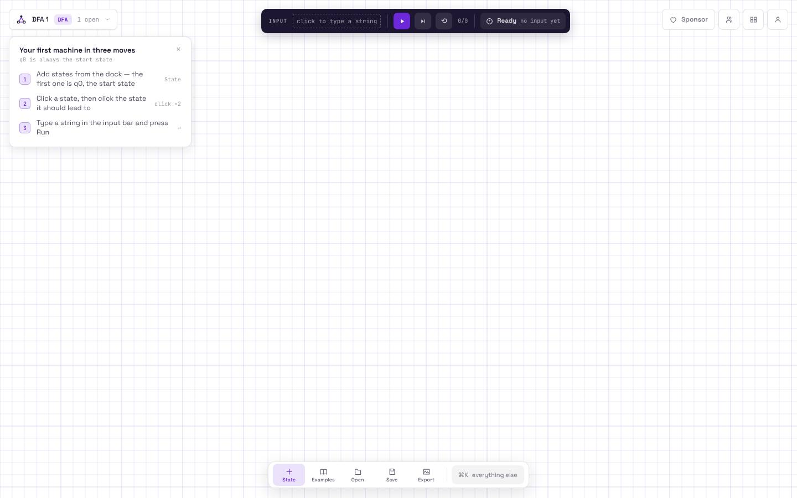
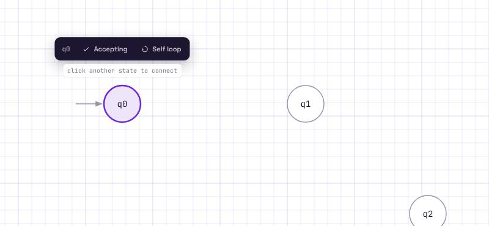
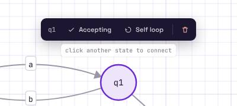
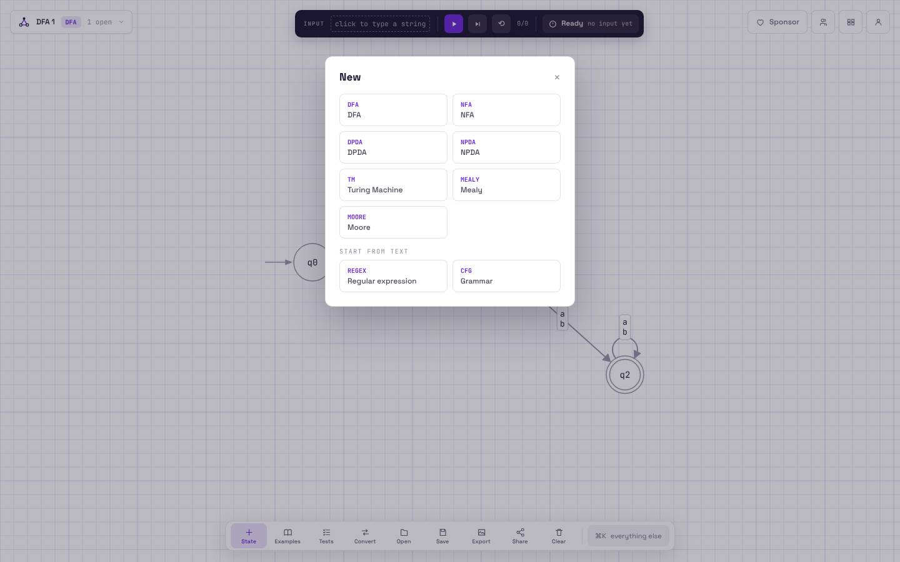
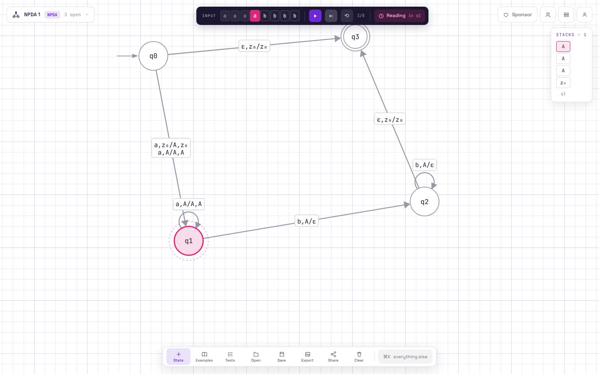
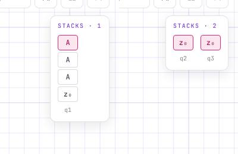
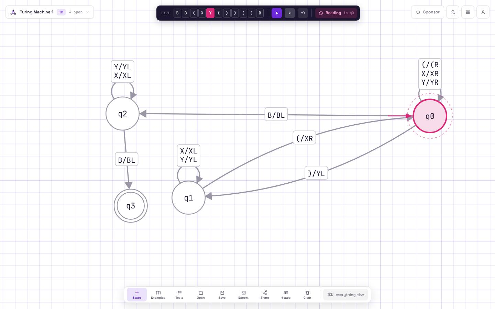
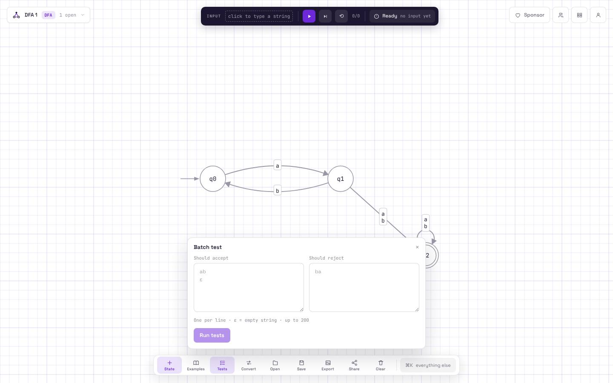
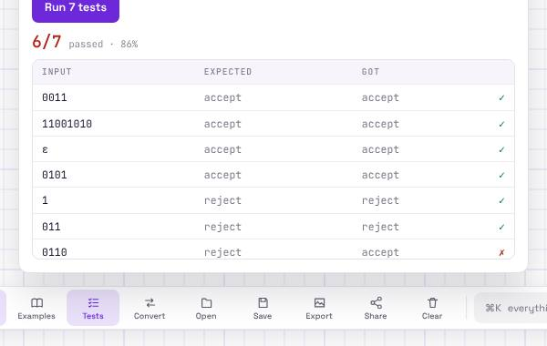

# מחקר: סימולטור האוטומטים שאנחנו לוקחים ממנו השראה

נבדק ב-10 בנובמבר 2026, ב-Chromium בלי ממשק (Playwright), חלון 1440×900, `deviceScaleFactor: 1`.
הכתובות: `automataverse.com/simulator`, הדף הראשי, `/learn`, `/changelog`. לא נכנסנו לחשבון ולא יצרנו חשבון.
הצילומים ב-[`shots/`](shots/) (קבצי `ref-*.jpg`). הם כאן רק לתיעוד: בקוד שלנו אין שום קוד, טקסט, לוגו או תמונה מהאתר.
אנחנו לוקחים את **מודל האינטראקציה** ואת **השפה החזותית** (נייר משבצות, קווים דקים, תוויות קטנות ב-mono), ובונים אותם מחדש בעברית ובפלטה של DSViz.

---

## 1. המבנה הכללי של המסך

אין אצלם "חלונות" קבועים. כל המסך הוא קנבס (רכיב `<canvas>` אחד, 1440×900, ציור ב-Konva לפי מבנה ה-`stageProps` בשמירה), ומעליו ארבעה רכיבים צפים:

| רכיב | מיקום ומידות | מה יש בו |
|---|---|---|
| בורר מכונות | שמאל למעלה, `16,16`, גובה 38, רדיוס 8 | אייקון, שם המכונה ("DFA 1"), תג סוג (`DFA` סגול על רקע סגול בהיר), "1 open", חץ. נפתח לרשימת "Open machines" + "New machine, regex or grammar" ([צילום](shots/ref-08-machine-tabs.jpg)) |
| סרגל הרצה | מרכז למעלה, `y=16`, גובה 44, רוחב משתנה (558 ריק), רקע כהה `#1C1630`, רדיוס 10, צל `0 6px 20px rgba(28,22,48,.22)` | התווית `INPUT`, שדה המילה (כשלא עורכים: תאים של סרט), Run (סגול), Step, Reset, מונה `0/8`, ותג מצב (Ready / Reading / Accepted / Rejected / Fix machine) |
| כפתורים בפינה | ימין למעלה | Sponsor, Classrooms, Menu, Profile (38×38, רדיוס 8, מסגרת 1px) |
| מגש כלים (dock) | מרכז למטה, `y=834`, גובה 48, רקע לבן, רדיוס 12, צל `0 8px 28px rgba(28,22,48,.13)` | State, Examples, Tests, Convert, Open, Save, Export, Share, Clear, ואז `⌘K everything else`. כל כפתור 58×40, אייקון 15px מעל תווית 10px |

הקנבס: רקע `#F7F5FB` עם רשת משבצות סגלגלה (קו דק כל 22px וקו חזק יותר כל 110px).
המגש מראה פחות כפתורים כשאין מצבים (State, Examples, Open, Save, Export בלבד). Tests, Convert, Share, Clear מופיעים רק כשיש מכונה ([לפני](shots/ref-01-empty-guide.jpg) / [אחרי](shots/ref-02-states.jpg)).

**מדריך פתיחה**: כרטיס 330px בפינה (רדיוס 10, צל עדין) עם שלושה צעדים ממוספרים ("הוסיפו מצבים", "לחצו על מצב ואז על המצב שאליו הוא מוביל", "הקלידו מילה ולחצו Run"). נסגר ב-×, ונשמר ב-`localStorage` שנסגר.

## 2. שפה חזותית (נמדד מה-CSS המחושב)

| אסימון | ערך |
|---|---|
| גופנים | Space Grotesk לממשק, JetBrains Mono לכל סמל, שם מצב, מונה ותג |
| דיו (טקסט) | `#1C1630` |
| נייר (רקע) | `#F7F5FB` |
| קו | `#1C16301F` (דיו ב-12%) |
| הדגשה (כפתור ראשי, בחירה) | `#6D28D9`, כהה `#55209F` |
| מצב פעיל בהרצה | `#DB2777` (ורוד), כהה `#A61E63` |
| הצלחה (מתקבלת) | `#0B7C72` (טורקיז) |
| שגיאה | `#B42318` |
| אזהרה | `#9A6700` |
| רדיוסים | 7px כפתור בסרגל, 8px כפתור במגש, 10px כרטיס וסרגל, 12px מגש |
| מעברים | `150ms cubic-bezier(.4,0,.2,1)` על צבע ורקע |
| אנימציות | `pop .42s cubic-bezier(.34,1.56,.64,1)` (מצב חדש), `ring 1.8s` אינסופי (טבעת מקווקוות סביב המצב הפעיל), `travel .9s` (נקודה שנוסעת על הקשת), `shake .38s` (שגיאה), `rise .16s` (חלונית נכנסת), `fade .12s` |
| מצב כהה | אין. |

**ציור המכונה** ([צילום](shots/ref-06-dfa-built.jpg)):
- מצב: עיגול בקוטר 60px, מילוי לבן, קו אפור `~#8E8A9A` ברוחב 1.5, שם במרכז ב-mono 14px.
- מצב התחלתי: חץ אפור קצר (כ-45px) שנכנס משמאל.
- מצב מקבל: טבעת כפולה (עיגול פנימי ברדיוס קטן ב-5px).
- מעבר: קו אפור 1.5px עם ראש חץ מלא. כשיש מעברים בשני הכיוונים, שניהם מתעקלים לצדדים מנוגדים. תווית: "גלולה" לבנה קטנה עם מסגרת, באמצע הקשת, ב-mono 12px. כמה סמלים באותו מעבר נכתבים **אחד מתחת לשני** (התווית `a,b` מוצגת בשתי שורות). כשיש יותר מ-5 שורות: "+3 more (click)" ([צילום](shots/ref-24-tm-two-tapes.jpg)).
- לולאה עצמית: עיגול קטן מעל המצב, והתווית מעליו.
- מצב נבחר: מילוי סגול בהיר `#EDE7F9` וקו סגול 2px ([צילום](shots/ref-03-state-toolbar.jpg)).

## 3. עריכה

### הוספת מצב
- כפתור **State** במגש (או "Add Node" ב-⌘K). המצב נוסף במקום אקראי פנוי במרכז, בשם הבא (`q0`, `q1`...). **הראשון תמיד התחלתי**, ואין דרך להעביר את ההתחלה למצב אחר.
- לחיצה כפולה על הקנבס הריק לא עושה כלום. אין מקש קיצור להוספת מצב.

### סרגל ליד המצב הנבחר
 

לחיצה על מצב בוחרת אותו, ומעליו מופיע סרגל כהה קטן (רדיוס 10): שם המצב, **Accepting** (✓), **Self loop** (↻). מתחתיו רמז: "click another state to connect".
לחיצה ימנית על מצב מוסיפה לסרגל כפתור **מחיקה** (פח, אדום). זה הסרגל היחיד שמשנה מצב, ואין חלון מאפיינים.

### הוספת מעבר
- בוחרים מצב, ואז לוחצים על מצב אחר: נפתח חלון "Add transition" עם שדה Symbols ("Comma-separate for several"), Cancel / Add ([צילום](shots/ref-05-add-transition.jpg)). Enter מאשר.
- לחיצה כפולה על מצב = בחירה + חיבור לעצמו, כלומר לולאה עצמית (אותו חלון).
- מעבר נוסף בין אותו זוג מצבים לא יוצר קשת שנייה: הסמלים נוספים לאותה קשת.
- **אוטומט מחסנית** ([צילום](shots/ref-19-pda-transition-dialog.jpg)): שלושה שדות בשורה: READ `,` STACK TOP `/` PUSH, וכפתורי הוספה מהירה ל-`ε` ול-`z₀` (תחתית המחסנית). התווית נשמרת כמחרוזת `a,z₀/A,z₀`, וכמה כללים על אותה קשת מופרדים ב-` | `.
- **מכונת טיורינג** ([צילום](shots/ref-22-tm-transition-dialog.jpg)): READ `/` WRITE, ושלושה כפתורי MOVE: Right / Left / Stay (‎→ ← –). `B` הוא הריק. נשמר כ-`(/XR`. במכונה עם שני סרטים: `0;B/B;0/R;R`.
- אין עריכה של מעבר קיים בלחיצה או בלחיצה כפולה על התווית. מחיקת מעבר: Ctrl/⌘ + לחיצה עליו (לפי מסך העזרה, [צילום](shots/ref-32-help.jpg)).

### גרירה, תצוגה ומחיקה
- גרירת מצב מזיזה אותו ([צילום](shots/ref-34-dragging.jpg)). גרירה של רקע = הזזת התצוגה. גלגלת = זום סביב הסמן, פי 1.1 בכל צעד ([צילום](shots/ref-33-zoom.jpg)).
- **אין ביטול/חזרה** (Ctrl+Z לא עושה כלום), **אין מחיקה במקלדת** (Delete / Backspace), אין בחירה מרובה, אין שינוי שם למצב, אין סידור אוטומטי. Clear במגש מוחק הכול.
- מצבי המכונה וכל הלשוניות נשמרים אוטומטית ב-`localStorage` (`automata_tabs`, `automata_tab_<id>`) בכל שינוי.

### סוגי מכונות ולשוניות

"New" מציע: DFA, NFA, DPDA, NPDA, Turing Machine, Mealy, Moore, ומטקסט: Regular expression, Grammar. כל מכונה נפתחת כלשונית נפרדת ברשימת "Open machines" (גם כל דוגמה שנטענת). אי אפשר להחליף סוג למכונה קיימת.
אלפבית לא מוגדר בשום מקום: הוא נגזר מהתוויות.

## 4. הרצה

### מילה אחת
1. לוחצים על השדה בסרגל ההרצה ומקלידים. ביציאה מהשדה המילה מוצגת כ**תאים** (תא לכל אות, 20×22, מסגרת דקה, mono) ([צילום](shots/ref-14-accepted.jpg)).
2. **Step**: צעד אחד. התא של האות הנוכחית צבוע ורוד מלא, האותיות שנקראו מתעמעמות. המונה מראה `3/8`.
3. **Run**: מריץ עד הסוף בקצב קבוע של כשנייה לאות (נמדד: 500ms נסיעה + 500ms עצירה). בזמן ריצה התג אומר "Reading in q1".
4. המצב הפעיל: מילוי ורוד בהיר, קו ורוד 2px, וטבעת מקווקוות שפועמת סביבו ([צילום](shots/ref-13-run-active-state.jpg)). הקשת שבה עברו נצבעת בצבע ההדגשה, ונקודה "נוסעת" עליה ([צילום](shots/ref-12-run-step1.jpg)).
5. סוף: **Accepted** ("halted in q0") בטורקיז, והמצב הסופי נצבע בטורקיז עם הטבעת ([צילום](shots/ref-14-accepted.jpg)); או **Rejected** באדום עם סיבה: "not accepting" ([צילום](shots/ref-15-rejected.jpg)), "No transition for '2'" ([צילום](shots/ref-16-no-transition.jpg)).
6. **Reset** (⟲) מחזיר להתחלה. אין צעד אחורה ואין בקרת מהירות בסימולטור (יש בהם במסך ההמרות).

### בדיקות לפני הרצה
ב-DFA, כל מצב חייב מעבר **אחד בדיוק** לכל אות. אחרת ההרצה לא מתחילה, התג עובר ל-"Fix machine" ומתחת לסרגל מופיעה הודעה אדומה: "Please Fix Non-Deterministic States: q0, q1" ([צילום](shots/ref-07-dfa-not-deterministic.jpg)). אותה הודעה מכסה גם מעבר חסר וגם מעבר כפול (לא מבחינים ביניהם, וזה מבלבל).
הרצה בלי מצבים פשוט לא עושה כלום, בלי הודעה.

### אוטומט לא דטרמיניסטי
כל המצבים הפעילים מסומנים יחד בוורוד, והתג מונה אותם: "Reading in q1, q0" ([צילום](shots/ref-17-nfa-multi-active.jpg)). מעברי `ε` מסומנים בתווית `ε`. בסוף: "Accepted halted in q2, q0" ([צילום](shots/ref-18-nfa-accepted.jpg)). אין תצוגה של "ענפים" שמתו.

### אוטומט מחסנית
 

כרטיס "STACKS · n" בפינה הימנית העליונה: **מחסנית לכל ענף** (קונפיגורציה), כעמודה של תאים 32×24 (הראש למעלה, ורוד), ושם המצב מתחת לעמודה. ב-NPDA יכולות להיות כמה עמודות. סיום: "Accepted by final state & empty stack".

### מכונת טיורינג

הסרט מחליף את שדה המילה בסרגל ההרצה: `TAPE` ותאים, עם `B` משני הצדדים; התא שמתחת לראש בוורוד. במכונה עם שני סרטים: שתי שורות `TAPE 1` / `TAPE 2` ([צילום](shots/ref-24-tm-two-tapes.jpg)). כפתור "1 tape / 2 tapes" במגש מחליף מצב. אין מגבלת צעדים גלויה.

### מילים רבות (Tests)
 

חלונית מעל המגש: שתי תיבות טקסט, "Should accept" ו-"Should reject", מילה בשורה, `ε` = מילה ריקה, עד 200. "Run 7 tests" מראה `6/7 passed · 86%` וטבלה: INPUT / EXPECTED / GOT / ✓ (ירוק) או ✗ (אדום).

## 5. שאר הכלים

| כלי | מה עושה | צילום |
|---|---|---|
| ⌘K / Ctrl+\\ | לוח פקודות: חיפוש, ↑↓, Enter. Save/Load to Cloud (דורש כניסה), Export PNG/JSON/SVG, Import JSON, Add Node, Clear, Reset Simulation, Convert, Copy as LaTeX (TikZ), New regex, New grammar | [ref-10](shots/ref-10-command-palette.jpg) |
| Examples | חלונית עם 8 דוגמאות בכרטיסים (סוג, רמה, שם, תיאור, "Try: ...") | [ref-11](shots/ref-11-examples.jpg) |
| Convert | מסך המרה מלא: מזעור DFA (צבע לכל קבוצת מצבים שקולים), DFA/NFA לביטוי רגולרי, NFA ל-DFA, הסרת ε. סרגל עם צעד אחורה/קדימה, ניגון, מהירות `1×`, "Open in simulator". חצים = צעד, רווח = ניגון, Esc = סגירה | [ref-28](shots/ref-28-convert-minimize.jpg) |
| Regex | בניית Thompson צעד אחרי צעד מתוך ביטוי (`(a+b)*abb`), עם ביטויים לדוגמה | [ref-29](shots/ref-29-regex-thompson.jpg) |
| Export | PNG (ברזולוציה כפולה), SVG, LaTeX TikZ | [ref-30](shots/ref-30-export.jpg) |
| Save / Open | הורדת `automata_DFA.json` (המבנה הפנימי: `nodeMap`, `transitionMap` עם תוויות כמחרוזות, `finalNodes`, `stageProps`) / טעינת JSON | |
| Share | קישור קבוע ו-iframe. **דורש כניסה, לא נבדק** | [ref-31](shots/ref-31-share-signin.jpg) |
| Classrooms | כיתות, הגשה וציון. **דורש כניסה, לא נבדק** (נפתח "You're not in any classrooms yet") | |
| Mealy / Moore | פלט על המעבר (`1/0`) או על המצב; בסוף "Output 000001" | [ref-25](shots/ref-25-mealy.jpg) |

## 6. מה חשוב לנו, ומה נעשה אחרת

**לוקחים** (זה מה שעושה את הכלי נעים):
1. הקנבס הוא המסך. נייר משבצות, קווים דקים, הכול ב-mono קטן, ושום דבר כבד לא מסתיר את הציור.
2. חיבור מצבים בשתי לחיצות (מצב, ואז מצב), ושדה אחד שמקבל כמה סמלים מופרדים בפסיק. קשת אחת לכל זוג מצבים.
3. סרגל קטן ליד המצב הנבחר (מקבל / לולאה / מחיקה).
4. המילה כתאים של סרט, עם האות הנוכחית צבועה, והמצב הפעיל צבוע באותו צבע. נקודה שנוסעת על הקשת.
5. סיום ברור: תג צבעוני עם סיבה קצרה.
6. מחסנית לכל ענף ב-NPDA, סרט שמחליף את המילה ב-TM.
7. טבלת בדיקות עם ✓ / ✗ ואחוז.
8. שמירה אוטומטית מקומית, JSON פתוח, דוגמאות בלחיצה.

**עושים אחרת** (חסר אצלם, או לא מתאים לכיתה בישראל):
1. **עברית ו-RTL**, עם סמלים, מילים ושמות מצבים תמיד LTR.
2. **ביטול / חזרה** (Ctrl+Z), **מחיקה במקלדת**, **בחירה מרובה**, **שינוי שם** למצב, **שינוי מצב התחלתי**, **סידור אוטומטי**.
3. **עריכת מעבר קיים** בלחיצה כפולה על התווית.
4. **צעד אחורה** ו**מהירות** גם בסימולטור עצמו.
5. **הודעות שגיאה מדויקות** שמבחינות בין "חסר מעבר" (אזהרה, אפשר לרוץ, יש מצב בור משתמע) ל-"שני מעברים באותה אות" (שגיאה), ומסמנות את המצב/הקשת על הקנבס.
6. **אלפבית מוצהר** (Σ, ו-Γ במחסנית ובטיורינג), עם בדיקה של אותיות שאינן באלפבית.
7. **מגבלת צעדים** גלויה ב-PDA וב-TM, עם הודעה "ייתכן שהמכונה לא עוצרת".
8. **מצב כהה**.
9. בלי חשבון ובלי ענן: הכול מקומי, כמו שאר DSViz.
